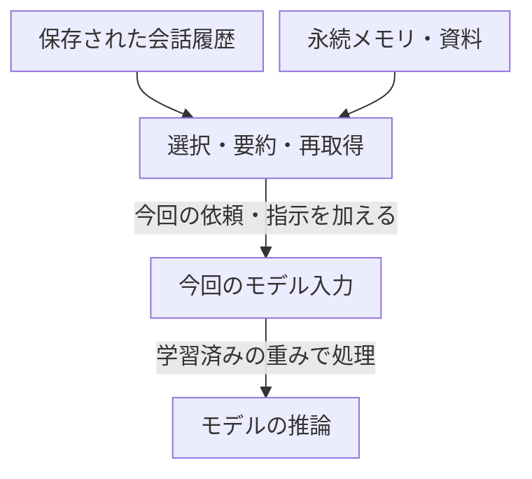

# AIエージェントのコンテキスト管理 — 会話履歴・要約・メモリの違い

ゲームのフレーム時間を比較するとき、測定値だけでなく、同じステージか、VSyncの設定が同じかも大切です。AIエージェントとの長い会話では、これらの条件が履歴に残っていても、今回のモデル入力から外れることがあります。ハーネスは、保存した情報のうち何を今回の推論で使うかを決めます。[AIエージェントのハーネス](/algorithms/agent-harness.html) · [OpenAI公式文書のConversation state](https://developers.openai.com/api/docs/guides/conversation-state)

## 保存するものと、今回渡すもの

ここでの**会話履歴**は、保存された発言やツールの呼び出し・結果の記録です。**推論ごとのコンテキスト**は、その回にモデルへ渡る入力のことです。今回の依頼と指示、選んだ履歴、要約、関連資料やツール結果などで組み立てます。たとえばOpenAIのConversations APIは会話IDにひもづけてメッセージやツール結果を保存できます。一方、長くなった入力をどう扱うかには、利用するAPIの仕組みとアプリの設計が関わります。[OpenAI公式文書のConversations API](https://developers.openai.com/api/docs/guides/conversation-state#using-the-conversations-api)



| 用語 | 何を指すか |
| --- | --- |
| 会話履歴 | 会話で起きたことの記録。元の発言やツール出力を調べるときの出典になる。 |
| 推論ごとのコンテキスト | 今回の依頼に答えるため、その回のモデルに渡る情報。 |
| 要約 | 長い記録から目的に合う部分を短くまとめた情報。推論の入力に使える。 |
| 永続メモリ | 将来の作業でも参照するために保存した設定、好み、作業上の決定など。保存期間と参照範囲は実装による。 |
| 学習済みの重み | 学習で得たモデルのパラメーター。渡された入力を処理するときに使う。 |

## コンテキスト窓には上限がある

**コンテキスト窓**（context window）の上限はモデルごとに決まるトークン数です。文字数とは別の単位で、同じ文字数の文章でもトークン数は変わります。入力の量を見積もるときは、メッセージの本文に加えて役割や境界、ツール定義なども関係します。OpenAIのモデルでは入力と出力、該当するモデルでは推論トークンにも窓を使うため、入力を組み立てるときは応答に使う余地も考えます。[LLMの文章生成](/algorithms/llm-text-generation.html) · [OpenAI公式文書のコンテキスト窓](https://developers.openai.com/api/docs/guides/conversation-state#managing-the-context-window) · [Counting tokens](https://developers.openai.com/api/docs/guides/token-counting)

長い会話から入力を作るとき、たとえば次の方法を組み合わせます。

- **切り捨て**で、入力から古い項目などを外す。直近の流れは残せますが、後から必要になる前提も外れ得ます。元の履歴が残っていれば、あとで読み直せます。
- **要約**で、複数の項目から要点をまとめる。変更前後の値が残っても、計測条件や例外が落ちることがあります。製品が行う圧縮の表現は実装によります。
- **再取得**で、今の質問に必要な元の発言、ログ、資料をIDや検索で探し、必要な部分を入力に足す。見つからなかったり、別条件の記録を拾ったりする場合もあるので、出典や計測条件を照合します。[OpenAI公式文書のRetrieval](https://developers.openai.com/api/docs/guides/retrieval#performing-semantic-search)

製品の実装例として、OpenAIのResponses APIにあるCompactionでは、次の入力に使う圧縮後の項目を返します。独立した `/responses/compact` の返り値には、人間が読める要約文とは異なる暗号化された項目が含まれ、元の項目が残る場合もあります。以下の手書き要約は、このAPIの中身を再現するものではなく、何を入力に残すかを観察するための教材です。[OpenAI公式文書のCompaction](https://developers.openai.com/api/docs/guides/compaction#standalone-compact-endpoint)

## 同じ3枠で、何が残るかを比べる

架空の測定で、同じステージのPlayerビルド、VSyncオフという条件のもと、影の描画を軽くする前は18 ms、後は12 msだったとします。元の履歴は、条件、変更前、変更内容、変更後、今回の依頼の5件です。入力には**1レコードを1枠と数えて3枠**だけ使います。この枠は文字数やトークン数を表すものではありません。

```python
SAVED_HISTORY = (
    ("conditions", "同じステージのPlayerビルド、VSyncオフ"),
    ("before", "変更前のフレーム時間は18 ms"),
    ("change", "影の描画を軽くした"),
    ("after", "変更後のフレーム時間は12 ms"),
    ("question", "比較結果を説明して"),
)

# 1レコードを1枠として数える、教材用の予算。
BUDGET = 3


def build_inputs(history):
    recent = history[-BUDGET:]

    # 人が書いた要約。計測条件は含めていない。
    summary = ("summary", "影を軽くする前は18 ms、後は12 ms")
    summarized = (summary, *history[-(BUDGET - 1):])

    conditions = next(
        (record for record in history if record[0] == "conditions"),
        None,
    )
    retrieved = summarized
    if conditions is not None:
        # 変更後の値は要約にもあるため、原文の after を条件に入れ替える。
        retrieved = (summary, conditions, history[-1])

    return {"recent": recent, "summary": summarized, "retrieval": retrieved}


if __name__ == "__main__":
    for strategy, records in build_inputs(SAVED_HISTORY).items():
        print(f"{strategy}: {len(records)}/{BUDGET} 枠")
        for key, text in records:
            print(f"  {key}: {text}")
    print(f"保存履歴: {len(SAVED_HISTORY)} 件")
```

3つとも今回の依頼が残り、保存履歴は5件のままです。変わるのは入力として取り出した3枠の中身です。

| 組み立て方 | 3枠に残る情報 |
| --- | --- |
| 直近のみ | 変更内容、変更後の12 ms、依頼。変更前の18 msと計測条件は外れる。 |
| 要約を加える | 変更内容と18 ms・12 msを含む要約、変更後の原文、依頼。計測条件は要約にも含まれない。 |
| 条件を再取得 | 要約、元の履歴から探した計測条件、依頼。要約に12 msがあるので、重複する変更後の原文の枠を使う。 |

この例では `conditions` というキーで元の履歴を探します。キーが見つからなければ、要約を加えた時点の入力のままです。手書き要約から抜けた条件は、残っている元の記録があって初めて再取得できます。

## 永続メモリとモデルの学習済みの重み

永続メモリは、複数の会話や作業で再利用する情報を保存する設計です。たとえば「性能の報告には計測条件を添える」という好みは次回も役立ちます。実際の測定でVSyncがオフだったかは、その測定の元の記録を確かめます。保存した好みが変わったり、必要なメモが今回の入力に選ばれなかったりするので、メモリに残したことだけで完全な再現や正確さは保証されません。[OpenAI Agents SDKのSandbox memory](https://developers.openai.com/api/docs/guides/agents/sandboxes#persist-memory-across-runs)

OpenAI Agents SDKのSandbox memoryは、会話履歴を保持するSessionとは別に、以前の作業から要点をファイルにまとめて再利用する例です。こうしたメモをモデルが参照すると今回の入力が変わります。学習済みの重みは、その入力を処理するモデルのパラメーターで、更新は学習の工程で行います。[OpenAI Agents SDKのSandbox memory](https://developers.openai.com/api/docs/guides/agents/sandboxes#persist-memory-across-runs) · [LLMの文章生成](/algorithms/llm-text-generation.html)

## 理解度チェック

::: details 変更前の18 msが直近入力にないなら、元の履歴から消えた？
この例では選んだ入力から外れただけで、元の履歴には残っています。検索やIDによって読み直せます。
:::

::: details 変更前後の値が要約にあれば、どんな条件で測ったかも分かる？
要約に含まれている情報を確かめます。教材の要約にはVSyncなどの条件がないため、元の記録を参照します。
:::

::: details メモリの内容を参照した回には何が変わる？
その回の推論入力に関連情報が加わります。モデルの重みを更新する学習は別の工程です。
:::

## 検証範囲

公式資料は2026年11月18日に確認しました。同日にWindowsのPython 3.12.4で掲載コードを実行し、3方式とも入力が3枠で、依頼と保存履歴5件が保たれることを確認しました。変更前の値や計測条件がどの入力に残るか、キーが見つからないときに要約を加えた入力を使うことも照合しました。

数値と要約文は教材用です。実行検証はローカルのレコード選択に限ります。実際のトークン計数、LLMによる要約品質、サービス側の圧縮やメモリの挙動は公式資料に基づく説明です。

## 関連項目

- [LLMの文章生成](/algorithms/llm-text-generation.html) — 文脈とトークン、学習と推論の違いを読む。
- [TransformerとAttention](/algorithms/transformer-attention.html) — 渡された入力をモデル内部でどう処理するかを追う。
- [AIエージェントのハーネス](/algorithms/agent-harness.html) — 履歴とツール結果を次のモデル呼び出しにつなぐ役割を確認する。
- [RAGの仕組み](/algorithms/retrieval-augmented-generation.html) — 入力に加える資料をどう分け、探し、選ぶかを読む。

## 参考資料

- [OpenAI公式文書 — Conversation state](https://developers.openai.com/api/docs/guides/conversation-state) · [Counting tokens](https://developers.openai.com/api/docs/guides/token-counting)
- [OpenAI公式文書 — Compaction](https://developers.openai.com/api/docs/guides/compaction)
- [OpenAI公式文書 — Retrieval](https://developers.openai.com/api/docs/guides/retrieval)
- [OpenAI Agents SDK — Sandbox Agents: Persist memory across runs](https://developers.openai.com/api/docs/guides/agents/sandboxes#persist-memory-across-runs)
