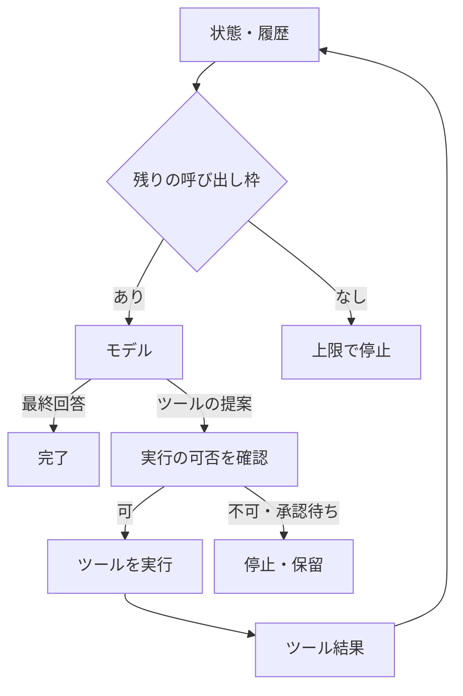

# AIエージェントのハーネス — モデル・ツール・実行ループをつなぐ仕組み

AIエージェントが「60 FPSの時間予算を計算して」と頼まれ、換算ツールを使うとします。モデルからツール名と引数が返った時点では、アプリにはまだ換算結果がありません。呼び出しを受け取り、実行してよいか判断し、結果をモデルに渡す処理が要ります。この作業を繰り返す仕組みが**エージェントの実行ループ**です。[OpenAI公式資料のFunction calling](https://developers.openai.com/api/docs/guides/function-calling#the-tool-calling-flow)

この記事では、そのループと、進捗や履歴を持ちながらループを進める部分を**ハーネス**と呼びます。用語が指す範囲は実装によって変わります。たとえばセッション管理や承認待ちからの再開、他のエージェントへの引き継ぎまで含める実装もあります。[OpenAI Agents APIのArchitecture](https://developers.openai.com/api/docs/guides/agents-api/architecture) · [OpenAI Agents SDKのSandbox Agents](https://developers.openai.com/api/docs/guides/agents/sandboxes)

## 誰が判断し、どこで処理するか

| 要素 | 担当すること |
| --- | --- |
| モデル | 受け取った文脈から、回答やツール呼び出しの提案を生成する。 |
| ハーネス | 状態を持ち、モデルに渡す情報を組み立てる。出力に応じて実行先を選び、継続や停止を判断する。 |
| ツール | 換算、データ取得、ファイル操作など、呼び出し先で定義された処理を行う。 |
| 実行環境・サンドボックス | 実行環境はコードやコマンドが動く場所。サンドボックスは、その処理が使えるファイルやネットワークなどを制限するための実行境界。 |

履歴には、利用者の依頼、モデルの提案、どの呼び出しに対して何が返ったかなどを記録できます。状態には、残りの呼び出し回数や承認待ちなど、次の処理を決める情報も含まれます。記録した項目のうち何を次のモデル入力に使うか、どこに保存するかは実装次第です。作業ファイルの保存や復元は、会話の履歴を管理することとは別に設計します。[OpenAI Agents SDKのRunning agents](https://developers.openai.com/api/docs/guides/agents/running-agents) · [Sandbox Agents](https://developers.openai.com/api/docs/guides/agents/sandboxes)

OpenAIのAgents APIでは、OpenAIが運用するCodexハーネスがモデル呼び出しとセッション管理を担います。アプリ側は仕事を渡してイベントを受け取り、自分が提供する関数ツールの処理を担当できます。コマンドや作業ファイルを扱う場合の実行環境は別の役割です。同APIでは、専用の実行環境を付けずにアプリ側の関数やリモートのMCPツールを使う構成もあります。どの要素をどこで動かすかは製品や構成によって変わります。[OpenAI Agents APIのArchitecture](https://developers.openai.com/api/docs/guides/agents-api/architecture#start-without-an-environment)

## 提案から実行へ、結果から次の判断へ

換算を例にすると、モデルに依頼と使えるツールの定義を渡し、モデルから `frame_budget` と `60` という提案を受け取ります。ハーネスや処理を受け持つアプリが実行の可否を判断し、許可された場合にツールを呼びます。結果の `16.67 ms` を呼び出しに対応づけて履歴に記録し、次のモデル入力へ渡します。モデルは結果を使って回答するか、必要に応じて次の提案を返せます。[OpenAI公式資料のFunction calling](https://developers.openai.com/api/docs/guides/function-calling#the-tool-calling-flow)



最終回答を返すほかに、モデルの呼び出し回数の上限、利用者の中止、続行できないエラーなどでもループを止められます。承認待ちは、承認後に同じ処理を再開できるよう状態を残して保留する場合があります。停止しても、すでに完了したツールの処理は残る場合があります。再開や再試行の判断には、どの処理まで実行したかの記録が役立ちます。[OpenAI Agents SDKの停止と保留](https://developers.openai.com/api/docs/guides/agents/running-agents#handle-pauses-and-failures-deliberately) · [Agents APIのエラー回復](https://developers.openai.com/api/docs/guides/agents-api/errors#recovery)

## ローカルでループだけを模擬する

以下の `fake_model` は、履歴の最後にツール結果があれば回答し、なければ60 FPSの換算を提案する関数です。`run` が履歴を持ち、登録済みのツールだけに処理を振り分けます。標準ライブラリだけで動く教材で、モデルへの入力と出力はPythonの値に置き換えています。

```python
from dataclasses import dataclass


@dataclass(frozen=True)
class ToolCall:
    name: str
    fps: int


def frame_budget(fps):
    if type(fps) is not int or fps <= 0:
        raise ValueError("FPS must be a positive integer")
    return f"{1000 / fps:.2f} ms"


TOOLS = {"frame_budget": frame_budget}


def fake_model(history):
    role, value = history[-1]
    if role == "tool":
        return f"予算は {value} です。"
    return ToolCall("frame_budget", 60)


def run(model, max_steps=2):
    history = [("user", "60 FPSの時間予算は？")]
    for _ in range(max_steps):
        proposal = model(tuple(history))
        if isinstance(proposal, str):
            history.append(("assistant", proposal))
            return "final", history

        history.append(("tool_call", proposal))
        tool = TOOLS.get(proposal.name)
        if tool is None:
            return "unknown_tool", history
        try:
            result = tool(proposal.fps)
        except ValueError as error:
            history.append(("error", str(error)))
            return "invalid_args", history
        history.append(("tool", result))
    return "step_limit", history


if __name__ == "__main__":
    cases = [fake_model, lambda _: ToolCall("unlisted", 60),
             lambda _: ToolCall("frame_budget", 0),
             lambda _: ToolCall("frame_budget", 60)]
    for simulate in cases:
        state, history = run(simulate)
        print(state, [role for role, _ in history], history[-1][1])
```

`final` の履歴は `user → tool_call → tool → assistant` です。換算結果を受け取った2回目のモデル呼び出しで「予算は 16.67 ms です。」が返ります。`unknown_tool` は登録外の名前で止まり、換算処理に入りません。`invalid_args` は登録済みの換算関数に入り、FPSを検査した時点で止まります。毎回換算を提案する最後の例では `step_limit` で停止し、履歴の最後に残る `16.67 ms` はツール結果です。上限の2回は**モデルを呼ぶ回数**で、この教材では1回の呼び出しで最大1個のツールを処理します。

## 実行を許可する判断と、実行中の制限

実際のアプリでは、ツール名と引数の検査に加え、どのデータにアクセスできるか、変更を伴う処理を誰が承認できるかを決めます。許可して実行したあとも、サンドボックスのファイルやネットワークの制限がその処理の届く範囲を決めます。外部のツールを使う場合は、そのサービス側の認可も関わります。ツールに渡すデータ、実行環境へ渡す資格情報、許可の対象はそれぞれ確かめる必要があります。[OpenAI Agents APIのSandbox security](https://developers.openai.com/api/docs/guides/agents-api/environments/security) · [MCPの認可](https://modelcontextprotocol.io/specification/2026-07-28/basic/authorization)

上のコードで `TOOLS` が制御するのは、どの関数に振り分けるかです。換算と実行ループは同じPythonプロセスで動きます。実際のサンドボックスに相当するファイルや通信の制限は、この例の検証範囲とは別です。

## Agent SkillsとMCPは、ループのどこに関わるか

Agent Skillsの手順は、たとえば「換算した時間を実測値として示さない」といった作業上の指示を、必要なときにモデルの文脈に加えられます。換算ツールがMCPサーバーにある構成なら、実行時はアプリ側のMCPクライアントが要求を送り、返された値をハーネスが次のモデル入力へつなぎます。この記事の例では、処理を同じプログラム内の関数に渡しています。[Agent Skillsの仕組み](/algorithms/agent-skills.html) · [MCPの仕組み](/algorithms/model-context-protocol.html)

## 理解度チェック

::: details モデルがツール名と引数を返した時点で、どこまで処理が進んだ？
その時点では提案が返りました。ハーネスやアプリ側が実行を許可し、ツールを呼び、結果を受け取ったあとでモデルに値を渡します。
:::

::: details `step_limit` で最後に `16.67 ms` が残ったら、最終回答はできた？
このケースで最後に残る値はツール結果です。上限に達した時点で、模擬モデルは最終回答を返していません。
:::

## 検証範囲

公式資料は2026年11月18日に確認しました。同日にWindowsのPython 3.12.4で掲載コードを実行し、通常完了、登録外の名前による停止、不正なFPSの拒否、回数上限の4経路を確かめました。2回目の模擬モデル呼び出しが `16.67 ms` を受け取ることと、上限に達した場合に最終回答が履歴に加わらないことも確認しました。

検証対象は、同一プロセス内の模擬ループです。実モデルの判断、MCP通信、外部サービスの認可、サンドボックスによる隔離は公式資料に基づく説明です。

## 関連項目

- [LLMの文章生成](/algorithms/llm-text-generation.html) — モデルが出力を生成する流れを読む。
- [TransformerとAttention](/algorithms/transformer-attention.html) — モデル内部で文脈がどう計算されるかを追う。
- [MCPの仕組み](/algorithms/model-context-protocol.html) — アプリと外部ツールの要求・応答を読む。
- [Function callingと構造化出力](/algorithms/function-calling-and-structured-outputs.html) — モデルの回答と実行依頼を分け、形や引数をどう確かめるかを読む。
- [Agent Skillsの仕組み](/algorithms/agent-skills.html) — 手順と資料を文脈に追加する流れを確認する。
- [AIエージェントのコンテキスト管理](/algorithms/agent-context-management.html) — 保持した履歴から何を次のモデル入力に使うかを読む。
- [RAGの仕組み](/algorithms/retrieval-augmented-generation.html) — 検索結果の候補を選び、回答に使える根拠にする流れを読む。

## 参考資料

- [OpenAI Agents API — Architecture](https://developers.openai.com/api/docs/guides/agents-api/architecture)
- [OpenAI Agents SDK — Running agents](https://developers.openai.com/api/docs/guides/agents/running-agents) · [Sandbox Agents](https://developers.openai.com/api/docs/guides/agents/sandboxes)
- [OpenAI公式資料 — Function calling](https://developers.openai.com/api/docs/guides/function-calling#the-tool-calling-flow)
- [OpenAI Agents API — Sandbox security](https://developers.openai.com/api/docs/guides/agents-api/environments/security) · [Errors and recovery](https://developers.openai.com/api/docs/guides/agents-api/errors#recovery)
- [MCP公式仕様 2026-07-28 — Authorization](https://modelcontextprotocol.io/specification/2026-07-28/basic/authorization)
