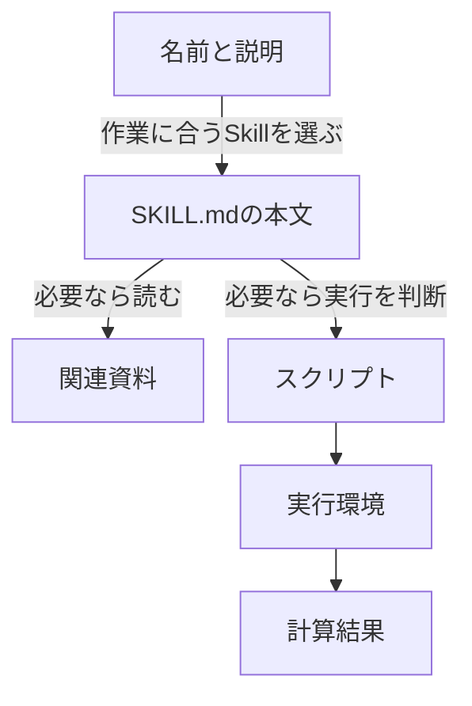

# Agent Skillsの仕組み — 手順と資料を必要なときに読み込む

ゲームの「目標60 FPSに対する1フレームの予算」を答えるとき、計算式のほかに、丸め方や実測値との区別も毎回そろえたいとします。**Agent Skills**は、このような繰り返し使う手順と資料をディレクトリにまとめるための共通形式です。エージェントはどんな作業に使えるかを先に知り、該当する作業で手順を読みます。[Agent Skills公式のOverview](https://agentskills.io/home)

## 名前と説明で見つけ、本文と資料を順に使う

Skillの入口は `SKILL.md` です。先頭にYAMLのメタデータ（frontmatter）があり、そのあとにMarkdownの手順が続きます。共通仕様で必須の項目は `name` と `description` です。`name` は1〜64文字で親ディレクトリ名と一致させます。`description` は1〜1024文字で、何をするSkillか、どの場面で使うかを書きます。`references/`、`scripts/`、`assets/` は用途に応じて資料、コード、テンプレートなどをまとめるための任意の構成です。[Agent Skills公式仕様](https://agentskills.io/specification)



この段階的な読み込みを **progressive disclosure** と呼びます。アプリはファイルから名前と説明を取り出して一覧を作り、モデルが対象を判断できるようにします。選ばれたSkillの本文が会話の文脈に入り、本文が参照する資料は必要に応じて追加されます。発見のためにアプリがファイルを開くことと、その内容をモデルへの入力に含めることは別の処理です。一覧の作り方や、利用者が明示して選ぶ方法には製品差があります。[Agent Skills公式仕様のProgressive disclosure](https://agentskills.io/specification#progressive-disclosure) · [クライアント実装ガイド](https://agentskills.io/client-implementation/adding-skills-support)

## ゲームのフレーム時間を扱う小さな例

次はフレーム時間の計算方法と説明の方針をまとめた教材です。名前と説明だけで、目標FPSの換算に使うものだと分かります。採用後に見る本文には、参照する資料と、計算を自動化するときに使うコードへの相対パスがあります。[Agent Skills公式仕様のFile references](https://agentskills.io/specification#file-references)

```text
frame-budget/
├── SKILL.md
├── references/
│   └── frame-budget.md
└── scripts/
    └── frame_budget.py
```

`SKILL.md` の内容です。

```markdown
---
name: frame-budget
description: 目標FPSを1フレームの時間予算（ms）に換算する。ゲーム開発でフレーム時間の予算を見積もるときに使う。
---

# フレーム時間の予算

1. 目標FPSを正の整数で受け取る。
2. 単位や換算の前提を確認するときは [換算表](references/frame-budget.md) を読む。
3. 計算を自動化するときは `scripts/frame_budget.py` に目標FPSを渡す。
4. 結果を1フレーム当たりの理論上の予算として示す。
```

参照資料の `references/frame-budget.md` には、1秒が1000ミリ秒なので、一定の間隔を仮定すると1フレームの予算は `1000 / FPS` ミリ秒になる、と書いてあります。60 FPSなら **16.67 ms**、120 FPSなら **8.33 ms** です。各フレームの実測値はプロファイラーで調べます。[CPUプロファイリング](/tools/profiling/cpu-profiling.html)

`scripts/frame_budget.py` は、同じ式を使って正の整数のFPSを小数第2位までのミリ秒に換算します。

```python
import sys

if len(sys.argv) != 2:
    raise SystemExit("usage: python frame_budget.py FPS")

try:
    fps = int(sys.argv[1])
except ValueError:
    raise SystemExit("FPS must be a positive integer")

if fps <= 0:
    raise SystemExit("FPS must be a positive integer")

print(f"{1000 / fps:.2f} ms")
```

参照資料を読むと、その内容をモデルへの入力に使えます。スクリプトを呼ぶ場合は、実行環境がコードを処理し、アプリがその出力をモデルに渡せます。たとえば正常な実行の出力は `16.67 ms` です。本文だけで説明できる作業もあり、スクリプトは必要な計算や変換を再現できる形にしたいときに添えます。[Claude公式文書のResources and code](https://platform.claude.com/docs/en/agents-and-tools/agent-skills/overview#level-3-resources-and-code-loaded-as-needed)

## 共通のファイル形式と、製品ごとの呼び出し方

共通仕様はファイル形式と段階的な読み込みの考え方を定めます。アプリがどこからSkillを見つけるか、どのUIで選ぶか、どこでコードを実行するかは製品側の設計です。たとえばClaude Codeは関連するSkillを選べるほか、利用者が `/skill-name` で明示して呼び出せます。`disable-model-invocation` は、その製品の自動選択を制御する拡張です。ClaudeのMessages APIでは、要求にSkillを指定し、コード実行のコンテナを使います。同じ形式を採用していても、入口や実行環境の違いは残ります。[Claude Code公式文書](https://code.claude.com/docs/en/skills#control-who-invokes-a-skill) · [Claude Platform公式文書](https://platform.claude.com/docs/en/agents-and-tools/agent-skills/overview)

用途の近いSkillが候補に並ぶと、自動選択は名前と説明、依頼の文脈、製品の選択方法に左右され、利用者の意図とずれることがあります。使いたいSkillが決まっていれば、対応する製品では明示的に指定できます。たとえばClaude Codeではコマンドで呼び出せます。Responses APIのシェルツールでは、候補のSkill名をプロンプトで指定する方法が案内されています。同名の候補をどう表示し、どちらを選べるかは製品と読み込み元によって変わります。[Agent Skillsのクライアント実装ガイド](https://agentskills.io/client-implementation/adding-skills-support#handling-name-collisions) · [Claude Codeの同名Skillの扱い](https://code.claude.com/docs/en/skills#resolve-skills-that-share-a-name) · [OpenAI公式資料のSkills in the user prompt](https://developers.openai.com/api/docs/guides/tools-skills#skills-in-the-user-prompt)

## 学習・Skill・MCP・実行が担うもの

| 仕組み | 担うもの |
| --- | --- |
| モデルの追加学習 | 学習データを使ってモデルの重みなどの学習パラメーターを更新する。 |
| Agent Skills | 推論時に参照する手順、資料、必要ならコードをまとめて渡す。 |
| MCP | AIアプリ側のクライアントと、機能を提供するサーバーの間で、要求と応答の形式をそろえる。 |
| ツール実行 | 実行環境やサーバーが、許可された入力に対して処理を行う。 |

Skillを読み込むと、モデルに渡す文脈が変わります。[LLMの文章生成](/algorithms/llm-text-generation.html)で扱った重みの更新は学習側の処理です。Skillの手順には、たとえば「ベンチマークの履歴は、使える場合に読み取りツールで確認してから説明する」と書けます。アプリに対応するMCP接続と許可があれば、クライアントがサーバーに要求を送り、サーバーが取得を行います。この組み合わせでは、参照の条件をSkillが伝え、やり取りをMCPがそろえ、取得をツールが担当します。[MCPの仕組み](/algorithms/model-context-protocol.html) · [MCP公式仕様のArchitecture](https://modelcontextprotocol.io/specification/2026-07-28/architecture)

## 指示を採用する判断と、実行を許可する判断

本文に「スクリプトを実行する」と書くのは作業の指示です。その処理が使えるかは、アプリのツール設定、実行環境の権限、利用者や組織の許可に従います。共通仕様には、事前許可するツールを挙げる実験的な `allowed-tools` もあります。対応や効果は製品によって変わります。たとえばClaude Codeでは管理設定などに従い、Skillを呼び出したターンで指定ツールを事前許可できます。[Agent Skills公式仕様のallowed-tools](https://agentskills.io/specification#allowed-tools-field) · [Claude Codeのツール事前許可](https://code.claude.com/docs/en/skills#pre-approve-tools-for-a-skill)

Skillの名前と説明は用途を見つける手掛かりです。内容の信頼性は、配布元、本文と参照資料、スクリプトが触れるファイルやネットワーク、実際の出力を見て判断します。たとえば換算式が合っていても、資料に古い前提があったり、結果をモデルが測定値として説明してしまったりすることがあります。教材で値を確認したように、使う場面でも資料の前提と出力の両方が検証対象になります。[クライアント実装ガイドのTrust considerations](https://agentskills.io/client-implementation/adding-skills-support#trust-considerations) · [Claude PlatformのSecurity considerations](https://platform.claude.com/docs/en/agents-and-tools/agent-skills/overview#security-considerations)

## 理解度チェック

::: details Skillを選ぶ段階で一覧に使う情報と、選んだあとに読む内容は？
名前と説明を一覧に使い、選んだあとで `SKILL.md` の手順を読みます。関連資料の内容は、作業で必要になった段階で参照します。
:::

::: details Skillを読み込んだとき、モデルの重みはどう扱われる？
Skillの読み込みで変わるのは推論に使う文脈です。学習で重みを更新する処理とは別です。
:::

::: details MCPのツールを使うと書いたSkillがあれば、接続も実行もできる？
手順を使うには、ホストで利用できるMCP接続があり、ツールの実行や対象データの利用が許可されている必要があります。
:::

## 検証範囲

公式仕様と製品の公式文書は2026年11月18日に確認しました。教材は通常のファイルとして置き、入口を `SKILL.md.example` として検証しました。YAMLを解析して必須項目とディレクトリ名の一致を確かめ、本文の相対パスが同梱ファイルを指すことを確認しました。

WindowsのPython 3.12.4で掲載スクリプトを通常のプログラムとして実行し、60 FPSと120 FPSの出力を資料の数値と照合しました。0、負数、整数に変換できない文字列など5通りの不正入力も確認しました。モデルによるSkillの選択、本文の読み込み、製品内での動作や権限の適用は、公式文書に基づく説明です。

## 関連項目

- [LLMの文章生成](/algorithms/llm-text-generation.html) — 文脈と学習済みの重みの役割を読む。
- [TransformerとAttention](/algorithms/transformer-attention.html) — 入力された文脈がモデル内部でどう計算されるかを追う。
- [MCPの仕組み](/algorithms/model-context-protocol.html) — 外部の機能を呼んで結果を受け取る流れを読む。
- [AIエージェントのハーネス](/algorithms/agent-harness.html) — 指示を文脈に含め、ツール結果を受け取って次の処理へ進む流れを読む。

## 参考資料

- [Agent Skills公式仕様 — Specification](https://agentskills.io/specification)
- [Agent Skills公式文書 — How to add skills support to your agent](https://agentskills.io/client-implementation/adding-skills-support)
- [Claude Code公式文書 — Extend Claude with skills](https://code.claude.com/docs/en/skills)
- [Claude Platform公式文書 — Agent Skills](https://platform.claude.com/docs/en/agents-and-tools/agent-skills/overview)
- [MCP公式仕様 2026-07-28 — Architecture](https://modelcontextprotocol.io/specification/2026-07-28/architecture)
