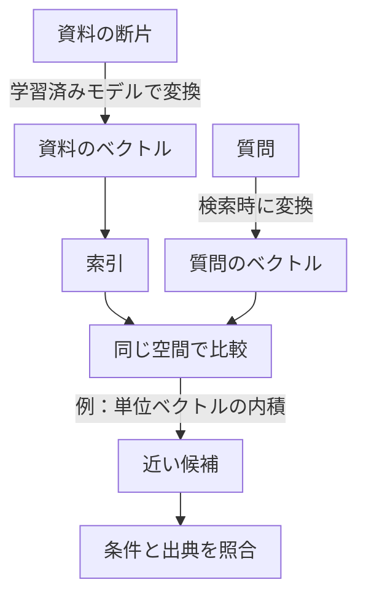

# 埋め込みとベクトル検索 — 似た資料をどう見つけるか

「影を軽くした記録」を探したとき、資料には「シャドウ描画を最適化」と書いてあるかもしれません。**ベクトル検索**は、質問と資料をベクトル（数値の列）に変換し、比較結果を使って候補を探す方法です。RAG（検索した資料を回答の生成に使う方式）の記事では、その流れを見ました。ここでは、その検索の一方式として、文章をどう比較し、何を別の条件で確かめるかを扱います。[RAGの仕組み](/algorithms/retrieval-augmented-generation.html) · [Sentence Transformersの意味検索](https://sbert.net/examples/sentence_transformer/applications/semantic-search/README.html)

## この記事で分かること

質問と資料をどう数値に変えて比較するか説明できます。内積とコサイン類似度の違いを読み、順位が高い候補を根拠として使えるか条件を照合できます。

## 文章を、比較できる数値の列にする

文章検索用の**埋め込み**は、学習済みのモデルが文や段落などの検索単位から作るベクトルです。たとえばSentence-BERTは、トークンごとの出力を平均などで集約して文全体の表現を作り、文同士の比較に使います。どの文章が近くなるかは、訓練データや目的、入力の与え方によって変わります。各成分を個別に取り出して「これは影の重要度」と読めるとは限りません。[Sentence-BERT原論文、§3](https://aclanthology.org/D19-1410.pdf)

| 表現 | 何を表すか |
| --- | --- |
| トークン埋め込み | トークンIDに対応するベクトル。系列モデル内でトークンごとの処理に使う。 |
| 位置情報 | 系列のどこにあるかをモデルに伝える。Transformer原論文では、位置ベクトルをトークン埋め込みに足す。 |
| 文章検索用の埋め込み | 質問や資料の断片などを、検索単位で比較するためのベクトル。 |

文章検索モデルも内部でトークンや位置を扱えます。索引（検索用に整理したデータ）に入れるのは、検索用に組み立てた文や断片の表現です。[Transformer原論文、§3.4〜3.5](https://arxiv.org/html/1706.03762v7#S3.SS4)

## 資料と質問を同じ空間で比べる

典型的な構成では、資料の断片を先に変換して、元の本文や資料IDと結びつけた索引に入れます。質問が来たら質問を変換し、索引にある資料のベクトルと比べます。アクセスを許可された範囲で検索し、得られた候補の版や機材、出典を照合します。[Elasticsearch公式のkNN検索](https://www.elastic.co/docs/solutions/search/vector/knn) · [Microsoft Learnのベクトル検索フィルター](https://learn.microsoft.com/en-us/azure/search/vector-search-filters)



比較するには、ベクトルの次元数（成分の数）が合い、質問側と資料側の空間が対応している必要があります。たとえば同じモデルの対応する設定を使う方法や、検索のために組として学習したエンコーダー（文章をベクトルに変換するモデル）を使う方法があります。次元数が同じというだけで、別のモデルが出したベクトルの座標に互換性があるとは判断できません。モデルを変える場合は、既存の索引と比較できるかを確認します。[Sentence Transformersの意味検索](https://sbert.net/examples/sentence_transformer/applications/semantic-search/README.html)

## コサイン類似度は方向を比べる

質問ベクトルを $q$、資料のベクトルを $d$ とします。ゼロでない2つのベクトルの**コサイン類似度**は、内積（対応する成分の積の合計）を、それぞれの長さの積で割った値です。ユークリッド空間で、2つの向きが同じなら $1$、直交なら $0$、逆なら $-1$ になります。[ベクトルの内積と正規化](/math/rendering/vector.html)

$$
\cos(q,d)=\frac{q\cdot d}{\lVert q\rVert\,\lVert d\rVert}
$$

$q$ と $d$ をそれぞれ長さで割って単位ベクトルにすれば、その内積は元のコサイン類似度と同じです。正の定数倍で長さだけを変えてもコサインは変わりません。正規化していない内積は長さにも影響されるので、順位が変わる場合があります。いずれかがゼロベクトルなら分母が0になり、コサイン類似度は未定義です。長さを確認して、除外や別の検索方法へ切り替える処理を設計します。[Elasticsearch公式のdense_vector](https://www.elastic.co/docs/reference/elasticsearch/mapping-reference/dense-vector)

検索には、モデルが前提とする指標を使います。

## 手で置いたベクトルで、順位の違いを確かめる

質問は「r18・PC-Aでの影の計測」です。候補の `bench-01`〜`bench-03` は、RAGの記事の公開向け索引と同じ資料ID・計測条件です。チーム内資料の `bench-00` は対象外とし、この例ではゼロベクトルの処理を見るために `bench-04` を加えます。質問を $(3,4)$、候補を次の2次元ベクトルとします。座標は説明用に決めた値です。[RAGの仕組み](/algorithms/retrieval-augmented-generation.html)

| 候補と計測条件 | 手作りベクトル | 内積 / コサイン |
| --- | --- | --- |
| `bench-01` r17・PC-A | $(3,4)$ | 25 / 1.00 |
| `bench-02` r18・PC-B | $(30,0)$ | 90 / 0.60 |
| `bench-03` r18・PC-A | $(4,3)$ | 24 / 0.96 |
| `bench-04` r18・PC-A | $(0,0)$ | 0 / 未定義 |

`bench-03` との内積は $3\cdot4+4\cdot3=24$ で、どちらも長さは5です。コサイン類似度は $24/(5\cdot5)=0.96$ になります。`bench-02` は内積が90ですが、候補の長さも30なので $90/(5\cdot30)=0.60$ です。コサインが最大の `bench-01` はビルドが古く、r18・PC-Aという条件に合う有効な候補は `bench-03` です。

次は標準ライブラリだけで動くコードです。`zip(..., strict=True)` で次元を確認するため、Python 3.10以降で実行します。比較する候補をそろえるため、この例ではゼロの資料を両方の順位から除外します。質問がゼロなら、正規化の時点でエラーにします。[Python組み込み関数のzip](https://docs.python.org/3.10/library/functions.html#zip)

```python
from math import hypot


QUERY = (3, 4)
DOCS = (
    ("bench-01", "r17", "PC-A", (3, 4)),
    ("bench-02", "r18", "PC-B", (30, 0)),
    ("bench-03", "r18", "PC-A", (4, 3)),
    ("bench-04", "r18", "PC-A", (0, 0)),
)


def dot(left, right):
    return sum(a * b for a, b in zip(left, right, strict=True))


def unit(vector):
    length = hypot(*vector)
    if length == 0:
        raise ValueError("zero vector")
    return tuple(value / length for value in vector)


def compare(query, docs):
    query_direction = unit(query)
    scores = []
    skipped = []
    for source, build, pc, vector in docs:
        if not any(vector):
            skipped.append(source)
            continue
        raw = dot(query, vector)
        cosine = dot(query_direction, unit(vector))
        scores.append((source, build, pc, raw, cosine))
    return scores, skipped


if __name__ == "__main__":
    scores, skipped = compare(QUERY, DOCS)
    dot_order = sorted(scores, key=lambda row: -row[3])
    print("内積:", " → ".join(row[0] for row in dot_order))
    print("コサイン類似度:")
    cosine_order = sorted(scores, key=lambda row: -row[4])
    for source, build, pc, raw, cosine in cosine_order:
        print(f"  {source} {build}/{pc}: {cosine:.2f} (内積 {raw})")
    matches = [source for source, build, pc, _, _ in cosine_order
               if (build, pc) == ("r18", "PC-A")]
    print("r18/PC-A:", ", ".join(matches))
    print("ゼロベクトルを除外:", ", ".join(skipped))
```

```text
内積: bench-02 → bench-01 → bench-03
コサイン類似度:
  bench-01 r17/PC-A: 1.00 (内積 25)
  bench-03 r18/PC-A: 0.96 (内積 24)
  bench-02 r18/PC-B: 0.60 (内積 90)
r18/PC-A: bench-03
ゼロベクトルを除外: bench-04
```

## 類似度、条件一致、事実の正しさを確かめる

キーワード検索は、本文や索引にある語を照合します。たとえば型番やエラー名のように、表記の一致を重視する検索に向きます。ベクトル検索は、学習した表現の近さを使うので、言い換えた文章も候補に入る場合があります。両者の順位を組み合わせるハイブリッド検索もあります。どの方法で必要な資料を見つけやすいかは、言語、用語、資料の種類が実際の用途に合うかを確かめて判断します。[Elastic公式の検索方式](https://www.elastic.co/docs/solutions/search/search-approaches) · [BEIR原論文](https://arxiv.org/abs/2104.08663)

コサイン値が大きい資料でも、ビルドの一致や数値の正しさは元の記録で確かめます。版や機材のような必須条件は検索のフィルターにも使えます。教材のコードはすべての有効な候補を採点してから条件で絞っています。実運用で先に上位件数を切ると、必要な条件を満たす候補を切り落とすことがあります。必要な条件を検索に含め、結果が足りないときは分かった範囲を示します。[Microsoft Learnのベクトル検索フィルター](https://learn.microsoft.com/en-us/azure/search/vector-search-filters) · [RAGの仕組み](/algorithms/retrieval-augmented-generation.html)

教材のコードは、候補のベクトルを一つずつ採点する全件走査です。

## 補足

扱える入力の長さ、出力の次元、長文を切り詰めるかどうかは、モデルや実装の仕様を確認します。 [Sentence Transformersのモデル参照](https://sbert.net/docs/package_reference/sentence_transformer/model.html)

DPRの原論文では別々の質問エンコーダーと資料エンコーダーを学習し、質問と資料の**内積**を使っています。 [DPR原論文、§3.1〜3.2](https://aclanthology.org/2020.emnlp-main.550.pdf)

たとえばElasticsearchの `dense_vector` の `cosine` 設定では、ゼロベクトルを受け付けず、返す `_score` は生のコサイン値を変換したものです。表示されたスコアを読むときは、製品と設定を確かめます。[Elasticsearch公式のdense_vector](https://www.elastic.co/docs/reference/elasticsearch/mapping-reference/dense-vector)

近似近傍索引では、比較する候補を絞ることで大きいデータ集合での待ち時間を抑えられる場合があります。その代わり、全件走査なら上位に入る候補を取りこぼすことがあります。同じデータ・指標・検索条件のもとで、検索時間と、全件走査で得た上位候補のうち拾えた割合（再現率）を比べます。この再現率は、質問に必要な根拠を見つけたかという評価とは別です。[Elasticsearch公式のkNN検索](https://www.elastic.co/docs/solutions/search/vector/knn#knn-methods) · [BEIR原論文](https://arxiv.org/abs/2104.08663)

## 要点

- 文章検索用の埋め込みは、質問や資料の断片など、検索する単位で比較するためのベクトルです。
- 比較には質問側と資料側で対応する空間が必要です。次元数が同じだけでは互換性を判断できません。
- コサイン類似度はベクトルの向きを比べます。長さが0なら分母も0になるため未定義です。
- 検索の上位候補も、必要な版・機材・出典に合うかを照合してから根拠に使います。

## 理解度チェック

::: details 次元数が同じなら、別々のモデルの出力をそのまま比較できる？
同じ次元数でも、質問と資料が対応する空間に写ることを確かめます。同じモデルの対応する設定や、互換性を前提に学習した組を使います。
:::

::: details ゼロベクトルの内積が0なら、コサイン類似度も0？
ゼロベクトルの長さは0です。内積は0でも、長さで割るコサイン類似度は未定義です。
:::

::: details 1.00の候補と0.96の候補があるなら、前者をr18・PC-Aの根拠にできる？
この例の1.00の候補はr17・PC-Aです。ビルドと機材を照合するとr18・PC-Aの有効な候補は `bench-03` です。
:::

## 検証範囲

原論文と公式資料は2026年11月18日に確認しました。同日にWindowsのPython 3.12.4で掲載例を実行し、内積とコサイン類似度、2種類の順位、条件一致、ゼロの資料の除外とゼロの質問の拒否を確認しました。片方の非ゼロベクトルを正の定数倍したときのコサインも照合しました。

実測の範囲は手作りベクトルの全件走査による計算と順位です。近似索引は実装しておらず、速度と再現率は未計測です。学習済みの埋め込みモデルや、実際の検索と回答の品質も検証対象外です。

## 関連項目

- [RAGの仕組み](/algorithms/retrieval-augmented-generation.html) — 探した資料の条件と出典を確かめて回答に使う流れを読む。
- [TransformerとAttention](/algorithms/transformer-attention.html) — モデル内部でトークン埋め込みと位置情報をどう使うかを追う。
- [ベクトル](/math/rendering/vector.html) — 長さ、内積、単位ベクトルの計算を確認する。

## 参考資料

- [Reimers・Gurevych — Sentence-BERT（EMNLP 2019）](https://aclanthology.org/D19-1410/)
- [Karpukhinら — Dense Passage Retrieval（EMNLP 2020）](https://aclanthology.org/2020.emnlp-main.550/)
- [Thakurら — BEIR（NeurIPS 2021 Datasets and Benchmarks）](https://arxiv.org/abs/2104.08663)
- [Vaswaniら — Attention Is All You Need（2017）](https://arxiv.org/html/1706.03762v7#S3.SS4)
- [Sentence Transformers公式 — Semantic Search](https://sbert.net/examples/sentence_transformer/applications/semantic-search/README.html)
- [Elasticsearch公式 — Dense vector](https://www.elastic.co/docs/reference/elasticsearch/mapping-reference/dense-vector) · [検索方式](https://www.elastic.co/docs/solutions/search/search-approaches)
- [Microsoft Learn — ベクトル検索フィルター](https://learn.microsoft.com/en-us/azure/search/vector-search-filters)
