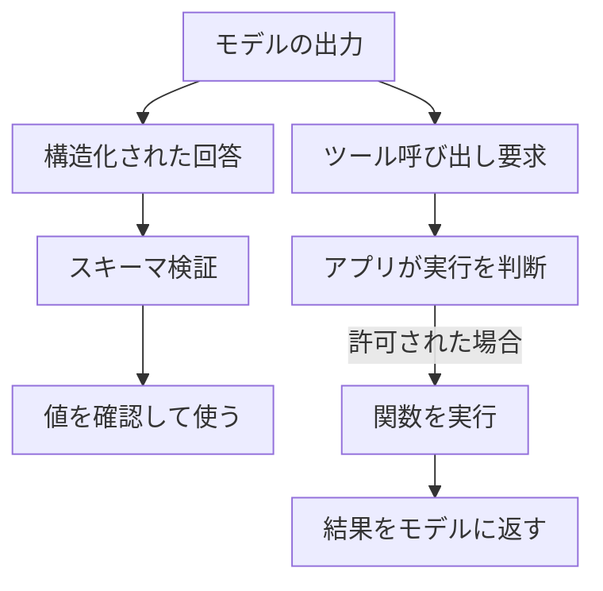

# Function callingと構造化出力 — AIの返答をプログラムにつなぐ仕組み

「60 FPSなら1フレームの予算は約16.67 msです」と返ってきたとします。人には読めますが、画面のFPS欄と時間予算欄に値を置くアプリには、どの値がどの項目か分かる形式が便利です。別の構成では、モデルがアプリに換算処理を依頼し、計算結果を受け取ってから回答します。前者は**回答の形**をそろえる話で、後者は**処理の依頼と結果**をやり取りする話です。[OpenAI公式資料のStructured model outputs](https://developers.openai.com/api/docs/guides/structured-outputs) · [Function calling](https://developers.openai.com/api/docs/guides/function-calling)

## 自然言語、JSON、スキーマは何を決めるか

| 用語 | 何を決めるか |
| --- | --- |
| 自然言語 | 人に伝える文章。説明を加えたり、表現や順序を変えたりできる。 |
| JSON | 文字列や数値、オブジェクトなどを表すためのテキスト形式。アプリは構文を解析して値を取り出す。 |
| スキーマ | どの項目を持ち、どの型や値を許すかという規則。JSON SchemaはJSONの値に適用する規則の書き方。 |
| 構造化出力 | 対応する機能で、モデルが返す回答を指定した形に制約する。 |
| Function calling | モデルが処理の名前と引数を返し、呼び出し先で実行した結果を受け取る仕組み。 |

たとえば `{"fps":60,"budget_ms":16.67}` はJSONのオブジェクトです。これを受け取るためのスキーマは、`fps` が整数で `budget_ms` が数値、両方が必須で、ほかの項目は許さないと指定できます。JSONの構文を解析してから、その値がスキーマに合うかを検査します。[RFC 8259のJSON文法](https://www.rfc-editor.org/rfc/rfc8259.html#section-2) · [JSON Schema Draft 2020-12のValidation](https://json-schema.org/draft/2020-12/json-schema-validation) · [JSON Schema公式のobject解説](https://json-schema.org/understanding-json-schema/reference/object)

```json
{
  "type": "object",
  "properties": {
    "fps": {"type": "integer"},
    "budget_ms": {"type": "number"}
  },
  "required": ["fps", "budget_ms"],
  "additionalProperties": false
}
```

`{"fps":true,"budget_ms":16.67}` はJSONとして読めますが、`true` は真偽値なのでこのスキーマの整数には合いません。`{"fps":60,"budget_ms":20.00}` は形と型に合いますが、60 FPSなら $1000/60$ を小数第2位に丸めて16.67 msです。**構文、スキーマ、計算や事実の正しさ**はそれぞれ確かめます。[JSON Schema Draft 2020-12の型](https://json-schema.org/draft/2020-12/json-schema-validation#name-type) · [Structured Outputsでの誤りの扱い](https://developers.openai.com/api/docs/guides/structured-outputs)

## 回答を受け取る経路と、処理を実行する経路



**構造化出力**を使う場合は、欲しい回答の形を指定します。OpenAIのResponses APIではテキストの出力形式 `text.format` に `json_schema` と対応するスキーマを指定し、厳格な適合を求める場合は `strict: true` を使います。対応している設定で、完了し拒否でない回答の形を制約できます。JSONモードはJSONとして読める形式を求める機能で、指定スキーマへの適合は別です。アプリは拒否、不完全な応答、APIエラーを確認してから回答データを読みます。使えるスキーマの範囲や指定場所は、モデルとAPIの仕様を確認します。[OpenAI公式資料のStructured model outputs](https://developers.openai.com/api/docs/guides/structured-outputs) · [Responses APIリファレンス](https://developers.openai.com/api/reference/resources/responses/methods/create)

**Function calling**では、利用できる関数名や引数をあらかじめ定義します。引数のスキーマは、その関数に何を渡せるかを決めます。たとえば `frame_budget` には `fps` を渡します。回答のスキーマにある `budget_ms` は、換算が済んでから得る値です。OpenAIの関数定義では `parameters` に引数のスキーマを指定します。[Function callingの流れ](https://developers.openai.com/api/docs/guides/function-calling#the-tool-calling-flow)

関数定義で `strict: true` を指定するには、対応するJSON Schemaの範囲で、各オブジェクトに `additionalProperties: false` を設定し、`properties` の全項目を `required` に入れます。値がないことを表したいときは、項目を必須にしたまま型に `null` を加えられます。条件を満たさないスキーマを `strict: true` で渡すと要求が拒否されます。`strict` を省略した場合、Responses APIは厳格モードに合わせてスキーマの正規化を試み、対応できなければ非厳格モードに戻ります。Chat Completions APIの既定は非厳格モードです。Responses APIで非厳格モードを明示するには `strict: false` を指定します。[OpenAI公式資料のStrict mode](https://developers.openai.com/api/docs/guides/function-calling#strict-mode) · [Responses APIへの移行ガイド](https://developers.openai.com/api/docs/guides/migrate-to-responses#5-update-function-definitions-and-outputs)

## アプリが呼び出しを受け取って結果を返す

OpenAIのResponses APIでアプリ独自の関数を使う例では、`function_call` の項目に `name`、JSONを表す文字列の `arguments`、対応づけに使う `call_id` が入ります。アプリは関数名と引数、対象の権限を確認し、許可された関数を実行します。結果は `function_call_output` として、同じ `call_id` と `output` を付けて返します。対応づけに使うのは呼び出し項目の `id` とは別の `call_id` です。一つの応答に複数の関数呼び出しが含まれることもあるため、同じ関数名が並んでも、各結果をその呼び出しの `call_id` にひもづけます。Chat Completions APIでは `tool_calls` 内の各 `id` を、結果を返すツールメッセージの `tool_call_id` に渡します。[OpenAI公式資料のFunction calling](https://developers.openai.com/api/docs/guides/function-calling#handling-function-calls) · [Responses APIへの移行ガイド](https://developers.openai.com/api/docs/guides/migrate-to-responses)

スキーマで `fps` が整数だと分かっても、計算に使える範囲か、実行を頼んだ人に権限があるかはアプリ側の規則で確かめます。変更を伴う処理なら、操作対象や影響を調べ、必要に応じて承認を取ります。ループや停止を管理するハーネスと、外部の機能に接続するMCPは、その前後の仕組みです。MCPを使う構成では、アプリがモデル側の呼び出し要求を受け、MCPクライアントを通じてサーバーへ別の要求を送れます。[AIエージェントのハーネス](/algorithms/agent-harness.html) · [MCPの仕組み](/algorithms/model-context-protocol.html)

たとえばResponses APIの関数をMCPツールへつなぐ場合、アプリは `arguments` のJSON文字列を読みます。MCPの `tools/call` では `params.name` にツール名、`params.arguments` に引数のオブジェクトを渡します。MCPサーバーからの応答はJSON-RPCの `id` で対応づけ、モデルへ返す結果は元の `call_id` に対応づけます。二つのIDはそれぞれのやり取りのための識別子です。[MCP公式仕様2026-07-28版のTools](https://modelcontextprotocol.io/specification/2026-07-28/server/tools#calling-tools) · [OpenAI公式資料の結果の返却](https://developers.openai.com/api/docs/guides/function-calling#formatting-results)

## ローカルの模擬応答で確かめる

次の例では、FPSとフレーム予算を含む回答と、FPSから予算を計算する関数への呼び出し要求を手書きします。Python 3.12.4の標準ライブラリで確認しました。どちらのJSONも同じ読み取り関数を通し、回答は項目・型・計算値の順に調べます。関数の呼び出しは名前と引数を調べ、アプリ側で与えた許可があるときだけ実行します。

Pythonの `json.loads` は既定で `NaN` や `Infinity` を受け入れますが、RFC 8259の数値文法では認められていません。一方、`1e999` のような数はJSONの文法に合います。教材では `float` に変換した値が有限に収まらなければ拒否します。RFCが同じオブジェクト内のキーを一意にするよう勧めていることを踏まえ、このアプリは重複したキーも拒否します。この拒否は、処理系によって採用される値が変わるのを避けるためのアプリの方針です。[RFC 8259 §4](https://www.rfc-editor.org/rfc/rfc8259.html#section-4) · [RFC 8259 §6](https://www.rfc-editor.org/rfc/rfc8259.html#section-6) · [Python 3.12のJSONの仕様適合性](https://docs.python.org/3.12/library/json.html#standard-compliance-and-interoperability)

項目と型の検査はこの教材で使う条件に絞っています。たとえば、JSON Schemaの整数には小数部がゼロの `60.0` も含まれますが、この例のアプリは正のFPSを整数表記の `60` で受け取ります。[JSON Schema Draft 2020-12の型](https://json-schema.org/draft/2020-12/json-schema-validation#name-type)

```python
import json
from math import isfinite


def reject_constant(token):
    raise ValueError(f"JSONの数値でない: {token}")


def read_float(token):
    value = float(token)
    if not isfinite(value):
        raise ValueError("有限のfloatに変換できない")
    return value


def unique_object(pairs):
    result = {}
    for key, value in pairs:
        if key in result:
            raise ValueError(f"同名のキー: {key}")
        result[key] = value
    return result


def read_json(raw):
    return json.loads(
        raw, parse_constant=reject_constant, parse_float=read_float,
        object_pairs_hook=unique_object,
    )


def positive_integer(value):
    return type(value) is int and value > 0


def frame_budget(fps):
    return round(1000 / fps, 2)


def check_summary(raw):
    try:
        record = read_json(raw)
    except json.JSONDecodeError:
        return "JSON構文エラー"
    except ValueError:
        return "この例の読み取り条件に合わない"

    if (not isinstance(record, dict) or set(record) != {"fps", "budget_ms"}
            or not positive_integer(record["fps"])
            or type(record["budget_ms"]) not in (int, float)):
        return "項目や型が不一致"
    if record["budget_ms"] != frame_budget(record["fps"]):
        return "形式は適合、計算値は不一致"
    return "形式と計算値が一致"


def run_call(call, *, allowed):
    if (call["type"], call["name"]) != ("function_call", "frame_budget"):
        raise ValueError("未登録のツール")
    args = read_json(call["arguments"])
    if (not isinstance(args, dict) or set(args) != {"fps"}
            or not positive_integer(args["fps"])):
        raise ValueError("引数が不正")
    if not allowed:
        return None
    result = {"budget_ms": frame_budget(args["fps"])}
    return {"type": "function_call_output", "call_id": call["call_id"],
            "output": json.dumps(result, allow_nan=False)}


if __name__ == "__main__":
    # モデル出力を手書きした教材。外部APIは使わない。
    for label, raw in (
        ("壊れたJSON", '{"fps":60,"budget_ms":}'),
        ("非数", '{"fps":60,"budget_ms":NaN}'),
        ("floatの範囲外", '{"fps":60,"budget_ms":1e999}'),
        ("キーの重複", '{"fps":120,"fps":60,"budget_ms":16.67}'),
        ("型が違うJSON", '{"fps":true,"budget_ms":16.67}'),
        ("値が違うJSON", '{"fps":60,"budget_ms":20}'),
        ("値も合うJSON", '{"fps":60,"budget_ms":16.67}'),
    ):
        print(f"{label}: {check_summary(raw)}")

    mock_call = {"type": "function_call", "name": "frame_budget",
                 "call_id": "call_demo_1", "arguments": '{"fps":60}'}
    denied = run_call(mock_call, allowed=False)
    print("権限なし:", "実行しない" if denied is None else denied)
    print("権限あり:", json.dumps(run_call(mock_call, allowed=True)))
```

```text
壊れたJSON: JSON構文エラー
非数: この例の読み取り条件に合わない
floatの範囲外: この例の読み取り条件に合わない
キーの重複: この例の読み取り条件に合わない
型が違うJSON: 項目や型が不一致
値が違うJSON: 形式は適合、計算値は不一致
値も合うJSON: 形式と計算値が一致
権限なし: 実行しない
権限あり: {"type": "function_call_output", "call_id": "call_demo_1", "output": "{\"budget_ms\": 16.67}"}
```

権限がない試行は、関数を実行する前にそこで終了します。実行を許可した試行は、16.67 msを計算し、同じ `call_id` の結果を組み立てます。最後の行では、内側の `output` もJSONを表す文字列にしています。実際のアプリで拒否や失敗のあとも会話を続ける場合は、呼び出しに対応する失敗結果を接続先の仕様に従って扱います。

## 理解度チェック

::: details JSONが読めれば、60 FPSの予算として20 msを採用できる？
型と必須項目に合うかを調べたうえで、計算結果も比べます。小数第2位までなら60 FPSの予算は16.67 msです。
:::

::: details ツール名と整数のFPSが届けば、すぐに実行できる？
許可された関数か、引数が有効か、実行する権限があるかをアプリが判断します。実行した結果を返す場合は、要求と同じ `call_id` にひもづけます。
:::

## 検証範囲

2026年11月20日に公式資料を確認し、WindowsのPython 3.12.4で掲載例を実行しました。構文、教材の項目と型、計算結果、実行許可を別々に確認しました。非有限の数値、変換で非有限になる数値、入れ子のオブジェクトも含む重複キーを拒否することと、同じ関数の異なる呼び出しにそれぞれ元の `call_id` を付けて結果を返すことも確かめました。

検証範囲は手書きの模擬データに対するローカル処理です。実際のモデルが返す内容、APIの厳格モードや拒否の挙動、外部ツールの実行や認可は公式資料に基づく説明です。

## 関連項目

- [LLMの文章生成](/algorithms/llm-text-generation.html) — モデルが文脈から出力を生成する流れを読む。
- [AIエージェントのハーネス](/algorithms/agent-harness.html) — ツールを実行し、結果をもとに続けるか判断する流れを読む。
- [MCPの仕組み](/algorithms/model-context-protocol.html) — ツールがアプリの外にあるとき、どう要求と応答をやり取りするかを追う。

## 参考資料

- [OpenAI公式資料 — Function calling](https://developers.openai.com/api/docs/guides/function-calling)
- [OpenAI公式資料 — Structured model outputs](https://developers.openai.com/api/docs/guides/structured-outputs)
- [OpenAI公式資料 — Responses APIリファレンス](https://developers.openai.com/api/reference/resources/responses/methods/create)
- [IETF — RFC 8259: JSON](https://www.rfc-editor.org/rfc/rfc8259.html)
- [JSON Schema Draft 2020-12 — Validation](https://json-schema.org/draft/2020-12/json-schema-validation)
