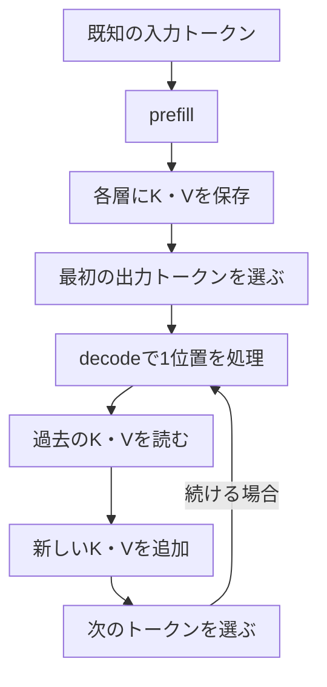

# KVキャッシュ — 推論で何を保存し、何が速くなり、メモリをどれだけ使うか

LLMが文章を1トークンずつ書くとき、次のトークンを決めるたびに、ここまでの文脈を参照します。たとえば、仕様書を読んでから「フレーム時間」と書き始めたとき、次の語を決める計算は仕様書にも生成済みの語にも依存します。そこで、各Attention層で過去の位置のKey（K、参照先との比較に使う値）とValue（V、参照先から混ぜる値）を保存し、次のステップで再利用します。これが **KVキャッシュ** です。計算を省ける一方で、処理済みのトークンが増えるほど保持するデータも増えます。[PagedAttention原論文 §2.2・§3](https://arxiv.org/html/2309.06180#S2.SS2)

## この記事で分かること

過去のK・Vを再利用できる理由と、キャッシュを使っても残る計算を説明できます。層数やKVヘッド数、文脈の長さから、キャッシュ本体の容量を見積もれます。

## prefillで蓄え、decodeで使う

ここでは、同じ先頭部分に1トークンずつ追加する自己回帰型のdecoder（前の出力を使って続きを作る部分）を考えます。各層は因果マスク（未来の位置を見せない制限）付きの自己Attentionを使い、過去の有効な位置全体を参照できる前提です。[TransformerとAttention](/algorithms/transformer-attention.html)

**prefill** は、既知の入力列を処理して各層にK・Vを蓄える段階です。入力の末尾位置の出力から、最初の出力トークンを選びます。**decode** は、直前に選んだトークンをモデルに通して続きを求める段階です。そのトークンのK・Vが各層に加わり、次の出力トークンの候補が得られます。トークンを選ぶ時点と、そのトークンを入力として処理してK・Vを保存する時点には、1ステップのずれがあります。[PagedAttention原論文 §2.2](https://arxiv.org/html/2309.06180#S2.SS2) · [NVIDIAのprefillとdecodeの解説](https://developer.nvidia.com/blog/streamlining-ai-inference-performance-and-deployment-with-nvidia-tensorrt-llm-chunked-prefill/)



## 過去のK・Vが変わらない理由

因果マスクがあると、位置$i$の出力が参照するのは位置$i$までです。末尾に新しいトークンを追加しても、過去の位置からは見えません。モデル重み・先頭のトークン列・位置の扱いが同じなら、次の層へ渡される過去の表現も変わりません。この関係が層を重ねても成り立つので、各層のK・Vをそのまま使えます。同じ単語が別の位置に現れたり、先頭の文が変わったりすると、以前と同じK・Vを使えるとは限りません。[Transformer原論文 §3.1–3.2](https://arxiv.org/html/1706.03762v7#S3) · [Hugging Face Transformersのキャッシュ解説](https://huggingface.co/docs/transformers/main/en/cache_explanation)

新しい位置では各層のQ・K・Vを作ります。Q（Query）は各Kと内積を取り、参照先のスコアを求めるための値です。**softmax**でスコアを参照先ごとの係数に変え、その係数でVを混ぜます。いまのQが変われば、保存済みのKに対する重みも変わるためです。過去の位置の射影（Q・K・Vへの変換）や層の出力を毎回作り直す作業は省けます。新しい位置のフィードフォワード層（位置ごとに特徴を変換する層）や、語彙のスコア計算は残ります。[PagedAttention原論文 §2.1–2.2](https://arxiv.org/html/2309.06180#S2)

すべての過去の位置を参照するAttentionでは、新しい1位置のスコアの数は、1ヘッドあたり参照する位置の数に比例します。長い文脈ではKVを読み込む量も増えます。実際の速度は、重みやKVの読み出し、バッチの大きさ、使うカーネルなどで変わるため、後の例で数える計算回数をそのまま速度の倍率にはできません。[PagedAttention原論文 §2.2–3](https://arxiv.org/html/2309.06180#S2.SS2) · [GQA原論文 §1–2](https://aclanthology.org/2023.emnlp-main.298/)

## 長い文脈と同時リクエストの容量を見積もる

たとえば、1層・1KVヘッドで、1トークンのKとVがそれぞれ4要素、1要素がFP16の2バイトなら、1トークン分は $2\times4\times2=16$ バイトです。処理済みの3トークンを保持すると、1列のKV本体は48バイトになります。

これを複数の層・ヘッド・リクエストに広げます。KとVの次元が等しく、全層のKVヘッド数とヘッド次元が同じで、全位置を保存するとします。1リクエストにつき1列を生成し、各要素のバイト数が一定で、リクエスト間でキャッシュを共有しない場合の、KV本体のバイト数は次のとおりです。[PagedAttention原論文 §3](https://arxiv.org/html/2309.06180#S3)

$$
2 \times L \times H_{KV} \times d \times b \times \sum_{r=1}^{R} T_r
$$

先頭の2はKとV、$L$は層数、$H_{KV}$はK・Vそれぞれのヘッド数、$d$はヘッドあたりの要素数、$b$は要素あたりのバイト数です。$R$はキャッシュを保持しているリクエスト数で、$T_r$はリクエスト$r$で処理して保存したトークンの数です。同じモデル重みを複数リクエストで使っても、入力と生成済みの続きが違えば、その位置のKVは個別に持つ必要があります。

MHA（Multi-Head Attention）ではQヘッドごとにK・Vのヘッドがあります。GQA（Grouped-Query Attention）では、複数のQヘッドがグループ内で一組のK・Vを使います。たとえば32個のQヘッドを4個ずつまとめるとKVヘッドは8個です。容量の式には、このKVヘッド数を使います。GQAはモデルのAttention構造の違いです。[GQA原論文 §2.2・図2](https://aclanthology.org/2023.emnlp-main.298/)

32層、Qヘッド32個、ヘッド次元128、1要素2バイト（FP16）とします。上の構成では1トークンあたりMHA（KVヘッド32個）は512 KiB、GQA（KVヘッド8個）は128 KiBです。各列が4,096トークンを保持すると、表の容量になります。1 KiBは1,024バイト、1 GiBは1,024 MiBです。

| 方式 | 1列 | 4列 |
| --- | ---: | ---: |
| MHA | 2 GiB | 8 GiB |
| GQA | 512 MiB | 2 GiB |

この値はKVの要素だけの容量です。

## 重み、会話履歴、プロンプトキャッシュとの違い

| 用語 | 何を保持し、何に使うか |
| --- | --- |
| モデル重み | 学習で得たパラメーター。入力からQ・K・Vなどを計算するときに使う。 |
| 会話履歴 | アプリが保持する発言やツール結果。次にモデルへ渡す入力の材料になる。 |
| 永続メモリ | アプリが後のセッションで再利用する設定や要点など。選んだ情報を入力へ加えられる。 |
| KVキャッシュ | トークン列を処理して得た層ごとのK・V。続きの推論で再利用する。 |
| プロンプトキャッシュ | 対応するサービスや実装で、別のリクエストからも共通の先頭部分の計算結果を再利用する仕組み。 |

## 小さなAttentionで、結果と計算回数を比べる

1層・1ヘッド・1次元で、入力は `[1, 2, -1]`、次の2ステップに渡す入力は `3` と `0` に固定します。各位置の数値を $x$ とし、$Q=x/2$、$K=x$、$V=2x$ として、因果マスクの範囲でAttentionを計算します。出力はAttentionの重み付き和で、次トークンの予測は行いません。

prefillでは両方とも3位置を処理します。decodeでは、キャッシュありなら新しい位置だけのK・Vを作り、なしならその時点までの入力すべてからK・Vを作り直します。この1層の比較ではK・Vの再利用に絞り、どちらもdecode時のスコアを最後の位置のQについてだけ計算します。以下はPython 3.12.4の標準ライブラリで実行しました。

```python
from math import exp, isclose


def project(tokens):
    return [(x, 2 * x) for x in tokens]  # (K, V)


def attend(x, visible_kv):
    query = x / 2
    scores = [query * key for key, _ in visible_kv]
    peak = max(scores)
    weights = [exp(score - peak) for score in scores]
    weighted_sum = sum(w * value for w, (_, value) in zip(weights, visible_kv))
    return weighted_sum / sum(weights)


def run(use_cache):
    tokens = [1, 2, -1]
    kv = project(tokens)
    projected = len(kv)
    scores = sum(range(1, len(tokens) + 1))
    outputs = [attend(x, kv[:i + 1]) for i, x in enumerate(tokens)]

    for x in (3, 0):
        tokens.append(x)
        new_kv = project([x] if use_cache else tokens)
        projected += len(new_kv)
        if use_cache:
            kv.extend(new_kv)
        else:
            kv = new_kv
        scores += len(kv)
        outputs.append(attend(x, kv))

    return outputs, projected, scores


def kv_bytes(layers, kv_heads, width, element_bytes, tokens, sequences):
    return 2 * layers * kv_heads * width * element_bytes * tokens * sequences


if __name__ == "__main__":
    cached, cached_kv, cached_scores = run(use_cache=True)
    plain, plain_kv, plain_scores = run(use_cache=False)
    assert len(cached) == len(plain) == 5
    assert all(isclose(a, b, rel_tol=1e-12, abs_tol=1e-12)
               for a, b in zip(cached, plain))
    assert (cached_kv, plain_kv, cached_scores, plain_scores) == (5, 12, 15, 15)

    print("Attention outputs:", [round(x, 6) for x in cached])
    print("K/V pairs (cached / uncached):", cached_kv, "/", plain_kv)
    print("Scores    (cached / uncached):", cached_scores, "/", plain_scores)

    mib = 1024 ** 2
    for name, heads in (("MHA", 32), ("GQA", 8)):
        one = kv_bytes(32, heads, 128, 2, 4096, 1)
        four = kv_bytes(32, heads, 128, 2, 4096, 4)
        expected = (2048, 8192) if name == "MHA" else (512, 2048)
        assert (one, four) == tuple(size * mib for size in expected)
        print(f"{name}: {one // mib} MiB (1 seq), {four // mib} MiB (4 seq)")
```

```text
Attention outputs: [2.0, 3.462117, -0.233638, 5.478406, 2.0]
K/V pairs (cached / uncached): 5 / 12
Scores    (cached / uncached): 15 / 15
MHA: 2048 MiB (1 seq), 8192 MiB (4 seq)
GQA: 512 MiB (1 seq), 2048 MiB (4 seq)
```

全5位置の出力は比較の許容差 `1e-12` 内で一致しました。K・Vを作った組数は、キャッシュなしでは $3+4+5=12$、ありでは $3+1+1=5$ です。この教材の1ヘッドのスコアは、prefillで $1+2+3=6$ 個、decodeでは最後のQについて $4+5=9$ 個なので、どちらも15個です。最後の2行は、容量表の1列と4列をMiBにそろえた値です。

本例の15対15は、1層でdecode時に最後の位置のQだけを比較した回数です。

## 補足

実際のVRAM使用量を見積もる際は、モデルの重み、作業領域、ブロック単位の割り当てや未使用領域も考慮します。参照窓を限定する層、低精度な格納形式、共通の先頭部分を共有する実装では、保持量の求め方が変わります。[PagedAttention原論文 §3–4](https://arxiv.org/html/2309.06180#S3) · [Hugging Face Transformersのキャッシュ方式](https://huggingface.co/docs/transformers/main/en/kv_cache)

OpenAI APIのプロンプトキャッシュは、条件を満たす先頭部分のKVテンソルを保存します。後のリクエストで同じ先頭部分のキャッシュが見つかれば、その部分の再計算を省けます。新しい入力部分の処理と応答の生成は引き続き必要です。一致や保持の条件はモデル・設定に依存します。会話が保存されていることだけで、同じ先頭部分を再利用できるとは限りません。[OpenAI公式資料のPrompt caching](https://developers.openai.com/api/docs/guides/prompt-caching#what-is-the-prompt-cache) · [AIエージェントのコンテキスト管理](/algorithms/agent-context-management.html)

多層のモデルで、過去の中間表現も保持せずに上の層の過去のK・Vを作り直すときは、入力となる下の層の過去の出力も計算し直します。その場合、下の層では過去のQについてもAttentionの計算が発生します。[Transformer原論文 §3.1–3.2](https://arxiv.org/html/1706.03762v7#S3) · [PagedAttention原論文 §2.2](https://arxiv.org/html/2309.06180#S2.SS2)

## 要点

- prefillで各層にK・Vをため、decodeで過去の分を読みながら新しい分を足します。
- 先頭の入力、重み、位置の扱いが同じなら、因果マスクのもとで過去のK・Vを再利用できます。
- 再利用できるのは過去のK・Vです。新しいQと参照できるKを比べ、Vを混ぜる計算は残ります。
- KV本体の容量は、保存したトークン数と、各層が持つKVヘッドの数などで決まります。

## 理解度チェック

::: details K・Vがキャッシュにあれば、新しい位置のAttentionスコアの計算も省ける？
過去の位置のK・Vの再計算は省けます。新しい位置のQに対するスコアは、使えるKを参照して求めます。
:::

::: details 同じモデルで、同じ長さの列を4つ同時に処理すると、KVの容量はどうなる？
列ごとに同じ量のKVを保持し、共有しなければ、KV本体は4倍になります。モデル重みを4組持つという意味ではありません。
:::

## 検証範囲

2026年11月19日に公式資料と原論文を確認し、WindowsのPython 3.12.4で掲載例を実行しました。1層・1ヘッドの固定入力で、キャッシュの有無による全5位置のAttention出力、K・Vを作る回数、スコアの数、容量表のバイト数を検算しました。実モデルの予測、GPUでの処理時間、VRAM使用量、APIのキャッシュ命中は実測の対象外です。

## 関連項目

- [TransformerとAttention](/algorithms/transformer-attention.html) — Q・K・Vと因果マスクの計算を追う。
- [LLMの文章生成](/algorithms/llm-text-generation.html) — 次トークンを選び、入力の末尾に加える流れを読む。
- [LLM推論のprefillとdecode](/algorithms/llm-prefill-and-decode.html) — キャッシュを作る段階と読み直す段階を、測定区間と計算の違いから比べる。
- [PagedAttention](/algorithms/paged-attention.html) — 複数リクエストのKVを固定長のブロックに分けて置く方法を図で追う。
- [投機的デコーディング](/algorithms/speculative-decoding.html) — 候補列を検証するとき、どの位置のK・Vを後の生成に残せるかを読む。
- [LLMの量子化](/algorithms/llm-quantization.html) — K・Vを少ないビットで表す仕組みと、重みの量子化との違いを読む。
- [AIエージェントのコンテキスト管理](/algorithms/agent-context-management.html) — 会話履歴から何を入力に残すかを考える。

## 参考資料

- [Vaswaniら — Attention Is All You Need（2017）](https://arxiv.org/abs/1706.03762)
- [Kwonら — Efficient Memory Management for Large Language Model Serving with PagedAttention（2023）](https://arxiv.org/html/2309.06180)
- [Ainslieら — GQA: Training Generalized Multi-Query Transformer Models from Multi-Head Checkpoints（2023）](https://aclanthology.org/2023.emnlp-main.298/)
- [NVIDIA — TensorRT-LLM Chunked Prefill](https://developer.nvidia.com/blog/streamlining-ai-inference-performance-and-deployment-with-nvidia-tensorrt-llm-chunked-prefill/)
- [Hugging Face Transformers — How caching works](https://huggingface.co/docs/transformers/main/en/cache_explanation)
- [OpenAI API — Prompt caching](https://developers.openai.com/api/docs/guides/prompt-caching)
