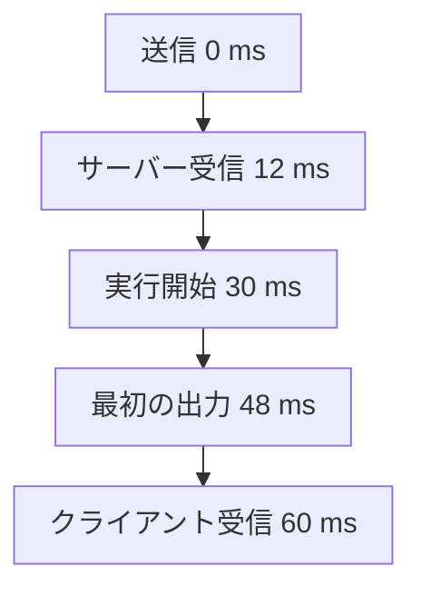
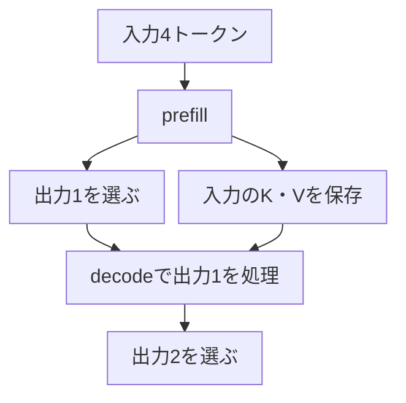

# LLM推論のprefillとdecode — 最初のトークンを待つ時間と、続きが出る間隔が違う理由

ストリーミングで文章が返ってくるとき、すぐ書き始めて途中で間が空く応答も、少し待ってから続けて出てくる応答もあります。書き始めの待ち時間は、入力を読む計算や、サーバーで実行を待つ時間にも左右されます。書き始めてからの間隔には、続きのトークンを求める計算や配信の間隔が効きます。どちらを改善したいかによって、見るべき時刻も変わります。[vLLMのBenchmark CLI](https://docs.vllm.ai/en/latest/benchmarking/cli/#understanding-the-latency-metrics) · [DistServe原論文 §2–3](https://arxiv.org/html/2401.09670#S2)

## この記事で分かること

最初の出力を待つ時間と、続きが届く間隔を別の指標として読めます。入力をまとめて処理できる理由と、生成時にどこで待ち時間が生まれるかを説明できます。

## TTFTと出力間隔は、違う時刻を引く

**prefill** は、既知の入力列をまとめて処理し、最初の出力を選ぶ段階です。**decode** は、直前に選んだトークンを入力にして続きを求める段階です。ここでは、因果マスク（未来の位置を見せない制限）付きのTransformerで、各リクエストで1トークンずつ続きを生成し、出力をストリーミングする場合を考えます。[PagedAttention原論文 §2.2](https://arxiv.org/html/2309.06180#S2.SS2) · [LLMの文章生成](/algorithms/llm-text-generation.html) · [KVキャッシュ](/algorithms/kv-cache.html)

クライアントから見た **TTFT**（Time to First Token）は、リクエストを送ってから、最初の有効な出力を受け取るまでです。各トークンを1つずつ受け取れる場合、 **ITL**（Inter-Token Latency）は、1番目から2番目、2番目から3番目のように隣り合う受信時刻の差です。ここでは各差と、その差の平均を分けて扱います。出力が1トークンなら受信間隔は求められません。最初のバイトや、本文を含まないストリームのイベントを受け取る時刻も、最初の有効な出力とは区別します。[NVIDIA AIPerf Metrics Reference](https://docs.nvidia.com/aiperf/v0.7.0/reference/ai-perf-metrics-reference) · [vLLMのBenchmark CLI](https://docs.vllm.ai/en/latest/benchmarking/cli/#understanding-the-latency-metrics)

送信を0 msとした説明用の時刻です。間隔は図の矢印の長さに比例しません。



この例で、クライアントが送信から受信までを測ると60 msです。サーバー受信からサーバーで最初の出力ができるまでは36 ms、実行開始からなら18 msです。サーバーの受信から実行開始までには、入力の準備や待ち行列が含まれ得ます。どの処理を含むかは測定点で決まるため、クライアント側のTTFTからprefillの処理時間だけを特定することはできません。

送信後、リクエストAは60・115・180 ms、Bは95・115・140 msにそれぞれ1トークンずつ届いたとします。Aは先に書き始めますが、Bは続きが短い間隔で届き、3トークン目が先に届きます。

| リクエスト | TTFT | ITL（各間隔） |
| --- | ---: | ---: |
| A | 60 ms | 55・65 ms |
| B | 95 ms | 20・25 ms |

実際のストリームでは、1回にまとめて届く出力（配信チャンク）に複数トークンが入ることがあります。

## 入力はまとめられ、続きは前の結果を待つ

入力のトークンは、生成を始める前に分かっています。prefillでは各層に入る全位置の表現から、位置ごとのQ（参照する側）、K（スコアを求める相手）、V（混ぜる値）を作ります。ここでは位置を1始まりで数えます。因果マスクは、同じ層の位置1は位置1だけ、位置2は位置1と2というように参照範囲を限ります。位置2が参照する位置1のK・Vは前の層の表現から作るため、同じ層の位置1のAttention出力を待つ必要はありません。前の層から必要な表現がそろえば、マスクで参照先を制限したまま、各位置の計算をまとめられます。[Transformer原論文 §3.2](https://arxiv.org/html/1706.03762v7#S3.SS2) · [PagedAttention原論文 §2.2](https://arxiv.org/html/2309.06180#S2.SS2)



prefillでは入力末尾の結果から最初の出力を選びます。通常の1トークンずつのdecodeは、その選択を次の入力に使うので、同じ列の後続ステップを先に確定できません。過去のK・Vをキャッシュから読み、新しく処理した位置のK・Vを加えます。Qと参照先のKを比べてVを混ぜる処理は、新しい位置ごとに必要です。独立した別のリクエストのdecodeは、まとめて処理する単位（バッチ）に同時に入れられます。[PagedAttention原論文 §2.1–2.3](https://arxiv.org/html/2309.06180#S2) · [TransformerとAttention](/algorithms/transformer-attention.html)

因果マスク以外で参照先を絞らない場合、4入力のprefillには、1ヘッドあたり $1+2+3+4=10$ 組のQとKのペアがあります。出力1を入力として処理するdecodeは、新しい1位置から5位置を参照します。次のdecodeは6位置です。この10・5・6という数は、マスクで許可されたペアの数です。カーネルが実際に発行する命令数や、それぞれの処理時間を表してはいません。

## 計算とメモリのどちらが時間を使うか

prefillで多くの位置をまとめると、一度読み出した重みを多くの入力位置の行列積に使えます。読み出す1バイトあたりの演算量が増え、十分に大きい入力では演算性能が上限になりやすくなります。少数列のdecodeでは1ステップで各列1位置だけを進めるため、重みの読み出しを分担できる位置が少なく、メモリ帯域が効きやすくなります。全体を参照するAttentionでは、長い文脈ほどdecodeの各ステップで読むK・Vも増えます。[DistServe原論文 §3.1](https://arxiv.org/html/2401.09670#S3.SS1) · [Sarathi-Serve原論文 §3.1](https://arxiv.org/html/2403.02310#S3.SS1)

どちらが律速かは、モデル、入力と文脈の長さ、バッチ、カーネル、計算性能とメモリ帯域の釣り合いで変わります。短い入力のprefillでは重みの読み出しの比重が大きく、逆に多数列のdecodeをまとめると重みを共有する計算が増えます。同じ段階でも、行列積とAttentionで律速要因が異なる場合があります。低ビット化で読み出し量を減らせるかも、対象とカーネル次第です。[DistServe原論文 §3・付録A.2](https://arxiv.org/html/2401.09670#A1.SS2) · [LLMの量子化](/algorithms/llm-quantization.html)

測ったITLには、1ステップの計算に加えて、次にその列が処理されるまでの待ち時間も現れます。たとえば同じGPUで長いprefillをまとめて実行すると、別のリクエストのdecodeが待たされて、出力の間隔が開くことがあります。

## 時刻差と因果マスクのペア数を確かめる

コードは図と表にある時刻をそのまま使います。各受信イベントは1トークン分で、時刻はすべて同じ説明用の基準にそろえています。もう一つの計算では、各クエリ位置が自分とそれ以前のKを参照するとして、許可されるペアを数えます。`itertools.pairwise` を使うため、Python 3.10以降で実行します。[Python標準ライブラリのpairwise](https://docs.python.org/3.10/library/itertools.html#itertools.pairwise)

```python
from itertools import pairwise
from statistics import mean


def token_metrics(sent_ms, visible_tokens_ms):
    ttft = visible_tokens_ms[0] - sent_ms
    itl = [after - before for before, after in pairwise(visible_tokens_ms)]
    return ttft, itl


def score_pairs(cached_tokens, new_tokens):
    # One head. Each new query can see its position and the earlier positions.
    return sum(range(cached_tokens + 1, cached_tokens + new_tokens + 1))


if __name__ == "__main__":
    for name, token_times in (("A", [60, 115, 180]), ("B", [95, 115, 140])):
        ttft, itl = token_metrics(0, token_times)
        print(f"{name}: TTFT {ttft} ms, ITL {itl} ms, mean {mean(itl):g} ms")

    client_send, server_receive, engine_start = 0, 12, 30
    server_first, client_first = 48, 60
    execution_to_first = server_first - engine_start
    server_ttft = server_first - server_receive
    client_ttft = client_first - client_send
    print(f"A first token: engine {execution_to_first}, server {server_ttft}, client {client_ttft} ms")

    # Prefill predicts output 1; the first decode consumes output 1.
    counts = [score_pairs(0, 4), score_pairs(4, 1), score_pairs(5, 1)]
    print(f"Valid Q/K score pairs: {counts}")
```

```text
A: TTFT 60 ms, ITL [55, 65] ms, mean 60 ms
B: TTFT 95 ms, ITL [20, 25] ms, mean 22.5 ms
A first token: engine 18, server 36, client 60 ms
Valid Q/K score pairs: [10, 5, 6]
```

AとBのITLの平均は、それぞれ60 msと22.5 msです。区間を変えた結果の18・36・60 msは、同じ最初の出力を別々の測定点で見た値です。最後の `[10, 5, 6]` はprefill、出力1を処理するdecode、出力2を処理するdecodeの順で、単位はミリ秒ではなくペアの個数です。

## 補足

実測ではクライアントとサーバーの時計を同じものとして引き算せず、それぞれの処理内で時刻差を取ります。vLLMにも、エンジン内部で待機区間とprefill区間を別々に記録する例があります。[vLLMのMetrics設計](https://docs.vllm.ai/en/latest/design/metrics/#interval-calculations)

通信の揺れや途中のバッファリングでも到着間隔は変わります。チャンクの到着時刻だけから各トークンが生成された時刻を取り出すことはできません。たとえばvLLMのクライアントベンチマークは、ITLを連続する配信出力間のサンプル、TPOT（Time per Output Token）を最初の出力を除くリクエスト単位の平均として記録します。ツールごとに集計が違うため、比較するときは測定点、チャンクとトークンの扱い、集計単位をそろえます。[vLLMの遅延指標の定義](https://docs.vllm.ai/en/latest/benchmarking/cli/#understanding-the-latency-metrics)

Sarathi-Serveでは、prefillを小分けにして進行中のdecodeと同じバッチへ入れ、間隔の増大を抑える方法を検証しています。1件の入力を早く処理することと、すでに生成中の応答を滑らかに保つことは、スケジューラーが同時に扱う別の目標です。[Sarathi-Serve原論文 §4](https://arxiv.org/html/2403.02310#S4)

## 要点

- クライアントで測るTTFTは、送信から最初の有効な出力までの時間です。ITLは、1トークンずつ届く場合の隣り合う受信時刻の差です。
- TTFTには通信や待ち時間も含まれ得ます。処理時間だけが知りたいときは、その区間を別に測ります。
- prefillでは既知の入力をまとめて処理できます。decodeでは直前に選んだトークンを使い、K・Vを再利用しながら続きを求めます。
- 処理を制限する要因は、入力と文脈の長さ、バッチ、カーネル、演算性能とメモリ帯域の釣り合いで変わります。

## 理解度チェック

::: details TTFTが増えたら、prefillの計算が遅くなったと言える？
待ち行列や通信、最初の出力を配信するまでの処理が長くなった可能性もあります。prefillを調べるには、その実行区間を測る必要があります。
:::

::: details 4入力のprefillで出力1が決まった直後、次のdecodeはどの位置を処理する？
出力1を新しい入力として処理します。キャッシュにある入力4位置と、新しい1位置のK・Vを使って、出力2を選ぶための結果を求めます。
:::

## 検証範囲

2026年11月19日に原論文と公式資料を確認し、WindowsのPython 3.12.4で掲載コードを実行しました。図と表の時刻は説明用に設定し、時刻差の計算とマスクで許可されるペアの列挙を検算しました。実モデルやAPIでのTTFT・ITL、GPUの律速、通信や待ち行列の時間は実測の対象外です。

## 関連項目

- [LLMの文章生成](/algorithms/llm-text-generation.html) — 次トークンを選び、選んだ結果を次に使う流れを確認する。
- [TransformerとAttention](/algorithms/transformer-attention.html) — 因果マスクで参照する範囲を制限する計算を読む。
- [KVキャッシュ](/algorithms/kv-cache.html) — decodeで再利用するテンソルと、その容量を見積もる。
- [LLMの量子化](/algorithms/llm-quantization.html) — 重みやKVを低ビットで表すと読み出し量や演算にどう影響するかを読む。

## 参考資料

- [vLLM公式 — Benchmark CLIの遅延指標](https://docs.vllm.ai/en/latest/benchmarking/cli/#understanding-the-latency-metrics) · [Metrics設計](https://docs.vllm.ai/en/latest/design/metrics/#interval-calculations)
- [NVIDIA公式 — AIPerf v0.7.0 Metrics Reference](https://docs.nvidia.com/aiperf/v0.7.0/reference/ai-perf-metrics-reference)
- [Vaswaniら — Attention Is All You Need（2017）](https://arxiv.org/html/1706.03762v7#S3.SS2)
- [Kwonら — Efficient Memory Management for Large Language Model Serving with PagedAttention（2023）](https://arxiv.org/html/2309.06180#S2.SS2)
- [Zhongら — DistServe: Disaggregating Prefill and Decoding for Goodput-optimized Large Language Model Serving（2024）](https://www.usenix.org/conference/osdi24/presentation/zhong-yinmin)
- [Agrawalら — Taming Throughput-Latency Tradeoff in LLM Inference with Sarathi-Serve（2024）](https://www.usenix.org/conference/osdi24/presentation/agrawal)
