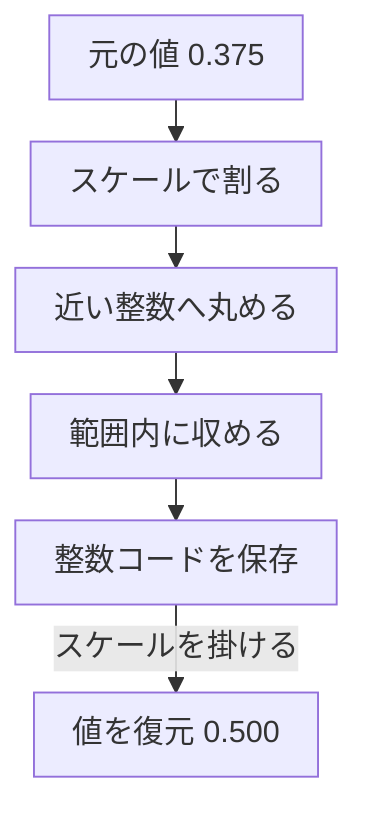
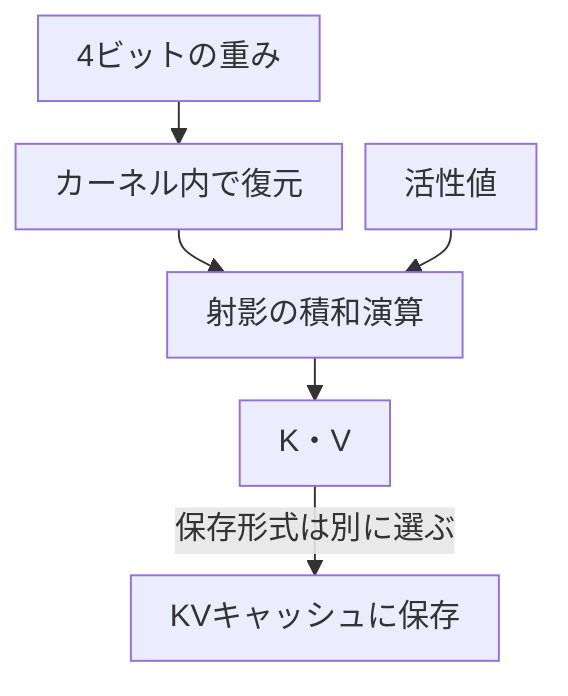

# LLMの量子化 — 精度とメモリ、重みとKVキャッシュの違い

モデルのファイルに「4ビット」と書かれていたら、何が4ビットでしょうか。学習済みの重みを4ビットに詰めて転送し、行列積を計算するときに展開する構成があります。生成が進むにつれて増えるKVキャッシュにも量子化は使えますが、そちらは重みとは別に選ぶ保存形式です。どのデータを、いつ、どんな精度で表すかを分けて見ると、容量と速度への効果を判断できます。[TensorRT 10系の重み量子化](https://docs.nvidia.com/deeplearning/tensorrt/10.x.x/inference-library/work-quantized-types.html#weight-only-quantization) · [KIVI原論文](https://proceedings.mlr.press/v235/liu24bz.html)

## 少ないビットで、近い値を表す

量子化では、多くの入力値を、限られた数の表現に対応づけます。ここでは、整数コードを等間隔の値に対応づける線形量子化を考えます。正のスケール $s$ は隣り合うコードに対応する復元値の間隔、ゼロ点 $z$ は元の値が0のときのコードです。次の式は、INT4を含む整数型を扱えるONNX opset 21の演算子仕様を参照します。整数への量子化では、$x/s$ を最近傍の整数に丸め、ちょうど中間なら偶数を選びます。ゼロ点を足してから、コードを使える範囲に収めます。この最後の操作がクリッピング（飽和）です。復元するときは、ゼロ点を引いてスケールを掛けます。[ONNX QuantizeLinear v21](https://onnx.ai/onnx/operators/onnx__QuantizeLinear.html#quantizelinear-21) · [ONNX DequantizeLinear v21](https://onnx.ai/onnx/operators/onnx__DequantizeLinear.html#dequantizelinear-21)

$$
q = \operatorname{clip}(\operatorname{round}(x/s)+z,\ q_{\min},\ q_{\max})
$$

$$
\hat{x}=s(q-z)
$$

図と掲載例は、ゼロ点が0の対称な方式です。スケールを0.25、使うコードを −7から7とすると、復元できる値は −1.75から1.75まで0.25刻みになります。4ビットの符号付き整数には −8も入りますが、この例では範囲を対称にするため使いません。FP8などの浮動小数点形式には、値が等間隔に並ばない方式もあります。[ONNXの4ビット整数仕様](https://onnx.ai/onnx/technical/int4.html) · [TensorRT 10系の量子化形式](https://docs.nvidia.com/deeplearning/tensorrt/10.x.x/inference-library/work-quantized-types.html)



0.375を0.25で割ると1.5です。隣の整数1と2のうち偶数の2へ丸め、0.25を掛けて0.500に戻します。復元値から元の値を引いた誤差は +0.125です。クリッピングで丸め結果を変えない場合、理想的な計算では最も近い値との差は刻みの半分以下です。1.90のように丸め結果が8になる値は、7に収めるので復元値が1.750、誤差は −0.150になります。スケールを小さくすると値の間隔は狭まりますが、同じビット数で表せる範囲も狭まります。

一つのスケールをテンソル全体で使う方法と、軸や小さなグループごとに持つ方法があります。グループごとに値の分布が違うなら、スケールを個別に選ぶことで、極端に大きい値に引きずられにくくなります。その分、保存するスケールや、方式によってはゼロ点も増えます。[ONNX QuantizeLinear v21のスケールの単位](https://onnx.ai/onnx/operators/onnx__QuantizeLinear.html#quantizelinear-21)

## 重み・活性値・KVキャッシュはどこにあるか

| 対象 | 何を低ビットにするか |
| --- | --- |
| 重み | 学習済みのパラメーター。保存容量や、計算前にメモリから読み出す量に効く。 |
| 活性値 | 推論中に各層で生まれる中間値。たとえば行列積へ渡す値を量子化し、対応するカーネルで計算する。 |
| KVキャッシュ | 過去のトークン位置のK・V。後のdecodeで読み直すために保持する容量に効く。 |

K・Vも中間値ですが、次の生成ステップまで残すため、KVキャッシュに書き込むときの精度は独立した設計箇所です。重みを4ビットにしても、それだけで過去のK・Vの保存形式は変わりません。Kの近似はQとの内積で求めるAttentionスコアに、Vの近似は重み付き和に影響します。KとVに別のグループ化を選んだ研究例もあります。[TensorRT LLMのFP8 KVキャッシュ](https://nvidia.github.io/TensorRT-LLM/latest/features/quantization.html#fp8-kv-cache) · [KIVI原論文](https://proceedings.mlr.press/v235/liu24bz.html) · [KVキャッシュ](/algorithms/kv-cache.html)

## 保存形式と演算精度を分けて見る

TensorRT 10系の重みのみの量子化では、行列積カーネルが4ビットの重みを読み、カーネル内で復元してから高精度で内積を計算します。次の図は、この方式でK・Vの射影を行う場合に、重みと活性値がどこで合流し、どこからがキャッシュの保存になるかを示します。[TensorRT 10系のWeight-Only Quantization](https://docs.nvidia.com/deeplearning/tensorrt/10.x.x/inference-library/work-quantized-types.html#weight-only-quantization)



別のカーネルでは、低ビットの重みと活性値を使って積を求め、和はより広い型で累積します。たとえば、8ビット整数の積を32ビット整数に累積する設計があります。W4A16のような表記は、対象の重みと活性値のビット数を表します。積算器や出力、softmaxの型まで知るには個々の実装を確認します。[Jacobらの整数演算による推論 §2](https://openaccess.thecvf.com/content_cvpr_2018/html/Jacob_Quantization_and_Training_CVPR_2018_paper.html) · [TensorRT LLMの量子化方式](https://nvidia.github.io/TensorRT-LLM/latest/features/quantization.html)

## 丸め誤差と容量をローカルで確かめる

下のコードでは、入力とスケールを分数で表し、丸めの境目を正確に扱います。`round` の列は丸めた直後、`q` はクリッピング後のコードです。`x_hat` は復元値、`error` は復元値から入力を引いた値です。0.125はスケールで割ると0.5なので、偶数の0に丸められます。

出力で `Fraction` を小数書式にするため、Python 3.12以降で実行します。[Python標準ライブラリのFraction](https://docs.python.org/3.12/library/fractions.html#fractions.Fraction)

容量は、1,024個の重みを2値ずつ1バイトに詰める前提で512 Bです。64個ごとに2バイトのスケールを持つなら、16個で32 Bを追加します。ゼロ点は固定の0とし、ヘッダーやアラインメントの空きは数えません。同じ1,024個をFP16で保持する場合は2,048 Bです。[ONNXのINT4パック規約](https://onnx.ai/onnx/technical/int4.html#packing-and-unpacking)

```python
from fractions import Fraction


scale = Fraction(1, 4)
q_min, q_max = -7, 7


def quantize(x):
    rounded = round(x / scale)  # Halfway values round to the even integer.
    q = max(q_min, min(q_max, rounded))
    reconstructed = q * scale
    return rounded, q, reconstructed


if __name__ == "__main__":
    print("     x  round   q    x_hat   error")
    for value in ("-2", "-0.375", "-0.25", "-0.125", "0.10",
                  "0.125", "0.375", "1.90", "2.0"):
        x = Fraction(value)
        rounded, q, reconstructed = quantize(x)
        error = reconstructed - x
        if rounded == q:
            assert abs(error) <= scale / 2
        print(f"{x:>6.3f} {rounded:>6} {q:>3} {reconstructed:>8.3f} {error:>7.3f}")

    count = 1024
    group_size = 64
    packed_bytes = count * 4 // 8
    scale_bytes = (count // group_size) * 2
    weight_bytes = packed_bytes + scale_bytes
    fp16_bytes = count * 2

    print(f"4-bit+scales: {packed_bytes} + {scale_bytes} = {weight_bytes} B")
    print(f"FP16: {fp16_bytes} B")
    print(f"FP16 / 4-bit+scales: {Fraction(fp16_bytes, weight_bytes):.2f}")
```

```text
     x  round   q    x_hat   error
-2.000     -8  -7   -1.750   0.250
-0.375     -2  -2   -0.500  -0.125
-0.250     -1  -1   -0.250   0.000
-0.125      0   0    0.000   0.125
 0.100      0   0    0.000  -0.100
 0.125      0   0    0.000  -0.125
 0.375      2   2    0.500   0.125
 1.900      8   7    1.750  -0.150
 2.000      8   7    1.750  -0.250
4-bit+scales: 512 + 32 = 544 B
FP16: 2048 B
FP16 / 4-bit+scales: 3.76
```

この2形式の容量は2,048 Bと544 Bです。FP16を基準にすると、スケール込みの容量は約26.6%になります。

## どこまで小さく、速くできるか

1,024個の重みで分かった3.76倍は、パックしたコードとスケールの合計に対する容量比です。モデル全体には、対象外の重みや別の型を使う層があり、実行時には活性値、作業領域、KVキャッシュも必要です。ファイルの小ささと推論中の最大VRAM使用量は、別々に測ります。[ONNXのINT4パック規約](https://onnx.ai/onnx/technical/int4.html#packing-and-unpacking) · [PagedAttention原論文 §3](https://arxiv.org/html/2309.06180#S3)

読み出すバイト数が減ると、メモリ帯域が律速の処理では役立ちます。一方、展開・復元の処理や、使える低ビット命令とカーネルの有無も時間に効きます。同じビット幅でも、短い入力を1件だけ処理するときと、長い入力を同時に何件も処理するときでは結果が変わり得ます。速度を比べるなら、同じモデルと実行環境で入力・出力長や同時件数をそろえ、最初のトークンが出るまでの時間と、その後の生成速度を分けて見ます。品質も、数値誤差だけでなく、実際に使う入力と評価項目で確かめます。[ONNX Runtimeの性能解説](https://onnxruntime.ai/docs/performance/model-optimizations/quantization.html#why-am-i-not-seeing-performance-improvements) · [Hugging Face Transformersの量子化KVキャッシュ](https://huggingface.co/docs/transformers/main/en/kv_cache#quantized-cache) · [KIVI原論文](https://proceedings.mlr.press/v235/liu24bz.html)

量子化をいつ考慮するかにも違いがあります。PTQ（Post-Training Quantization）は、学習済みモデルを量子化に適応させる再学習をせずに変換します。スケールの調整などに代表的な入力で校正する方式もあります。QAT（Quantization-Aware Training）は、丸めや飽和による近似を学習や微調整の中で模擬し、モデルがその近似に適応できるようにします。どちらでも、配備する方式と評価結果を合わせて確認します。[TensorRT 10系の量子化ワークフロー](https://docs.nvidia.com/deeplearning/tensorrt/10.x.x/inference-library/work-quantized-types.html#quantization-workflows) · [TorchAO 0.17のQAT](https://docs.pytorch.org/ao/stable/workflows/qat.html)

## 理解度チェック

::: details スケール0.25なら、復元誤差はいつでも0.125以下？
丸めたコードがそのまま使える場合は、理想的な演算で誤差の絶対値は0.125以下です。1.90の例では8を7に収めるため、絶対値は0.150になります。
:::

::: details 重みをFP16から4ビットにしたら、VRAMと生成時間はどちらも4分の1？
スケールなどの付加情報や、活性値・KVキャッシュ・作業領域も容量に含まれます。生成時間は読み出し量と展開・計算に使うカーネル、ハードウェア、文脈長や同時件数によって変わります。
:::

## 検証範囲

2026年11月19日に公式資料と原論文を確認しました。同日にWindowsのPython 3.12.4の標準ライブラリで、9個の入力の丸め・飽和・復元と符号付き誤差、付加情報を含めた重みのバイト数を検算しました。コード中の整数はPythonの型で保持し、パック後の容量は要素数から計算しています。実際のLLMの品質、速度、VRAM使用量、GPUでのパックやカーネル実装は実測の対象外です。

## 関連項目

- [LLMの文章生成](/algorithms/llm-text-generation.html) — 推論で使う重みと、入力から作る次トークンの分布を読む。
- [TransformerとAttention](/algorithms/transformer-attention.html) — QとKの内積やVの重み付き和が何を計算するかを追う。
- [KVキャッシュ](/algorithms/kv-cache.html) — 各層のK・Vがどれだけ増えるかを文脈長やKVヘッド数から見積もる。
- [LLMのファインチューニングとLoRAの仕組み](/algorithms/lora-fine-tuning.html) — 既存の重みに学んだ更新分を足し、マージするときに格納形式がどう関わるかを読む。
- [QLoRAの仕組み](/algorithms/qlora.html) — 量子化した基底を凍結してアダプターを学ぶ方法と、二重量子化で減る容量を読む。
- [LLM推論のprefillとdecode](/algorithms/llm-prefill-and-decode.html) — 入力の処理と続きの生成で、演算とメモリ帯域の影響がどう変わるかを読む。

## 参考資料

- [ONNX — QuantizeLinear v21](https://onnx.ai/onnx/operators/onnx__QuantizeLinear.html#quantizelinear-21) · [DequantizeLinear v21](https://onnx.ai/onnx/operators/onnx__DequantizeLinear.html#dequantizelinear-21) · [4 bit integer types](https://onnx.ai/onnx/technical/int4.html)
- [NVIDIA — TensorRT 10系 Working with Quantized Types](https://docs.nvidia.com/deeplearning/tensorrt/10.x.x/inference-library/work-quantized-types.html) · [TensorRT LLMの量子化方式](https://nvidia.github.io/TensorRT-LLM/latest/features/quantization.html)
- [Liuら — KIVI: A Tuning-Free Asymmetric 2bit Quantization for KV Cache（2024）](https://proceedings.mlr.press/v235/liu24bz.html)
- [Jacobら — Quantization and Training of Neural Networks for Efficient Integer-Arithmetic-Only Inference（2018）](https://openaccess.thecvf.com/content_cvpr_2018/html/Jacob_Quantization_and_Training_CVPR_2018_paper.html)
- [PyTorch — TorchAO 0.17のQuantization-Aware Training](https://docs.pytorch.org/ao/stable/workflows/qat.html)
- [ONNX Runtime — Quantize ONNX models](https://onnxruntime.ai/docs/performance/model-optimizations/quantization.html)
