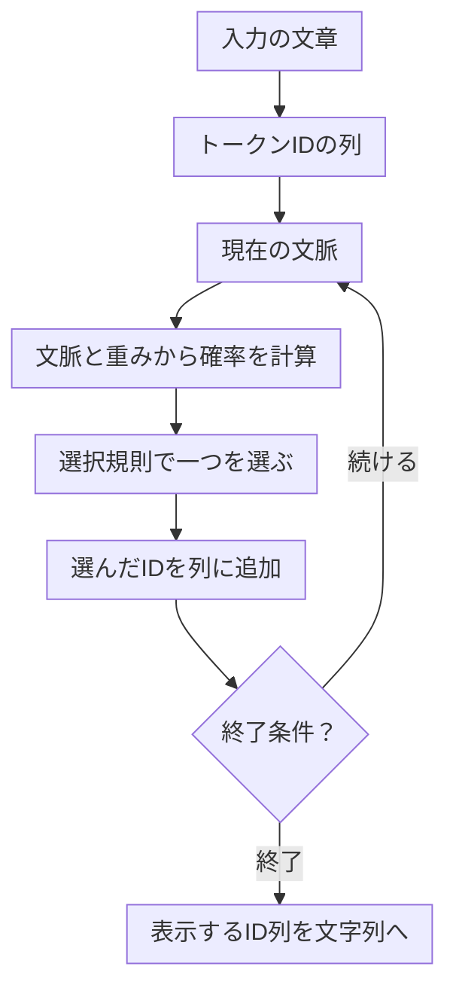

# LLMはどう文章を生成するのか — トークン・次トークン予測・学習と推論

「HPが少ない敵の行動を考えて」と入力すると、LLM（大規模言語モデル）は入力をトークンの列として受け取り、次に続くトークンの確率を求めます。一つを選んで列に加え、伸びた列を条件として次を求めます。ここでは、このように過去の列を条件に続きを作る**自己回帰型のテキスト生成**を扱います。[GPT-2原論文 §2](https://cdn.openai.com/better-language-models/language_models_are_unsupervised_multitask_learners.pdf)

## 文章をトークンにし、続きの候補を求める

トークナイザーは文字列を、語彙に登録された単位とそのIDの列に変換します。モデルはそのIDを数値ベクトルに変え、学習済みの**重み**（計算に使う調整済みのパラメーター）を使って文脈を計算します。出力段階では次トークン候補のスコアから確率分布を求め、選択規則に従って一つを選びます。選んだIDを列に追加すると、次回の計算の文脈も変わります。[Transformer原論文 §3](https://arxiv.org/html/1706.03762v7#S3)



終了トークンが選ばれた場合や出力長の制限などで生成を終えます。図は計算の論理的な流れです。Transformerのattentionなど、文脈を処理する内部の計算はこの図の確率計算の部分に含まれます。個別の非公開モデルの構成や実行方式は、この説明からは決まりません。[Transformer原論文 §3](https://arxiv.org/html/1706.03762v7#S3)

## トークンは単語と同じ長さにはならない

トークンには単語全体、単語の一部、句読点、空白を含む部分などが対応します。バイト単位を基礎とする方式では、一つの文字のバイト表現が複数トークンに分かれる場合もあります。文字数・単語数・トークン数は、それぞれ異なる数え方です。実際の分割とIDは、使うトークナイザーと語彙に依存します。[tiktoken公式のBPE解説](https://github.com/openai/tiktoken#what-is-bpe-anyway) · [Unicodeと文字コード](/data/unicode-and-encoding.html)

BPE（Byte Pair Encoding）は、隣り合う記号の組を結合してより大きい単位を作る方式です。言語処理では、学習データ中の頻度から結合規則を用意する方法があります。次は考え方を示すために、規則を二つだけ決めた教材用の例です。実際のモデルのトークナイザーで測定した分割ではありません。[SennrichらのサブワードBPE原論文 §3.2](https://aclanthology.org/P16-1162/)

- 初期の記号をASCII文字1つずつとし、`h` と `p` を結合して `hp` にします。
- 次の規則で `2` と `0` を結合して `20` にします。
- この例のIDは `hp` が5、`=` が2、`20` が6、`0` が4と決めます。ID自体は語彙中の識別子です。

| 入力 | 教材用の分割 | ID列 |
| --- | --- | --- |
| `hp=20` | `hp`、`=`、`20` | `[5, 2, 6]` |
| `hp=200` | `hp`、`=`、`20`、`0` | `[5, 2, 6, 4]` |

最初の入力は5文字で3トークンです。別の結合規則や語彙なら、同じ入力の分割も変わります。GPT-2で使われたバイト単位BPEも、この教材のASCII文字だけの規則とは異なります。[GPT-2原論文 §2.2](https://cdn.openai.com/better-language-models/language_models_are_unsupervised_multitask_learners.pdf)

## 次トークンの確率と、選び方

文脈を $c$、学習済みの重みを $\theta$ とすると、モデルが求めるのは候補 $v$ の条件付き確率 $p_\theta(v\mid c)$ です。代表的な出力層では、語彙中の各候補にスコア（logit）$z_v$ を付けます。**softmax** は、各スコアの指数を取り、その合計で割って全候補の確率の合計を1にする計算です。[Transformer原論文 §3.4](https://arxiv.org/html/1706.03762v7#S3.SS4)

$$
p_\theta(v\mid c)=\frac{\exp(z_v)}{\sum_{u\in V}\exp(z_u)}
$$

以下は分割の例とは独立した、3候補だけの確率計算です。「回復」「攻撃」「待機」のスコアを仮に2、1、0と置きます。これらの数値は説明用に決めた値で、学習済みLLMの出力を測ったものではありません。

| 仮の候補 | logit | 計算した確率 |
| --- | --- | --- |
| 回復 | 2 | 0.665241 |
| 攻撃 | 1 | 0.244728 |
| 待機 | 0 | 0.090031 |

最大の確率を選ぶgreedy方式なら「回復」です。分布からサンプリングする方式なら、別の候補も選ばれます。一様乱数として $r=0.8$ を得たと仮定する例では、回復の区間は $[0,0.665241\ldots)$、攻撃の区間はその続きなので「攻撃」が選ばれます。これは候補を選ぶ処理の違いで、生成後の文脈も変えることになります。[重み付き抽選](/game/loot-tables.html) · [GPT-2原論文 §3.5・§3.6](https://cdn.openai.com/better-language-models/language_models_are_unsupervised_multitask_learners.pdf)

次のコードはPython 3.12.4の標準ライブラリで検証しました。最大値をスコアから引くと、softmaxの比を保ちながら指数関数へ大きな正の値を渡すことを避けられます。

```python
import math

tokens = ["回復", "攻撃", "待機"]
logits = [2.0, 1.0, 0.0]
maximum = max(logits)
weights = [math.exp(value - maximum) for value in logits]
total = sum(weights)
probabilities = [weight / total for weight in weights]

for token, probability in zip(tokens, probabilities):
    print(f"{token}: {probability:.6f}")

greedy = max(range(len(tokens)), key=probabilities.__getitem__)
print("greedy:", tokens[greedy])

threshold = 0.8  # サンプリングの仕組みを観察するための固定値
cumulative = 0.0
for token, probability in zip(tokens, probabilities):
    cumulative += probability
    if threshold < cumulative:
        print("sample:", token)
        break
```

```text
回復: 0.665241
攻撃: 0.244728
待機: 0.090031
greedy: 回復
sample: 攻撃
```

選んだあとに続く確率も、そのトークンを含む文脈を条件にします。別の仮の例で、「回復」の確率が0.6、そのあとに「。」が続く確率が0.5、そのあとに終了トークンが続く確率が0.8なら、分布に従ってサンプリングする際にこの列が出る確率は $0.6\times0.5\times0.8=0.24$ です。各確率は、それまでの列に条件付けられています。[GPT-2原論文 §2の系列確率](https://cdn.openai.com/better-language-models/language_models_are_unsupervised_multitask_learners.pdf)

## 学習は重みを変え、推論は重みを使う

次トークン予測の事前学習では、学習文に実際に現れた次のトークンを正解とします。**損失** は、予測がその正解からどの程度外れたかを表す、学習で小さくしたい値です。たとえば正解トークンに付けた確率が低いほど損失が大きくなるように計算し、損失を小さくする方向へ重み $\theta$ を更新します。たくさんの文と位置に対する学習を通じて、出力確率を計算する数値の集合が変わります。単語の並びだけでなく、文章中に表れる構造や関係もこの学習の対象になり得ます。[GPT-2原論文 §2](https://cdn.openai.com/better-language-models/language_models_are_unsupervised_multitask_learners.pdf)

通常の固定重みでの推論では、その重みを使い、与えられた文脈に応じて確率を計算します。「このゲームでは回復を禁止する」と文脈に加えることと、その文を使って重みを更新することは別の処理です。GPT-3の原論文では、入力に例を与えてタスクに適応させる設定で、勾配による重み更新を行わないことが明記されています。[GPT-3原論文 §2](https://arxiv.org/html/2005.14165v4#S2)

| 情報 | 主な役割 | この説明で変わる場面 |
| --- | --- | --- |
| 重み | 入力からスコアを計算する学習済みの数値 | 学習や追加学習で更新する |
| コンテキスト | 今回の出力を条件付けるトークン列 | 入力や生成したトークンを加える |

コンテキストに渡せる長さにはモデルや実行条件による上限があります。過去の会話や資料を使う場合も、どの情報が今回の入力に渡されたかが出力に影響します。[AIエージェントのコンテキスト管理](/algorithms/agent-context-management.html) · [OpenAI APIの会話状態](https://developers.openai.com/api/docs/guides/conversation-state)

会話の保存と学習への利用は、サービスや設定ごとに確認します。たとえばOpenAI APIには、エンドポイントや設定に応じて処理に必要な状態を保存する場合があります。同APIへ送ったデータは、利用者が明示的に共有を選んだ場合を除き、モデルの訓練・改善には使われません。これはOpenAI APIのデータの扱いです。[OpenAI APIのデータ管理](https://developers.openai.com/api/docs/guides/your-data)

Transformerでは、こうした数値計算にベクトル、行列、attentionなどを使います。詳しい構造を追う前に、文脈として渡す列と、計算に使う重みを区別すると、入力を変えることと学習することの関係を読めます。[Transformer原論文](https://arxiv.org/abs/1706.03762) · [行列](/math/rendering/matrix.html)

## もっともらしさと事実の正しさを確認する

次トークンの確率は、その文脈でどんな続きにスコアを付けるかを表します。文章中の主張が一次資料と一致するかを判定する確率ではありません。事実と異なる説明でも、文章として自然な形で続くことがあります。TruthfulQAの研究は、人間の文章中にある誤解をモデルが再現する問題を測定しました。そこでの旧モデルの結果を、現在の特定モデルの性能として扱うことはできません。[TruthfulQA原論文](https://aclanthology.org/2022.acl-long.229/)

ゲームコードの説明でも、API名や関数の形が自然に見えることと、使用中の版で存在して正しく動くことを確かめる作業は分かれます。出力は公式資料、コンパイル、仕様に沿う実行結果と照合します。[AIが書いたコードとの付き合い方](/tools/reviewing-ai-generated-code.html)

## 理解度チェック

::: details 10文字の入力なら、どのLLMでも10トークンになる？
分割はトークナイザーと語彙に依存します。今回の教材では5文字の `hp=20` が3トークンになりました。単語や文字とトークンは異なる単位です。
:::

::: details もっとも確率が高い候補が、毎回必ず選ばれる？
選択規則によります。この教材のgreedyでは「回復」、分布への固定値0.8を使った例では「攻撃」になりました。
:::

::: details 禁止事項を入力に加えると、この推論中に重みも更新される？
ここで扱う固定重みの推論では、追加した文は文脈として確率計算に使われます。重みの更新は学習の処理です。
:::

## 検証範囲

2026年11月18日に、WindowsのPython 3.12.4の標準ライブラリで、教材用BPE規則と往復変換、softmaxの確率と合計、greedyと累積区間での選択、条件付き確率の積、掲載コードの出力を確認しました。トークナイザーの実装や語彙はモデルごとに異なります。この環境に実モデル用のトークナイザーがなかったため、分割規則とIDを明示した小さな教材を使いました。

分割、スコア、確率はすべて説明用の値です。学習済みLLMの推論、実際のトークナイザーによる分割、学習による重み更新、個別の非公開モデルの内部は検証していません。本文の学習・推論の説明は原論文と公式資料に基づきます。

## 関連項目

- トークンの列から文脈を計算する内部を、Q/K/Vと重み付き和で追う。[TransformerとAttention — 埋め込み・位置情報・Q/K/Vで文脈を計算する](/algorithms/transformer-attention.html)
- 続きを1トークンずつ書くとき、推論で何を保存し、どの計算を省けるかを読む。[KVキャッシュ](/algorithms/kv-cache.html)
- 学習済みのモデルを用途に合わせるとき、どのパラメーターを学習するかを読む。[LLMのファインチューニングとLoRAの仕組み](/algorithms/lora-fine-tuning.html)
- 最初のトークンまでの待ち時間と、それ以降の出力間隔を分けて読む。[LLM推論のprefillとdecode](/algorithms/llm-prefill-and-decode.html)
- 推論で使う重みや中間値を、少ないビットでどう近似するかを読む。[LLMの量子化](/algorithms/llm-quantization.html)
- モデルの提案を受けたAIアプリが、外部のツールを呼んで結果を受け取る流れを読む。[MCPの仕組み — AIモデルと外部ツールをどうつなぐか](/algorithms/model-context-protocol.html)
- 作業に応じて、エージェントが手順や資料を文脈に加える流れを読む。[Agent Skillsの仕組み](/algorithms/agent-skills.html)
- 提案されたツールを実行するか判断し、結果をモデルに戻す仕組みを読む。[AIエージェントのハーネス](/algorithms/agent-harness.html)
- モデルが返したデータをアプリで検査し、処理につなぐ方法を読む。[Function callingと構造化出力](/algorithms/function-calling-and-structured-outputs.html)
- 長い会話のどの情報を推論入力に残すかを読む。[AIエージェントのコンテキスト管理](/algorithms/agent-context-management.html)
- 質問に対応する資料を探し、モデルの回答に根拠として渡す仕組みを読む。[RAGの仕組み](/algorithms/retrieval-augmented-generation.html)
- [Unicodeと文字コード](/data/unicode-and-encoding.html) — 文字とバイトの関係を確認する。
- [重み付き抽選](/game/loot-tables.html) — 確率と累積区間で一つを選ぶ処理を読む。
- [行列](/math/rendering/matrix.html) — ベクトルをまとめて変換する数値計算の基礎を確認する。
- [AIが書いたコードとの付き合い方](/tools/reviewing-ai-generated-code.html) — 生成された提案を公式資料と実行結果で検証する。

## 参考資料

- [Radfordら — Language Models are Unsupervised Multitask Learners（2019）](https://cdn.openai.com/better-language-models/language_models_are_unsupervised_multitask_learners.pdf)
- [Sennrich・Haddow・Birch — Neural Machine Translation of Rare Words with Subword Units（ACL 2016）](https://aclanthology.org/P16-1162/)
- [OpenAI — tiktokenのBPE解説](https://github.com/openai/tiktoken#what-is-bpe-anyway)
- [Vaswaniら — Attention Is All You Need（2017）](https://arxiv.org/abs/1706.03762)
- [Brownら — Language Models are Few-Shot Learners（2020）](https://arxiv.org/abs/2005.14165v4)
- [OpenAI API — Conversation state](https://developers.openai.com/api/docs/guides/conversation-state) · [Data controls](https://developers.openai.com/api/docs/guides/your-data)
- [Lin・Hilton・Evans — TruthfulQA: Measuring How Models Mimic Human Falsehoods（ACL 2022）](https://aclanthology.org/2022.acl-long.229/)
