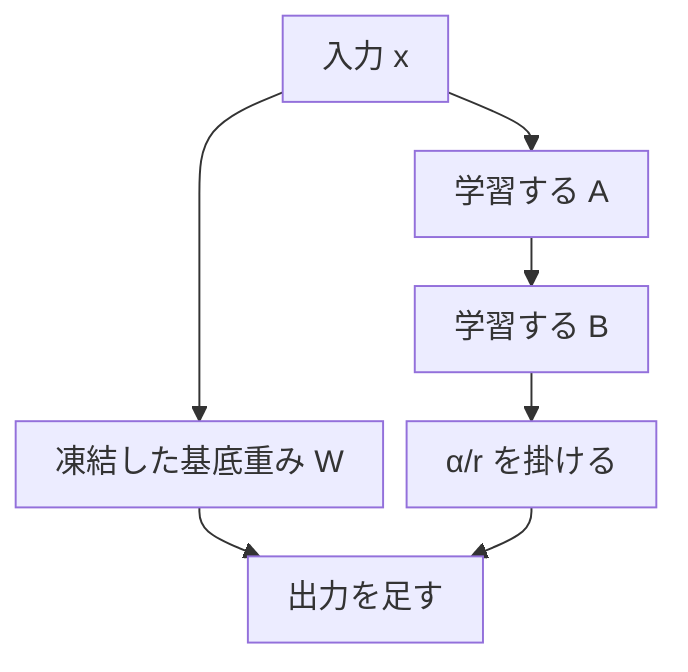

# LLMのファインチューニングとLoRAの仕組み — 基底重みを凍結し、差分だけを学ぶ

ゲームの不具合報告から、再現条件と発生頻度を決まった書式で抜き出すモデルを考えます。書式を毎回指示する方法もあれば、報告と期待する出力の例を使って、学習済みモデルをその用途に合わせて再学習する方法もあります。後者がファインチューニングです。LoRA（Low-Rank Adaptation）では、元のモデルの重みを固定し、選んだ層で足し合わせる更新分を、小さな2枚の行列で学びます。[LoRA原論文 §2・§4](https://arxiv.org/html/2106.09685v2#S4) · [LLMの文章生成](/algorithms/llm-text-generation.html)

## 何を変えるかで、プロンプトやRAGと区別する

| 方法 | 何を変えるか |
| --- | --- |
| プロンプト | 今回の入力に、指示や少数の例を追加する。 |
| RAG | 質問に応じて外部資料を検索し、推論で参照する情報を追加する。 |
| ファインチューニング | 学習済みモデルを出発点として、訓練データに基づき、推論で使うパラメーターを更新する。 |
| LoRA | ファインチューニングの一方式。基底重みを固定し、出力に加わる更新分を別のパラメーターとして学習する。 |

たとえば、不具合報告の書式を学ばせるのと、現在の修正状況を資料から引くのは別の仕事です。LoRAで書式を学ばせたモデルに、RAGで当日のチケット情報を渡すこともできます。ここで区別しているのは、推論時に資料を検索して入力を変える処理と、学習によって推論に使う重みを変える処理です。RAGを構成する検索器や生成器を別途訓練する設計もあります。[RAG原論文 §2](https://arxiv.org/abs/2005.11401) · [RAGの仕組み](/algorithms/retrieval-augmented-generation.html)

## 凍結したWに、低ランクの更新を足す

一つの線形層を考えます。入力 $x$ を列ベクトル、入力と出力の要素数をそれぞれ $d_{\mathrm{in}}$、$d_{\mathrm{out}}$ とします。基底重み $W$ の形は $d_{\mathrm{out}}\times d_{\mathrm{in}}$ です。LoRAでは、同じ入力に対して次の2経路を計算し、その出力を足します。$r$ は更新分が通る中間表現の要素数で、更新行列のランクの上限です。$\alpha$ は更新分の寄与を調整する定数です。この例ではバイアスを省略し、原論文の固定スケール $\alpha/r$ を使います。[LoRA原論文 §4.1](https://arxiv.org/html/2106.09685v2#S4.SS1)



| 行列 | 形状 | 働き |
| --- | --- | --- |
| $W$ | $d_{\mathrm{out}}\times d_{\mathrm{in}}$ | 基底の出力を作る。 |
| $A$ | $r\times d_{\mathrm{in}}$ | 入力から $r$ 個の値を求める。 |
| $B$ | $d_{\mathrm{out}}\times r$ | その $r$ 個を使い、出力と同じ長さにする。 |

$$
\Delta W=BA,\qquad y=Wx+(\alpha/r)B(Ax)
$$

積 $BA$ の形は $W$ と同じです。$B(Ax)$ は $B$ の $r$ 本の列を組み合わせた結果なので、更新行列 $\Delta W$ のランクは最大でも $r$ です。ランクを制限するのは更新分です。基底の $W$ や、更新を足したあとの行列全体のランクまで $r$ にする必要はありません。[LoRA原論文 §4.1](https://arxiv.org/html/2106.09685v2#S4.SS1) · [行列](/math/rendering/matrix.html)

## 何個のパラメーターを学ぶか {#何個のパラメータを学ぶか}

$A$ と $B$ だけを学習し、$\alpha$ とバイアスなどは学習対象に含めないとします。一つの $W$ の全要素を更新する場合は $d_{\mathrm{out}}d_{\mathrm{in}}$ 個です。LoRAで学ぶ要素は $rd_{\mathrm{in}}+d_{\mathrm{out}}r$ 個です。たとえば4行3列の $W$ に $r=1$ を使うと、$W$ の全12個に対して、$A$ の3個と $B$ の4個で計7個を学びます。

同じように4,096行4,096列の行列を1枚だけ対象にし、ランク8なら、全要素を更新する場合は16,777,216個、LoRAは65,536個で、比は $1/256$ です。複数の層や射影を対象にする場合は、その構成ごとに合計します。学習対象が減っても、基底重みを使う計算、活性値、更新する層へ必要な逆伝播は残ります。学習時間やメモリ全体が、パラメーター数と同じ比で減るとは限りません。[LoRA原論文 §4.2](https://arxiv.org/html/2106.09685v2#S4.SS2) · [PyTorch 2.15のAutograd mechanics](https://docs.pytorch.org/docs/2.15/notes/autograd.html#setting-requires-grad)

原論文の初期化では、$A$ を乱数で初期化し、$B$ をゼロにするため、最初の更新分 $BA$ はゼロです。学習時は両経路で出力を作り、その誤差をもとに $A$・$B$ を更新します。適応後の推論では学習済みの値を使って出力を計算し、パラメーターは更新しません。Transformerでは、たとえばAttentionのQやVを作る射影が対象になります。どの行列を選ぶかはモデルや学習の目的によります。[LoRA原論文 §4.1–4.2](https://arxiv.org/html/2106.09685v2#S4) · [TransformerとAttention](/algorithms/transformer-attention.html)

## 推論では別々に使うか、先にマージする

両経路に同じ入力を渡し、固定したアダプターとスケールを使う線形層を考えます。推論時はdropoutを無効にします。この条件では、分配法則と行列積の結合法則により、$W$ と $A$・$B$ の別々の経路を、一つの重みにまとめられます。

$$
W_{\mathrm{eff}}=W+(\alpha/r)BA,\qquad y=W_{\mathrm{eff}}x
$$

代数的には同じ出力です。マージ済みの層では、推論のたびに別の経路を計算する必要がなくなります。一方、重みを別々に置くと、基底を共有して用途に応じてアダプターを切り替えやすくなります。マージの可否は実装と格納形式にも依存します。有限精度では別々に計算する場合と丸め順が変わり、量子化した重みではマージ非対応の形式や、再量子化で誤差が加わる方式もあります。[LoRA原論文 §4.1](https://arxiv.org/html/2106.09685v2#S4.SS1) · [Hugging Face PEFTのマージ](https://huggingface.co/docs/peft/main/en/developer_guides/checkpoint#merge-the-weights) · [PEFTの量子化済み重みのマージ](https://huggingface.co/docs/peft/developer_guides/quantization#merging-adapters-into-quantized-weights) · [LLMの量子化](/algorithms/llm-quantization.html)

## 小さな行列で、足す前とマージ後を比べる

4行3列の `W` に対して、`A` は1行3列、`B` は4行1列です。手で決めた入力 `[2, -1, 3]` を使います。適応後を想定して `A` と `B` には固定値を入れ、`rank = 1`、`alpha = 2`、バイアスやdropoutなしとします。まず `Wx` と `B(Ax)` を別々に計算して足し、次にマージした重みに同じ入力を掛けます。

行列とベクトルの長さを `zip(..., strict=True)` で確認するため、Python 3.10以降で実行します。[Python組み込み関数のzip](https://docs.python.org/3.10/library/functions.html#zip)

```python
from fractions import Fraction


def dot(left, right):
    return sum(a * b for a, b in zip(left, right, strict=True))


def matvec(matrix, vector):
    return [dot(row, vector) for row in matrix]


def matmul(left, right):
    columns = list(zip(*right, strict=True))
    return [[dot(row, col) for col in columns] for row in left]


def add_scaled(base, update, scale):
    return [a + scale * b for a, b in zip(base, update, strict=True)]


if __name__ == "__main__":
    W = [[1, 0, -1], [0, 2, 1], [-1, 0, 2], [1, 1, 1]]
    A = [[1, -1, 2]]
    B = [[1], [-1], [2], [0]]
    x = [2, -1, 3]
    rank, alpha = 1, 2
    scale = Fraction(alpha, rank)

    base = matvec(W, x)
    low_rank = matvec(A, x)
    update = matvec(B, low_rank)
    split = add_scaled(base, update, scale)

    delta = matmul(B, A)
    merged_weights = [add_scaled(w, d, scale)
                      for w, d in zip(W, delta, strict=True)]
    merged = matvec(merged_weights, x)
    assert split == merged

    d_out, d_in = len(W), len(W[0])
    lora_count = rank * (d_in + d_out)
    print("Base:", base)
    print("Ax:", low_rank)
    print("BAx:", update)
    print("Split: [" + ", ".join(map(str, split)) + "]")
    print("Merged: [" + ", ".join(map(str, merged)) + "]")
    print(f"Trainable weights: LoRA {lora_count}, full {d_in * d_out}")
```

```text
Base: [-1, 1, 4, 4]
Ax: [9]
BAx: [9, -9, 18, 0]
Split: [17, -17, 40, 4]
Merged: [17, -17, 40, 4]
Trainable weights: LoRA 7, full 12
```

`Ax` は1要素の `[9]` です。これを `B` に通した結果を2倍し、`Wx` に加えると `[17, -17, 40, 4]` になります。図の2経路で計算しても、先に重みをマージしても、分数で正確に計算したこの例では同じ結果です。

## 何が良くなったかは、目的に合わせて測る

LoRAで学べる傾向は、訓練データ、対象の層、ランクなどに左右されます。期待する書式を学べたかを見るなら学習に使っていない報告で確認し、形式の適合と内容の正しさを別々に評価します。例に新事実を含めても、それを正確に答えたり、根拠を検索して提示したりできる保証はありません。速度や消費メモリは、基底の型、アダプターの適用方法、カーネルや実行環境も含めて比較します。[LoRA原論文 §5・§7](https://arxiv.org/html/2106.09685v2#S5) · [Gekhmanらの新知識に関するファインチューニングの実験](https://aclanthology.org/2024.emnlp-main.444/)

## 理解度チェック

::: details 基底重みWを凍結すると、Wの出力は推論で使われなくなる？
基底重みは引き続き出力に寄与します。別々の経路で計算するなら $Wx$ を求めて更新分を足し、マージした場合も有効重みに $W$ が含まれます。凍結は、学習時にそのパラメーターを更新しないという意味です。
:::

::: details 更新分を基底重みにマージすれば、どの実装でも出力はビット単位で同じ？
同じ線形式としてまとめられる条件では、代数上の出力が一致します。実装の浮動小数点の丸めや、量子化形式の再変換による差は別に確かめます。
:::

## 検証範囲

2026年11月20日に原論文と公式資料を確認し、WindowsのPython 3.12.4で教材の行列積、学習対象の要素数、別々の経路とマージ済みの重みの出力を検算しました。整数で表せる固定値を使った線形層1枚の検証です。勾配による学習、浮動小数点や量子化環境での一致、LLMの品質・速度・メモリは実測の対象外です。

## 関連項目

- [LLMの文章生成](/algorithms/llm-text-generation.html) — 学習済みの重みと推論時の入力を区別する。
- [RAGの仕組み](/algorithms/retrieval-augmented-generation.html) — 推論時に検索した資料をどう使うかを読む。
- [LLMの量子化](/algorithms/llm-quantization.html) — 重みの格納形式と、計算に使う型の違いを読む。
- [QLoRAの仕組み](/algorithms/qlora.html) — 差分を学ぶときに、4ビットで保持した基底が逆伝播でどう使われるかを読む。
- [TransformerとAttention](/algorithms/transformer-attention.html) — LoRAの対象になり得る線形射影が何を作るかを追う。

## 参考資料

- [Huら — LoRA: Low-Rank Adaptation of Large Language Models（ICLR 2022）](https://arxiv.org/html/2106.09685v2#S4)
- [Microsoft — 原著者のLoRA実装](https://github.com/microsoft/LoRA)
- [Hugging Face — PEFTのLoRA解説](https://huggingface.co/docs/peft/main/en/conceptual_guides/lora) · [重みのマージ](https://huggingface.co/docs/peft/main/en/developer_guides/checkpoint#merge-the-weights)
- [Lewisら — Retrieval-Augmented Generation for Knowledge-Intensive NLP Tasks（NeurIPS 2020）](https://arxiv.org/abs/2005.11401)
- [Gekhmanら — Does Fine-Tuning LLMs on New Knowledge Encourage Hallucinations?（EMNLP 2024）](https://aclanthology.org/2024.emnlp-main.444/)
