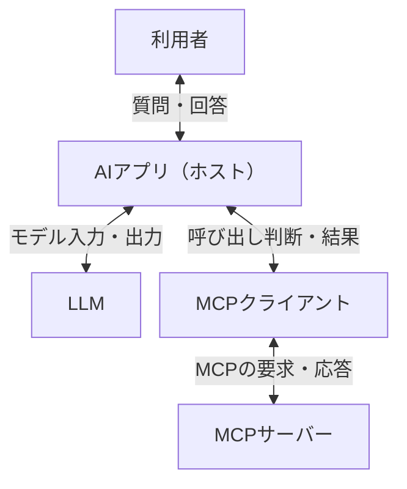
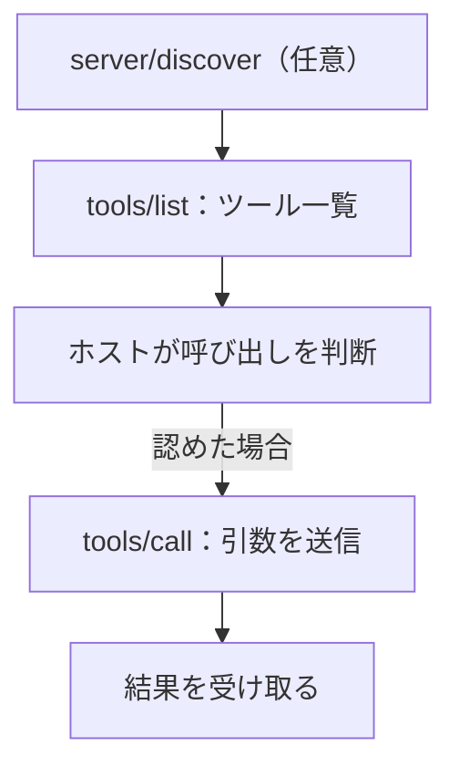

# MCPの仕組み — AIモデルと外部ツールをどうつなぐか

「60 fpsで90フレームは何秒？」とAIアプリに聞いたとします。モデルが換算ツールを使う案を出し、アプリがそれを呼んで結果を受け取れば、モデルはその値を使って答えられます。**MCP（Model Context Protocol）は、AIアプリ側のクライアントと、ツールや資料を提供するサーバーの間で、要求と応答をやり取りするための規約です。** この記事ではMCP公式仕様の **2026-07-28版** を扱います。[MCP公式仕様](https://modelcontextprotocol.io/specification/2026-07-28)

## ホスト・クライアント・サーバーの役割

**ホスト**は利用者が使うAIアプリです。モデルとのやり取りを担当し、どのサーバーを使えるようにするか、どのデータをどこへ渡すかを管理します。ホストは、やり取りするMCPサーバーごとに**MCPクライアント**を持ちます。**MCPサーバー**は機能を提供し、ツールの実行や資料の読み出しを引き受けます。サーバーはローカルの別プロセスでも、離れたサービスでも構いません。[MCP Architecture](https://modelcontextprotocol.io/specification/2026-07-28/architecture)



この例では、モデルの出力は「この名前のツールに、この引数を渡したい」という提案です。実際に要求を送るかはホストが判断し、送る場合はクライアントがMCPメッセージを作ります。結果を受け取ったあと、会話の次の入力へ何を含めるかもホストが決めます。既存のLLM記事で扱ったトークン生成は図のモデル側、MCPは図のクライアントとサーバーの間です。[MCP公式のArchitecture overview](https://modelcontextprotocol.io/docs/2026-07-28/learn/architecture) · [LLMの文章生成](/algorithms/llm-text-generation.html)

## サーバーが提供する三つの機能

同じゲーム開発支援サーバーでも、換算処理、参照できる資料、よく使う依頼の型では用途が違います。一つのサーバーが、このうち必要な機能を提供できます。

| 種類 | 役割とゲーム開発での例 |
| --- | --- |
| [Tools](https://modelcontextprotocol.io/specification/2026-07-28/server/tools) | `tools/list` で定義を知り、`tools/call` で処理を呼ぶ。たとえばフレーム数を秒に換算する。 |
| [Resources](https://modelcontextprotocol.io/specification/2026-07-28/server/resources) | `resources/list` で候補を知り、`resources/read` でURIを指定してデータを読む。たとえばアニメーションの命名規約を読む。 |
| [Prompts](https://modelcontextprotocol.io/specification/2026-07-28/server/prompts.md) | `prompts/list` で候補を知り、`prompts/get` で引数を渡してひな型を取得する。たとえばバグ報告を要約するためのメッセージを組み立てる。 |

仕様では、Toolsはモデルの提案から呼ぶ、Resourcesはアプリが会話に採り入れる、Promptsは利用者が選ぶ形を想定しています。実際の画面と操作方法はアプリによって変わります。ここから先の換算例では **Toolsだけ**を提供します。[Tools](https://modelcontextprotocol.io/specification/2026-07-28/server/tools) · [Resources](https://modelcontextprotocol.io/specification/2026-07-28/server/resources) · [Prompts](https://modelcontextprotocol.io/specification/2026-07-28/server/prompts.md)

## 能力を確認してから、ツールを呼ぶ

2026-07-28版では、クライアントが各要求の `params._meta` にプロトコル版と自分の対応能力を入れます。サーバーは要求ごとに対応する版かを判断します。サーバーの対応版と能力を先に知りたいときは `server/discover` を使えます。このメソッドはサーバーに実装必須で、クライアントから呼ぶかは任意です。2025-11-25以前の仕様では、接続の最初に `initialize` で版と能力を交換する方式でした。[Versioning and Compatibility](https://modelcontextprotocol.io/specification/2026-07-28/basic/versioning) · [Discovery](https://modelcontextprotocol.io/specification/2026-07-28/server/discover)

換算の例では、サーバーがToolsに対応していることを確認し、次にツール一覧から名前と引数の形式を取得します。`tools` という能力は機能の種類を示し、`frames_to_seconds` という個別のツールは一覧の中で分かります。



`frames_to_seconds` の定義は `inputSchema` で、`frames` を0以上の整数、`fps` を1以上の整数とします。両方とも必須です。以下は、ホストが呼び出しを認めたあとの**クライアントからサーバーへの要求本体**です。`clientCapabilities` の空オブジェクトは、このクライアントが追加の能力を申告していないことを示します。[Base Protocol](https://modelcontextprotocol.io/specification/2026-07-28/basic) · [Tools](https://modelcontextprotocol.io/specification/2026-07-28/server/tools)

```json
{
  "jsonrpc": "2.0",
  "id": 3,
  "method": "tools/call",
  "params": {
    "_meta": {
      "io.modelcontextprotocol/protocolVersion": "2026-07-28",
      "io.modelcontextprotocol/clientInfo": {
        "name": "study-host",
        "version": "1.0.0"
      },
      "io.modelcontextprotocol/clientCapabilities": {}
    },
    "name": "frames_to_seconds",
    "arguments": {
      "frames": 90,
      "fps": 60
    }
  }
}
```

**サーバーからクライアントへの応答**には同じ `id` が入ります。クライアントはこの値で要求と応答を対応づけます。換算結果の $90 / 60 = 1.5$ 秒は `content` に文字列として入ります。`resultType` の `complete` は最終結果であることを示し、ツールの処理が失敗した場合は結果の `isError` がその失敗を表せます。[Base Protocol](https://modelcontextprotocol.io/specification/2026-07-28/basic) · [Tools](https://modelcontextprotocol.io/specification/2026-07-28/server/tools)

```json
{
  "jsonrpc": "2.0",
  "id": 3,
  "result": {
    "resultType": "complete",
    "content": [
      {
        "type": "text",
        "text": "1.5 s"
      }
    ],
    "isError": false,
    "_meta": {
      "io.modelcontextprotocol/serverInfo": {
        "name": "frame-math",
        "version": "1.0.0"
      }
    }
  }
}
```

このJSON-RPCメッセージを運ぶ方法を**トランスポート**と呼びます。仕様には、子プロセスの標準入出力を使う `stdio` と、HTTPを使う Streamable HTTP があります。上のコードはどちらでも使うメッセージ本体です。HTTPの場合はプロトコル版などをHTTPヘッダーにも入れます。[Transports](https://modelcontextprotocol.io/specification/2026-07-28/basic/transports)

## 対応能力と実行の許可は別に決まる

一覧に出たツールを候補にできても、実行できるかは権限や入力次第です。たとえば、ビルド番号を読むツールと成果物を配布するツールが同じサーバーにあるとします。ホストは後者で送る情報と実行の影響を確かめ、設定されたポリシーに従って、必要なら利用者に確認します。サーバー側も、要求者が対象を操作できるか、引数が有効かを検査します。HTTP向けの認可仕様は、保護されたサーバーへ許可された範囲でアクセスするための仕組みを定めています。[MCP Architecture](https://modelcontextprotocol.io/specification/2026-07-28/architecture) · [ToolsのSecurity Considerations](https://modelcontextprotocol.io/specification/2026-07-28/server/tools#security-considerations) · [Authorization](https://modelcontextprotocol.io/specification/2026-07-28/basic/authorization)

要求の形式が正しくても、返された文書やツールの結果は提供元のデータです。ホストは、結果のどの部分をモデルに渡すか、どの操作を許すかを管理します。`server/discover` に含まれるサーバー名や版もサーバーの自己申告なので、接続先を信頼する判断には別の根拠が必要です。[Discovery](https://modelcontextprotocol.io/specification/2026-07-28/server/discover) · [Security Best Practices](https://modelcontextprotocol.io/docs/2026-07-28/tutorials/security/security_best_practices)

## 理解度チェック

::: details モデルがツール名と引数を返したら、誰が実際の要求を送る？
ホストが実行を判断し、MCPクライアントがサーバーへ要求を送ります。サーバーが処理を行い、クライアントに結果を返します。
:::

::: details 2026-07-28版では、版とクライアントの能力をどこで伝える？
各要求の `params._meta` です。必要に応じて `server/discover` から相手の対応版と能力を調べられます。
:::

::: details `tools` に対応するサーバーなら、成果物の配布も許可されている？
`tools` はツール機能に対応するという能力の宣言です。実行の許可はホストの判断とサーバー側のアクセス制御などで別に決まります。
:::

## 検証範囲

2026年11月18日に、WindowsのPython 3.12.4で架空の `server/discover`、`tools/list`、`tools/call` の要求と応答を3組検証しました。2026-07-28版の公式JSON Schemaの該当定義に照らし、要求IDの対応、能力の宣言、引数の形式、$90 / 60 = 1.5$ の結果を確認しました。引数を1つ欠く場合や `fps` が0の場合など、無効な入力も検査しました。[公式JSON Schema](https://github.com/modelcontextprotocol/modelcontextprotocol/blob/main/schema/2026-07-28/schema.json)

検証対象は教材用のJSONと換算式です。実際のMCPクライアントとサーバー間の通信、認可、モデルによるツール選択は仕様と公式文書に基づく説明です。

## 関連項目

- [LLMの文章生成](/algorithms/llm-text-generation.html) — モデルが文脈から次のトークンを選ぶ流れに戻る。
- [TransformerとAttention](/algorithms/transformer-attention.html) — モデル内部でトークン間の情報をどう混ぜるかを読む。
- [Agent Skillsの仕組み](/algorithms/agent-skills.html) — 手順と資料をまとめる形式と、外部ツールの接続をどう併用できるかを読む。
- [AIエージェントのハーネス](/algorithms/agent-harness.html) — 受け取ったツール結果をモデルに戻し、実行を続けるか判断する流れを読む。
- [Function callingと構造化出力](/algorithms/function-calling-and-structured-outputs.html) — モデル側のツール呼び出し要求と、アプリが検査する引数の形を読む。
- [RAGの仕組み](/algorithms/retrieval-augmented-generation.html) — 外部資料を検索して回答の入力に使う構成を読む。

## 参考資料

- [MCP公式仕様 2026-07-28 — 概要](https://modelcontextprotocol.io/specification/2026-07-28)
- [MCP公式文書 — Architecture overview](https://modelcontextprotocol.io/docs/2026-07-28/learn/architecture)
- [MCP公式仕様 — Versioning and Compatibility](https://modelcontextprotocol.io/specification/2026-07-28/basic/versioning)
- [MCP公式仕様 — Discovery](https://modelcontextprotocol.io/specification/2026-07-28/server/discover)
- [MCP公式仕様 — Tools](https://modelcontextprotocol.io/specification/2026-07-28/server/tools) · [Resources](https://modelcontextprotocol.io/specification/2026-07-28/server/resources) · [Prompts](https://modelcontextprotocol.io/specification/2026-07-28/server/prompts.md)
- [MCP公式仕様 — Authorization](https://modelcontextprotocol.io/specification/2026-07-28/basic/authorization) · [Security Best Practices](https://modelcontextprotocol.io/docs/2026-07-28/tutorials/security/security_best_practices)
