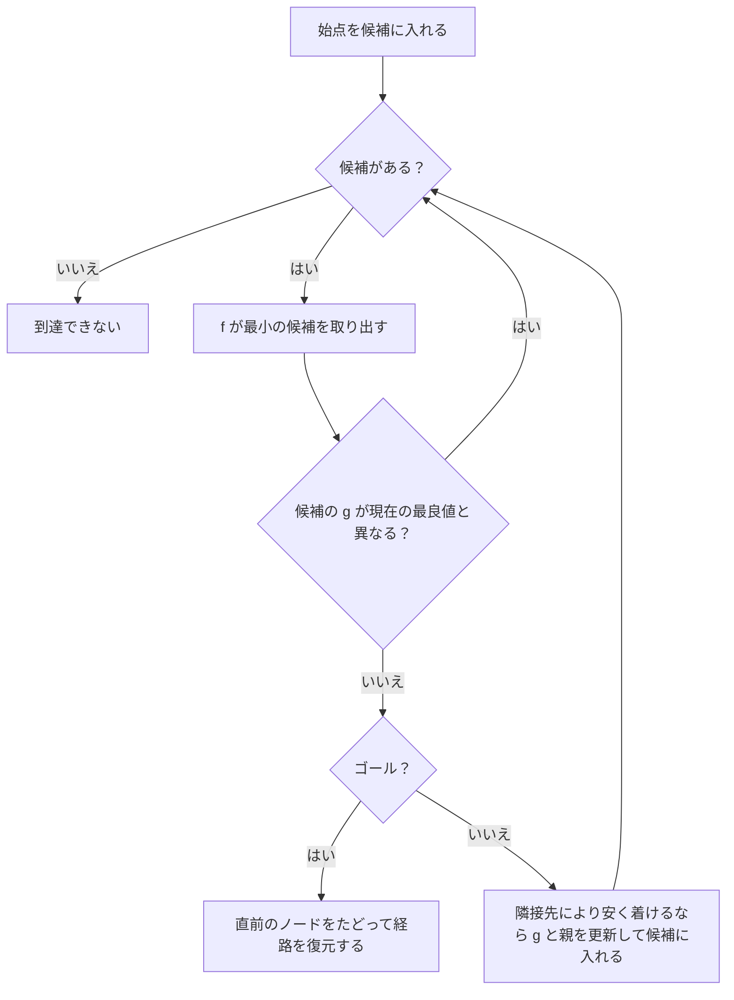

# 経路探索 — A* とナビメッシュ

NPCが別の部屋にいるプレイヤーへ近づくには、どの通路と扉を通るかを決める必要があります。**経路探索**では、移動できる場所とつながりをグラフにし、始点から終点に達する辺の列を求めます。各辺に距離や移動時間などのコストを付けると、何を優先するかを探索に反映できます。

## 移動できる場所をグラフにする

| 表現 | ノード | 辺 | ゲームで決めること |
| --- | --- | --- | --- |
| グリッド | タイルやセル | 上下左右や斜めの隣接 | 壁、地形ごとのコスト、斜めに進むときに壁の角を通れるか |
| ウェイポイント | 通路の分岐や扉などに置いた点 | 点から点へ移動できる区間 | 点の配置、段差など一方向だけ通れる接続 |
| ナビメッシュ | 歩行可能な領域を分割したポリゴン | 隣接ポリゴン間の境界や特殊な接続 | キャラクターの半径、段差や傾斜の上限、ジャンプやはしごの接続 |

坂を避けたい場合は坂の辺のコストを高くし、通行できない場合は辺を取り除きます。どの辺を作るかはキャラクターにもよります。幅の狭い通路を小型のキャラクターだけが通れる場合、必要な幅は移動可能領域を生成するときの条件になります。[Recastのナビメッシュ生成](https://recastnav.com/md_Docs_2__1__Introduction.html)

## BFS、Dijkstra法、A*で探索順を決める

| 手法 | 次に調べるノード | 最短経路を求められる条件 |
| --- | --- | --- |
| 幅優先探索（BFS） | [キュー](/algorithms/queues-and-deques.html)に先に入ったノード | すべての辺のコストが同じ |
| Dijkstra法 | 始点からの暫定コスト `g` が最小のノード | 辺のコストが非負 |
| A* | `f = g + h` が最小のノード | 辺のコストが非負で、ヒューリスティックと実装が下記の条件を満たす |

`h` は、そこからゴールまでにかかる残りコストの見積もりです。Dijkstra法は `h = 0` のA*としても実装できます。Dijkstra法とA*の候補の管理には、最小の優先度を取り出せる[二分ヒープ](/algorithms/binary-heaps.html)を使えます。より安い経路で同じノードに到達したら、暫定コストと直前のノードを更新します。下図の実装は、優先度を更新した候補を追加し、古い候補を取り出したときに破棄します。[Dijkstraの原論文](https://doi.org/10.1007/BF01386390)、[A*の原論文](https://doi.org/10.1109/TSSC.1968.300136)



ゴールへの候補を初めて追加した時点では、別の経路でより安く到達できる可能性があります。この実装では、現在の最良の `g` を持つゴールの候補をヒープから取り出した時点で終了します。

### 見積もりを過大にしない

- **許容的（admissible）**な `h` は、各ノードからゴールまでの真の最小コスト以下です。ゴールで `h = 0` とし、展開済みのノードにもより安い経路が見つかったら再び候補に入れると、最短経路を求められます。
- **整合的（consistent）**な `h` は、どの辺 `u → v` でも `h(u) ≤ cost(u, v) + h(v)` を満たします。ゴールで `h = 0` なら、辺に沿ってこの不等式を足すことで許容性も得られます。整合的な場合、最小の `f` を持つ候補として一度展開したノードの `g` は、あとからより小さくなることがありません。

上下左右に1マスずつ、1回あたり1以上のコストで進むグリッドでは、横と縦のマス数の差の絶対値を足したマンハッタン距離が使えます。1回でその和は最大1しか減らないため、整合的です。斜め1歩のコストが1なら、斜め隣のゴールに対するマンハッタン距離は2となり、最短コストの1を超えます。移動規則やコストを変えたら `h` の条件も確かめます。[A*の原論文](https://doi.org/10.1109/TSSC.1968.300136)、[著者らの訂正（1972年）](https://cse.sc.edu/~mgv/csce580sp15/astarHNR1972.pdf)

## C++20でグリッドを探索する

上下左右に進めるマップを使います。`S` が始点、`G` がゴール、`#` が壁です。セルに入るコストは `9` が9、その他の通行可能なセルが1です。BFSで歩数だけを数えると上端の7歩が最短ですが、その経路のコストは `6 × 9 + 1 = 55` です。3行目を経由すると11歩でコスト11になり、下のプログラムではDijkstra法とA*の両方がそのコストの経路を見つけます。

<p><a href="/study/samples/algorithms/pathfinding/grid_pathfinding.cpp" download>grid_pathfinding.cppをダウンロード</a></p>

<<< @/public/samples/algorithms/pathfinding/grid_pathfinding.cpp{cpp}

Visual Studioのx64 Native Tools Command Promptで、ダウンロードしたファイルのあるフォルダーに移動して実行します。

```bat
cl /nologo /std:c++20 /permissive- /EHsc /W4 /WX grid_pathfinding.cpp
.\grid_pathfinding.exe
```

```text
Dijkstra: cost=11, expanded=30
A*: cost=11, expanded=16
S999999G
*#....#*
********
...##...
........
Disconnected: no path
Start equals goal: cost=0
```

`*` がA*の経路です。`expanded` はヒープから取り出した有効な候補の数で、ゴールも含みます。ヒープに残った古い候補の読み飛ばしは数えません。この地図と同点時の優先規則では、残り距離を使ったA*のほうが調べたノードは少なくなりました。探索時間を測る場合は、ヒープの操作や `h` の計算も含めて計測します。

## ナビメッシュでポリゴン列から曲がり角を求める

ナビメッシュのグラフで探索すると、始点から終点までに通るポリゴンの列が得られます。この列が作る通行領域を**コリドー**と呼び、隣り合うポリゴンの共有辺を**ポータル**として扱います。ファネルアルゴリズムは、現在の曲がり角から先のポータルを順に見て、直進できる範囲の左右の境界を狭めます。片側の境界を更新すると反対側の境界を越えるときは、その反対側の頂点を次の曲がり角にし、そこから処理を再開します。曲がり角を結んだ線は選ばれたコリドーを通ります。コリドーの選び方によって、マップ全体で得られる経路の長さは変わります。[Detourの経路クエリAPI](https://recastnav.com/classdtNavMeshQuery.html)、[ポータルを使う実装](https://github.com/recastnavigation/recastnavigation/blob/main/Detour/Source/DetourNavMeshQuery.cpp)


**Recast**は入力の三角形をボクセル化し、キャラクターが歩ける領域をポリゴンに変換します。**Detour**は生成したナビメッシュを使い、実行時に `findPath` でポリゴンの列、`findStraightPath` でコリドー内の曲がり角を求めます。部分経路が返る場合もあるので、完全な経路を要求する処理では、結果のステータスと最後のポリゴンを確認します。ジャンプなどの特殊な接続を経路に含めた場合は、その区間に対応する動作を呼び出します。[Recastの生成工程](https://recastnav.com/md_Docs_2__1__Introduction.html)、[Detourの経路クエリAPI](https://recastnav.com/classdtNavMeshQuery.html)

- **Unreal Engine 5.7**のNavigation Systemは、レベルの衝突形状を使ってタイル単位のナビメッシュを作ります。生成モードにはStatic、Dynamic、Dynamic Modifiers Onlyがあり、エリアごとのコストも設定できます。[Unreal Engine 5.7のNavigation System](https://dev.epicgames.com/documentation/en-us/unreal-engine/navigation-system-in-unreal-engine?application_version=5.7)
- **Unity 6.0のAI Navigation 2.0系**では、`NavMeshSurface` で対象の形状からエージェント用のナビメッシュを生成し、`NavMeshLink` で分かれた領域をつなげられます。`NavMeshAgent.SetDestination` で目的地を指定すると、結果が出るまで `pathPending` が数フレームにわたって真になる場合があります。[Unity 6.0のAI Navigation](https://docs.unity3d.com/6000.0/Documentation/Manual/com.unity.ai.navigation.html)、[NavMeshSurface](https://docs.unity3d.com/Packages/com.unity.ai.navigation@2.0/manual/NavMeshSurface.html)、[NavMeshLink](https://docs.unity3d.com/Packages/com.unity.ai.navigation@2.0/manual/NavMeshLink.html)、[SetDestination](https://docs.unity3d.com/6000.0/Documentation/ScriptReference/AI.NavMeshAgent.SetDestination.html)

## 障害物が動くときと、探索を1フレームで終えられないとき

同じ通路を歩く別のキャラクターとすれ違うだけなら、コリドーを保ったまま、近くの衝突を避けるように速度や方向を調整できます。扉が閉じて通れなくなった場合は、通行不可になった接続をグラフに反映し、その接続を使う経路を再計算します。経路の再計算が必要かどうかは、障害物が動いた事実と、現在の経路を無効にしたかどうかを分けて考えると判断できます。[Unreal Engine 5.7の生成モードと回避方式](https://dev.epicgames.com/documentation/en-us/unreal-engine/navigation-system-in-unreal-engine?application_version=5.7)

- **探索を分割する**。1回に展開するノード数に上限を設け、候補、コスト、親を保持して続きから進めます。Detourには `initSlicedFindPath`、`updateSlicedFindPath`、`finalizeSlicedFindPath` があります。途中で地図を更新する設計なら、保持した探索状態が新しい地図でも有効かを確認します。[Detourの分割クエリAPI](https://recastnav.com/classdtNavMeshQuery.html)
- **階層を作る**。HPA*では地図を領域に分け、境界をまたぐ出入口と、領域内の出入口間コストを用意します。遠距離は上位グラフで探索し、選んだ区間を具体的な移動に展開します。前計算と保存領域を使って探索を減らせます。出入口の抽出方法によっては最短経路より長くなり、地図が変わる場合は影響を受けた区間の情報を更新します。[HPA*の原論文](https://www.academia.edu/14521553/Near_optimal_hierarchical_path_finding)

## 時間とメモリ

頂点数を `V`、辺数を `E` とし、隣接リストと探索用の追加メモリを分けて数えます。

| 実装 | 最悪時間 | 追加メモリ |
| --- | --- | --- |
| BFS | `O(V + E)` | `O(V)` |
| Dijkstra法・整合的なA*（古い候補を残す二分ヒープ） | `O((V + E) log(V + E))` | `O(V + E)` |

整合的なA*で `h` を定数時間で計算できるとします。各ノードからの辺を最大1回調べ、緩和に成功するたびにヒープへ候補を追加します。各候補の追加・取り出しはヒープの要素数に対して対数時間で、古い候補を保持する分だけヒープが大きくなり得ます。実際に測るときは、展開数と探索時間に加えて、ヒープの最大要素数や再探索の頻度も記録するとコストの原因を追えます。[二分ヒープ](/algorithms/binary-heaps.html)

## 理解度チェック

1. 泥のマスを通ると通常の9倍のコストがかかる地図で、BFSは何を最小にしますか。総コストを最小にするにはどの手法が使えますか。
2. 斜め移動のコストを1にしたグリッドで、マンハッタン距離は許容的ですか。
3. ナビメッシュで経路が見つかったあと、ファネルは何を求めますか。その経路上の扉が閉じて通れなくなったら、どこからやり直しますか。

::: details 解答
1. BFSは移動回数を最小にします。辺のコストが非負なので、総コストにはDijkstra法を使えます。移動規則に合ったヒューリスティックがあればA*も使えます。
2. 許容性を満たしません。斜め隣のゴールまでのコストは1ですが、マンハッタン距離は2です。
3. ファネルは、ポリゴン列が作るコリドー内の曲がり角を求めます。扉の接続を通行不可に更新してポリゴン列を探索し直し、新しいコリドーから曲がり角を求めます。
:::

## 関連項目

- [キューとデック](/algorithms/queues-and-deques.html)
- [二分ヒープ](/algorithms/binary-heaps.html)
- [ビヘイビアツリーとブラックボード](/game/patterns/behavior-tree-and-blackboard.html)
- [当たり判定と物理](/game/basics/collisions-and-physics.html)

## 参考資料

- Dijkstra, *A note on two problems in connexion with graphs*（1959年）。[原論文](https://doi.org/10.1007/BF01386390)
- Hart, Nilsson, Raphael, *A Formal Basis for the Heuristic Determination of Minimum Cost Paths*（1968年）。[原論文](https://doi.org/10.1109/TSSC.1968.300136)、[著者らの訂正（1972年）](https://cse.sc.edu/~mgv/csce580sp15/astarHNR1972.pdf)
- Botea, Müller, Schaeffer, *Near Optimal Hierarchical Path-Finding*（2004年）。[原論文](https://www.academia.edu/14521553/Near_optimal_hierarchical_path_finding)
- [Recast公式資料](https://recastnav.com/md_Docs_2__1__Introduction.html)、[Detour公式API](https://recastnav.com/classdtNavMeshQuery.html)
- [Unreal Engine 5.7 Navigation System](https://dev.epicgames.com/documentation/en-us/unreal-engine/navigation-system-in-unreal-engine?application_version=5.7)、[Unity 6.0 AI Navigation](https://docs.unity3d.com/6000.0/Documentation/Manual/com.unity.ai.navigation.html)
