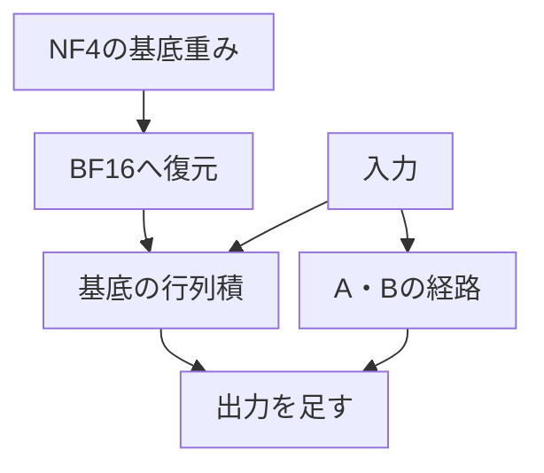
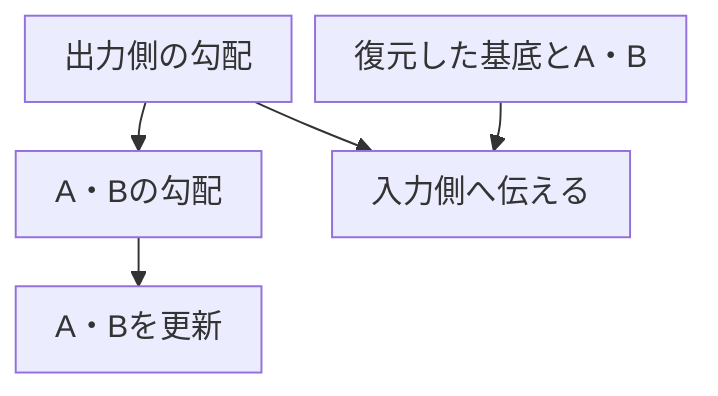

# QLoRAの仕組み — 4ビットで保存した基底重みを凍結し、差分だけを学ぶ

LoRAで学習するのは小さなアダプターですが、学習中は、大きな基底モデルも読み出して計算に使います。QLoRAでは基底モデルの対象となる重みを4ビットに量子化して保持し、その値を固定したままLoRAの差分を学びます。基底を保存する型、行列積に使う型、学習で更新する値を分けると、何の容量が減るのかが分かります。[QLoRA原論文 §2–3](https://arxiv.org/html/2305.14314v1#S3) · [LoRAの仕組み](/algorithms/lora-fine-tuning.html) · [LLMの量子化](/algorithms/llm-quantization.html)

## この記事で分かること

基底重みを保存するビット幅、行列積に使う型、学習で更新するアダプターを区別できます。容量の例から、二重量子化がどのデータを小さくするか説明できます。

## 保存は4ビット、行列積には復元した値を使う

比較のため、通常のLoRA側では、対象の基底重みをBF16（16ビット浮動小数点）で保持する構成を考えます。QLoRA側は原論文の線形層の例です。**凍結**は、学習でそのパラメーターを更新しないという意味です。[QLoRA原論文 §3](https://arxiv.org/html/2305.14314v1#S3)

| 構成 | 基底を保持する形式 | 学習で更新する値 |
| --- | --- | --- |
| LoRA | BF16。この比較での設定。 | アダプターのA・B |
| QLoRA | NF4の4ビットコードとスケール。 | アダプターのA・B |

**NF4**（NormalFloat 4）は、重みの値を表す4ビットの形式です。4ビットのコードは16通りあり、正規分布の分位点をもとに設計された、不等間隔の値に対応します。0も含まれます。量子化するときは重みをブロックに分け、ブロック内の絶対値の最大値で正規化してからコードに置き換えます。コードとブロックのスケールを使うと、元の重みの近似値を復元できます。[QLoRA原論文 §2–3・付録E](https://arxiv.org/html/2305.14314v1#S3)

原論文では、基底を使うときにBF16へ復元してから行列積を計算します。BF16はこの例の演算に渡す型です。積を足し合わせるときの型や、最適化器が状態を持つ型までBF16でそろうとは限りません。実装では、値がNF4コードであることと、コードを詰める容器の型も分けます。たとえばbitsandbytesでは量子化方式、容器の型、演算の型を別に指定できます。どの単位で復元し、一時領域をどれだけ使うかはカーネルに依存します。[QLoRA原論文 §3](https://arxiv.org/html/2305.14314v1#S3) · [bitsandbytesの4ビット層](https://huggingface.co/docs/bitsandbytes/reference/nn/linear4bit) · [FSDP-QLoRAの型の説明](https://huggingface.co/docs/bitsandbytes/main/en/fsdp_qlora)



## 基底は凍結しても、勾配は入力側へ通る

入力 $x$ を列ベクトル、復元した基底重みを $\widehat{W}$、LoRAの固定倍率を $\lambda$ とすると、バイアスを省いた線形層の出力は次のようになります。QLoRAで変わるのは基底に使う値の保持・復元です。アダプターでは、LoRAと同じようにA・Bを学びます。

$$
y=\widehat{W}x + \lambda B(Ax)
$$

学習時は、出力と教師データから損失を計算し、出力側の勾配を受け取ります。その勾配からA・Bの勾配を計算して更新し、基底の4ビットコードやスケールは固定します。手前の層にも学習対象があるなら、入力側へ勾配を送る計算が残ります。たとえば出力側の勾配を $g$ とすると、基底経路 $\widehat{W}x$ から入力側へ返る分は $\widehat{W}^{\mathsf{T}}g$ です。基底を使って勾配を伝えることと、基底の重みを更新することは別です。[QLoRA原論文 §3](https://arxiv.org/html/2305.14314v1#S3) · [PyTorchの凍結と勾配の説明](https://docs.pytorch.org/docs/2.15/notes/autograd.html#setting-requires-grad)



推論時は、固定した基底と学習済みのアダプターで出力を計算します。学習時のような逆伝播や最適化器の更新はありません。アダプターを別に載せるかマージするかは配備の選択です。量子化形式によってはマージに対応せず、復元・加算・再量子化する方式では丸めによる差も生じます。[PEFTの量子化済み重みのマージ](https://huggingface.co/docs/peft/developer_guides/quantization#merging-adapters-into-quantized-weights) · [LoRAのマージ](/algorithms/lora-fine-tuning.html)

## NF4、二重量子化、ページングは何を減らすか

- **NF4** は、基底重みそのものを4ビットのコードで保持する方式です。
- **二重量子化**（Double Quantization）は、ブロックごとのスケールも低ビットにする方式です。復元時は、二段目のスケールを使って一段目のスケールを求めてから、NF4コードを復元します。
- **ページ付き最適化器**（Paged Optimizers）は、Adamなどが更新量を決めるために保持する状態を、メモリの負荷に応じてCPUとGPUの間でページ単位に移せるようにします。学習時の一時的なVRAM不足に対処する仕組みです。ページの移動には転送時間がかかり得ます。

原論文では、基底重み64個ごとのスケールをFP8で表し、そのスケール256個ごとに二段目のFP32スケールを持ちます。ページ付き最適化器が扱うのは学習の更新に必要な状態です。推論中の過去のK・Vを保持するKVキャッシュとは役割が違います。[QLoRA原論文 §3](https://arxiv.org/html/2305.14314v1#S3) · [bitsandbytesのページ付き最適化器](https://huggingface.co/docs/bitsandbytes/explanations/optimizers#paged-optimizers) · [KVキャッシュ](/algorithms/kv-cache.html)

## 重みとスケールの容量を見積もる

対象の基底重みを16,384個とします。64個で1ブロックなら256ブロックで、スケールの二段目もちょうど1ブロックです。各値を隙間なく詰めたときの、重みとスケールだけの容量を比べます。原論文の1重みあたりの概算と同じく、平均を引くためのオフセット、コード表、ヘッダー、アラインメントの空きはこの計算の外です。[QLoRA原論文 §3のDouble Quantization](https://arxiv.org/html/2305.14314v1#S3)

| 基底の格納方法 | 容量の内訳 |
| --- | --- |
| BF16 | 重み32,768 B |
| NF4＋FP32スケール | 重み8,192 B＋スケール1,024 Bで9,216 B |
| NF4＋二重量子化 | 重み8,192 B＋一段目256 B＋二段目4 Bで8,452 B |

次のコードは重みの値を量子化せず、コードとスケールの個数からバイト数を数えます。分数の小数書式を使うためPython 3.12以降で実行します。

```python
from fractions import Fraction

# 64重みで1ブロック、256スケールで二段目の1ブロック。
# コード表・平均値のオフセット・パディングは容量に含めない。
weights = 16_384
first_blocks = weights // 64
second_blocks = first_blocks // 256
assert weights == first_blocks * 64 and first_blocks == second_blocks * 256

baseline = weights * 2           # 基底を16ビットで保持する場合
nf4_codes = weights // 2         # 4ビット×2個を1バイトに格納
plain_scales = first_blocks * 4   # FP32を1ブロックにつき1個
scale_codes = first_blocks       # 二重量子化ではFP8を1個ずつ
outer_scales = second_blocks * 4  # 二段目にFP32を1個ずつ

single = nf4_codes + plain_scales
double = nf4_codes + scale_codes + outer_scales
single_bits = Fraction(single * 8, weights)
double_bits = Fraction(double * 8, weights)

print(f"16ビットの基底: {baseline:,} B")
print(f"NF4コード: {nf4_codes:,} B")
print(f"二重量子化なし: {single:,} B（スケール {plain_scales:,} B）")
print(
    f"二重量子化あり: {double:,} B"
    f"（FP8 {scale_codes:,} B + FP32 {outer_scales:,} B）"
)
print(f"重み1個あたり: {single_bits:.3f} → {double_bits:.9f} bit")
print(f"節約: {single - double:,} B、重み1個あたり {single_bits - double_bits:.9f} bit")
print(f"16ビット基底に対する割合: {Fraction(double, baseline) * 100:.2f}%")
```

```text
16ビットの基底: 32,768 B
NF4コード: 8,192 B
二重量子化なし: 9,216 B（スケール 1,024 B）
二重量子化あり: 8,452 B（FP8 256 B + FP32 4 B）
重み1個あたり: 4.500 → 4.126953125 bit
節約: 764 B、重み1個あたり 0.373046875 bit
16ビット基底に対する割合: 25.79%
```

この仮定では、二重量子化によってスケール分が764 B、重み1個あたり約0.373ビット減ります。16ビットで保持した場合の25.79%は、表にある重みとスケールの合計を比べた値です。

実際の学習では、表で数えた基底以外に、量子化対象外の重み、A・B、活性値、勾配、最適化器の状態、演算の作業領域も使います。学習時の最大VRAMは、これらを含めて考えます。復元やページ転送にかかる時間、対応するカーネル、入力長とバッチも実行時間に影響します。品質は利用するモデルとタスクの評価で確認します。原論文の比較も、対象モデルとタスクが定まった実験です。[QLoRA原論文 §4・§8・付録G](https://arxiv.org/html/2305.14314v1#S8)

## 要点

- 量子化の対象となる基底重みはNF4の4ビットコードとスケールで保持し、学習中は固定します。学習で更新するのはLoRAアダプターのA・Bです。
- 原論文の例では、基底重みをBF16に復元して行列積に使います。手前の層に勾配を伝えるときにも、復元した基底を使います。
- 二重量子化ではスケールの格納容量を減らします。ページングでは、最適化器の状態をCPUとGPUの間でページ単位に移せるようにします。
- 学習時の最大VRAMを見積もるときは、基底の格納容量に加えて、アダプター、活性値、勾配、最適化器の状態、作業領域なども考えます。

## 理解度チェック

::: details 基底を凍結すると、手前の層へ勾配を送る計算も省ける？
基底のパラメーターの更新は省けます。手前へ勾配を伝える場合は、復元した基底も使って入力側の勾配を計算します。
:::

::: details 二重量子化を使うと、基底の4ビットコードがさらに短くなる？
この構成で短くするのはブロックのスケールです。基底の重みを表すNF4コードは4ビットのままです。
:::

## 検証範囲

2026年11月20日に原論文と公式資料を確認し、WindowsのPython 3.12.4で容量と1重みあたりのビット数を検算しました。検証は格納容量の算術に限ります。実GPUのピークVRAM、学習時間、推論速度、モデルの品質、ページ転送の挙動は実測の対象外です。

## 関連項目

- [LLMのファインチューニングとLoRAの仕組み](/algorithms/lora-fine-tuning.html) — 凍結した基底に足す更新分と、A・Bの形を読む。
- [LLMの量子化](/algorithms/llm-quantization.html) — スケールと復元、保存形式と演算精度の区別を確かめる。
- [KVキャッシュ](/algorithms/kv-cache.html) — 推論中に保持するK・Vとモデル重みの容量を区別する。

## 参考資料

- [Dettmersら — QLoRA: Efficient Finetuning of Quantized LLMs（NeurIPS 2023）](https://arxiv.org/abs/2305.14314) · [原論文 §3](https://arxiv.org/html/2305.14314v1#S3)
- [bitsandbytes公式 — 4-bit quantization](https://huggingface.co/docs/bitsandbytes/reference/nn/linear4bit) · [FSDP-QLoRA](https://huggingface.co/docs/bitsandbytes/main/en/fsdp_qlora) · [Paged optimizers](https://huggingface.co/docs/bitsandbytes/explanations/optimizers#paged-optimizers)
- [Hugging Face PEFT — 量子化済み重みとアダプターのマージ](https://huggingface.co/docs/peft/developer_guides/quantization#merging-adapters-into-quantized-weights)
