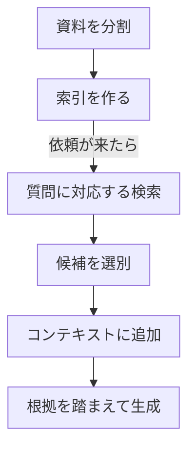

# RAGの仕組み — 検索した資料をどう回答に使うか

「ビルドr18をPC-Aで動かしたとき、影を軽くした前後のフレーム時間は？」という質問に答えるには、その条件の計測記録が要ります。**RAG**（Retrieval-Augmented Generation、検索拡張生成）は、質問に合わせて資料を検索し、その結果をモデルへの入力に加えて回答を生成する考え方です。前回のコンテキスト管理では入力に何を残すかを見ました。ここでは、必要な資料をどう見つけ、回答に使える状態にするかを扱います。[AIエージェントのコンテキスト管理](/algorithms/agent-context-management.html) · [Lewisらの原論文](https://arxiv.org/abs/2005.11401)

## この記事で分かること

- 質問に合う資料の断片を見つけ、出典を添えてモデルへ渡す流れを説明する。
- 検索の順位が高い候補でも、ビルドや計測機材の条件が違えば根拠に使えないと判断する。

## 資料の準備と、質問が来てからの処理

計測ログや設計文書を丸ごと渡すと、質問と関係のない内容も入力枠を使います。そこで、見出しや段落を手掛かりに、検索単位の**断片**（チャンク）に分けます。断片を語やベクトル（数値の並び）から探せるように整えたデータが**索引**です。

計測値と条件が別々の断片に分かれそうなら、断片に条件や見出しを添えます。元のファイル名と節、版や日付、アクセスに必要な属性もひもづけます。[Microsoft Learnの資料分割ガイド](https://learn.microsoft.com/en-us/azure/architecture/ai-ml/guide/rag/rag-chunking-phase) · [検索索引とフィルター](https://learn.microsoft.com/en-us/azure/architecture/ai-ml/guide/rag/rag-information-retrieval)



質問が来たら、たとえば `影` と `フレーム時間` を検索語にし、`r18` と `PC-A` を条件にします。許可された範囲で候補を集め、質問との関連度と条件を確認します。

採用した本文と出典を質問と一緒にモデルへ渡し、根拠を使って答えるよう求めます。[根拠を使う指示の設計](https://learn.microsoft.com/en-us/azure/architecture/ai-ml/guide/rag/rag-prompt-engineering#design-grounding-instructions)

## 小さな計測ログ集合を検索する

架空の計測ログ4件を、分割済みの断片として用意します。`source` は資料IDです。`build`、`pc`、`scope` は元資料に付けた属性です。`tags` は人が付けた検索用の語で、空白で区切っています。資料の本文を解析する代わりに、各タグから該当する断片を引ける索引を作ります。ここでは `public` の資料だけを索引に入れます。

検索では、条件に合う断片について、一致した**異なるタグの数**を点数にします。同点なら資料ID順に並べ、上位2件までを返します。いずれのタグも一致しなければ候補は0件です。この点数は、本文の信頼性や計測値の正しさを測るものではありません。

```python
from collections import Counter, defaultdict
from dataclasses import dataclass


@dataclass(frozen=True)
class Chunk:
    source: str
    build: str
    pc: str
    scope: str
    tags: str
    text: str


CHUNKS = (
    Chunk("bench-00", "r18", "PC-A", "team-only", "影 フレーム時間", "チーム内資料"),
    Chunk("bench-01", "r17", "PC-A", "public", "影 フレーム時間", "19 ms → 13 ms"),
    Chunk("bench-02", "r18", "PC-B", "public", "影 フレーム時間", "16 ms → 10 ms"),
    Chunk("bench-03", "r18", "PC-A", "public", "影 計測", "18 ms → 12 ms"),
)


def build_index(chunks, allowed_scopes):
    index = defaultdict(list)
    for chunk in chunks:
        if chunk.scope in allowed_scopes:
            for tag in set(chunk.tags.split()):
                index[tag].append(chunk)
    return index


def search(index, query, *, build=None, pc=None, limit=2):
    scores = Counter()
    for term in set(query.split()):
        for chunk in index.get(term, ()):
            if build is not None and chunk.build != build:
                continue
            if pc is not None and chunk.pc != pc:
                continue
            scores[chunk] += 1
    return sorted(scores.items(), key=lambda pair: (-pair[1], pair[0].source))[:limit]


if __name__ == "__main__":
    index = build_index(CHUNKS, {"public"})
    for label, query, filters in (
        ("条件なし", "影 フレーム時間", {}),
        ("条件あり", "影 フレーム時間", {"build": "r18", "pc": "PC-A"}),
        ("別の表記", "シャドウ", {"build": "r18", "pc": "PC-A"}),
    ):
        print(label)
        candidates = search(index, query, **filters)
        for chunk, score in candidates:
            print(f"  {chunk.source} {chunk.build}/{chunk.pc} {score}点: {chunk.text}")
        if not candidates:
            print("  根拠候補なし")
```

```text
条件なし
  bench-01 r17/PC-A 2点: 19 ms → 13 ms
  bench-02 r18/PC-B 2点: 16 ms → 10 ms
条件あり
  bench-03 r18/PC-A 1点: 18 ms → 12 ms
別の表記
  根拠候補なし
```

ビルドとPCを指定しないと、タグが2つ一致する別条件の資料が先に出ます。`r18` と `PC-A` の両方で絞ると、1点の `bench-03` が候補になります。`シャドウ` では、`影` を同じ意味として扱わないため、資料が索引にあっても取得できません。チーム内資料の `bench-00` は、この例の公開向け索引には入りません。

このコードの出力は検索結果です。生成側に渡す場合は、候補の本文と条件、資料IDを一緒に含めます。人が回答例を書くなら「`bench-03` のr18・PC-Aでは、影を軽くする前後で18 msから12 msになった」と、その記録が示す範囲に絞れます。

## 順位・出典・答えの正しさを確認する

検索順位は、検索方式がその候補を質問とどの程度関連づけたかの目安です。上位の数値でも、別ビルドや別の計測機材なら、いまの質問への根拠には使えません。版と日付を記録し、資料の修正や撤回を検索側にも反映させます。新しい記録が、過去の特定ビルドを尋ねる質問に合うとは限らないので、質問が指す版を照合します。[Microsoft Learnの索引の更新と削除](https://learn.microsoft.com/en-us/azure/search/search-how-to-define-index-projections) · [根拠を使う指示の設計](https://learn.microsoft.com/en-us/azure/architecture/ai-ml/guide/rag/rag-prompt-engineering#design-grounding-instructions)

権限は関連度とは別の条件です。許可された利用者やサービスの範囲に取得を絞り、モデルに渡す前にも出典を含めて公開範囲を保ちます。回答に出典が付いたら、引用先が実際にその主張を支えるかを確認できます。引用が正確でも、資料自体に誤記があったり、計測条件が違ったりすれば答えは誤ります。[Microsoft Learnの文書単位アクセス制御](https://learn.microsoft.com/en-us/azure/search/search-document-level-access-overview) · [Google Cloudの根拠付けの検査](https://docs.cloud.google.com/generative-ai-app-builder/docs/check-grounding)

根拠が足りないときは、たとえば「r18・PC-Aの条件では確認できなかった」と調べた範囲を示します。条件が曖昧なら聞き直し、表記の違いが疑わしければ別の語でも検索します。矛盾する資料があれば、どの条件で食い違うのかを伝えます。検索結果が0件でも、索引の更新待ちや検索漏れで見つかっていない場合があります。[Microsoft Learnの根拠付け](https://learn.microsoft.com/en-us/azure/architecture/ai-ml/guide/rag/rag-prompt-engineering#design-grounding-instructions)

## キーワード検索、類似度検索、両方を使う検索

語や型番の一致を使う**キーワード検索**では、`PC-A` やエラーコードのように同じ表記を探すのが得意です。**埋め込みによる検索**では、質問と断片を同じ表現空間のベクトルに変え、コサイン類似度などで近い候補を探します。表記の異なる言い換えが候補に入る場合があります。両方の順位を組み合わせる**ハイブリッド検索**や、構造化された項目を条件に検索する方法もあります。[Elastic公式の検索方式](https://www.elastic.co/docs/solutions/search/search-approaches) · [Hybrid search](https://www.elastic.co/docs/solutions/search/hybrid-search)

## 検索、学習、メモリ、入力管理の役割

| 仕組み | 何を扱うか |
| --- | --- |
| RAG | 質問に関連する資料を取得し、回答の入力に加える。 |
| 追加学習 | 学習データを使ってモデルのパラメーターを更新する。 |
| 永続メモリ | 次の作業でも再利用する好みや決定を保存する。検索対象にもできる。 |
| コンテキスト管理 | 今回の入力枠にどの履歴、指示、検索結果をどれだけ入れるか決める。 |

同じ学習済みモデルを使いながら、回答に使う資料を更新できます。検索して入力を変える処理と、学習でパラメーターを変える処理は併用できます。検索処理をツールとして呼ぶなら、ハーネスが結果を受け取り、構成によってはMCPで検索側と通信します。[AIエージェントのハーネス](/algorithms/agent-harness.html) · [MCPの仕組み](/algorithms/model-context-protocol.html)

## 補足

### 検索結果の選び方

実装によっては、候補を別の評価器で並べ替える**再順位付け**や、重複する断片の除外も行います。[Microsoft Learnの情報検索](https://learn.microsoft.com/en-us/azure/architecture/ai-ml/guide/rag/rag-information-retrieval)

### 原論文で比較した方式

Lewisらの2020年の原論文は、Wikipediaの密ベクトル索引からの検索を文章生成モデルに組み合わせて評価しました。論文には、密ベクトル検索をキーワードベースのBM25に置き換えた比較もあります。上の図はアプリ側で検索結果を選んで入力に加える構成の例です。原論文では取得した文書候補を確率的に扱い、どの文書に依存させるかについて複数の方式を比較しています。[Lewisら — NeurIPS 2020、§2と§4.5](https://papers.neurips.cc/paper_files/paper/2020/file/6b493230205f780e1bc26945df7481e5-Paper.pdf)

原論文では検索側や生成側の微調整も行っています。[Lewisらの原論文](https://arxiv.org/abs/2005.11401)

## 要点

- 資料を断片に分け、索引から探せるようにする。断片には出典・版・アクセスに必要な属性を添える。
- 質問の条件に合い、取得を許された断片を選んでモデルに渡す。
- 検索結果を根拠にするときは、順位に加えて出典、条件、資料が主張を支えるかを確かめる。
- 根拠が足りない場合は、何を調べて何が確認できなかったかを示す。

## 理解度チェック

::: details キーワードの一致数で一番上なら、r18・PC-Aの結果として使える？
上位でも、ビルドや機材などの条件が違う可能性があります。元の資料で条件と引用箇所を確かめます。
:::

::: details 「シャドウ」で候補が出なければ、資料がないと判断できる？
この例では「影」というタグの資料が残っています。同義語を扱わない検索なので、語の違いによる検索漏れが起きます。
:::

## 検証範囲

原論文と公式資料は2026年11月18日に確認しました。同日にWindowsのPython 3.12.4で架空の計測ログを検索し、条件による順位の変化、対象外の資料、語の不一致による検索漏れを確認しました。

検証範囲は、手で付けた検索語と架空の属性を使うローカル検索です。学習済み埋め込み、実サービスのアクセス制御、実LLMの生成や回答品質は資料に基づく説明です。

## 関連項目

- [LLMのファインチューニングとLoRAの仕組み](/algorithms/lora-fine-tuning.html) — 推論時に資料を加える処理と、学習で重みの更新分を得る処理を比べる。
- [AIエージェントのコンテキスト管理](/algorithms/agent-context-management.html) — 検索結果を含め、推論入力に何を残すかを読む。
- [埋め込みとベクトル検索](/algorithms/embeddings-and-vector-search.html) — 質問と資料をどう比較し、順位を決めるかを読む。
- [LLMの文章生成](/algorithms/llm-text-generation.html) — 渡された文脈をもとに続きを生成する仕組みを読む。
- [AIエージェントのハーネス](/algorithms/agent-harness.html) — ツールの結果を受け取り、モデルの次の入力に渡す流れを確認する。
- [MCPの仕組み](/algorithms/model-context-protocol.html) — 外部サーバーから情報を取得する要求と応答を読む。

## 参考資料

- [Lewisら — Retrieval-Augmented Generation for Knowledge-Intensive NLP Tasks（NeurIPS 2020）](https://arxiv.org/abs/2005.11401)
- [Microsoft Learn — Chunking phase](https://learn.microsoft.com/en-us/azure/architecture/ai-ml/guide/rag/rag-chunking-phase) · [Information retrieval](https://learn.microsoft.com/en-us/azure/architecture/ai-ml/guide/rag/rag-information-retrieval)
- [Elastic公式 — Search approaches](https://www.elastic.co/docs/solutions/search/search-approaches)
- [Microsoft Learn — Design grounding instructions](https://learn.microsoft.com/en-us/azure/architecture/ai-ml/guide/rag/rag-prompt-engineering#design-grounding-instructions) · [Document-level access control](https://learn.microsoft.com/en-us/azure/search/search-document-level-access-overview)
- [Google Cloud公式 — Check grounding with RAG](https://docs.cloud.google.com/generative-ai-app-builder/docs/check-grounding)
