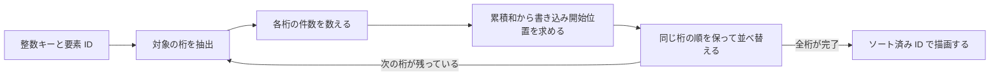

# ソート — イントロソート・基数ソート・GPU の描画順

ゲームで並べ替える対象は、材質ごとの描画コマンド、半透明パーティクル、優先順位を持つイベントなど。並べたい順序と同じキーの扱いを決めてから、比較で並べるか、整数キーのビットで振り分けるかを選ぶ。

## 比較ソートと安定性

| 方法 | 使えるキー | 性質 |
| --- | --- | --- |
| `std::sort` | 厳密弱順序で比較できる値 | C++20 の要件は `O(n log n)` 比較。等価な要素の順は保証されない。 |
| `std::stable_sort` | 厳密弱順序で比較できる値 | 等価な要素の元の順を保つ。C++20 の比較回数は十分な追加メモリーがあれば `O(n log n)`、それ以外は高々 `O(n log² n)`。 |
| LSD 基数ソート | 桁に分けられる固定幅のキー | 下位桁から安定に振り分ける。下の方式では `d` 桁、基数 `b` に対して `O(d(n+b))` 時間、`O(n+b)` の追加領域。 |

比較関数は「先に置くか」を答える。たとえば深度の降順なら `a.depth > b.depth`。等しい値に `true` を返す `>=` は厳密弱順序の条件を破る。浮動小数点の深度を使う場合は、NaN の入力を除くか、NaN を置く場所まで定めた比較にする。安定ソートで保てるのは同じ入力列の順。フレームごとに入力順が変わる構成で同じキーを毎回同じ順にしたいなら、インスタンス ID などを副キーにする。

### イントロソート

クイックソートはピボットで範囲を分割して処理する。偏った分割を繰り返すと、狭まる範囲が小さく、処理が二乗時間に近づく。Musser のイントロソートは、分割の深さに上限を設け、それを超えた部分を [ヒープ](/algorithms/binary-heaps.html) でソートする。分割に使う深さを `O(log n)` に制限し、残りの部分も `O(n log n)` の上界を持つヒープソートで処理する。小さな範囲で挿入ソートを使う実装もある。

C++20 の `std::sort` は比較回数の上限を要求する。イントロソートは上限を満たす実装方法の一つで、標準は内部のアルゴリズムを指定していない。

## 基数ソートと GPU の振り分け

LSD 基数ソートは、最下位の桁から一つずつ処理する。たとえば `21, 13, 12` を 10 進で並べると、一の位で `21, 12, 13` になる。十の位で振り分けるとき、同じ十の位の `12, 13` の順を保つと、結果は `12, 13, 21` になる。



GPU では、たとえばスレッドグループごとに桁の個数を集計し、並列の累積和でグループ別の書き込み位置を求める。各グループ内でも同じ桁の要素の位置を求め、ソート用の書き込み先へ移す。段階を分けた場合は、前の段階の書き込みを後の段階が読めるよう同期する。全粒子のデータを移す代わりに `キーと粒子 ID` の組だけを移し、後の描画で ID から粒子データを読む構成にできる。

### バイトニックソートと Onesweep

バイトニックソートは、比較して入れ替える要素の組が入力値によらず決まるソーティングネットワーク。$2^k$ 要素なら比較の段数は $1+2+\cdots+k=k(k+1)/2$ で、たとえば 128 要素なら 28 段。小さな配列を一つのスレッドグループ内に収めると、グループ共有メモリーとグループ内同期で処理できる。実装例は [GPU パーティクル](/graphics/shader/gpu-particles.html) を参照。

大量の固定幅キーには、全要素を桁ごとに振り分ける GPU 基数ソートがある。Adinets と Merrill の Onesweep は、全桁の総ヒストグラムを先に作る。各桁ではブロック内で振り分け、ブロック間のプレフィックスを求めながら書き込み先を決める。論文では通常の方式で桁ごとにキーを読む集計パスを省き、各桁で全体メモリーを通るデータ量を減らす。桁ごとの読み書き、作業用領域、比較の段数を実データのサイズで計測する。 [Adinets・Merrill — Onesweep（2022）](https://research.nvidia.com/publication/2022-06_onesweep-faster-least-significant-digit-radix-sort-gpus)

### 半透明を奥から手前へ描く

通常の source-over の色ブレンドでは、背景の色を `Cb`、今回の色を `Cs`、今回のアルファを `a` として、`a*Cs + (1-a)*Cb` を求める。黒に赤と青をアルファ 0.5 で重ねる例では、赤→青で `(0.25, 0, 0.5)`、青→赤で `(0.5, 0, 0.25)`。手前にあるものを後から描く必要があるため、半透明粒子の中心を使う場合は、視線方向の深度で奥から手前へ並べる。中心の深度だけでは、交差する大きな面の全ピクセルを正しく並べられないこともある。

CPU にある少数の描画コマンドなら CPU で並べ、シミュレーションの結果と描画対象が GPU にあるなら GPU 内で完結させる構成も選べる。ソートの段数、読み書きの帯域、同期の時間を含め、描画までの全体で計測する。

## コード例 — 16 ビットの描画キーを安定に並べる

C++20 のプログラム。深度キーは視点から奥ほど大きい `uint16_t` とし、降順にするため `0xffff - depth` を昇順で並べる。1 パスで 8 ビットずつ処理する。要素を入力順に走査して同じバケツの次の位置へ書くので、各パスの振り分けは安定する。結果を `std::stable_sort` と照合する。

```cpp
#include <algorithm>
#include <array>
#include <cstddef>
#include <cstdint>
#include <iostream>
#include <vector>

struct Particle
{
    std::uint16_t depth;
    char id;
    bool operator==(const Particle&) const = default;
};

std::size_t digit(const Particle& particle, unsigned int shift)
{
    const auto key = 0xffffu - static_cast<unsigned int>(particle.depth);
    return (key >> shift) & 0xffu;
}

void radixSortByDescendingDepth(std::vector<Particle>& particles)
{
    std::vector<Particle> scratch(particles.size());
    for (unsigned int shift = 0; shift < 16; shift += 8)
    {
        std::array<std::size_t, 256> positions{};
        for (const auto& particle : particles)
        {
            ++positions[digit(particle, shift)];
        }

        std::size_t start = 0;
        for (auto& position : positions)
        {
            const auto count = position;
            position = start;
            start += count;
        }

        for (const auto& particle : particles)
        {
            scratch[positions[digit(particle, shift)]++] = particle;
        }
        particles.swap(scratch);
    }
}

int main()
{
    std::vector<Particle> particles{{512, 'A'}, {4, 'B'}, {512, 'C'}, {1000, 'D'}};
    auto reference = particles;
    std::stable_sort(reference.begin(), reference.end(),
                     [](const Particle& a, const Particle& b)
                     {
                         return a.depth > b.depth;
                     });

    radixSortByDescendingDepth(particles);
    if (particles != reference)
    {
        return 1;
    }
    for (const auto& particle : particles)
    {
        std::cout << particle.id << ' ' << particle.depth << '\n';
    }
}
```

出力は `D 1000`、`A 512`、`C 512`、`B 4`。深度が同じ A と C は入力と同じ順。浮動小数点深度を 16 ビットに量子化する場合、別の深度が同じ値になるため、表示上許容できる粒度と副キーの有無を選ぶ。

## 理解度チェック

<details><summary>イントロソートが偏った分割に対応できるのはなぜ？</summary>

分割の深さを監視し、上限に達した部分はヒープソートに切り替える。偏った分割がそのまま続くのを防ぐ。

</details>

<details><summary>LSD 基数ソートの上位桁のパスで、同じ桁の順を入れ替えると何が起きる？</summary>

すでに整えた下位桁の順を壊す。各パスで同じ桁の要素の順を保つ必要がある。

</details>

<details><summary>GPU 上で粒子を計算して GPU で描く。粒子の全属性をソートで移動する必要はある？</summary>

キーと粒子 ID だけを並べ替え、描画側が ID から属性を読める。CPU へ戻す処理も省ける。

</details>

## 関連項目

- [二分ヒープ](/algorithms/binary-heaps.html)
- [Compute Shader](/graphics/compute/compute-shader.html)
- [GPU パーティクル](/graphics/shader/gpu-particles.html)

## 参考資料

- [WG21 N4861 — C++20 最終作業草案 `alg.sort`](https://timsong-cpp.github.io/cppwp/n4861/alg.sort)
- [David R. Musser — Introspective Sorting and Selection Algorithms（著者の公開資料、1997）](https://www.cs.rpi.edu/~musser/gp/index_1.html)
- [Nadathur Satish・Mark Harris・Michael Garland — Designing Efficient Sorting Algorithms for Manycore GPUs（2009）](https://research.nvidia.com/publication/2009-05_designing-efficient-sorting-algorithms-manycore-gpus)
- [Microsoft — Alpha Blending の合成式](https://learn.microsoft.com/en-us/windows/win32/learnwin32/using-color-in-direct2d#alpha-blending)
