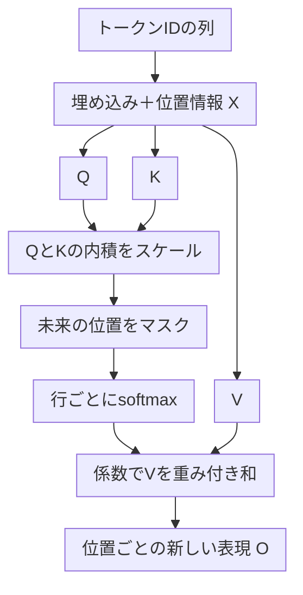

# TransformerとAttention — 埋め込み・位置情報・Q/K/Vで文脈を計算する

LLMの生成では、すでにあるトークン列を条件にして次のトークンの確率を求めます。Transformerのself-attention（自己注意）は、その途中で各位置の表現に、列内のほかの位置の情報を取り込む計算です。ここでは、生成用のdecoder（続きを作る部分）で使う因果的なself-attention（後の位置を参照しない自己注意）を、小さな数値例で追います。[LLMの文章生成](/algorithms/llm-text-generation.html) · [Transformer原論文 §3](https://arxiv.org/html/1706.03762v7#S3)

## この記事で分かること

位置情報がトークンの表現に加わる理由と、自己注意がQ・K・Vを使って参照先の情報を混ぜる流れを説明できます。因果マスクをかけたとき、各位置がどこを見られるか判断できます。

## トークンIDから、位置ごとの数値ベクトルへ

トークンIDは語彙中の識別子です。埋め込み（embedding）では、IDに対応する学習済みの数値ベクトルを表から読み出します。同じIDには同じ表の行が対応しますが、その後の層で計算される表現は、位置や周囲の入力によって変わります。[Transformer原論文 §3.4](https://arxiv.org/html/1706.03762v7#S3.SS4)

位置情報は、列のどこにある入力かを計算へ渡すためのものです。

この教材では、加算直前の埋め込み $E$ と位置ベクトル $P$ を手で決めます。3トークンの列をA、B、Aとし、位置は0始まりで数えます。1行が1位置を表す行列として $X=E+P$ を計算します。実際のモデルの語彙や重みを測った数値ではありません。

| 位置とトークン | $E$ の行 | $P$ の行 |
| --- | --- | --- |
| 0のA | $(1,0)$ | $(0,0)$ |
| 1のB | $(-1,1)$ | $(1,0)$ |
| 2のA | $(1,0)$ | $(0,1)$ |

$$
X=E+P=\begin{bmatrix}1&0\\0&1\\1&1\end{bmatrix}
$$

位置0と2のAは同じ埋め込みですが、位置ベクトルを足したあとは異なる行になります。ここで用いた $P$ は教材用の値で、原論文のsin/cosを計算した値とは区別します。

## Q・Kで参照の重みを求め、Vを混ぜる

自己注意では、出力を求める位置の **Query（Q）** を参照先の **Key（K）** と比較し、参照先から受け取る **Value（V）** の混ぜ方を決めます。固定重みで推論するときは、学習済みの射影行列 $W_Q,W_K,W_V$ を入力の行列 $X$ に掛け、その行列積で各位置のQ・K・Vへ変換します。[Transformer原論文 §3.2.2](https://arxiv.org/html/1706.03762v7#S3.SS2.SSS2)

$$
Q=XW_Q,\qquad K=XW_K,\qquad V=XW_V
$$



QとKの1行の次元を $d_k$ とすると、scaled dot-product attentionは次の式です。$M$ は見せない位置を除くためのマスクです。**softmax** は、スコアの指数を求めて合計で割る計算です。この式では参照位置の方向に適用します。[Transformer原論文 §3.2.1・§3.2.3](https://arxiv.org/html/1706.03762v7#S3.SS2.SSS1)

$$
A=\operatorname{softmax}_{\mathrm{row}}\left(\frac{QK^T}{\sqrt{d_k}}+M\right)
$$

$$
O=AV
$$

分母はQとKの次元の平方根です。原論文では、成分が独立で平均0・分散1という仮定のもとで内積の分散が $d_k$ になることから、スコアが大きくなりすぎるのを抑える理由を説明しています。これはQやKの長さを単位長に揃える操作とは異なります。[Transformer原論文 §3.2.1](https://arxiv.org/html/1706.03762v7#S3.SS2.SSS1)

## 3トークン・2次元で、位置1の出力を計算する

この例では射影行列も説明用に決めます。$W_K$ は単位行列で、$W_Q$ と $W_V$ は異なる変換です。

$$
\begin{aligned}
W_Q&=\begin{bmatrix}1&1\\0&1\end{bmatrix}\\[4pt]
W_K&=\begin{bmatrix}1&0\\0&1\end{bmatrix}\\[4pt]
W_V&=\begin{bmatrix}1&2\\3&0\end{bmatrix}
\end{aligned}
$$

行列積の結果は次のとおりです。Vの第0行は $(1,2)$、第1行は $(3,0)$ になります。

$$
\begin{aligned}
Q&=\begin{bmatrix}1&1\\0&1\\1&2\end{bmatrix}\\[4pt]
K&=\begin{bmatrix}1&0\\0&1\\1&1\end{bmatrix}\\[4pt]
V&=\begin{bmatrix}1&2\\3&0\\4&2\end{bmatrix}
\end{aligned}
$$

位置1のQueryは $(0,1)$ です。Kの3行との内積は $(0,1,1)$ で、$d_k=2$ なので $\sqrt{2}$ で割ります。ここでは列の3位置をまとめて計算し、途中の位置1を取り出しています。その出力で次の位置2を予測するとき、位置2の入力を見せないように、位置0と1だけを参照します。

$$
s_1=\left(0,\frac{1}{\sqrt2},-\infty\right)
$$

未来のスコアをsoftmaxの**前**に $-\infty$ にすると、その位置の指数関数の値は0になります。残る二つで正規化するため、出力に使う係数は次のようになります。これは生成時と学習時に未来を見せないための因果マスクです。[Transformer原論文 §3.2.3](https://arxiv.org/html/1706.03762v7#S3.SS2.SSS3)

| 参照位置 | スコア | 位置1からの係数 |
| --- | --- | --- |
| 0 | $0$ | 0.330238 |
| 1 | $1/\sqrt2$ | 0.669762 |
| 2 | $-\infty$ | 0.000000 |

位置0と1の丸め前の係数を $a,b$ として、Vを混ぜます。表とコード出力は小数6桁に丸め、式中の $\ldots$ は続く桁を省いています。計算には丸める前の値を使いました。

$$
\begin{aligned}
O_1&=a(1,2)+b(3,0)\\
&=(2.339523\ldots,\ 0.660476\ldots)
\end{aligned}
$$

Attention係数の0.669762は、位置1のValueを混ぜる重みです。ここでは候補トークンを抽選して一つに絞らず、許された位置のValueの重み付き和を計算しています。前の記事の次トークン確率は語彙中の候補に対する分布で、ここでの分布の軸は参照位置です。[Transformer原論文 §3.2・§3.4](https://arxiv.org/html/1706.03762v7#S3.SS2) · [LLMの文章生成](/algorithms/llm-text-generation.html)

## 掲載例をローカルで計算する

次は1ヘッドの位置1だけを出力する例です。Python 3.12.4の標準ライブラリで検証しました。`position` は0始まりです。重みと入力はすべて教材用の固定値です。

```python
import math

embeddings = [[1.0, 0.0], [-1.0, 1.0], [1.0, 0.0]]
positions = [[0.0, 0.0], [1.0, 0.0], [0.0, 1.0]]
inputs = [
    [value + offset for value, offset in zip(vector, position)]
    for vector, position in zip(embeddings, positions)
]
query_weights = [[1.0, 1.0], [0.0, 1.0]]
key_weights = [[1.0, 0.0], [0.0, 1.0]]
value_weights = [[1.0, 2.0], [3.0, 0.0]]

def multiply(left, right):
    columns = list(zip(*right))
    return [
        [sum(a * b for a, b in zip(row, column)) for column in columns]
        for row in left
    ]

queries = multiply(inputs, query_weights)
keys = multiply(inputs, key_weights)
values = multiply(inputs, value_weights)

position = 1
query = queries[position]
scores = []
for index, key in enumerate(keys):
    score = sum(a * b for a, b in zip(query, key)) / math.sqrt(len(query))
    scores.append(score if index <= position else -math.inf)

maximum = max(scores)
exponentials = [math.exp(score - maximum) for score in scores]
total = sum(exponentials)
attention = [value / total for value in exponentials]
output = [
    sum(weight * value[column] for weight, value in zip(attention, values))
    for column in range(len(values[0]))
]
print("attention", " ".join(f"{value:.6f}" for value in attention))
print("output", " ".join(f"{value:.6f}" for value in output))
```

```text
attention 0.330238 0.669762 0.000000
output 2.339523 0.660477
```

追加の検算では、未来の位置2の入力だけを $(10,-7)$ に変えました。因果マスクがあると、位置0と1の出力は変わりませんでした。マスクを外した計算では、位置0も未来のVを混ぜるため出力が変わりました。マスクを使わないself-attentionもあり、参照できる範囲は用途と構成で決まります。[Transformer原論文 §3.2.3](https://arxiv.org/html/1706.03762v7#S3.SS2.SSS3)

## Attentionの出力から、次の層と語彙の確率へ

**multi-head attention** では、異なる射影行列を使う複数の計算経路（ヘッド）の出力をつなぎ、さらに射影します。原論文のブロックには、入力を計算結果に足す残差接続、値を正規化するLayer Normalization、各位置に同じ関数を使うFFN（Feed-Forward Network）もあります。FFNは、attentionで混ぜたあとの各位置の特徴を変換します。これらを層として重ね、最終的な位置の表現を語彙へのスコアとsoftmaxにつなげます。[Transformer原論文 §3.1〜§3.4](https://arxiv.org/html/1706.03762v7#S3)

## 補足

原論文のTransformerは、埋め込みを $\sqrt{d_{\mathrm{model}}}$ 倍してから位置ベクトルを加えます。位置表現にはsinとcosを使い、学習する位置埋め込みとも比較しています。位置の渡し方はモデルによって変わります。[Transformer原論文 §3.5](https://arxiv.org/html/1706.03762v7#S3.SS5)

たとえばRoPEは、QとKに位置に応じた回転を適用して位置情報を計算に取り込みます。[RoFormer原論文](https://arxiv.org/abs/2104.09864)

PyTorch 2.15の公式資料では、ドロップアウトを無効にした場合の行列積・マスク・softmax・Vの重み付き和の順序を確認できます。[PyTorch 2.15のscaled dot-product attention](https://docs.pytorch.org/docs/2.15/generated/torch.nn.functional.scaled_dot_product_attention.html)

原論文の全体構成はencoderとdecoderを持つ翻訳モデルです。今回の教材はそのうち生成側の因果的self-attentionを抜き出しており、語彙の出力層まで含めたLLM全体の実装ではありません。位置表現や正規化の場所など、後続のモデルで変わる部分もあります。[Transformer原論文 §3.1](https://arxiv.org/html/1706.03762v7#S3.SS1)

## 要点

- この例では同じトークンに同じ埋め込みが対応します。位置情報を加えた表現は、位置によって変わります。
- Qと各Kの内積をもとに参照位置ごとの重みを求め、その重みでVを混ぜます。
- 因果マスクはsoftmaxの前に未来の位置のスコアを除くため、未来のVは出力に混ざりません。
- Attentionの係数は参照位置ごとの重みです。次のトークンの確率は後段の出力層で求めます。

## 理解度チェック

::: details 同じトークンAが位置0と2にあれば、入力の行も必ず同じ？
この教材の埋め込みは同じですが、位置ベクトルを足したXの行は異なります。さらに各層の表現は参照できる文脈にも依存します。
:::

::: details 位置1から位置2を見せないようにするには、どこでマスクする？
softmaxの前のスコアをマスクします。この例では位置2を負の無限大にし、位置0と1で重みを正規化しました。
:::

::: details 0.669762は、次にある語彙トークンが出る確率？
位置1の出力に、その参照位置のValueをどれだけ混ぜるかを示す係数です。次トークンの語彙分布は、後段の出力層で求めます。
:::

## 検証範囲

2026年11月18日に、WindowsのPython 3.12.4の標準ライブラリで、3トークン・2次元・1ヘッドの教材用行列を検算しました。埋め込みと位置の加算、Q/K/Vの射影、スコア、マスク、softmax、Vの重み付き和と掲載コードの出力を確認しました。全3位置のマスク付き・なしの結果を比べ、未来の入力変更に対する先行位置の不変性も確認しています。

入力と重みは説明用に手で決めた値です。実際の語彙埋め込み、学習済みモデル、学習による更新、multi-head、残差接続、正規化、FFN、語彙出力層、RoPEは実測していません。これらは原論文に基づく説明です。

## 関連項目

- [LLMの文章生成](/algorithms/llm-text-generation.html) — トークンを選んで続きを作る外側の流れを確認する。
- [KVキャッシュ](/algorithms/kv-cache.html) — 因果マスクのもとで、各層の過去のK・Vを続きの生成に使う仕組みを読む。
- [FlashAttention](/algorithms/flash-attention.html) — 同じAttentionを計算しながら、スコアと重みの全行列を保存する途中処理を省く。
- [LLM推論のprefillとdecode](/algorithms/llm-prefill-and-decode.html) — 因果マスクで入力の計算をまとめられる理由と、続きの生成を待つ理由を読む。
- [LLMの量子化](/algorithms/llm-quantization.html) — 射影の重みと、生成したK・Vを低ビットで保存する場合の違いを読む。
- [LLMのテンソル並列](/algorithms/tensor-parallelism.html) — 1つの層の行列積をGPU間で分け、どこで部分和を足すかを読む。
- [MoEの仕組み](/algorithms/moe-routing.html) — 一部のFFNを複数の専門家に置き換え、トークンごとに使う専門家を選ぶ方法を読む。
- [MCPの仕組み](/algorithms/model-context-protocol.html) — モデルの出力を受けたアプリが、外部のツールや資料を使う流れを読む。
- [Agent Skillsの仕組み](/algorithms/agent-skills.html) — 手順と資料が必要なときにモデルの文脈へ入る流れを読む。
- [AIエージェントのハーネス](/algorithms/agent-harness.html) — モデルを呼び、ツールの結果と履歴を次の入力へつなぐ仕組みを読む。
- [AIエージェントのコンテキスト管理](/algorithms/agent-context-management.html) — 入力するトークン列のもとになる情報を、履歴や資料からどう選ぶかを読む。
- [ベクトル](/math/rendering/vector.html) — 内積と重み付きのベクトル計算を読む。
- [埋め込みとベクトル検索](/algorithms/embeddings-and-vector-search.html) — トークンの内部表現と、文章検索用の表現の役割を比べる。
- [行列](/math/rendering/matrix.html) — ベクトルをまとめて変換する行列積を確認する。

## 参考資料

- [Vaswaniら — Attention Is All You Need（2017）](https://arxiv.org/abs/1706.03762)
- [Transformer原論文 — HTML版のモデル構成](https://arxiv.org/html/1706.03762v7#S3)
- [Suら — RoFormer: Enhanced Transformer with Rotary Position Embedding](https://arxiv.org/abs/2104.09864)
- [PyTorch 2.15 — scaled_dot_product_attention](https://docs.pytorch.org/docs/2.15/generated/torch.nn.functional.scaled_dot_product_attention.html)
