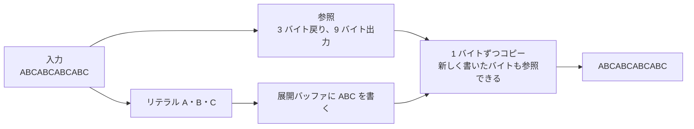

# 圧縮の基礎 — LZ の参照・エントロピー符号・GPU 展開

可逆圧縮では、展開後に元のバイト列を再現する。ゲームのアセットでは、ファイルのサイズだけでなく、必要な部分だけを読めるか、CPU や GPU で展開する時間、展開前後に持つバッファの量も選択に影響する。

## 繰り返しを距離と長さに置き換える

LZ77 系では、以前と同じ並びを見つけたときに、過去へ戻る**距離**とコピーする**長さ**で表せる。まだ参照で表せないバイトはリテラルとして出力する。例えば `ABCABCABCABC` は、最初の `ABC` をリテラルとして出し、距離 3、長さ 9 を使って再現できる。



参照の長さが距離より長い場合、出力しながらコピー元が前へ進む。最初の 3 バイトを書いた状態で 1 バイトずつ追加すると、4 バイト目のコピー元は追加済みの `A` になる。元の 3 バイトだけを固定で読み取る処理では、この参照を展開できない。

## エントロピー符号化を組み合わせる

エントロピー符号化は、よく現れる記号を少ないビットで表す。例えば `A` を `0`、`B` を `10`、`C` を `11` とする接頭符号なら、`AAABAC` は $1+1+1+2+1+2=8$ ビットになる。同じ 3 種類を一律 2 ビットで表すと 12 ビット。実際には、復号側に符号表を伝える費用なども加わる。

LZ77 系と組み合わせる場合、記号は元のバイトだけに限らない。長さや距離を表すコードも符号化できる。入力に繰り返しが少なく、記号の出現頻度も均一に近いと、ヘッダーやトークンの分だけ圧縮後の方が大きくなることがある。

### Zstandard の FSE は状態とビット列を一緒に進める

Zstandard のシーケンスには、リテラル長、マッチ長、オフセットのコードがある。RFC 8878 の FSE（Finite State Entropy）は、現在の状態から記号、読むビット数、次状態の基準値を表引きする。読み取ったビットの値を基準値へ足し、次の状態を得る。出現頻度の高い記号に多くの状態を割り当てるので、個々の記号に固定長のビット列を割り当てる方式とは異なり、平均では整数ビットに縛られない。Zstandard の圧縮リテラルには Huffman 符号が使われる。 [RFC 8878 §4.1 — FSE](https://www.rfc-editor.org/rfc/rfc8878.html#section-4.1)

速度と圧縮率を比べるときは、同じ入力データで圧縮後のバイト数、圧縮時間、展開時間を別々に記録する。ロード時に I/O と展開を直列に行う単純な例では、転送速度 200 MB/s で 40 MB を読み、展開に 30 ms かかるなら合計は 230 ms。別の方式で 25 MB に縮み、展開が 55 ms なら合計 180 ms になる。並行処理する実装ではこの足し算だけで決まらないため、キューの待ちとパスの重なりも測る。

## LZ4・zlib・Zstandard・GDeflate の違い

| 形式・実装 | 対象の仕様 | どう表現するか |
| --- | --- | --- |
| LZ4 | LZ4 Block、Frame 仕様 1.6.4 | リテラルと後方参照をバイト単位のトークンなどで格納する。ブロックの符号化に Huffman は使わない。フレーム形式はヘッダー・ブロック・任意のチェックサムなどを規定する |
| zlib | RFC 1950 と RFC 1951 | ライブラリの名称でもあり、RFC 1950 は zlib データ形式を定義する。zlib 形式は DEFLATE のデータをヘッダーと Adler-32 などで包む。DEFLATE の圧縮ブロックは LZ77 と Huffman 符号を組み合わせる |
| Zstandard | RFC 8878 | リテラルと、リテラル長・マッチ長・オフセットを表すシーケンスを持つ。圧縮された記号列には Huffman や FSE を使う。フレームのほか、参照する履歴や符号表を共有する辞書も定義する |
| GDeflate | DirectStorage 1.1 の `GDEFLATE` | DEFLATE 系のデータを、展開時にタイルを分け、タイル内でも複数のビット列を並行処理できるように配置する |

GDeflate のストリームは最大 64 KiB の展開タイルを持ち、最後のタイルは短くなりうる。Microsoft の参照実装はタイル内で最大 32 並列の展開を可能にするビット列の配置を説明している。DEFLATE や zlib と同じ展開器にそのまま渡せる形式ではない。ゲームで GPU 展開を使う経路と実行条件は [DirectStorage](../game/directstorage.md)を参照。

圧縮データを先頭から一つの履歴でつなげると、途中のデータだけを展開しにくい。アセット単位やストリーミングの粒度で独立した圧縮単位を作れば、必要な区間にアクセスしやすくなる。一方で、単位を細かくすると単位間の繰り返しを参照できず、ヘッダーも増える。読み込むバイト数、展開後のバイト数、I/O と展開と GPU 転送を含む時間を同じアセットで比較する。

## コード例 — リテラルと後方参照だけの可逆圧縮

C++20 の独立した例。リテラルは `0, 値`、参照は `1, 距離, 長さ` のバイト列で表す。長さが 4 以上の一致だけを参照にする。教材用の形式なので、エントロピー符号やフレームのヘッダーは使わない。展開器は指定した出力サイズを超える参照、存在しない過去の位置、途中で切れたトークンを拒む。

```cpp
#include <cassert>
#include <cstddef>
#include <cstdint>
#include <iostream>
#include <optional>
#include <span>
#include <vector>

using Byte = std::uint8_t;
using Bytes = std::vector<Byte>;

Bytes compress(std::span<const Byte> input)
{
    Bytes packed;
    for (std::size_t pos = 0; pos < input.size();)
    {
        std::size_t bestLength = 0;
        std::size_t bestDistance = 0;
        for (std::size_t distance = 1; distance <= 255 && distance <= pos; ++distance)
        {
            std::size_t length = 0;
            while (length < 255 && length < input.size() - pos &&
                   input[pos + length] == input[pos + length - distance])
            {
                ++length;
            }
            if (length > bestLength)
            {
                bestLength = length;
                bestDistance = distance;
            }
        }
        if (bestLength >= 4)
        {
            packed.push_back(1);
            packed.push_back(static_cast<Byte>(bestDistance));
            packed.push_back(static_cast<Byte>(bestLength));
            pos += bestLength;
        }
        else
        {
            packed.push_back(0);
            packed.push_back(input[pos++]);
        }
    }
    return packed;
}

std::optional<Bytes> decompress(std::span<const Byte> packed, std::size_t expectedSize)
{
    Bytes output;
    for (std::size_t pos = 0; pos < packed.size();)
    {
        const Byte tag = packed[pos++];
        if (tag == 0 && pos < packed.size() && output.size() < expectedSize)
        {
            output.push_back(packed[pos++]);
        }
        else if (tag == 1 && packed.size() - pos >= 2)
        {
            const std::size_t distance = packed[pos++];
            const std::size_t length = packed[pos++];
            if (distance == 0 || distance > output.size() ||
                length < 4 || length > expectedSize - output.size())
            {
                return std::nullopt;
            }
            for (std::size_t i = 0; i < length; ++i)
            {
                const Byte value = output[output.size() - distance];
                output.push_back(value);
            }
        }
        else
        {
            return std::nullopt;
        }
    }
    if (output.size() != expectedSize)
        return std::nullopt;

    return output;
}

int main()
{
    const Bytes input{'A', 'B', 'C', 'A', 'B', 'C', 'A', 'B', 'C', 'A', 'B', 'C'};
    const Bytes packed = compress(input);
    const auto output = decompress(packed, input.size());
    assert(output && *output == input);
    assert(!decompress(Bytes{1, 3, 9}, input.size()));
    assert(!decompress(Bytes{0}, input.size()));
    assert(!decompress(packed, input.size() - 1));
    std::cout << input.size() << " -> " << packed.size()
              << " -> " << output->size() << '\n';
}
```

出力は `12 -> 9 -> 12`。リテラル 3 個が 6 バイト、距離 3・長さ 9 の参照が 3 バイト。短いデータや繰り返しのないデータを入れると、この例では元のサイズを超えうる。実際のファイル形式では、[バイナリファイルの読み取り前に範囲を検査する](binary-file-validation.md)で扱うサイズや境界の検査も必要になる。

## 理解度チェック

1. 後方参照の長さが距離より長いとき、展開器は追加したばかりのバイトを使うか。
2. raw DEFLATE のバイト列と zlib 形式は何が違うか。
3. 独立した圧縮単位を細かくすると、アクセスと圧縮率にどう影響するか。

::: details 解答

1. 使う。出力の末尾から距離だけ戻った位置を各コピーで読み、コピー元も一つずつ進む。
2. zlib 形式にはヘッダーや Adler-32 があり、その内部に DEFLATE データを持つ。
3. 欲しい場所の近くから読みやすくなる。単位をまたぐ参照がなくなり、ヘッダーも増えるため圧縮率が下がりうる。

:::

## 関連項目

- [バイナリファイルの読み取り前に範囲を検査する](binary-file-validation.md)
- [アセットの読み込み](../game/asset-loading.md)
- [DirectStorage](../game/directstorage.md)
- [テクスチャストリーミング](../graphics/texture/texture-streaming-and-mip-residency.md)

## 参考資料

- LZ4 Project, [LZ4 Block Format](https://github.com/lz4/lz4/blob/dev/doc/lz4_Block_format.md)・[LZ4 Frame Format](https://github.com/lz4/lz4/blob/dev/doc/lz4_Frame_format.md)
- RFC Editor, [RFC 1950 — zlib](https://www.rfc-editor.org/rfc/rfc1950.html)・[RFC 1951 — DEFLATE](https://www.rfc-editor.org/rfc/rfc1951.html)
- RFC Editor, [RFC 8878 — Zstandard](https://www.rfc-editor.org/rfc/rfc8878.html)
- Microsoft, [DirectStorage 1.1](https://devblogs.microsoft.com/directx/directstorage-1-1-now-available/)・[GDeflate 参照実装](https://github.com/microsoft/DirectStorage/blob/main/GDeflate/GDeflate/README.md)
