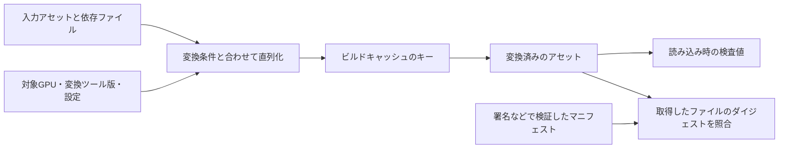

# ハッシュとチェックサム — アセットの識別と破損検出を分ける

アセットを再ビルドするか調べるときは、入力や変換設定の違いを検出します。パッケージを読み込むときは、読み取ったバイト列が作成時のものと一致するかを調べます。変換済みのアセットを安全に配信するときは、照合に使う情報の出所も検証します。三つの用途で、同じアルゴリズムや同じ対象範囲を使う必要はありません。



## 何を検出するかで選ぶ

| 方式 | 使いどころ | 注意点 |
| --- | --- | --- |
| CRC | 転送や保存で生じた偶発的なビットの変化を検出する。gzipは非圧縮データのCRC-32を末尾に保存する。 | CRC-32とCRC-32Cは異なる多項式を使う。初期値、入力・出力の反転、最終XORまでそろえる。 |
| xxHash | メモリ上の多数のデータを高速に識別する。公式仕様のXXH64やXXH3-128などから、用途に合う出力幅を選ぶ。 | 非暗号学的ハッシュ。アルゴリズム、シード、保存時のバイト順を固定し、必要な場合は内容を照合する。 |
| SHA-256 | 配布ファイルなどのダイジェストを作り、信頼済みの値と比較する。 | ファイルとダイジェストを同じ未検証の場所から取得するだけでは出所を保証できない。署名などでマニフェストを検証する。 |

CRCは、入力をビット列の多項式とみなし、決めた多項式での剰余を用います。処理の途中ではビットをシフトし、桁に応じてXORします。ここで使うCRC-32の生成多項式の下位32ビットは `0x04c11db7`、下位ビットから進める実装で用いる反転表現は `0xedb88320` です。CRC-32Cの反転表現は `0x82f63b78` です。

## コード例 — gzipと同じCRC-32を計算する

C++20の単体例です。入力はASCIIの `123456789` を表す9バイトです。テーブルを使わず、一度に1ビット処理します。実運用でファイル形式を扱うときは、先に長さと範囲を確認し、形式で決められたバイトだけを計算に入れます。

```cpp
#include <array>
#include <cstdint>
#include <iomanip>
#include <iostream>
#include <span>

std::uint32_t crc32(std::span<const std::uint8_t> bytes)
{
    std::uint32_t crc = 0xffff'ffffu;
    for (std::uint8_t value : bytes) {
        crc ^= value;
        for (int bit = 0; bit < 8; ++bit) {
            const bool low = (crc & 1u) != 0;
            crc >>= 1;
            if (low) {
                crc ^= 0xedb8'8320u;
            }
        }
    }
    return crc ^ 0xffff'ffffu;
}

int main()
{
    constexpr std::array<std::uint8_t, 9> input{
        0x31, 0x32, 0x33, 0x34, 0x35, 0x36, 0x37, 0x38, 0x39
    };
    auto changed = input;
    changed.back() ^= 1u;
    const auto expected = crc32(input);
    const auto actual = crc32(changed);
    std::cout << std::hex << std::setfill('0')
              << std::setw(8) << expected << '\n'
              << std::setw(8) << actual << '\n';
    return expected == 0xcbf4'3926u && actual != expected ? 0 : 1;
}
```

最初の値は `cbf43926`、末尾1ビットを反転した後は `bcf309b0` です。gzipの末尾に最初の値を書くなら、バイト順は `26 39 f4 cb` になります。

## アセットの名前と内容を分ける

シーンから参照するアセットには、名前を変えても保てる論理IDを持たせられます。ビルドキャッシュのキーは、変換した成果物が変わる条件を反映します。たとえば同じ画像でも、BC5とBC7の出力は異なるので、画像のバイト列に加えて、変換ツールの版、出力形式、色空間の指定、依存ファイルをキーの入力にします。

可変長の値を連結するときは長さやタグを入れます。`ab` と `c`、`a` と `bc` は、そのまま連結すると同じ `abc` になります。複数の依存ファイルを含めるときは並び順も定義します。ハッシュが一致したときの扱いは用途次第で、ローカルキャッシュなら入力のメタデータや内容を追加で照合できます。暗号学的ハッシュを用いる配布では、期待値を収めたマニフェストが信頼できることを確認します。

## 理解度チェック

1. gzipのCRC-32を、CPUのCRC-32C命令に置き換えて同じ結果を比較できるか。
2. 画像の内容が同じで、GPU向け圧縮形式を変えた。キャッシュキーのどこに差を入れるか。
3. 未検証のサーバーからファイルとSHA-256値を取得し、値が一致した。出所の検証に何が必要か。

::: details 解答

1. できない。生成多項式が異なり、同じバイト列でも検査値は一般に異なる。
2. 変換設定を直列化してキーの入力に含める。画像のハッシュだけでは設定の変更が分からない。
3. 信頼済みの期待値が必要。例えば署名されたマニフェストを信頼できる公開鍵で検証する。

:::

## 関連項目

- [ハッシュ表](/algorithms/hash-tables.html)
- [バイナリファイルの検証](/data/binary-file-validation.html)
- [圧縮の基礎](/data/compression-basics.html)
- [アセットロード](/game/asset-loading.html)

## 参考資料

- [RFC 1952 — GZIP file format specification version 4.3](https://www.rfc-editor.org/rfc/rfc1952)
- [RFC 3720 Appendix B — CRC-32C](https://www.rfc-editor.org/rfc/rfc3720#appendix-B)
- [xxHash公式仕様 — XXH32・XXH64・XXH3](https://github.com/Cyan4973/xxHash/blob/dev/doc/xxhash_spec.md)
- [NIST FIPS 180-4 — Secure Hash Standard](https://csrc.nist.gov/pubs/fips/180-4/upd1/final)
- [NIST SP 800-107 Rev. 1 — Recommendation for Applications Using Approved Hash Algorithms](https://csrc.nist.gov/pubs/sp/800/107/r1/final)
