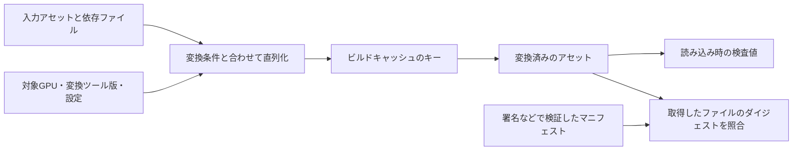

# ハッシュとチェックサム — アセットの識別と破損検出を分ける

アセットを再ビルドするか調べるときは、入力や変換設定の違いを検出します。パッケージを読み込むときは、読み取ったバイト列が作成時のものと一致するかを調べます。変換済みのアセットを安全に配信するときは、照合に使う情報の出所も検証します。三つの用途で、同じアルゴリズムや同じ対象範囲を使う必要はありません。



## 何を検出するかで選ぶ

| 方式 | 使いどころ | 注意点 |
| --- | --- | --- |
| CRC | 転送や保存で生じた偶発的なビットの変化を検出する。gzipは非圧縮データのCRC-32を末尾に保存する。 | CRC-32とCRC-32Cは異なる多項式を使う。初期値、入力・出力の反転、最終XORまでそろえる。 |
| xxHash | メモリ上の多数のデータを高速に識別する。公式仕様のXXH64やXXH3-128などから、用途に合う出力幅を選ぶ。 | 非暗号学的ハッシュ。アルゴリズム、シード、保存時のバイト順を固定し、必要な場合は内容を照合する。 |
| SHA-256 | 配布ファイルなどのダイジェストを作り、信頼済みの値と比較する。 | ファイルとダイジェストを同じ未検証の場所から取得するだけでは出所を保証できない。署名などでマニフェストを検証する。 |

CRCは、入力をビット列の多項式とみなし、決めた多項式での剰余を用います。処理の途中ではビットをシフトし、桁に応じてXORします。ここで使うCRC-32の生成多項式の下位32ビットは `0x04c11db7`、下位ビットから進める実装で用いる反転表現は `0xedb88320` です。CRC-32Cの反転表現は `0x82f63b78` です。

### XXH64 と XXH3 の内部

| xxHash v0.8.4 の API | 幅 | 処理の特徴 |
| --- | --- | --- |
| `XXH32` | 32 ビット | 32 ビット算術。短いチェック用キーなど、衝突を別手段で扱える場合に使える |
| `XXH64` | 64 ビット | 32 バイトずつ四つの 64 ビット累積値を更新。既存フォーマットとの互換性に使う |
| `XXH3_64bits` | 64 ビット | 長さによって処理を分け、長い入力は並行に更新できる累積値を持つ |
| `XXH3_128bits` | 128 ビット | 128 ビット結果。保持するキーが大きくなる代わりに、偶発的な衝突の確率を下げられる |

XXH64 は長い入力の 32 バイトを、リトルエンディアンの 64 ビット語 $x$ 四つとして読む。各累積値 $a$ の更新は $a\leftarrow \operatorname{rotl}_{31}(a+xP_2)P_1$。$P_1,P_2$ は仕様の定数で、加算と乗算は $2^{64}$ を法とする。別々の累積値を回転して合成し、残りのバイトと長さも混ぜる。最後にシフト、XOR、乗算を繰り返す avalanche により、入力の局所的な変化を出力の複数のビットに広げる。例えばリトルエンディアンで `01 02 00 00 00 00 00 00` と並ぶ 8 バイトは $1+2\times256=513$ になる。CPU のネイティブなバイト順や構造体のメモリ表現をそのまま外部形式にすると、同じアセットでも別の結果になり得る。

XXH3-64 と XXH3-128 は、ともに入力長で処理を分ける。短い入力は 0、1〜3、4〜8、9〜16 バイト、中程度の入力は 17〜128、129〜240 バイト、長い入力は 241 バイト以上の経路を使う。長い経路は 64 バイトのストライプを、8 個の 64 ビット累積値で処理する。既定の 192 バイトの secret では 1 ブロックに $(192-64)/8=16$ ストライプ、すなわち $16\times64=1024$ バイト。入力と secret の一部を XOR した結果を 32 ビットずつに分けて乗算するなど、複数のレーンを SIMD で更新できる。長い入力の処理速度が高くても、小さなアセットキーでは初期化と読み出しの負荷が目立つ。選択するときは、ファイル全体のハッシュで測った帯域と、短いキーを何件処理できるかを別々に記録する。

`XXH64` と `XXH3_64bits` は同じ幅でも別のアルゴリズム。キャッシュの書式にアルゴリズムの名前を持たせると、更新後に古い値を取り違えずに済む。seed や secret は同じ入力に対して別のハッシュ列を作るパラメーターであり、認証用の秘密鍵としては使わない。公式の canonical 形式は結果をビッグエンディアンのバイト列にする。入力をリトルエンディアンの語として処理する話と、得られた結果を保存する際のバイト順は別である。

### コード例 — 一括と分割で同じ XXH3-128 を得る

C++20 と xxHash v0.8.4 の `xxhash.h` を使います。公式ヘッダーに `XXH_INLINE_ALL` を指定して、ライブラリを別にリンクせずこの翻訳単位だけでビルドします。一括で読んだ入力と、ファイル読み出しを想定して 3 バイトと 6 バイトに分けた入力が、同じ canonical 形式になることを確かめます。

```cpp
#define XXH_INLINE_ALL
#include "xxhash.h"

#include <array>
#include <cstdint>
#include <cstring>
#include <iomanip>
#include <iostream>
#include <memory>

int main()
{
    constexpr std::array<std::uint8_t, 9> bytes{
        0x31, 0x32, 0x33, 0x34, 0x35, 0x36, 0x37, 0x38, 0x39
    };
    const auto one_shot = XXH3_128bits(bytes.data(), bytes.size());

    std::unique_ptr<XXH3_state_t, decltype(&XXH3_freeState)>
        state(XXH3_createState(), XXH3_freeState);
    if (!state || XXH3_128bits_reset(state.get()) != XXH_OK)
        return 1;
    if (XXH3_128bits_update(state.get(), bytes.data(), 3) != XXH_OK
        || XXH3_128bits_update(state.get(), bytes.data() + 3, bytes.size() - 3) != XXH_OK)
        return 1;

    XXH128_canonical_t a{};
    XXH128_canonical_t b{};
    XXH128_canonicalFromHash(&a, one_shot);
    XXH128_canonicalFromHash(&b, XXH3_128bits_digest(state.get()));
    if (std::memcmp(a.digest, b.digest, sizeof a.digest) != 0)
        return 2;
    std::cout << std::hex << std::setfill('0');
    for (unsigned char byte : a.digest)
        std::cout << std::setw(2) << static_cast<unsigned>(byte);
    std::cout << '\n';
}
```

ストリーミングでチャンク境界を変えても、同じ順に同じバイトを渡せば結果は一致します。アセットのデータと設定の間を区切る必要がある場合は、各部分の長さや型タグを入力に含めます。`update` の呼び出しを分けるだけでは区切りはハッシュへ入らないので、長さが違う二つの組が同じバイト列になることがあります。

### MD5 と SHA-1 を使う範囲

MD5 と SHA-1 には、異なる内容で同じダイジェストを作れることが実証されている。RFC 6151 は衝突耐性が必要な用途での MD5 の使用を認めていない。SHA-1 では 2017 年に CWI と Google の研究者が異なる二つの PDF を使って完全版の衝突を示した。NIST は SHA-1 を使う暗号保護から 2030 年末までに移行する方針を示している。衝突耐性を失うと、検証用に提出した内容と、後から照合を通る別の内容を区別できなくなるため、署名、信頼できる配布物の検証、第三者が入力を選べる識別に流用できない。

以前の配布形式で既に付いている MD5 や SHA-1 を読み、対応するローカルの候補を探す用途はあり得る。そこで同じ値が出たら、長さや元のバイト列も照合する。新規のローカルキャッシュでは XXH3 など、信頼境界を越える配布では署名済みマニフェストと SHA-256 など、用途に合ったものを選ぶ。パスワードの保管では、候補を高速に照合できる汎用ハッシュだけを使うと総当たりを容易にするので、用途に特化した鍵導出関数を選ぶ。

## コード例 — gzipと同じCRC-32を計算する

C++20の単体例です。入力はASCIIの `123456789` を表す9バイトです。テーブルを使わず、一度に1ビット処理します。実運用でファイル形式を扱うときは、先に長さと範囲を確認し、形式で決められたバイトだけを計算に入れます。

```cpp
#include <array>
#include <cstdint>
#include <iomanip>
#include <iostream>
#include <span>

std::uint32_t crc32(std::span<const std::uint8_t> bytes)
{
    std::uint32_t crc = 0xffff'ffffu;
    for (std::uint8_t value : bytes) {
        crc ^= value;
        for (int bit = 0; bit < 8; ++bit) {
            const bool low = (crc & 1u) != 0;
            crc >>= 1;
            if (low) {
                crc ^= 0xedb8'8320u;
            }
        }
    }
    return crc ^ 0xffff'ffffu;
}

int main()
{
    constexpr std::array<std::uint8_t, 9> input{
        0x31, 0x32, 0x33, 0x34, 0x35, 0x36, 0x37, 0x38, 0x39
    };
    auto changed = input;
    changed.back() ^= 1u;
    const auto expected = crc32(input);
    const auto actual = crc32(changed);
    std::cout << std::hex << std::setfill('0')
              << std::setw(8) << expected << '\n'
              << std::setw(8) << actual << '\n';
    return expected == 0xcbf4'3926u && actual != expected ? 0 : 1;
}
```

最初の値は `cbf43926`、末尾1ビットを反転した後は `bcf309b0` です。gzipの末尾に最初の値を書くなら、バイト順は `26 39 f4 cb` になります。

## アセットの名前と内容を分ける

シーンから参照するアセットには、名前を変えても保てる論理IDを持たせられます。ビルドキャッシュのキーは、変換した成果物が変わる条件を反映します。たとえば同じ画像でも、BC5とBC7の出力は異なるので、画像のバイト列に加えて、変換ツールの版、出力形式、色空間の指定、依存ファイルをキーの入力にします。

可変長の値を連結するときは長さやタグを入れます。`ab` と `c`、`a` と `bc` は、そのまま連結すると同じ `abc` になります。複数の依存ファイルを含めるときは並び順も定義します。ハッシュが一致したときの扱いは用途次第で、ローカルキャッシュなら入力のメタデータや内容を追加で照合できます。暗号学的ハッシュを用いる配布では、期待値を収めたマニフェストが信頼できることを確認します。

### 誕生日限界と 64 ビット ID

$b$ ビットのハッシュ値が独立かつ一様と仮定し、可能な値の数を $M=2^b$ とします。異なる入力を $n$ 件ハッシュするとき、すべてが異なる確率は次の積になります。$k$ 件が重複していないとき、次の一件が既存の値を避ける確率は $1-k/M$ だからです。

$$
P(\mathrm{collision})
=1-\prod_{k=0}^{n-1}\left(1-\frac{k}{M}\right)
\approx 1-\exp\left(-\frac{n(n-1)}{2M}\right)
$$

近似は $n/M$ が十分小さいときに $\log(1-k/M)\approx-k/M$ とし、$0$ から $n-1$ の和を使って導きます。指数の中の $\lambda=n(n-1)/(2M)$ は、全組み合わせのうち同じ値になる組の期待数です。64 ビットで $n=2^{32}$ のとき $\lambda\approx0.5$、1 組以上の衝突は $1-e^{-0.5}\approx39.35\%$。50% になる目安は $\sqrt{2M\ln2}\approx5.06\times10^9$ 件です。$2^{32}$ は衝突が生じる規模の目安であり、必ず衝突する件数ではありません。

| 異なる入力の数 | 64 ビットの衝突確率 | 128 ビットの衝突確率 |
| ---: | ---: | ---: |
| 100 万 | $2.71\times10^{-8}$ | $1.47\times10^{-27}$ |
| 10 億 | $0.0267$ | $1.47\times10^{-21}$ |
| $2^{32}$ | $0.3935$ | $2.71\times10^{-20}$ |

表は 0〜1 の確率で、例えば 10 億件の 64 ビットは約 2.67% です。一件の決まった ID に対し一件が一致する確率 $1/M$ と、全ての組の中でいずれかが一致する確率は対象が違います。この計算は偏りのある入力集合や、意図的に衝突を探せる非暗号学的ハッシュの安全性を保証しません。

アセットの ID として使う場合は、件数を現在のロード数で数えるか、複数バージョンと DLC を含む全登録数で数えるかを決めます。衝突の影響が誤ったアセットの読み込みなら、ID が一致した時点で名前空間や正規化された論理キーも照合します。外部に固定した短い ID を振るなら、ビルド時に ID から元のキーへの対応を調べて重複を検出し、書式に合った方法で解消します。幅を 128 ビットに広げる場合でも、外部 ID の永続性とハッシュの取り扱いは書式で定義します。

### コード例 — 衝突確率を C++20 で検算する

`-std=c++20` の単体例。値が小さいときに `1 - exp(-lambda)` で有効桁が失われるため、`-expm1(-lambda)` を使います。`ldexp(1.0, bits)` で $2^b$ を浮動小数点で作るので、64 ビット整数の範囲を超える $2^{64}$ や $2^{128}$ も扱えます。

```cpp
#include <array>
#include <cassert>
#include <cmath>
#include <cstdint>
#include <iomanip>
#include <iostream>

double collision_probability(std::uint64_t count, int bits)
{
    assert(bits == 64 || bits == 128);
    if (count < 2)
        return 0.0;
    const double n = static_cast<double>(count);
    const double pairs = n * (n - 1.0) / 2.0;
    return -std::expm1(-pairs / std::ldexp(1.0, bits));
}

int main()
{
    constexpr std::array<std::uint64_t, 3> sizes{
        1'000'000, 1'000'000'000, std::uint64_t{1} << 32
    };
    assert(collision_probability(1, 64) == 0.0);
    assert(std::abs(collision_probability(sizes.back(), 64) - 0.3934693402) < 1e-9);
    std::cout << std::scientific << std::setprecision(4);
    for (auto n : sizes)
        std::cout << n << ' ' << collision_probability(n, 64)
                  << ' ' << collision_probability(n, 128) << '\n';
}
```

## 理解度チェック

1. gzipのCRC-32を、CPUのCRC-32C命令に置き換えて同じ結果を比較できるか。
2. 画像の内容が同じで、GPU向け圧縮形式を変えた。キャッシュキーのどこに差を入れるか。
3. 未検証のサーバーからファイルとSHA-256値を取得し、値が一致した。出所の検証に何が必要か。
4. 64 ビットの `XXH64` を `XXH3_64bits` に置き換えると、既存のキャッシュキーはそのまま使えるか。
5. 64 ビット ID が $2^{32}$ 件あるとき、1 組以上の衝突の目安は何%か。
6. SHA-1 の値が同じなら、二つの第三者提供ファイルを同一と判定できるか。

::: details 解答

1. できない。生成多項式が異なり、同じバイト列でも検査値は一般に異なる。
2. 変換設定を直列化してキーの入力に含める。画像のハッシュだけでは設定の変更が分からない。
3. 信頼済みの期待値が必要。例えば署名されたマニフェストを信頼できる公開鍵で検証する。
4. 別のアルゴリズムなので、旧形式を引き続き読めるようにするか、キャッシュを再作成する。
5. 一様かつ独立と仮定した場合、約 39.35%。
6. SHA-1 の衝突は実証されている。バイト列を比較するか、配布時には衝突耐性のあるダイジェストと署名などで照合する。

:::

## 関連項目

- [ハッシュ表](/algorithms/hash-tables.html)
- [バイナリファイルの読み取り前に範囲を検査する](/data/binary-file-validation.html)
- [圧縮の基礎](/data/compression-basics.html)
- [アセットロード](/game/asset-loading.html)

## 参考資料

- [RFC 1952 — GZIP file format specification version 4.3](https://www.rfc-editor.org/rfc/rfc1952)
- [RFC 3720 Appendix B — CRC-32C](https://www.rfc-editor.org/rfc/rfc3720#appendix-B)
- [xxHash公式仕様 — XXH32・XXH64・XXH3](https://github.com/Cyan4973/xxHash/blob/v0.8.4/doc/xxhash_spec.md)
- [NIST FIPS 180-4 — Secure Hash Standard](https://csrc.nist.gov/pubs/fips/180-4/upd1/final)
- [NIST SP 800-107 Rev. 1 — Recommendation for Applications Using Approved Hash Algorithms](https://csrc.nist.gov/pubs/sp/800/107/r1/final)

- [xxHash v0.8.4 — API と canonical 形式](https://github.com/Cyan4973/xxHash/blob/v0.8.4/xxhash.h)・[リリースノート](https://github.com/Cyan4973/xxHash/releases/tag/v0.8.4)
- [RFC 6151 — MD5 と HMAC-MD5 のセキュリティ上の考慮事項](https://www.rfc-editor.org/rfc/rfc6151.html#section-2)
- [NIST — SHA-1 からの移行](https://csrc.nist.gov/news/2022/nist-transitioning-away-from-sha-1-for-all-apps)・[NIST SP 800-63B-4 — Password Verifiers](https://pages.nist.gov/800-63-4/sp800-63b.html#passwordver)
- [Stevens ほか — The first collision for full SHA-1](https://shattered.io/static/shattered.pdf)（2017）
