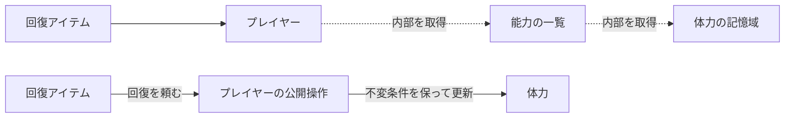

# デメテルの法則 — 相手の内部構造を知らずに仕事を頼む

プレイヤーの回復処理が、仲間オブジェクトから能力一覧を取り出し、さらに体力バッファを取り出して値を書き換えるとします。体力を別の場所に保存するだけで、この呼び出しも直すことになります。回復という操作をプレイヤーに頼めれば、呼び出し側が知るのは操作の契約までです。



## メソッドが直接扱う相手を絞る

原論文にはクラス形式とオブジェクト形式があります。ここではオブジェクト形式の考え方を使います。メソッドは自身、引数として受け取った相手、自身が直接保持する構成要素、その処理で生成した相手とのやり取りに寄せます。知っている相手から得た別のオブジェクトを次々にたどると、型や所有関係の変更が呼び出し側まで広がります。

呼び出しを一行から三行に分けても、アクセスする相手は同じです。一方、座標を表す値のフィールドを読む操作や、ビルダーが自身を返す連鎖には、同じ種類の内部依存が生じるとは限りません。どのオブジェクトの内部構造を何のために知るかを確認します。

## Facade・Mediator・DIPとの関係

| 手段 | どの結合を扱うか | ゲームの例 |
| --- | --- | --- |
| デメテルの法則 | 一つのメソッドが、どこまで他のオブジェクトを知るか | 回復アイテムがプレイヤーに回復を頼み、体力の保存形式を知らずに済む |
| Facade | サブシステムの入口をまとめ、呼び出し側が内部の組み合わせを覚える量を減らす | セーブの読み書きに、ファイルとバージョン変換を隠す入口を置く |
| Mediator | 複数の部品が互いに連絡する手順を一箇所にまとめる | インベントリとUIの更新順を調停する |
| DIP | どのモジュールがどの抽象を参照するかを決める | セーブの方針側が記憶装置の実装へ直接依存せず、必要な操作を表す境界を持つ |

デメテルの法則に沿って一つの公開操作を追加しても、その引数が具体的なストレージ型ならDIPの観点では依存が残ります。抽象を注入しても、戻り値から内部のグラフを次々にたどればLoDの観点では依存が広がります。公開操作は、内部の各フィールドを一つずつ転送する形より、呼び出し側が実行したい仕事を表す方が変更に強くなります。

## コード例 — 回復をプレイヤーへ頼む

C++20の単体例です。回復量を0以上、現在値を0から最大値の間に保ちます。回復した実際の量は呼び出し側へ返します。

```cpp
#include <algorithm>
#include <iostream>

class Player {
public:
    int heal(int requested)
    {
        const int applied = std::clamp(requested, 0, maximum_ - health_);
        health_ += applied;
        return applied;
    }

    int health() const { return health_; }

private:
    static constexpr int maximum_ = 100;
    int health_ = 90;
};

class Potion {
public:
    int apply(Player& target) const { return target.heal(25); }
};

int main()
{
    Player player;
    Potion potion;
    const int restored = potion.apply(player);
    const int second = potion.apply(player);
    std::cout << restored << ' ' << second << ' ' << player.health() << '\n';
    return restored == 10 && second == 0 && player.health() == 100 ? 0 : 1;
}
```

出力は `10 0 100` です。回復できる上限の決定と書き込みを `Player` に置くと、体力を他の部品に移しても、`heal` の契約を保てる限り `Potion` の呼び出しを変えずに済みます。

## 理解度チェック

1. `a.getB().getC().run()` を途中の変数に分けると、依存する相手は減るか。
2. 複数ウィジェットが互いに更新を通知し合うとき、連絡手順を集約するパターンはどれか。
3. 外部ストレージの具象型に依存するセーブ処理が、連鎖呼び出しを一つ消した。次に依存の方向をどう調べるか。

::: details 解答

1. 減らない。`C` の場所と操作を引き続き知る必要がある。
2. Mediator。ウィジェット間の調整の責務を集める。
3. DIPの観点で、保存の方針側とストレージ実装の両方から、必要な操作の抽象に依存できるか調べる。

:::

## 関連項目

- [依存関係と依存の方向](/design/foundations/dependency.html)
- [Facade](/design/patterns/facade.html)
- [Mediator](/design/patterns/mediator.html)
- [依存性逆転の原則](/design/solid/dip.html)

## 参考資料

- [Lieberherr・Holland・Riel — Object-Oriented Programming: An Objective Sense of Style、OOPSLA 1988](https://www2.ccs.neu.edu/research/demeter/papers/law-of-demeter/oopsla88-law-of-demeter.pdf)
- [Karl Lieberherr — Law of Demeter: Principle of Least Knowledge](https://khoury.northeastern.edu/home/lieber/LoD.html)
- [Addison-Wesley — Design Patterns（著者・目次）](https://www.informit.com/store/design-patterns-elements-of-reusable-object-oriented-9780201633610)
