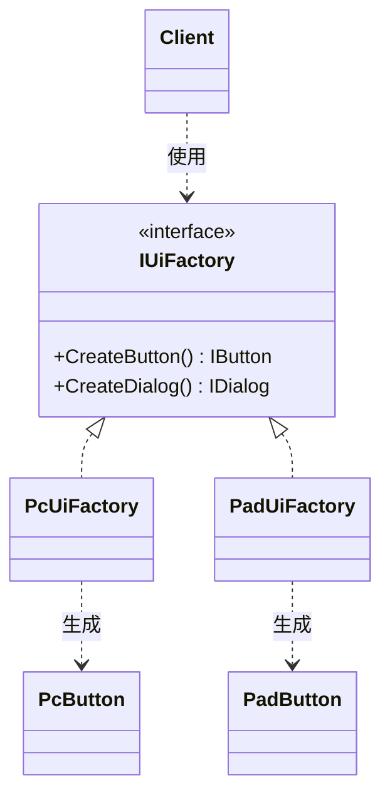

# Abstract Factory

## 解決する問題

**互いに関連する複数のオブジェクト一族**を、組み合わせを間違えずに生成したい。例: PC版UIのボタンとPS5版UIのスクロールバーが混ざってはいけない。

## 登場人物と責務

- **AbstractFactory**: 一族の各製品を作る生成メソッド群の宣言(`CreateButton()`, `CreateScrollBar()`)
- **ConcreteFactory**: 一族1セット分の生成を担当(`Ps5UiFactory`)
- **AbstractProduct / ConcreteProduct**: 各製品の抽象と具象
- **Client**: AbstractFactory経由でのみ生成し、具象を知らない

## 最小構成図



## パターンなしの実装

```cpp
// C++20(問題例)
void BuildSettingsScreen(Platform platform) {
    if (platform == Platform::Pc) {
        auto button = std::make_unique<PcButton>();     // マウス用
        auto dialog = std::make_unique<PcDialog>();
    } else {
        auto button = std::make_unique<PadButton>();    // パッド用
        auto dialog = std::make_unique<PcDialog>();     // ← コピペミス!混在に誰も気づかない
    }
    // 画面組み立て...
}
```

## 問題点

- 生成分岐が**画面の数だけ**複製され、プラットフォーム追加で全画面を修正。
- 一族の**組み合わせ整合性**(パッド用にはパッド用を)がコンパイラで守られず、上のようなコピペミスが実行時まで発覚しない。

## パターン適用後のC++コード

```cpp
// C++20
#include <memory>

class IButton { public: virtual ~IButton() = default; virtual void Draw() = 0; };
class IDialog { public: virtual ~IDialog() = default; virtual void Open() = 0; };

class PcButton : public IButton { public: void Draw() override { /* マウスhover対応 */ } };
class PcDialog : public IDialog { public: void Open() override { /* ESCで閉じる */ } };
class PadButton : public IButton { public: void Draw() override { /* フォーカス枠 */ } };
class PadDialog : public IDialog { public: void Open() override { /* Bで閉じる */ } };

class IUiFactory {   // 一族の生成をまとめて宣言
public:
    virtual ~IUiFactory() = default;
    virtual std::unique_ptr<IButton> CreateButton() = 0;
    virtual std::unique_ptr<IDialog> CreateDialog() = 0;
};

class PcUiFactory : public IUiFactory {
public:
    std::unique_ptr<IButton> CreateButton() override { return std::make_unique<PcButton>(); }
    std::unique_ptr<IDialog> CreateDialog() override { return std::make_unique<PcDialog>(); }
};
class PadUiFactory : public IUiFactory {
public:
    std::unique_ptr<IButton> CreateButton() override { return std::make_unique<PadButton>(); }
    std::unique_ptr<IDialog> CreateDialog() override { return std::make_unique<PadDialog>(); }
};

// 画面構築コードはプラットフォームを知らない。混在はConcreteFactory内に閉じるので起きない
void BuildSettingsScreen(IUiFactory& factory) {
    auto button = factory.CreateButton();
    auto dialog = factory.CreateDialog();
    // 画面組み立て...
}
```

検証済みサンプル: <a href="/study/samples/cpp/pattern_abstract_factory.cpp">samples/pattern_abstract_factory.cpp</a>

## C#またはUnityでの実装

```csharp
// Unity: 「一族」をPrefab参照のセットとしてScriptableObjectにまとめるのが自然形
[CreateAssetMenu(menuName = "UI/UiTheme")]
public class UiTheme : ScriptableObject {          // これがConcreteFactory相当
    [SerializeField] private Button buttonPrefab;
    [SerializeField] private Dialog dialogPrefab;
    public Button CreateButton(Transform parent) => Object.Instantiate(buttonPrefab, parent);
    public Dialog CreateDialog(Transform parent) => Object.Instantiate(dialogPrefab, parent);
}
// PC用ThemeアセットとPad用Themeアセットを作り、起動時にどちらかを差す
```

「一族の整合性をアセット1個にまとめて保証する」— Unityではクラス階層よりデータで表現します。

## ゲームでの具体例

- プラットフォーム別UI(マウス系/パッド系/タッチ系)
- 季節イベントのテーマ一式(通常/ハロウィン: 背景・BGM・エフェクトのセット)
- レンダリングAPI別のリソース一式(DirectX/Vulkanのバッファ・テクスチャ・シェーダ生成)

## 利点

- 一族の組み合わせ整合性が**構造で保証**される(混在バグがコンパイル時に消える)
- 一族の切り替えがファクトリ1個の差し替えで済む
- クライアントが具象から完全に独立

## 欠点

- クラス数が多い(製品数×一族数+抽象)。GoFで最も「重い」パターンの一つ
- **一族に製品を1つ追加する**と、全ConcreteFactoryとインターフェースを修正(製品軸には閉じていない)
- 一族が1つしかない段階では完全な過剰設計

## 適用条件

- 「セットで揃っていないといけない」制約が実際にある
- 一族が2セット以上あり、切り替えが要件にある

## 避けるべき条件

- 一族が1セットしかない/セット間の混在が問題にならない
- 製品の種類(ボタン、ダイアログ、…)の方が頻繁に増える(このパターンは製品追加に弱い)

## 似たパターンとの違い

- [Factory Method](/design/patterns/factory-method.html): 1製品の生成の可変点。Abstract Factoryは**複数製品の整合したセット**。実装上、Abstract Factoryの各メソッドはFactory Methodそのもの
- [Builder](/design/patterns/builder.html): 「一族のどれを作るか」ではなく「複雑な1個の組み立て手順」
- [Facade](/design/patterns/facade.html): 生成ではなく既存サブシステムへの窓口

## 実務でよく見かける変形

- データ駆動版: 「テーマ設定ファイル」にアセットIDのセットを書き、汎用ローダーが読む(UEのDataAssetも同型 → [第10部](/game/unreal/gameplay-framework.html))
- 部分適用版: 全製品でなく、混在事故が実際に起きる2〜3製品だけをセット化

## 過剰設計になる例

「いつかSwitch版を出すかもしれない」だけの理由でPC版しかないゲームにIUiFactory階層を作る——[YAGNI](/design/foundations/yagni-kiss-dry.html)違反の典型。プラットフォーム対応が確定してから導入しても遅くありません。

## 関連項目

- [Factory Method](/design/patterns/factory-method.html) / [Builder](/design/patterns/builder.html)
- [OCP](/design/solid/ocp.html)
- [ケーススタディ: オブジェクト生成](/design/case-studies/object-spawning.html)

## 理解度チェック

1. Factory Methodとの本質的な違いは何ですか。
2. このパターンが「弱い」変更の軸はどちらですか(一族の追加/製品の追加)。
3. Unityで同じ問題をクラス階層なしで解く方法は?

## 演習

「通常テーマ/ハロウィンテーマ」で背景・BGM・リザルト演出の3点セットが切り替わる仕様を、(a) Abstract Factory、(b) ScriptableObject的なデータセット、の2通りで設計し、「クリスマステーマ追加」と「3点セットに称号枠を追加」のそれぞれで変更箇所を比較してください。

---

前: [Factory Method](/design/patterns/factory-method.html) | [カテゴリ目次](/design/patterns/) | 次: [Builder](/design/patterns/builder.html)
