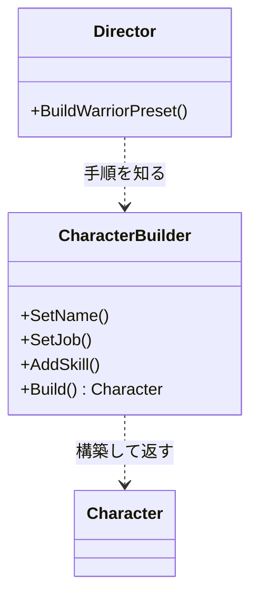

# Builder

## 解決する問題

**構築手順が複雑なオブジェクト**(必須/任意の設定が多い、段階的に組み立てる、組み合わせに制約がある)を、巨大なコンストラクタ引数リストなしで安全に作りたい。

## 登場人物と責務

- **Product**: 作られる複雑なオブジェクト(例: `Character`)
- **Builder**: 部分ごとの構築メソッドを提供(`SetClass()`, `AddSkill()`)し、最後に `Build()` で完成品を返す
- **Director**(省略されがち): 定番の組み立て手順を知っている(「戦士テンプレ」)

## 最小構成図



## パターンなしの実装

```cpp
// C++20(問題例)— 望遠鏡コンストラクタ (telescoping constructor)
Character hero("Hero", Job::Warrior, 100, 50, 10, 5, true, false, nullptr, 3);
// 100は何?50は?trueは何のフラグ? 呼び出し側で読めない
// 「名前と職業だけ指定したい」のに全引数が必要
```

## 問題点

- 引数の意味が呼び出し側で読めない。同型の引数(int, int)の順序ミスはコンパイラが検出できない
- 任意項目のためにオーバーロードやデフォルト引数が爆発する
- 「スキルは職業決定後にしか足せない」のような**手順の制約**を表現できない

## パターン適用後のC++コード

```cpp
// C++20 — メソッドチェーン形式(fluent builder)
#include <string>
#include <vector>

struct Character {
    std::string name;
    std::string job;
    int hp = 100;
    std::vector<std::string> skills;
};

class CharacterBuilder {
public:
    CharacterBuilder& Name(std::string v) { c_.name = std::move(v); return *this; }
    CharacterBuilder& Job(std::string v)  { c_.job = std::move(v); return *this; }
    CharacterBuilder& Hp(int v)           { c_.hp = v; return *this; }
    CharacterBuilder& AddSkill(std::string v) { c_.skills.push_back(std::move(v)); return *this; }

    Character Build() {
        // 完成時にまとめて検証できるのがBuilderの利点
        if (c_.job.empty()) c_.job = "Novice";
        return std::move(c_);
    }
private:
    Character c_;
};

// 使用側: 何を設定しているかが読める。任意項目は書かなければよい
// Character hero = CharacterBuilder{}.Name("Hero").Job("Warrior").AddSkill("Slash").Build();
```

検証済みサンプル: <a href="/study/samples/cpp/pattern_builder.cpp">samples/pattern_builder.cpp</a>

### C++20ならではの代替: 指示付き初期化

**設定の集合が「ただのデータ」なら、Builderクラス自体が不要**なことも多いです。

```cpp
// C++20 designated initializers — 引数の名前付き問題はこれで解決することが多い
struct CharacterDesc {
    std::string name;
    std::string job = "Novice";
    int hp = 100;
};
Character CreateCharacter(const CharacterDesc& desc);
// 使用: CreateCharacter({ .name = "Hero", .job = "Warrior" });
```

Builderが正当化されるのは、**手順に順序・検証・中間状態**があるとき(構築中にしか許されない操作がある、完成品を不変にしたい)です。

## C#またはUnityでの実装

```csharp
// C#: オブジェクト初期化子があるので単純なBuilderは不要になりがち
var desc = new CharacterDesc { Name = "Hero", Job = Job.Warrior };  // これで十分な場合が多い

// Builderが活きるのは手順と検証があるとき(例: レベル生成)
public class DungeonBuilder {
    private readonly List<Room> rooms = new();
    public DungeonBuilder AddRoom(RectInt bounds) { rooms.Add(new Room(bounds)); return this; }
    public DungeonBuilder ConnectAll() { /* 全部屋を通路で接続 */ return this; }
    public Dungeon Build() {
        if (rooms.Count == 0) throw new InvalidOperationException("部屋が必要");
        return new Dungeon(rooms);   // 完成品は不変にできる
    }
}
```

## ゲームでの具体例

- プロシージャルなレベル生成(部屋を追加→接続→検証→確定)
- キャラクターメイキング(種族→職業→外見、前段の選択が後段の選択肢を制約)
- 通知UIやツイーン設定(`tween.Move(...).Ease(...).Delay(...).Start()` はBuilderの変形)

## 利点

- 呼び出し側が**読める**(何をどう設定したか)
- 任意項目・段階的構築・完成時検証を表現できる
- 完成品(Product)を不変オブジェクトにできる(構築中だけ可変)

## 欠点

- クラスとコードが増える。単純なデータ設定には過剰
- ビルダーの状態管理(Build後の再利用可否など)という新しい決め事が必要
- C++ではメソッドチェーンと右辺値の絡みで書き味の調整(`&&`修飾など)が必要になることがある(上の例では省略)

## 適用条件

- 構築に順序・段階・検証がある
- 任意項目が多く、組み合わせが多様
- 完成品を不変にしたい

## 避けるべき条件

- 設定項目がただのデータ → 集約struct+指示付き初期化(C++20)/オブジェクト初期化子(C#)で十分
- 項目が3個以下で安定 → 普通のコンストラクタでよい

## 似たパターンとの違い

- [Factory Method](/design/patterns/factory-method.html): 「どの型を作るか」の分岐。Builderは「1つの複雑なものの組み立て方」
- [Prototype](/design/patterns/prototype.html): 既存個体のコピー。Builderはゼロから手順で組む
- [Composite](/design/patterns/composite.html): Builderの成果物がCompositeツリー、という組み合わせは頻出(UIツリー構築など)

## 実務でよく見かける変形

- **Descパターン**(ゲーム業界で頻出): `D3D12_..._DESC` のように設定structを渡す形。Builderの「名前付き設定」の利点をクラスなしで得る
- Directorをデータ化: プリセット(戦士テンプレ)をJSONやScriptableObjectにして、汎用ビルダーが読む

## 過剰設計になる例

`Vector3Builder{}.X(1).Y(2).Z(3).Build()` — 3個の必須引数にBuilderは何の価値も足しません。**「読めない引数リスト」問題は、まず名前付きの設定structで解決を試み、手順・検証が必要なときだけBuilderに進む**のが判断順です。

## 関連項目

- [Factory Method](/design/patterns/factory-method.html) / [Abstract Factory](/design/patterns/abstract-factory.html)
- [構造体とクラス](/languages/cpp/structs-and-classes.html)(Descパターンの基盤)

## 理解度チェック

1. Builderが「設定struct渡し」より正当化される条件は何ですか。
2. 望遠鏡コンストラクタの何が危険ですか(コンパイラが守れない点を挙げる)。
3. Build()で検証をまとめて行える利点を説明してください。

## 演習

「クエスト」を組み立てるAPIを設計してください。制約: 目標(討伐/収集)は必須で1つ以上、報酬は任意、討伐目標には対象敵IDが必須。(a) 設定struct案と (b) Builder案を書き、制約違反がいつ検出されるか(コンパイル時/Build時/実行時)を比較してください。

---

前: [Abstract Factory](/design/patterns/abstract-factory.html) | [カテゴリ目次](/design/patterns/) | 次: [Prototype](/design/patterns/prototype.html)
