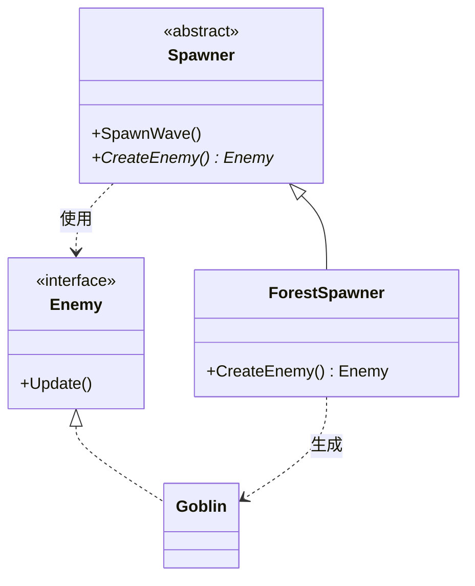

# Factory Method

## 解決する問題

「どの具象クラスを生成するか」の決定を、使う側のコードから切り離したい。`new Goblin()` と直接書くと、呼び出し側が具象型に結合し、生成する種類を変えるたびに呼び出し側を修正することになります。

## 登場人物と責務

- **Product(抽象)**: 生成されるものの共通インターフェース(例: `Enemy`)
- **ConcreteProduct**: 具体的な生成物(例: `Goblin`, `Dragon`)
- **Creator**: 生成用のメソッド(ファクトリメソッド)を宣言する側。生成物を**使う**コードも持つことが多い
- **ConcreteCreator**: どのConcreteProductを作るかを決める

## 最小構成図



## パターンなしの実装

```cpp
// C++20(問題例)
void SpawnWave(StageType stage, std::vector<std::unique_ptr<Enemy>>& out) {
    for (int i = 0; i < 5; ++i) {
        if (stage == StageType::Forest)      out.push_back(std::make_unique<Goblin>());
        else if (stage == StageType::Volcano) out.push_back(std::make_unique<FireImp>());
        else if (stage == StageType::Ice)     out.push_back(std::make_unique<IceGolem>());
    }
    // 出現演出、リストへの登録などの共通処理...
}
```

## 問題点

- ステージ追加のたびにこの関数(と、生成分岐を書いた他の全関数)を修正([OCP](/design/solid/ocp.html)が閉じていない)。
- 「5体湧かせて演出して登録する」という**共通の流れ**と「何を作るか」という**可変点**が絡まっている。
- テストで「ダミー敵を湧かせる」ことができない。

## パターン適用後のC++コード

```cpp
// C++20
#include <memory>
#include <vector>

class Enemy {
public:
    virtual ~Enemy() = default;
    virtual void Update() = 0;
};
class Goblin : public Enemy { public: void Update() override { /* 徘徊 */ } };
class FireImp : public Enemy { public: void Update() override { /* 火球 */ } };

class Spawner {
public:
    virtual ~Spawner() = default;
    // 共通の流れは基底に1回だけ書く(Template Methodとの併用形)
    void SpawnWave(std::vector<std::unique_ptr<Enemy>>& out) {
        for (int i = 0; i < 5; ++i) {
            auto e = CreateEnemy();      // 可変点だけ子に任せる = Factory Method
            /* 出現演出・登録などの共通処理 */
            out.push_back(std::move(e));
        }
    }
protected:
    virtual std::unique_ptr<Enemy> CreateEnemy() = 0;   // これがファクトリメソッド
};

class ForestSpawner : public Spawner {
protected:
    std::unique_ptr<Enemy> CreateEnemy() override { return std::make_unique<Goblin>(); }
};
class VolcanoSpawner : public Spawner {
protected:
    std::unique_ptr<Enemy> CreateEnemy() override { return std::make_unique<FireImp>(); }
};
```

検証済みサンプル: <a href="/study/samples/cpp/pattern_factory_method.cpp">samples/pattern_factory_method.cpp</a>

### 現代的な変形(継承なし版)

サブクラスを作らず、生成関数を注入する形が現代C++では主流です。

```cpp
// C++20 — std::functionによる軽量版
class Spawner {
public:
    using EnemyFactory = std::function<std::unique_ptr<Enemy>()>;
    explicit Spawner(EnemyFactory factory) : factory_(std::move(factory)) {}
    void SpawnWave(std::vector<std::unique_ptr<Enemy>>& out) {
        for (int i = 0; i < 5; ++i) out.push_back(factory_());
    }
private:
    EnemyFactory factory_;
};
// 使用: Spawner forest([]{ return std::make_unique<Goblin>(); });
```

## C#またはUnityでの実装

```csharp
// Unity: PrefabをScriptableObjectで差し替える形が事実上のFactory Method
[CreateAssetMenu(menuName = "Spawn/StageSpawnConfig")]
public class StageSpawnConfig : ScriptableObject {
    [SerializeField] private Enemy enemyPrefab;   // 「何を作るか」をデータで注入
    public Enemy CreateEnemy(Vector3 pos) => Object.Instantiate(enemyPrefab, pos, Quaternion.identity);
}

public class WaveSpawner : MonoBehaviour {
    [SerializeField] private StageSpawnConfig config;   // ステージ毎に差し替え
    public void SpawnWave() {
        for (int i = 0; i < 5; i++) config.CreateEnemy(RandomPoint());
    }
}
```

Unityでは「生成の可変点」はサブクラスよりも**Prefab/ScriptableObjectの参照差し替え**で表現するのが自然です。

## ゲームでの具体例

- ステージごとの敵構成、難易度ごとの敵バリエーション
- 弾生成: 武器が「自分の弾の作り方」を持つ
- ネットワーク対戦: パケット種別からメッセージオブジェクトを生成

## 利点

- 生成の分岐が1か所に集まり、種類追加が新Creator(または新Prefab)の追加で済む
- 「使う側」が具象型から切り離され、テスト用生成物を注入できる
- 生成の共通手続き(初期化・登録・演出)を1か所に保てる

## 欠点

- クラス数が増える(継承版は生成物1種につきCreator1つ)
- 「実際に何が生成されるのか」がコードを直線的に読んでも分からなくなる
- 生成物のコンストラクタ引数が種類ごとに違うと、インターフェースの設計が難しくなる

## 適用条件

- 生成する型の決定を、使用箇所から独立して変えたい(ステージ・難易度・設定・テスト)
- 生成の前後に共通手続きがある
- 種類が増え続けることが分かっている

## 避けるべき条件

- 生成する型が1つ、または固定の少数で増えない → `std::make_unique` 直書きで十分
- 生成に可変点がない → 関数化すら不要
- 「とりあえずFactoryクラスを作る」文化 → newを1回包んだだけの `XxxFactory` はコードを追う手数を増やすだけ

## 似たパターンとの違い

- [Abstract Factory](/design/patterns/abstract-factory.html): 単品の生成 vs **関連する一族**の生成。Factory Methodを束ねたものがAbstract Factoryになりがち
- [Builder](/design/patterns/builder.html): 「どれを作るか」 vs 「複雑な1つを**どう組み立てるか**」
- [Prototype](/design/patterns/prototype.html): クラスから作る vs **既存インスタンスをコピー**して作る

## 実務でよく見かける変形

- static関数版: `Enemy::Create(EnemyType type)` — 分岐は残るが生成箇所が1か所に集約される。小規模ではこれで十分なことが多い
- 登録制ファクトリ: `map<string, function<unique_ptr<Enemy>()>>` にIDで登録。データ駆動([Type Object](/game/patterns/type-object-and-sandbox.html))と組み合わせる
- DIコンテナのファクトリ注入(→ [DI](/game/patterns/service-locator-and-di.html))

## 過剰設計になる例

`PlayerFactory` が `new Player()` を包むだけで、プレイヤーは常に1種類——これは間接化のコストだけ払う典型。**可変点がないところにファクトリを作らない。**

## 関連項目

- [OCP](/design/solid/ocp.html) / [DIP](/design/solid/dip.html) / [Template Method](/design/patterns/template-method.html)
- [ケーススタディ: オブジェクト生成](/design/case-studies/object-spawning.html)

## 理解度チェック

1. Factory Methodが分離する「2つの関心」は何と何ですか。
2. 継承版とstd::function版の使い分けの基準を1つ挙げてください。
3. Factoryを作るべきでないのはどんなときですか。

## 演習

「宝箱から出るアイテム」の生成を、(a) switch直書き、(b) 登録制ファクトリ(IDから生成関数を引く)、の2通りで実装し、「新アイテム追加時に触るファイル」を比較してください。

---

前: [カテゴリ目次](/design/patterns/) | 次: [Abstract Factory](/design/patterns/abstract-factory.html)
