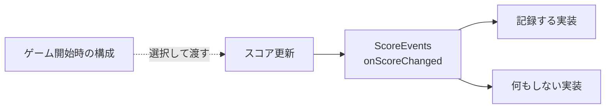

# Null Objectパターン — 任意の機能を何もしない実装で表す

スコアの変更をプレイ分析へ記録する機能を考えます。対戦中は実際の記録先を使い、オフラインや単体テストでは記録しない設定を使います。記録先が任意なら、初期化で同じインターフェースを持つ空の実装を選べます。以後、スコアの処理は記録先の有無を調べず、同じ操作を呼び出します。



## 何もしないことが契約を満たすか

WoolfのNull Objectでは、実装が「何もしない」の詳細を引き受けます。通知を送らなくてもルールが成り立つなら、空の操作を定義できます。一方、アイテム購入に必須の決済先が見つからないとき、空の実装が「購入成功」を返すと、呼び出し側が誤った状態へ進みます。欠落がエラーなら初期化や操作の結果に表します。欠落そのものが状態として意味を持つなら、`std::optional` などで呼び出し側へ伝えます。

戻り値を持つ場合も意味を決めます。例えば「追加の演出を列挙する」操作で空の一覧を返すことには意味があります。「同じ名前のファイルを保存した」という結果を返す操作で、何も保存せずに成功とするのは契約を破ります。

## コード例 — 通知の有無にかかわらず同じルールを動かす

C++20の単体例です。`Score` は通知先を参照で受け取り、通知先は `Score` より長く生きます。`CaptureScoreEvents` は最後の通知値をテスト用に記録します。実際のゲームなら分析用キューなどを背後に置けます。

```cpp
#include <iostream>

class ScoreEvents {
public:
    virtual ~ScoreEvents() = default;
    virtual void onScoreChanged(int score) noexcept = 0;
};

class NoScoreEvents final : public ScoreEvents {
public:
    void onScoreChanged(int) noexcept override {}
};

class CaptureScoreEvents final : public ScoreEvents {
public:
    int last = 0;
    void onScoreChanged(int score) noexcept override { last = score; }
};

class Score {
public:
    explicit Score(ScoreEvents& events) : events_(events) {}

    void collectCoin() noexcept
    {
        if (value_ < 100) {
            value_ += 10;
            events_.onScoreChanged(value_);
        }
    }

    int value() const noexcept { return value_; }

private:
    ScoreEvents& events_;
    int value_ = 0;
};

int main()
{
    NoScoreEvents noEvents;
    CaptureScoreEvents capture;
    Score offline(noEvents);
    Score recorded(capture);

    offline.collectCoin();
    recorded.collectCoin();
    std::cout << offline.value() << ' ' << recorded.value() << ' ' << capture.last << '\n';
    return offline.value() == 10 && recorded.value() == 10 && capture.last == 10 ? 0 : 1;
}
```

結果は `10 10 10` です。スコアを更新する責務は `Score` にあり、二つの通知先はそのルールを変更しません。空の実装を共有するなら可変状態を持たせず、呼び出されるスレッドや依存先の寿命もインターフェースの契約に含めます。

Null Objectを選ぶのは構成側です。呼び出すたびに有無を調べるコードが構成の一箇所に移ります。どちらの実装が選ばれたかを知る必要がある運用では、呼び出し側に判定を広げず、構成や診断ログに選択を残します。

## 理解度チェック

1. 通知先をNull Objectにすると、`Score` に必要な参照の寿命はどうなるか。
2. 有効なファイル保存先が設定されなかった場合に、空の実装で成功を返してよいか。
3. 空の実装と、テストで通知を記録する実装の役割はどう違うか。

::: details 解答

1. 通知先は引き続き `Score` より長く生きる。空の実装でも参照先のオブジェクトは必要。
2. 必須の保存が行われていないので、失敗を表す。保存が任意という契約なら、保存しない構成の意味を定義できる。
3. 空の実装は構成として何もしない。テスト用の記録実装は通知の値を検査するために持つ。

:::

## 関連項目

- [依存関係と依存の方向](/design/foundations/dependency.html)
- [Strategy](/design/patterns/strategy.html)
- [Observer](/design/patterns/observer.html)

## 参考資料

- [Bobby Woolf — The Null Object Pattern（著者原稿）](https://www.cs.uni.edu/~wallingf/blog-images/code/null-object-woolf.pdf)
- [WG21 N4861（C++20）— Virtual functions](https://timsong-cpp.github.io/cppwp/n4861/class.virtual)
- [WG21 N4861（C++20）— References](https://timsong-cpp.github.io/cppwp/n4861/dcl.ref)
