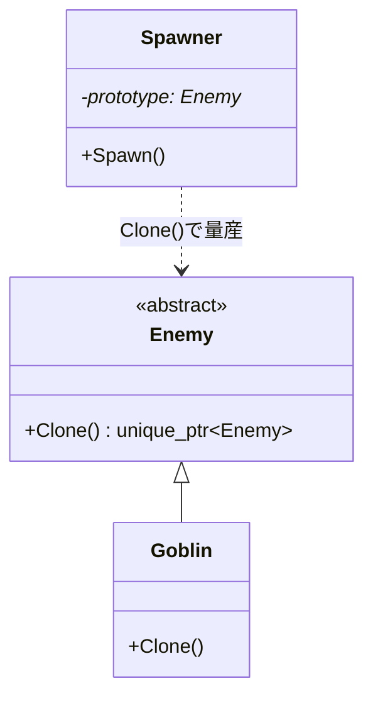

# Prototype

## 解決する問題

「クラスから new する」のではなく、**設定済みの見本(プロトタイプ)をコピーして**新しいインスタンスを作りたい。生成したい種類が実行時に決まる(データやエディタ上の配置で決まる)場合、クラス階層での表現は追いつきません。

## 登場人物と責務

- **Prototype**: 自分の複製を返す `Clone()` を宣言する抽象
- **ConcretePrototype**: 実際の複製処理(深いコピーの範囲を決める)
- **Client**: 見本を保持し、`Clone()` で量産する

## 最小構成図



## パターンなしの実装

```cpp
// C++20(問題例)— 種類はデータ(敵テーブル)で決まるのに、生成がクラス分岐
std::unique_ptr<Enemy> SpawnFromTable(const EnemyRecord& record) {
    std::unique_ptr<Enemy> e;
    if (record.typeName == "goblin") e = std::make_unique<Goblin>();
    else if (record.typeName == "orc") e = std::make_unique<Orc>();
    // レコードの個別調整(色違い・強化版)を毎回ここで再設定
    e->SetHp(record.hp);
    e->SetColor(record.color);
    return e;
}
```

## 問題点

- 「色違いゴブリン(強)」のような**バリエーションごとにクラスを作れない**(データ量産に階層が追いつかない)
- 見本の調整(エディタで配置した敵のパラメータ)をコードで再現する二度手間

## パターン適用後のC++コード

```cpp
// C++20
#include <memory>
#include <string>
#include <unordered_map>

class Enemy {
public:
    virtual ~Enemy() = default;
    virtual std::unique_ptr<Enemy> Clone() const = 0;   // 複製は自分が知っている
    int hp = 10;
    std::string color = "green";
};

class Goblin : public Enemy {
public:
    std::unique_ptr<Enemy> Clone() const override {
        return std::make_unique<Goblin>(*this);   // コピーコンストラクタで複製
    }
};

// 見本置き場: 「設定済みの個体」を種類として登録する
class PrototypeRegistry {
public:
    void Register(const std::string& id, std::unique_ptr<Enemy> proto) {
        protos_[id] = std::move(proto);
    }
    std::unique_ptr<Enemy> Spawn(const std::string& id) const {
        return protos_.at(id)->Clone();
    }
private:
    std::unordered_map<std::string, std::unique_ptr<Enemy>> protos_;
};

// 使用例: 色違い強化ゴブリンを「クラスを増やさず」種類として登録
// auto elite = std::make_unique<Goblin>(); elite->hp = 50; elite->color = "red";
// registry.Register("elite_goblin", std::move(elite));
// auto e1 = registry.Spawn("elite_goblin");  // 何体でも複製
```

検証済みサンプル: <a href="/study/samples/cpp/pattern_prototype.cpp">samples/pattern_prototype.cpp</a>

### C++での注意: Cloneの中身

- `Clone()` はコピーコンストラクタに委ねるのが基本(→ [コピー](/languages/cpp/ctor-dtor-copy-move.html))。メンバにポインタがある場合、**どこまで深くコピーするか**(共有か複製か)を型ごとに決める必要があります。これがこのパターンの実装難所です(→ [所有権](/runtime/memory/ownership-and-borrowing.html))。
- 派生型を増やすたびに `Clone()` を書くのを忘れがち(忘れるとスライシングや浅すぎるコピーが起きる)。CRTP(奇妙に再帰したテンプレートパターン)で自動化する変形もあります。

## C#またはUnityでの実装

**UnityのPrefab + Instantiate がPrototypeパターンそのもの**です。

```csharp
// Prefab(エディタで設定済みの見本)を複製して量産する — 毎日使っているPrototype
public class Spawner : MonoBehaviour {
    [SerializeField] private Enemy enemyPrefab;      // 見本(プロトタイプ)
    public Enemy Spawn(Vector3 pos) => Instantiate(enemyPrefab, pos, Quaternion.identity);
}
```

- Prefab Variantは「見本の派生見本」で、Prototypeの階層化に相当。
- C#でのClone実装は `ICloneable` よりも、明示的なコピーコンストラクタやrecordの `with` 式が推奨されます(ICloneableは深い/浅いの契約が曖昧なため)。

## ゲームでの具体例

- Prefab/Prefab Variant(Unity)、Blueprint Class(UE: クラスとデータの中間物)
- エディタで配置・調整した敵の量産、パーティクルのテンプレート
- 「呪われた複製」系のギミック(実行時に既存個体のコピーを作る)

## 利点

- **種類の追加がデータ作業になる**(クラス追加不要)。エディタ調整済みの状態をそのまま量産できる
- 実行時に新しい「種類」を作れる(合成・変異システム)
- 複雑な初期化を1回だけ行い、以後はコピーで済ませられる(初期化が重い場合の高速化)

## 欠点

- 深いコピーの設計が難しい(共有すべきものと複製すべきものの区別 → [Flyweight](/design/patterns/flyweight.html)との併用で解決することが多い)
- 見本の管理場所(レジストリ)が必要
- 「この個体はどの見本から来たか」の追跡が必要になる場合、仕組みを足す必要がある

## 適用条件

- 種類がデータ・エディタ作業で増える(コード変更なしで増やしたい)
- 設定済み状態の複製が生成の主な形
- 実行時に種類が生まれる

## 避けるべき条件

- 種類がコードで固定的に決まっていて少ない → Factory Methodやnew直書きで十分
- 個体がほぼ状態を持たない → コピーする意味がない(共有で足りる → Flyweight)

## 似たパターンとの違い

- [Factory Method](/design/patterns/factory-method.html): クラスが生成方法を知る。Prototypeは**インスタンスが**生成方法(自己複製)を知る
- [Flyweight](/design/patterns/flyweight.html): コピーせず**共有**する。実務では「共有部分はFlyweight、個体部分はPrototypeでコピー」と併用する
- [Memento](/design/patterns/memento.html): 複製の目的が「新個体」か「状態の保存・復元」か

## 実務でよく見かける変形

- [Type Object](/game/patterns/type-object-and-sandbox.html)との併用: 種類データ(共有)+個体状態(コピー)の分離。大規模ではこちらが主流
- シリアライズ経由の複製: 保存→読込で深いコピーを実現(遅いが確実。エディタ実装でよく使われる)

## 過剰設計になる例

数種類しかない・実行時にも増えない敵に `Clone()` 階層とレジストリを整備する——Factory Methodどころかswitchで十分な規模に、深いコピーの難しさだけ持ち込む結果になります。

## 関連項目

- [コピーとムーブ](/languages/cpp/ctor-dtor-copy-move.html) / [所有権](/runtime/memory/ownership-and-borrowing.html)
- [Type Object](/game/patterns/type-object-and-sandbox.html)
- [ケーススタディ: オブジェクト生成](/design/case-studies/object-spawning.html)

## 理解度チェック

1. Factory MethodではなくPrototypeが必要になるのは、種類が「何によって」増えるときですか。
2. Cloneの実装で最も注意すべき設計判断は何ですか。
3. UnityのPrefabがPrototypeである理由を説明してください。

## 演習

`Enemy` に `std::vector<Item> dropItems`(所有)と `const EnemyTypeData* typeData`(共有データへの非所有ポインタ)があるとします。`Clone()` でそれぞれをどう扱うべきか、理由とともに書いてください。

---

前: [Builder](/design/patterns/builder.html) | [カテゴリ目次](/design/patterns/) | 次: [Singleton](/design/patterns/singleton.html)
