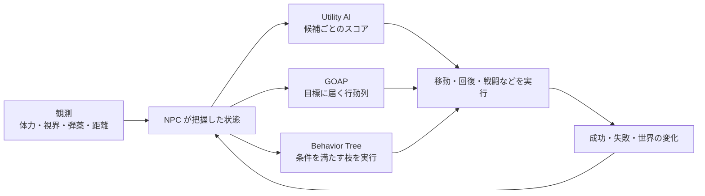

# ゲーム AI の意思決定 — Utility AI・GOAP・Behavior Tree を選ぶ

NPC が敵に気づいたとき、戦う、距離を取る、回復するなどの候補がある。どの方式でも、まず NPC が知っている世界の状態と、実際に実行できる行動を決める。意思決定は行動を選び、移動やアニメーションの仕組みはその行動を実行して結果を返す。



## Utility AI — 候補に点数を付ける

候補ごとに考慮する入力を決め、応答曲線で共通のスコア範囲に写す。例えば体力を 0〜1 に正規化して、回復の必要性を $(1-\mathrm{HP})^2$ にすると、体力 0.2 では 0.64、体力 0.8 では 0.04 になる。この曲線は体力が少ないほど急に回復を優先する。回復手段がないときは、候補から回復を外す。

複数の入力を掛け合わせると、いずれかが 0 の行動は 0 になる。和なら、一つの高い値が別の低い値を補いうる。何を必須条件にするかと、何を選好として混ぜるかを区別する。同点の規則や、現在の行動を切り替えるために必要な点差を決めると、小さな値の変動で行動が毎回切り替わるのを防ぎやすい。

## GOAP — 前提と効果から行動列を探す

Goal-Oriented Action Planning では、目標を「達成したい状態」、各行動を「実行前に必要な条件・実行後の効果・コスト」で表す。NPC が安全になるまでの例を考える。

| 行動 | 前提 | 効果 | コストの例 |
| --- | --- | --- | --- |
| 遮蔽に移動 | 遮蔽への経路あり | 遮蔽内 | 2 |
| 治療する | 遮蔽内、回復薬あり | 体力確保、回復薬を消費 | 1 |
| 安全な部屋に退き、備品で治療 | 部屋への経路あり、備品あり | 遮蔽内、体力確保 | 5 |

初期状態が「遮蔽の外、回復薬あり」で、どちらの経路も使え、部屋に備品があるとする。目標が「遮蔽内かつ体力確保」なら、「遮蔽に移動 → 治療する」のコストは 3、「安全な部屋に退き、備品で治療」は 5。遮蔽への経路が使えなくなれば、移動の前提を更新し、別の計画を探せる。行動列を探すための探索空間は世界状態、道順を探す [ナビメッシュ上の経路探索](../algorithms/pathfinding.md)は空間上の位置が対象になる。

## Behavior Tree — 枝で実行順と割り込みを決める

Selector や Sequence などで条件と行動を組み立てる。例えば「体力が低い場合は退避して回復する枝」を、「敵が見える場合は追跡する枝」より優先できる。木で選べる行動や順序は、作者がノードと条件で定義する。**Unreal Engine 5.8** の Behavior Tree では Blackboard のキーを監視する Decorator を使い、値の変化に応じて下位の行動を中断するよう設定できる。ノードとキーの役割は [Behavior Tree と Blackboard](patterns/behavior-tree-and-blackboard.md)を参照。

| 方式 | 作者が定義すること | 実行中に確認すること |
| --- | --- | --- |
| Utility AI | 候補、入力、応答曲線、選択規則 | 最終スコアと、どの入力がその点数になったか |
| GOAP | 世界状態、目標、行動の前提と効果、コスト | 探索した状態数、選んだ行動列、再計画の原因 |
| Behavior Tree | 枝の順序、条件、タスク、割り込み | 現在の枝、条件の変化、中断とタスクの結果 |

組み合わせるなら、Utility AI が目標を選び、GOAP が手順を探し、各行動の実行を小さな Behavior Tree に任せる構成も可能。すべての層が独自に割り込むと、どこで判断が変わったかを追いにくい。観測値、選択理由、失敗の原因を同じ NPC の履歴として残す。

## コード例 — 体力に応じて候補の順位を変える

標準 C++20 の例。回復・交戦・退避のスコアを計算し、回復の前提を満たさない場合は候補から除く。同点では先に並んだ候補が残る。関数に渡す体力、脅威、視界の値は 0〜1。

```cpp
#include <array>
#include <iomanip>
#include <iostream>
#include <string_view>

struct Situation
{
    double health;
    double threat;
    double visibility;
    bool hasMedicine;
};

struct Candidate
{
    std::string_view action;
    double score;
    bool eligible;
};

Candidate choose_action(const Situation& situation)
{
    const double missingHealth = 1.0 - situation.health;
    const std::array candidates{
        Candidate{"heal", missingHealth * missingHealth, situation.hasMedicine},
        Candidate{"engage", situation.visibility * situation.health, true},
        Candidate{"retreat", situation.threat * missingHealth, true}
    };

    Candidate best{"idle", 0.0, true};
    for (const Candidate& candidate : candidates)
    {
        if (candidate.eligible && candidate.score > best.score)
            best = candidate;
    }
    return best;
}

int main()
{
    const std::array situations{
        Situation{0.2, 0.6, 0.8, true},
        Situation{0.2, 0.6, 0.8, false},
        Situation{0.8, 0.6, 0.8, true}
    };
    for (const Situation& situation : situations)
    {
        const Candidate choice = choose_action(situation);
        std::cout << choice.action << ' ' << std::fixed << std::setprecision(2)
                  << choice.score << '\n';
    }
}
```

出力は `heal 0.64`、`retreat 0.48`、`engage 0.64`。1 件目と 2 件目は体力・脅威・視界が同じ。回復薬の有無だけで回復が候補から外れ、退避が選ばれる。

## 理解度チェック

1. Utility AI で「鍵がないと開けられない扉」を扱うとき、点数とは別に何を判定するか。
2. GOAP の計画を実行中に遮蔽への経路が塞がれた。どの情報を更新するか。
3. Behavior Tree の処理中、追跡より回復を優先したい。木でどの二点を確認するか。

::: details 解答

1. 鍵を持っているかを実行可能条件として判定する。
2. 遮蔽への経路があるという前提を更新する。必要に応じて、実行可能な行動から計画を作り直す。
3. 回復の枝を追跡より優先する順序と、追跡中に回復条件が成立したときの割り込みの設定。

:::

## 関連項目

- [Behavior Tree と Blackboard](patterns/behavior-tree-and-blackboard.md)
- [ステートマシン](patterns/state-machines.md)
- [経路探索](../algorithms/pathfinding.md)

## 参考資料

- Kevin Dill・Dave Mark, [Improving AI Decision Modeling Through Utility Theory](https://www.gdcvault.com/play/1012410/Improving-AI-Decision-Modeling-Through2d)・[講演資料](https://media.gdcvault.com/gdc10/slides/MarkDill_ImprovingAIUtilityTheory.pdf), GDC 2010
- Jeff Orkin, [Three States and a Plan — The AI of F.E.A.R.](https://gdcvault.com/play/1013282/Three-States-and-a-Plan), GDC 2006
- Epic Games, [Behavior Tree Overview（Unreal Engine 5.8）](https://dev.epicgames.com/documentation/en-us/unreal-engine/behavior-tree-in-unreal-engine---overview)
