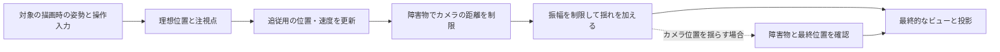

# カメラシステム — 追従・衝突回避・画面揺れを組み合わせる

三人称のカメラは、プレイヤーの背後に置いた目標点を追い、壁が近ければ手前へ寄り、着地などに合わせて短時間だけ揺れます。プレイヤーがどこを向いているか、カメラがどこに置けるか、画面がどう動くかを一つの変数で扱うと、壁から離れた後や揺れが終わった後の復帰を制御しにくくなります。

## カメラが取りたい位置と、画面を描く位置

追う対象の位置をそのまま注視点にすると、対象の姿勢やアニメーションの細かな動きがカメラへ伝わります。胸の高さなどに安定した注視点を置き、回転と肩越しのオフセットから理想位置を作ります。注視点とカメラ位置は別々に平滑化できます。見下ろしカメラなら、対象の移動方向へ注視点を先行させて、これから移動する場所を画面に入れられます。



追従は対象の移動を反映したあとに更新します。物理更新と描画更新の頻度が異なる場合は、カメラが追う対象と画面に描く対象が同じ時点の姿勢になるようにします。カメラの射影やFOVは[座標とカメラの基礎](/graphics/basics/transforms-and-cameras.html)、入力から照準へ向きを渡す処理は[照準操作](/design/case-studies/aim-control.html)で扱います。

## ばねで追従し、時間刻みで進める

目標 $g$ が1ステップの間に一定なら、カメラ位置 $x$ の誤差を $e=x-g$、速度を $v$ として、角周波数 $\omega>0$ の臨界減衰ばねを次の式で進められます。

$$
\begin{aligned}
a &= v+\omega e \\
e_{\mathrm{next}} &= (e+a\Delta t)\exp(-\omega\Delta t) \\
v_{\mathrm{next}} &= (v-\omega a\Delta t)\exp(-\omega\Delta t)
\end{aligned}
$$

誤差が10、速度が0、$\omega=4\ \mathrm{s}^{-1}$ なら0.25秒後の誤差は $(10+40\cdot0.25)e^{-1}\simeq7.358$ です。式は目標を固定した臨界減衰の微分方程式の解なので、同じ目標に対し0.25秒を1回進めても、0.125秒を2回進めても丸め誤差を除いて一致します。目標が動く場合は、各ステップでどの時点の目標を入力するかによって結果が変わります。

臨界減衰は振動を伴わない境界です。初期速度が0の固定目標への追従では目標を通り越さずに近づきますが、すでに大きな速度がある状態で目標を変えると、一度通り越すことはあります。シーン切り替えなどで瞬間移動させるなら、目標位置へ直接移して追従速度もリセットします。

## 障害物と揺れを追従から切り離す

三人称のアームでは、支点からカメラの理想位置へ球をスイープし、壁に当たる前までアームを縮めます。線のレイだけでは、カメラの中心が通れても画面の端に障害物が入り込む場合があります。プローブの半径とニアクリップの広がりは別に調整します。ターゲット自身のコライダーやトリガーを候補から外し、開始位置が障害物と重なる場合も別に扱います。

壁に入らないよう縮める処理と、遮蔽物が消えたあと元の距離まで戻す処理は速度を分けられます。例えば希望距離が6 m、球の中心が壁に接するまでの移動距離が2.4 m、安全余白が0.1 mなら、描画用の距離は2.3 mまで縮めます。壁がなくなったら、この描画距離から時間をかけて戻します。

画面揺れは、着地などのイベントで振幅と持続時間を決め、時間とともに弱めるオフセットとして加えます。基準の追従状態へ揺れた位置を毎回書き戻すと、追従が次のフレームでも揺れを追います。揺れは表示用の位置や回転へ加え、ゲームの照準に使う向きとは用途に応じて分けます。位置をずらした結果、壁に入る恐れがある場合は、揺れた位置をもう一度確認するか、位置の振幅を制限します。

## コード例 — 追従を進め、アームの距離を制限する

C++20の単体プログラムです。`cl /std:c++20 /EHsc camera.cpp` でコンパイルできます。1軸の追従を2種類の時間刻みで比較します。球のスイープ結果は2.4 mとして渡します。衝突クエリ自体はエンジン側で実行する想定です。

```cpp
#include <algorithm>
#include <cmath>
#include <iomanip>
#include <iostream>
#include <optional>

struct Spring {
    double position;
    double velocity;
};

Spring step(Spring state, double target, double omega, double dt)
{
    const double error = state.position - target;
    const double a = state.velocity + omega * error;
    const double decay = std::exp(-omega * dt);
    return {
        target + (error + a * dt) * decay,
        (state.velocity - omega * a * dt) * decay
    };
}

double safeArm(double desired, std::optional<double> sweepDistance, double margin)
{
    if (!sweepDistance) {
        return desired;
    }
    return std::clamp(*sweepDistance - margin, 0.0, desired);
}

int main()
{
    const Spring start{10.0, 0.0};
    const auto oneStep = step(start, 0.0, 4.0, 0.25);
    const auto twoSteps = step(step(start, 0.0, 4.0, 0.125), 0.0, 4.0, 0.125);
    const double distance = safeArm(6.0, 2.4, 0.1);
    std::cout << std::fixed << std::setprecision(3)
              << "One step: " << oneStep.position << '\n'
              << "Two steps: " << twoSteps.position << '\n'
              << "Arm: " << distance << '\n';
    return std::abs(oneStep.position - twoSteps.position) < 1e-12 ? 0 : 1;
}
```

Visual C++で実行すると、1回と2回の位置はどちらも `7.358`、障害物があるときのアームの距離は `2.300` と表示されます。

## エンジンの機能に対応させる

| 対象の版 | 使える機能 |
| --- | --- |
| Unity Cinemachine 3.1 | Third Person Followに追従と衝突補正がある。DeoccluderはLook At対象への視線を保てる位置を探す拡張。Impulse SourceとListenerは、イベントの揺れを発生させる側と受け取る側を分ける |
| Unreal Engine 5.8 | Spring Armは希望距離を保ち、障害物があると縮む。衝突判定にはプローブの半径とチャンネルを指定でき、Camera Lagで追従を調整できる |

ここで示した臨界減衰の式と、エンジンの各設定の値は別に扱います。例えばCinemachineのDampingに指定する値が、この式の角周波数 $\omega$ に直接対応するとは限りません。

## 理解度チェック

1. プレイヤーが急にワープしたとき、追従の状態をどう更新しますか。
2. 壁に当たったときはすぐに近づき、離れたときは徐々に戻したい。何を分けますか。
3. 短時間だけ画面を揺らし、照準を同じ方向に保つには、どの値へ揺れを足しますか。

::: details 解答
1. カメラの追従位置を新しい目標に合わせ、速度もリセットします。
2. 壁による縮みの適用と、障害物がなくなったあとの描画距離の復帰を分けます。
3. 表示用の位置や回転へ加え、照準を計算する向きと追従用の状態へは書き戻しません。
:::

## 関連項目

- [座標とカメラの基礎](/graphics/basics/transforms-and-cameras.html)
- [補間と曲線](/math/rendering/interpolation-and-curves.html)
- [物理の時間積分と衝突判定](/math/physics-integration-and-collision.html)

## 参考資料

- [Ryan Juckett、Damped Springs](https://www.ryanjuckett.com/damped-springs/)
- [Unity、Third Person Follow（Cinemachine 3.1）](https://docs.unity3d.com/Packages/com.unity.cinemachine@3.1/manual/CinemachineThirdPersonFollow.html)
- [Unity、Cinemachine Deoccluder（Cinemachine 3.1）](https://docs.unity3d.com/Packages/com.unity.cinemachine@3.1/manual/CinemachineDeoccluder.html)
- [Unity、Cinemachine Impulse（Cinemachine 3.1）](https://docs.unity3d.com/Packages/com.unity.cinemachine@3.1/manual/CinemachineImpulse.html)
- [Epic Games、プレイヤー操作のカメラとSpring Arm（Unreal Engine 5.8）](https://dev.epicgames.com/documentation/unreal-engine/quick-start-guide-to-player-controlled-cameras-in-unreal-engine-cpp?application_version=5.8)
