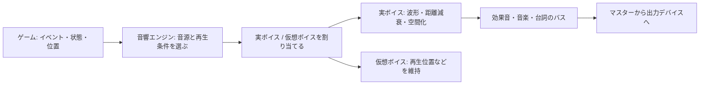

# ゲームオーディオの仕組み — イベント・ボイス管理・3D 音響

ゲームが発行する「木の床を走った」「車の回転数が上がった」といった情報を、どの音源を選び、どこから、どの音量で鳴らすかに変えるのがゲームオーディオの役割。音声素材と再生のルールをデータとして持てば、実装側とサウンド制作側はイベント名とパラメーターを取り決めて作業できる。

## イベントからミックスまで



| 層 | ゲームでの例 |
| --- | --- |
| イベント・パラメーター | `Footstep` を発行し、床材や移動速度を渡す。 |
| 音源選択 | 床材に合う素材の中から一つ選ぶ。ループ音なら速度に合わせて音色やピッチを変える。 |
| ボイス | 実際に鳴る音源の単位。イベント一つから複数の音が重なることもある。 |
| バス | 効果音、台詞、音楽などの出力をまとめて処理する経路。グループ全体の音量やエフェクトを変えられる。 |
| バンク | 実行時にロードする音響データのまとまり。どの場面で使うバンクや素材を常駐させるかがロード設計に関わる。 |

Audiokinetic の Wwise 2024.1 系には Event、SoundBank、ゲームの数値を音響プロパティーへ結びつける RTPC などがある。FMOD Studio 2.04 では Event をオーサリングし、実行時には Event Instance を作って再生する。Parameter、Bus、Bank などで変化やルーティング、配布するデータを管理する。ゲームコードの `SoundManager` などには、これらを呼び出す窓口と、ゲーム側の再生要求を管理する役割を置ける。

## 実ボイスの上限と仮想化

すべての環境音を同じコストでミックスすると、音が増えたときに処理時間が足りなくなる。そこで、同時に実際の音を作るボイスに予算を置く。たとえばプレイヤーへの通知は優先し、遠い焚き火や群衆のループは可聴性が低ければ仮想ボイスに回す。仮想ボイスには再生位置などの状態を残せる。位置を進める方式なら、近づいて実ボイスに戻ったときに、ループの続きから聞こえる。

FMOD Engine 2.04 の Core API では、実チャンネル上限を超えると優先度が低いチャンネルから仮想化し、同じ優先度の中では可聴性が低いものを選ぶ。Event Instance の個数制限と実ボイス数の制限は、別々に考える。制限に達したとき、古い音を終了する、再生要求を断る、仮想化する、のどれを選ぶかでゲーム中の聞こえ方が変わる。

音が一瞬途切れるときは、優先度や仮想化で実ボイスから外れたのか、素材のストリーミングが間に合わなかったのか、出力が飽和したのかを分けて調べる。実ボイス数だけでなく、デコード、ミックス、ストリーミング、エフェクトの時間を見る。

## 3D 音響の三つの入力

リスナーの位置と向きに対する音源の相対位置から、どの方向・距離にいるかを求める。その情報を複数の処理で使う。

| 処理 | 何を変えるか |
| --- | --- |
| 距離減衰 | 距離に応じて音量などを変える。減衰カーブはゲーム中で必要な可聴距離に合わせる。 |
| 空間化 | リスナーに対する方向を、左右のパンやヘッドフォン向けの HRTF などで表現する。 |
| 遮蔽・反響 | 壁の向こうなどの直達音を弱めたり、低域通過フィルターで高域を落としたりする。部屋や経路に応じて残響の送り量も設計できる。 |

同じ位置の音源でも、リスナーが反対を向くと左右の聞こえ方が変わる。カメラがキャラクターから離れたゲームでは、リスナーの位置と向きをどこから取るかで結果が変わる。UI の通知音などはワールド内の位置を持たずに出力することもできる。距離や向きの操作で音がどう変わるかは、[空間パンニング](/browser/audio-spatial-panning.html) と [音の遮蔽](/browser/audio-occlusion.html) でも扱う。

## コード例 — 2 ボイスの予算で仮想ボイスを残す

C++20 の観察用プログラム。`priority` は値が大きいほど優先し、同値なら `audibility` が大きいものから選ぶ。これは製品ごとの判定を再現したものではなく、上限と再生位置の考え方を確かめるための規則。1 ブロックは 480 フレーム。サンプルレートが 48,000 Hz なら `480 / 48000 = 0.01` 秒。実ボイスかどうかにかかわらず、ループのカーソルを進める。

```cpp
#include <algorithm>
#include <array>
#include <cstddef>
#include <iostream>
#include <string_view>

struct Voice
{
    std::string_view name;
    int priority;
    float audibility;
    int frame{};
};

void processBlock(std::array<Voice, 3>& voices)
{
    constexpr int blockFrames = 480;
    constexpr int loopFrames = 48000;
    constexpr std::size_t realBudget = 2;
    std::array<std::size_t, 3> order{0, 1, 2};
    std::stable_sort(order.begin(), order.end(), [&](auto a, auto b)
    {
        if (voices[a].priority != voices[b].priority)
        {
            return voices[a].priority > voices[b].priority;
        }
        return voices[a].audibility > voices[b].audibility;
    });

    for (std::size_t rank = 0; rank < order.size(); ++rank)
    {
        Voice& voice = voices[order[rank]];
        const bool real = rank < realBudget;
        std::cout << voice.name << (real ? " real" : " virtual")
                  << " at " << voice.frame << '\n';
        voice.frame = (voice.frame + blockFrames) % loopFrames;
    }
}

int main()
{
    std::array<Voice, 3> voices{{
        {"UI", 10, 0.30f},
        {"Fire", 1, 0.10f},
        {"Wind", 1, 0.60f},
    }};

    processBlock(voices);
    voices[1].audibility = 0.90f;
    processBlock(voices);
}
```

最初は UI と Wind が実ボイス、Fire は仮想。次のブロックで Fire の可聴性が上がると、Fire は実ボイスになり、カーソルは `0` ではなく `480` を示す。このプログラムは波形を出力せず、順位と再生位置をコンソールで確認する。

## 理解度チェック

<details><summary>イベントのインスタンス数と、ミックス中の実ボイス数は同じ？</summary>

イベントには複数の音源が含まれることがあり、個々の音源には仮想化などの状態もある。イベントと実ボイスは別の単位として数える。

</details>

<details><summary>仮想化している間もループのカーソルを進める理由は？</summary>

再び実ボイスになったとき、鳴り続けていた場合に対応する位置から出力できる。

</details>

<details><summary>壁の裏に移動した音源を遠くに聞こえさせたい。距離減衰だけで足りる？</summary>

距離が同じでも壁が直達音を遮る。遮蔽用の音量やフィルターを別に扱えば、その差を表せる。

</details>

## 関連項目

- [SoundManager の設計](/design/case-studies/sound-manager.html)
- [アセットの読み込み](/game/asset-loading.html)
- [空間パンニング](/browser/audio-spatial-panning.html)
- [オーディオのミキシングとヘッドルーム](/browser/audio-mixing-and-headroom.html)

## 参考資料

- [Audiokinetic — Wwise Fundamentals の対象版とコアワークフロー](https://info.audiokinetic.com/recertification)
- [Audiokinetic — The Wwise Project](https://www.audiokinetic.com/download/documents/WwiseProjectAdventure_en.pdf)
- [Audiokinetic — Integrating Audio in your Game: The Wwise Approach](https://www.audiokinetic.com/download/documents/TheWwiseApproach.pdf)
- [Firelight Technologies — FMOD Studio 2.04 Concepts](https://www.fmod.com/docs/2.04/studio/fmod-studio-concepts.html)
- [Firelight Technologies — FMOD Engine 2.04 Virtual Voice System](https://www.fmod.com/docs/2.04/api/managing-resources-in-the-core-api.html#virtual-voice-system)
