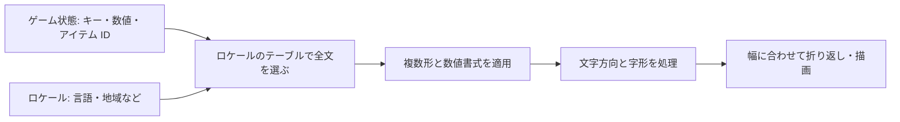

# ローカライズの設計 — 文字列テーブル・フォント・右から左の UI

ゲームのローカライズでは、同じ意味を伝える文章でも、語順、数の表し方、画面上の幅、文字の進行方向が変わる。ゲーム内で保持する値や識別子と、プレイヤー向けに組み立てた表示を分けると、同じセーブデータからロケールに合った画面を作り直せる。

## 文字列テーブルと書式

ゲームコードには `inventory.items_owned` のような意味を表すキーと、`count` のような引数を置く。文章はキーごとにテーブルへ入れ、翻訳者へ用途や引数の説明を渡す。同じ英単語でも、ボタンの「保存」と名詞の「セーブデータ」では別のキーを使う。原文を直したときに訳が古くなったことも追えるようにする。



「`count` + ` items`」のような連結では語順を変えにくい。全文のテンプレートと名前付き引数を使えば、日本語で「所持アイテム：{count} 個」、英語で「{count} items owned」のように、翻訳側で配置を決められる。数値には、そのロケールの桁区切りや小数点を使う。

複数形は言語ごとに規則が違う。CLDR 49 の英語の基数では、整数 1 は `one`、整数 0 と 2 は `other`。日本語は同じ用途に `other` だけを使う。アラビア語の基数には `zero`、`one`、`two`、`few`、`many`、`other` がある。CLDR のカテゴリ名は文法上の分類に使い、特殊な「空です」などの文言は UI の意味に応じて別のキーを選べる。

| 扱う値 | 設計例 |
| --- | --- |
| 翻訳がないキー | プロジェクトで決めたフォールバックのロケールを順に試す。欠落をログやテストで検出する。 |
| 装備名、画像、音声 | 文章とは別のアセット参照として管理し、ロケール変更時に読み直す。 |
| 数値や日付 | ゲーム状態には値を保持し、表示する時点で地域の書式へ変換する。 |

Unity の Localization パッケージ 1.5 系は String Table と Smart Strings を提供する。Unreal Engine 5.8 では String Tables と、表示用の翻訳情報を持つ `FText` を使える。ロケールの切り替えを扱うときは、画面に残したキャッシュやフォントの切り替えも確認する。

## 可変長テキストとフォント

コードポイントを文字として保持できても、選んだフォントに対応する字形がなければ画面に出せない。代替フォントをロケールごとに選び、実際のテキストで字形の不足を調べる。代替フォントの行高や幅も確認する。アラビア文字などでは前後の文字によって字形が変わるため、文字を一つずつ別のスプライトにして並べる方法では正しく表示できない。シェーピングに対応するテキストエンジンを使う。

ラベル幅を英語の原文に固定すると、翻訳でボタンが押し出される。実際に使用するフォントとサイズで測り、親の幅に応じて折り返す。Unicode 18.0 の UAX #14 は改行できる位置を求める規則を定め、画面の利用可能な幅やフォントでどこを選ぶかはレイアウト側が決める。ビルドに擬似ローカライズを含めれば、長い文字列や文字の化け方を翻訳が届く前に観察できる。

### 右から左の文章と UI

Unicode 18.0 の双方向アルゴリズム（UAX #9）は、アラビア語の文に商品コード `AB-123` が入る場合のように、異なる向きが混ざるテキストの表示順を定める。元データは論理順のまま渡す。動的な名前やコードは、テキストシステムに対応機能があれば方向を分離する指定を使い、周囲の句読点や括弧が崩れないか確認する。

文章の双方向処理と画面の配置は別の設定。RTL の画面では左右固定の配置を行の始端・終端で指定し、戻る矢印など、読み方向で意味が変わる要素だけを必要に応じて反転する。写真や製品ロゴなど、左右が固有のコンテンツには元の向きを使う。

## コード例 — 同じキーから 2 言語の表示を組み立てる

C++20 の観察用プログラム。英語と日本語の非負整数だけを対象にし、テンプレートの `{count}` を置換する。`en-GB` のテーブルがなければ、このプロジェクトの方針として `en` を使う。簡潔にするため `count` は区切りのない ASCII の 10 進数を使う。製品で数値・複数形・双方向処理を一般化するときは、対応するロケールデータやテキスト処理ライブラリーを用いる。

```cpp
#include <array>
#include <cstdint>
#include <iostream>
#include <string>
#include <string_view>

struct LocaleStrings
{
    std::string_view locale;
    std::string_view one;
    std::string_view other;
};

constexpr std::array<LocaleStrings, 2> inventoryItemsOwned{{
    {"en", "{count} item owned", "{count} items owned"},
    {"ja", "所持アイテム：{count} 個", "所持アイテム：{count} 個"},
}};

const LocaleStrings& lookup(std::string_view locale)
{
    for (const auto& entry : inventoryItemsOwned)
    {
        if (entry.locale == locale)
        {
            return entry;
        }
    }

    const auto language = locale.substr(0, locale.find('-'));
    for (const auto& entry : inventoryItemsOwned)
    {
        if (entry.locale == language)
        {
            return entry;
        }
    }
    return inventoryItemsOwned.front();
}

std::string formatItemsOwned(std::string_view locale, std::uint32_t count)
{
    const auto& strings = lookup(locale);
    const bool useOne = strings.locale == "en" && count == 1u;
    std::string result(useOne ? strings.one : strings.other);
    constexpr std::string_view token = "{count}";
    result.replace(result.find(token), token.size(), std::to_string(count));
    return result;
}

int main()
{
    std::cout << formatItemsOwned("en", 1) << '\n'
              << formatItemsOwned("en-GB", 2) << '\n'
              << formatItemsOwned("ja", 2) << '\n';
}
```

ソースと実行時の文字コードは UTF-8 を指定する。MSVC では `/std:c++20 /utf-8`。出力は `1 item owned`、`2 items owned`、`所持アイテム：2 個` の 3 行。日本語が文字化けするときは、出力先も UTF-8 で読んでいるか確認する。

## 理解度チェック

<details><summary>英語の断片をプログラムで連結すると、ほかの言語で何が難しくなる？</summary>

語順と複数形の規則が言語で変わる。ロケールごとに全文を持ち、必要な値を引数で渡すと、訳文で順序と語形を選べる。

</details>

<details><summary>翻訳を Unicode で保存した。表示でまだ確認すべきことは？</summary>

フォントに必要な字形があるか、代替フォントで行高や幅が変わらないか、シェーピングと折り返しが適切かを確認する。

</details>

<details><summary>アラビア語と英数字が混ざる文字列を、コードで逆順に並べれば表示できる？</summary>

論理順のまま渡し、双方向アルゴリズムに任せる。英数字は周囲の文字と異なる方向を持つため、文字列全体を逆順にするとコードや数値まで崩れる。

</details>

## 関連項目

- [Unicode と文字エンコーディング](/data/unicode-and-encoding.html)
- [Unicode の実践](/practice/data/unicode-observation.html)
- [アセットの読み込み](/game/asset-loading.html)

## 参考資料

- [Unicode 18.0 — UAX #9: Unicode Bidirectional Algorithm](https://www.unicode.org/reports/tr9/tr9-52.html)
- [Unicode 18.0 — UAX #14: Unicode Line Breaking Algorithm](https://www.unicode.org/reports/tr14/tr14-57.html)
- [Unicode CLDR 49 — Language Plural Rules](https://www.unicode.org/cldr/charts/49/supplemental/language_plural_rules.html)
- [HarfBuzz — Shaping and shaping plans](https://harfbuzz.github.io/shaping-concepts.html)
- [Unity Localization 1.5 — String Tables](https://docs.unity3d.com/Packages/com.unity.localization@1.5/manual/StringTables.html)
- [Epic Games — Localization Overview for Unreal Engine 5.8](https://dev.epicgames.com/documentation/unreal-engine/localization-overview-for-unreal-engine?application_version=5.8)
