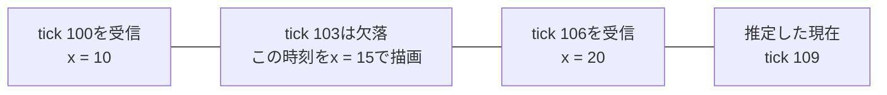
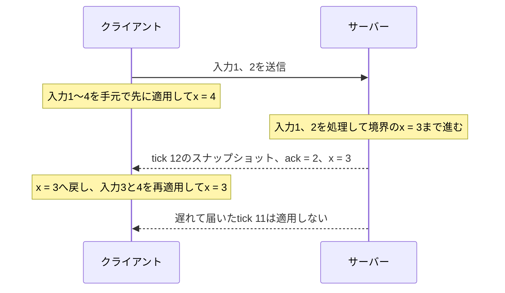

# ゲームのネットワーク同期 — 状態・入力・予測とロールバック

対戦中に右へ移動すると、自分の画面ではすぐに動いてほしい一方、別のプレイヤーの画面でも同じルールで結果が決まる必要があります。各端末がいつの状態を描画し、誰が結果を確定するかを決めるのがネットワーク同期の設計です。[Yahn W. BernierのGDC 2001講演資料](https://www.gamedevs.org/uploads/latency-compensation-in-client-server-protocols.pdf)

## 誰が状態を確定するか

**サーバー権威**では、クライアントが「入力番号2で右へ移動したい」などの操作を送り、サーバーが衝突や得点を含む正規の結果を決めます。クライアントは先に手元の画面を更新でき、サーバーから確定結果が届いた時点で表示や予測に使う状態を合わせます。[Unreal Engine 5.6のネットワーキング概要](https://dev.epicgames.com/documentation/en-us/unreal-engine/networking-overview-for-unreal-engine?application_version=5.6)

| 構成 | 誰が計算するか | 遊ぶときの違い |
| --- | --- | --- |
| 専用サーバー | プレイヤーから独立したプロセスが正規の状態を進めます。 | 全員がサーバーまでの通信を経由します。 |
| リッスンサーバー | プレイヤーの一人が遊んでいるプロセスでサーバーも動かします。 | ホスト自身は操作をサーバーへ届けるための外部通信を省けます。 |
| P2P | 端末が互いにデータをやり取りします。決定論的ロールバックでは、各端末が同じルールで同じ入力を実行します。 | 中央の試合サーバーを置かない構成も取れます。結果の確定方法や切断時の扱いは別に決めます。 |

## 状態を送る方式と入力を送る方式

| 方式 | 何を送るか | 相手が待つもの |
| --- | --- | --- |
| スナップショット同期 | サーバーが、あるティック時点の位置や速度などを送ります。自分の操作は入力として送ります。 | 欠けた更新を飛ばせる設計では、新しい状態を受け取ったら先へ進めます。 |
| 決定論的ロックステップ | 全員が同じ初期状態から始め、ティックごとの入力を共有します。 | 入力がそろってから確定して進む方式では、一人分が遅れてもそのティックで待ちます。 |

『Age of Empires』の開発者は、決定論的なシミュレーションに入力を配ることで、数多くのユニットの状態を端末ごとに計算する構成を説明しています。[BettnerとTerrano「1500 Archers on a 28.8」](https://zoo.cs.yale.edu/classes/cs538/readings/papers/terrano_1500arch.pdf)

**ティック**はシミュレーションの一回分の更新です。例えばサーバーが固定の時間刻みで毎秒60ティック進み、状態は3ティックに一度の毎秒20回送信します。画面の描画頻度は別に決まります。スナップショットに入れるティック番号から、受信側はどの更新の状態かを識別できます。[ゲームループと時間](/game/basics/game-loop-and-time.html) · [GDC 2001講演資料のクライアント・サーバー方式の解説](https://www.gamedevs.org/uploads/latency-compensation-in-client-server-protocols.pdf)

UDPでティック11、12の順に送っても、12だけが届いたり、12が先に届いたりします。全体を含む状態更新なら、同じ対象の12を適用した後に11で上書きする必要はありません。一方、入力や試合開始など、飛ばすと結果が変わるメッセージには、確認と再送などの配送ルールを用意します。移動入力なら、最新の入力と直近の数件をまとめて送り、受信側で入力番号の重複を除く方法もあります。[UDPデータグラムの境界と送受信](/network/udp-datagrams.html) · [遅延・スループットとキュー](/network/latency-throughput-and-queues.html) · [RFC 8085 §3.3](https://www.rfc-editor.org/rfc/rfc8085.html#section-3.3)

## 他のプレイヤーを少し前の時刻で描く

相手の位置は、届いた値へ毎回飛ばすと階段状に動きます。**スナップショット補間**では、受信済みの状態を時刻順に保持し、描画したい時刻を挟む二点から位置を求めます。描画時刻を推定したサーバー時刻より少し遅らせると、到着間隔の揺れや一部の欠落があっても二点を確保しやすくなります。[GDC 2001講演資料の補間とラグ補償の解説](https://www.gamedevs.org/uploads/latency-compensation-in-client-server-protocols.pdf)



毎秒60ティックで、推定したサーバーの現在が109、補間遅延を6ティックとした例です。描画する103は100と106のちょうど中間なので、位置は15です。描画時刻より新しい点がまだ届いていなければ、最後の位置を保持するか、速度から短時間だけ外挿するなどの方針が必要です。補間遅延を増やすほど表示は過去に寄るので、滑らかさと操作の見え方を見ながら調整します。

## 自分の入力は先に適用し、確定後に合わせる

**クライアント予測**では、自分の入力をサーバーの返答より先に適用します。**リコンシリエーション**（照合と補正）では、サーバーの確定位置へ戻し、その位置にまだ反映されていない自分の入力を順番に適用し直します。スナップショットのサーバーティックと、処理済み入力番号 `ack` は役割が違います。ここでの `ack = 2` は、入力番号2までをサーバーが処理し終え、その判断結果が確定位置に含まれるという意味です。[Unreal Engine 5.6のCharacter Movementの補正手順](https://dev.epicgames.com/documentation/en-us/unreal-engine/understanding-networked-movement-in-the-character-movement-component-for-unreal-engine?application_version=5.6)



入力番号は受信した最大値と同じとは限りません。1と3が到着しても、2が未処理なら、まとめて「3まで処理済み」とは報告できません。どこまで連続して処理したか、欠けた入力を待つか期限で処理済みにするかを先に決めます。補正した状態を使って判定しつつ、画面上の小さな位置のずれだけを数フレームで滑らかに寄せる実装もあります。[Unity Netcode for Entities 1.10のPrediction Smoothing](https://docs.unity3d.com/Packages/com.unity.netcode@1.10/manual/prediction-smoothing.html)

## C++20で補正と補間を確かめる

<a href="/study/samples/game/network-sync/network_sync.cpp" download>network_sync.cpp</a>を保存します。サーバーとクライアントの処理、スナップショットの受信順、途中の状態の欠落を一つのプロセス内で再現します。WindowsではVisual Studioの**x64 Native Tools Command Prompt**で次のように実行できます。

```bat
cl /nologo /std:c++20 /EHsc /W4 network_sync.cpp
network_sync.exe
```

```text
Local predicted: 4
Snapshot: tick=12 ack=2 x=3
Local after replay: 3
Accepted stale: false
Accepted duplicate: false
Remote at draw tick 103: 15
```

自分の予測位置4は `0 + 2 + 2 - 1 + 1` です。確定位置3を受け取ると、入力1と2を履歴から除き、入力3の `-1`、入力4の `+1` を足して位置3になります。サンプルの各スナップショットは、自分の位置と処理済み入力番号をそのまま持ちます。

<<< @/public/samples/game/network-sync/network_sync.cpp{cpp}

## 格闘ゲームで入力のずれを巻き戻す

GGPO型の**ロールバック**では、相手の入力がまだ届いていないティックも、直近の入力を使うなどして予測で進めます。例えばティック30で相手が何も入力しないと予測し、32まで進んだ後に30の入力が届いたとします。その入力が予測と違えば、30の直前の状態を復元し、届いた入力で30から32まで計算し直します。[GGPOの仕組み](https://github.com/pond3r/ggpo/blob/master/doc/README.md)

各端末が同じ入力から同じ結果に到達するため、同じ初期状態、入力を適用するティック、乱数の状態、処理順、計算結果をそろえる必要があります。固定ティックはその一部です。復元用の状態を保存するメモリと、複数ティックをまとめて再実行するCPU時間も必要です。効果音や通知を再実行で重複させないために、再生済みのイベントを識別する、確定した時点で通知するなどの方法を選びます。[GGPO Developer Guide](https://github.com/pond3r/ggpo/blob/master/doc/DeveloperGuide.md)

ローカルプレイヤーのリコンシリエーションも入力を再適用します。復元元はサーバーのスナップショットです。上のGGPO型では、各端末が過去に保存した自分のシミュレーション状態を復元し、予測が外れた相手の入力を差し替えます。

## ラグ補償では判定が参照する時刻を戻す

即時に結果が決まる対戦アクションを判定するとき、サーバー到着時の相手の位置と、操作した人が画面で見た位置はずれます。Valveの方式では、サーバーが位置の履歴を持ち、操作時の通信遅延と描画の補間遅延を考慮して、その人が見ていた時刻の状態を判定に使います。判定結果は現在の状態へ反映します。[GDC 2001講演資料の「Lag Compensation」節](https://www.gamedevs.org/uploads/latency-compensation-in-client-server-protocols.pdf)

例えば相手の画面ではすでに壁の裏に入っていても、操作した側が見ていた時点ではまだ手前だった場合があります。どちらの見え方をどこまで優先するかを決めるため、履歴の長さや許容する巻き戻し時間に上限を設けます。復元するのはその判定に必要な過去の状態で、格闘ゲームのロールバックのように過去から現在までシミュレーション全体を進め直す手順とは区別できます。[GDC 2001講演資料の公平性の議論](https://www.gamedevs.org/uploads/latency-compensation-in-client-server-protocols.pdf)・[Game Developer 2001年8月号のBernierによる補足](https://media.gdcvault.com/GD_Mag_Archives/GDM_August_2001.pdf)

## 誰にどの状態をどれだけ送るか

| 方法 | 帯域を抑える例 |
| --- | --- |
| 差分圧縮 | 受信側が保持している基準のスナップショットを番号で指定し、そこから変わった値を送ります。基準を失ったら、再び読める状態を送ります。 |
| 関連性（relevance） | 遠いエリアの装飾など、受信者のゲーム進行や表示に関わらない対象を配送候補から外します。 |
| 優先度（priority） | 配送候補の中で、近くのキャラクターなどを、少し更新が遅れてもよい対象より先に選びます。 |

関連性は受信者ごとに変わります。例えば近づいて初めて配送対象になったキャラクターには、受信側が状態を作れる情報から送ります。帯域が足りないときは、各対象の最終更新時刻も使うと、低優先度の対象が更新されないままになるのを防げます。[Unreal Engine 5.6のIris Filtering](https://dev.epicgames.com/documentation/en-us/unreal-engine/iris-filtering-in-unreal-engine?application_version=5.6) · [Iris Prioritization](https://dev.epicgames.com/documentation/en-us/unreal-engine/iris-prioritization-in-unreal-engine?application_version=5.6)

## エンジンの用語と役割

| 製品と資料の版 | このページの考え方との対応 |
| --- | --- |
| Unreal Engine 5.6と5.8のReplicationとIris | Replicationはアクターなどの状態をネットワークで伝える仕組みです。Irisは接続ごとのフィルタリングや優先付けを扱う方式です。5.6の資料ではオプトインの実験的な機能で、Epicは5.8で本番利用向け（Production Ready）になったと発表しました。キャラクターの入力履歴や移動補正はCharacter Movementの説明で追えます。[5.6のIrisの概要](https://dev.epicgames.com/documentation/en-us/unreal-engine/introduction-to-iris-in-unreal-engine?application_version=5.6) · [5.8の発表](https://www.unrealengine.com/news/state-of-unreal-2026-top-news-from-the-show) · [5.6のCharacter Movement](https://dev.epicgames.com/documentation/en-us/unreal-engine/understanding-networked-movement-in-the-character-movement-component-for-unreal-engine?application_version=5.6) |
| Unity Netcode for GameObjects 2.7 | Client Anticipationは見込んだ結果を先に表示し、サーバーの値を受けて補正できます。完全なロールバックと入力の再実行ループは、同版の標準機能には含まれません。[Client Anticipation](https://docs.unity3d.com/Packages/com.unity.netcode.gameobjects@2.7/manual/advanced-topics/client-anticipation.html) |
| Unity Netcode for Entities 1.10 | ECS上の同期対象であるGhostに対し、予測する対象のシミュレーションをサーバーのスナップショットから再実行できます。[Prediction in Netcode for Entities](https://docs.unity3d.com/Packages/com.unity.netcode@1.10/manual/prediction-n4e.html) |

## 理解度チェック

1. 同じ対象についてティック12の完全な状態を適用した後にティック11が届きました。確定位置の表示を11へ上書きしますか。
2. クライアントには入力1から4までが残っています。確定位置と `ack = 2` が届いたら、どの入力を再適用しますか。
3. ティック30の相手入力の予測が、32まで進んでから外れたと分かりました。GGPO型のロールバックはどの状態へ戻り、何を計算し直しますか。

::: details 解答
1. 12を使い続けます。11をそのまま適用すると古い位置に戻ります。
2. 確定位置を起点に3と4を再適用します。1と2の処理結果は確定位置に反映されています。
3. 30の入力をまだ適用していない保存状態へ戻り、確定した入力を使って30から32まで進め直します。
:::

## 関連項目

- [UDPデータグラムの境界と送受信](/network/udp-datagrams.html)
- [遅延・スループットとキュー](/network/latency-throughput-and-queues.html)
- [ゲームループと時間](/game/basics/game-loop-and-time.html)
- [衝突判定と物理](/game/basics/collisions-and-physics.html)
- [ECS](/game/ecs.html)

## 参考資料

- [RFC 768 User Datagram Protocol](https://www.rfc-editor.org/rfc/rfc768.html) · [RFC 8085 UDP Usage Guidelines](https://www.rfc-editor.org/rfc/rfc8085.html)
- [Yahn W. Bernier「Latency Compensating Methods in Client/Server In-game Protocol Design and Optimization」GDC 2001講演資料](https://www.gamedevs.org/uploads/latency-compensation-in-client-server-protocols.pdf)・[GDC 2001 Programming Proceedings](https://web.archive.org/web/20010426145840id_/http://www.gdconf.com/archives/proceedings/2001/prog_papers.html)
- [Yahn W. Bernier「Artificial Lag」への回答、Game Developer、2001年8月号](https://media.gdcvault.com/GD_Mag_Archives/GDM_August_2001.pdf)
- [Paul BettnerとMark Terrano「1500 Archers on a 28.8: Network Programming in Age of Empires and Beyond」](https://zoo.cs.yale.edu/classes/cs538/readings/papers/terrano_1500arch.pdf)
- [GGPO README](https://github.com/pond3r/ggpo/blob/master/doc/README.md) · [GGPO Developer Guide](https://github.com/pond3r/ggpo/blob/master/doc/DeveloperGuide.md)
- [Unreal Engine 5.6 Networking Overview](https://dev.epicgames.com/documentation/en-us/unreal-engine/networking-overview-for-unreal-engine?application_version=5.6) · [5.6のIris](https://dev.epicgames.com/documentation/en-us/unreal-engine/introduction-to-iris-in-unreal-engine?application_version=5.6) · [State of Unreal 2026での5.8の発表](https://www.unrealengine.com/news/state-of-unreal-2026-top-news-from-the-show)
- [Unity Netcode for GameObjects 2.7 Client Anticipation](https://docs.unity3d.com/Packages/com.unity.netcode.gameobjects@2.7/manual/advanced-topics/client-anticipation.html) · [Netcode for Entities 1.10 Prediction](https://docs.unity3d.com/Packages/com.unity.netcode@1.10/manual/prediction.html)
