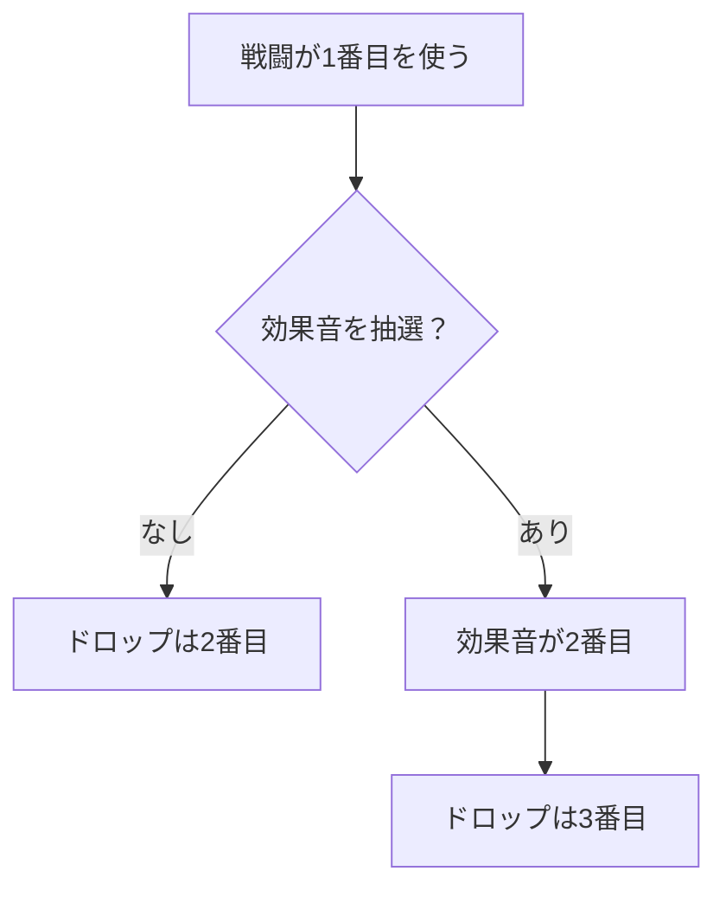

# ゲームの乱数設計 — 戦闘・ドロップ・演出の乱数を分ける

敵を倒したとき、効果音に少し変化を付けるようにした。それだけで、同じ操作をしたときに落ちるアイテムが変わることがあります。戦闘も報酬も効果音も、次の乱数を作る同じ生成器を使うと、効果音が使った分だけ後の抽選がずれるためです。

## この記事で分かること

演出用の抽選が報酬まで変える理由と、処理ごとに生成器の状態を分ける効果を説明できます。最初からの再生と途中再開で、どの乱数の情報を保存するか判断できます。

## 一つの乱数列を共有すると何が起きるか

敵を倒す攻撃のクリティカル判定、効果音のバリエーション、倒した敵のドロップ抽選を、この順で考えます。効果音のバリエーションを選ぶ設定をオンにすると、共有の生成器では追加の呼び出しが1回入ります。攻撃とドロップの処理順はそのままでも、ドロップ抽選に割り当たる値が2番目から3番目に移ります。



## 用途ごとに生成器の状態を持つ

ここでいう**乱数ストリーム**は、用途に割り当てた乱数列です。戦闘・ドロップ・演出で生成器の状態を別々に持てば、演出で何回引いても戦闘やドロップの状態は進みません。戦闘の抽選を増やしても、ドロップ用の状態はその処理だけでは進みません。

ゲームのルールによる影響は残ります。戦闘が変わって倒す敵の順番まで変わる場合は、ドロップ抽選の回数や対応する敵が変わり得ます。[GGPO開発者ガイドの乱数とゲーム状態の説明](https://github.com/pond3r/ggpo/blob/master/doc/DeveloperGuide.md#beware-of-random-number-generators)

| 用途 | 何を決めるか | 状態を持つ場所の例 |
| --- | --- | --- |
| 戦闘 | クリティカル、AIの行動選択 | 対戦を進めるシミュレーション |
| ドロップ | ドロップの有無、アイテムの種類 | 報酬を確定する処理 |
| 演出 | 効果音のバリエーション、火花の向き | 音や画面を作るクライアント側の処理 |

見た目が同じような効果でも、ランダムに飛ぶ火花は演出にでき、当たり判定を持つ破片の飛ぶ向きはゲームの状態を変えます。どこが抽選を所有するかは、見た目よりも抽選結果の使われ方で判断します。

### 効果音の有無だけを変えたC++例

次の例では、戦闘用の値を1回引き、敵は倒れたものとして進めます。効果音の抽選は設定がオンなら1回です。最後に、ドロップ用の値が `0x80000000` 未満ならアイテムが落ちます。共有と分離それぞれで、効果音を抽選する前後を比べます。

```cpp
#include <initializer_list>
#include <iostream>
#include <random>

void Encounter(std::mt19937& battle, std::mt19937& loot,
               std::mt19937& effects, bool extraEffect) {
    const auto attackRoll = battle();
    if (extraEffect) {
        (void)effects();
    }
    const auto lootRoll = loot();
    std::cout << attackRoll << ' ' << lootRoll << ' '
              << (lootRoll < 0x80000000u ? "drop" : "no drop") << '\n';
}

int main() {
    for (const bool extraEffect : {false, true}) {
        const auto* label = extraEffect ? "FX on" : "FX off";
        std::mt19937 shared{5489u};
        std::cout << "shared " << label << ": ";
        Encounter(shared, shared, shared, extraEffect);

        std::mt19937 battle{5489u}, loot{1u}, effects{7u};
        std::cout << "separate " << label << ": ";
        Encounter(battle, loot, effects, extraEffect);
    }
}
```

| 生成器 | 効果音の抽選 | 戦闘で引いた値 | ドロップで引いた値 | ドロップ結果 |
| --- | --- | ---: | ---: | --- |
| 共有 | なし | 3499211612 | 581869302 | 落ちる |
| 共有 | あり | 3499211612 | 3890346734 | 落ちない |
| 用途別 | なし | 3499211612 | 1791095845 | 落ちる |
| 用途別 | あり | 3499211612 | 1791095845 | 落ちる |

共有では、効果音が `581869302` を使ったため、ドロップは次の `3890346734` で判定します。用途別では、ドロップ用の**シード**（乱数列を初期化する値）`1` から毎回最初の値を引き、効果音を有効にしても同じ結果です。共有と用途別ではドロップが使う列そのものが違います。比較するのは、それぞれの構成で効果音を追加したときの変化です。

## 分ける単位とシードを決める

生成器の実装と設定をそろえ、同じシードで初期化すると、別インスタンスでも同じ列から始まります。状態は別々に進みますが、両方で最初の値を使うとその値は同じです。生成器を分けるだけで統計的な独立性が得られるわけではありません。

マッチのシードから用途別に初期化するなら、用途を示す固定ID（戦闘、ドロップ、演出など）を入力に含め、シードの導出方式も固定します。

用途ごとに分けても、同じ用途の中では呼び出し順が結果を左右します。たとえば敵Aを倒す前に敵Bを倒せば、同じドロップ用ストリームの値が別の敵に渡ります。戦闘の消費から報酬を隔離したいだけなら用途別で十分です。

敵ごとに抽選を安定させたいなら、持続する敵IDごとに生成器を持つ方法や、マッチのキーと「用途・イベントID・抽選番号」から乱数を求める方法もあります。同じtick（ゲームの更新単位）に複数の敵が倒れるなら、tickだけでは区別できません。どの抽選に同じ値を割り当てるかを、安定したIDで決めます。

生成器を細かく分けるほど消費の影響を狭められる一方、状態を持つ方式では保存・復元する対象が増えます。イベントから求める方式では、イベントIDの付け方や再利用のルールまで設計する必要があります。どの変更の後も何を同じ結果にしたいかで粒度を選びます。

## リプレイは開始地点と再生方式で保存内容が変わる

シードは生成器を初期化する値です。**途中状態**は、そこまで乱数を消費した後で、次の値を出すために必要な情報です。

| 再生方式 | 保存する情報の例 | 費用と制約 |
| --- | --- | --- |
| 開始から入力を再生 | 開始状態、マッチのシードまたは各生成器の開始状態、入力、ルールやデータの版 | 乱数をログに並べずに済みます。生成器、用途別の初期化、抽選規則、呼び出し順を再現します。 |
| チェックポイントから再開・巻き戻し | 途中のゲーム状態、影響する各生成器の現在の状態、使っていれば分布の内部状態、以降の入力 | 先頭から計算し直す時間を省けます。保存する状態の量は増えます。 |
| 確定した結果を記録して再生 | 対応するイベントやtick、確定したアイテムや戦闘結果、再生に必要なデータの版 | 保存した抽選を引き直す必要はありません。結果ログの量が増え、ほかの状態更新を再現する設計も要ります。 |

途中再開に必要なのは、次のゲーム状態に影響するストリームの状態です。見た目や音まで再現するリプレイなら、演出の状態や決まった演出結果も保存対象にできます。入力だけの再生と、途中状態をまとめて保存するスナップショットの役割は、関連する記事で扱います。[入力リプレイの実践](/practice/game/input-replay.html) · [ゲームの決定性](/game/simulation-determinism.html) · [GGPO開発者ガイド](https://github.com/pond3r/ggpo/blob/master/doc/DeveloperGuide.md#beware-of-random-number-generators) · [WG21 N4659の乱数の要件](https://www.open-std.org/jtc1/sc22/wg21/docs/papers/2017/n4659.pdf)

## 補足

### ゲームやライブラリで分ける例

『Age of Empires』の開発者は、同期して進むシミュレーションの中で地形の効果音を乱数で選んだところ、端末ごとのゲーム進行が食い違った例を報告しています。[Bettner・TerranoのGDC 2001講演資料、p.8](https://zoo.cs.yale.edu/classes/cs538/readings/papers/terrano_1500arch.pdf#page=8)

OpenRAの `release-20250330` では、同期用の生成器とは別に、陣営と開始地点を割り当てる生成器があります。こちらは同期用と同じロビーのシードで初期化されます。ここでは、開始時の割り当てが同期用の列を進めないようにするために、状態を分けています。[OpenRAの `World.cs`](https://github.com/OpenRA/OpenRA/blob/release-20250330/OpenRA.Game/World.cs#L197-L213)

ライブラリによっては、初期状態とストリームを選ぶ番号を別々に渡せます。たとえばPCGの最小C実装は `initstate` と `initseq` を受け取ります。これはその実装の仕様です。[PCG作者による最小C実装の解説](https://www.pcg-random.org/using-pcg-c-basic.html)

マッチのキーとイベントの情報から乱数を求める方式は、**カウンターベースの生成器**で構成できます。カウンターを入力にして値を求めるので、別のイベントを先に処理しても共有のカウンターは進みません。[SalmonほかのRandom123論文](https://www.thesalmons.org/john/random123/papers/random123sc11.pdf)

### 実装をまたぐ再現性と途中状態の復元

この例の `std::mt19937` は、C++17の仕様で状態遷移と生の出力が定義されています。標準ライブラリの `std::uniform_int_distribution` などは、使うライブラリの実装が生成アルゴリズムを決めます。別の標準ライブラリの抽選結果まで一致するとは限りません。実装をまたいで結果を保存・再生する設計では、生成器と、出力をドロップ率や重み付きテーブルへ割り当てる規則を版管理します。[WG21 N4659の乱数生成器と分布の規定](https://www.open-std.org/jtc1/sc22/wg21/docs/papers/2017/n4659.pdf#page=1099)

Godot 4.6の `RandomNumberGenerator` では `seed` が列を初期化し、以前取得した `state` を設定すると途中へ戻れます。`seed` を設定すると内部状態も変わります。両方を保存する場合は `seed` の次に保存済みの `state` を設定します。Godotは生成アルゴリズムを実装の詳細としているため、このAPIがあることだけで別バージョンとの再生互換性までは判断できません。[Godot 4.6の `RandomNumberGenerator`](https://docs.godotengine.org/en/4.6/classes/class_randomnumbergenerator.html)

## 要点

- 一つの生成器を共有すると、演出が値を一つ使うだけで後の抽選に別の値が渡ります。
- 用途別に状態を持てば、演出の消費で戦闘やドロップ用の列は進みません。同じ用途内で誰が値を取るかには処理順が影響します。
- シードは列の開始用です。途中から続けるなら、次のゲーム状態に影響する生成器などの途中状態を復元します。
- 保存する情報は、入力から再計算するか、途中から再開するか、確定済みの結果を再生するかで変わります。

## 理解度チェック

::: details 火花の数を増やしても報酬を変えたくない。どこを分ける？
火花の演出と、報酬を確定する処理で別の生成器の状態を持たせます。生成した火花が当たり判定にも使われる場合は、その判定に影響する抽選をゲーム側で扱います。
:::

::: details 途中のセーブ地点から再開するとき、開始時のシードだけで足りる？
シードを設定するだけでは列の先頭に戻ります。チェックポイントからすぐ続ける設計では、次のゲーム状態に関わる生成器と、必要に応じて分布の現在の状態を復元します。
:::

## 検証範囲

C++例は2026年11月16日に同じWindows x64環境のMSVC 19.35.32217.1とGCC 16.2.0（MinGW-w64）で実行しました。いずれもC++17と最適化あり（`/O2` と `-O2`）で、4条件の乱数とドロップ結果が表に一致しました。別の小さなテストでは、それぞれの標準ライブラリ内で `std::mt19937` の途中状態をテキストに保存・復元すると次の値が一致し、同じシードで初期化し直した生成器は列の先頭に戻ることを確認しました。このテストの消費回数では、先頭の値と復元後の次の値が異なりました。ライブラリ間の保存データの互換性、ほかの乱数API、実際のネット対戦の再生は未検証です。

## 関連項目

- [ドロップテーブルと重み付き抽選 — 確率・期待値・偏りを読む](/game/loot-tables.html) — 乱数を報酬に割り当てる規則と、外れが続く確率を考える。
- [ゲームの決定性](/game/simulation-determinism.html) — 乱数、実行順、数値環境を含めて、ゲームの結果が一致する条件を整理する。
- [入力の記録とリプレイ](/practice/game/input-replay.html) — tickごとの入力を再生し、最初にずれた状態を照合する。
- [ゲームのネットワーク同期](/game/network-sync.html) — ロールバックやサーバー権威で、状態をいつ復元・確定するかを考える。
- [シャッフルバッグ — 独立抽選と引き切り方式の違い](/game/shuffle-bag.html) — 袋に残った候補が次の抽選に与える影響を考える。
- 乱数で作る並びが等確率になる条件を、交換の手順から確かめる。[Fisher–Yates法 — 公平なシャッフルと偏る並べ替え](/algorithms/fisher-yates-shuffle.html)

## 参考資料

- [Paul Bettner・Mark Terrano — 1500 Archers on a 28.8（GDC 2001）](https://zoo.cs.yale.edu/classes/cs538/readings/papers/terrano_1500arch.pdf#page=8)
- [OpenRA release-20250330 — World.cs](https://github.com/OpenRA/OpenRA/blob/release-20250330/OpenRA.Game/World.cs#L197-L213)
- [WG21 N4659 — C++17作業草案、乱数生成器・分布](https://www.open-std.org/jtc1/sc22/wg21/docs/papers/2017/n4659.pdf)
- [Godot 4.6 — RandomNumberGenerator](https://docs.godotengine.org/en/4.6/classes/class_randomnumbergenerator.html)
- [GGPO — Developer Guide](https://github.com/pond3r/ggpo/blob/master/doc/DeveloperGuide.md)
- [PCG — Using the Minimal C Implementation](https://www.pcg-random.org/using-pcg-c-basic.html)
- [John K. Salmonほか — Parallel Random Numbers: As Easy as 1, 2, 3（SC11）](https://www.thesalmons.org/john/random123/papers/random123sc11.pdf)
