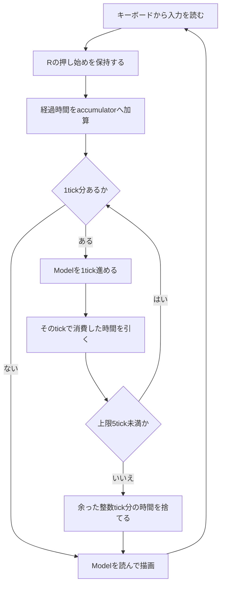

# 小さなシューティングの設計 — C++とUnityで作る

「左右に動いて弾を撃ち、降ってくる敵を倒す」ゲームを題材に、**何を決めてからコードにするか**を追います。丸い図形だけで作り、画像・音・アセット管理を加える前に、操作とルールの一周を完成させます。

<figure class="study-figure study-figure-playfield">
  
  <ul class="study-figure-key"><li>① 自機：移動する</li><li>② 弾：上へ進む</li><li>③ 敵：下へ進む</li></ul>
  <figcaption><strong>まず、作るものを絵でつかむ。</strong> 同じ画面に見える自機・弾・敵も、更新するデータと表示の役割は分けます。これは実機キャプチャではなく、仕様を説明する模式図です。<a href="/study/images/shooter/playfield.svg" target="_blank" rel="noopener noreferrer">画面の図を拡大</a></figcaption>
</figure>

同じルールの完全なソースを2種類用意しています。

- [C++17 + raylib 5.5版：起動手順と全コード](/game/shooter-cpp.html)
- [C# + Unity 6版：シーンの準備と全コード](/game/shooter-unity.html)

どちらも、ゲームの状態を持つModelと、キーボード・画面・実時間に接続する部分を分けます。Unity版はこの比較をしやすくするため、ルールを普通のC#クラスへ置く例です。Unityで自機・弾・敵ごとにMonoBehaviourを持たせる構成も選択肢ですが、本例では採用していません。

## 1. 最初に「遊べる最小仕様」を決める

クラス名の一覧を考える前に、入力に対して何が起き、何をもって一回のプレイが終わるかを決めます。

| 項目 | この例の仕様 |
| --- | --- |
| 画面 | 論理サイズ640×720。左上が原点、右が+x、下が+y |
| 自機 | 初期位置(320, 650)、半径18、毎秒280の速さ。画面内を上下左右に移動 |
| 操作 | 矢印またはWASDで移動、Space長押しで連射、Rで最初からやり直し |
| 弾 | 半径5、上向きに毎秒520。自機中心の24上から発射。発射間隔0.15秒 |
| 敵 | 半径16、下向きに毎秒110。0.65秒ごとに出現。出現位置は決めた6か所を循環 |
| 当たり判定 | 円同士。弾1個で敵1体を倒し、100点加算 |
| 被弾 | 敵との接触でHPを1減らす。初期HP3。被弾後0.8秒は追加ダメージを受けない |
| 無敵中の接触 | 触れた敵は消えるが、HPは減らない |
| 画面外 | 弾と敵は取り除く。下へ抜けた敵による追加ペナルティはない |
| 終了 | HP0でGame Over。ゲーム世界の更新を止め、Rによる再開は受け付ける |
| 上限 | 弾64個、敵32体。上限に達した追加は見送る |

これはボスやステージクリアのある完成作品の仕様ではなく、設計を一周するための小さな範囲です。敵の出現位置を乱数にしないのも、まず動きを予想しやすくするためです。

## 2. 1フレームと1tickを分ける

**フレーム**は入力を読み、画面を描く単位です。**tick**はゲームの状態を一段進める単位です。この例のtickは1/60秒です。描画が速いフレームではtickを進めず、遅いフレームでは複数tick進める場合があります。

<figure class="study-figure">
  
  <figcaption><strong>絵を描く回数と、世界を進める回数は別。</strong> 一定のフレーム時間を仮定した説明用の例です。現実の入力・フレーム時間の揺れまで同じになることは意味しません。<a href="/study/images/shooter/timing.svg" target="_blank" rel="noopener noreferrer">時間の図を拡大</a></figcaption>
</figure>

1回のフレーム時間は最大0.1秒まで取り込み、1フレームで進めるのは最大5tickです。それでも整数tick分が残れば捨て、小数部分だけ持ち越します。重いときに追い付き処理を延々と続けないための、この教材での方針です。**捨てた時間の分だけ、ゲームの進行は実時間から遅れます。** 時間を必ず保存するシミュレーションとは異なる方針なので、製品では用途に合わせて選びます。

このModel自身は固定tickで進みますが、それだけでリプレイや通信同期の決定性が得られるわけではありません。この例では入力をフレームごとに読むため、描画頻度によってどの入力を何tickに適用するかも変わります。再現を目指すなら、tick番号に対応する入力、乱数、演算・走査順、実行環境の差まで検討します。[ゲームループ](/game/patterns/game-loop-and-update.html)も参照してください。

### 長押しと押し始めを区別する

移動と射撃は「いま押されているか」を使います。Spaceを長押ししたとき、発射間隔の管理はModelが行います。

キーボードの移動軸はそれぞれ-1・0・1です。斜め入力`(1, 1)`をそのまま使うと長さが√2になるので、移動方向を正規化して速さをそろえます。方向がゼロなら割り算しません。アナログスティックへ拡張する場合は、小さな傾きまで常に長さ1へ伸ばさず、入力の強さを残す方針も必要です。

Rは「押し始めた」という1回の要求です。入力を読んだフレームでtickが0回でも、その要求を次のtickまで保持します。1フレームでtickを5回進める場合は、最初の1回だけへ渡します。再開をキーの長押しとして渡し続けると、毎tick初期状態に戻ってしまいます。

Game Over中も入力と描画は続けます。Modelの通常更新だけを止めるので、再開要求を拾えます。

## 3. データの所有者を決める

最初は「同じ振る舞いがあるから基底クラスを作る」より、**どのデータを誰が変更してよいか**を決めます。

<figure class="study-figure">
  
  <figcaption><strong>キーを読む・状態を進める・絵を描く、の置き場所を分ける。</strong> 矢印は入力やデータの流れです。クラスの継承関係を表す図ではありません。<a href="/study/images/shooter/architecture.svg" target="_blank" rel="noopener noreferrer">役割分担の図を拡大</a></figcaption>
</figure>

| データ・資源 | 所有者 | 変更する場所 |
| --- | --- | --- |
| 自機位置、HP、無敵の残りtick | Model | 移動と被弾の処理 |
| 弾・敵の一覧 | Model | 出現・移動・衝突・掃除の処理 |
| スコア、Game Over状態 | Model | 敵撃破と被弾の処理 |
| 発射待ち、出現待ち、次の出現位置 | Model | 固定tickの更新 |
| キーの状態、未消費のR要求 | 入力・ループ側 | OS / Unityから入力を読む場所 |
| accumulator | ループ側 | 実時間と固定tickの橋渡し |
| ウィンドウ、カメラ、Sprite、表示用GameObject | 描画・Unity側 | 起動・表示更新・終了処理 |

弾と敵は、小さな値データの配列として持ちます。C++では上限分を予約した`std::vector`、C#では上限サイズの配列と有効件数を使います。C#版は掃除の際に生きている要素を前へ詰めます。「配列にしたからECS」という意味ではありません。この規模では、専用の[ECS](/game/ecs.html)やジョブスケジューラを持ち込まずに更新順と所有を読み取れることを優先しています。

C++版は教材を小さくするため値の状態を公開しています。外側から勝手に変更しないという約束で使い、描画関数は`const World&`を受け取ります。C#版は内部配列を非公開にし、描画へは値のコピーを渡します。所有の方針と、言語機能でどこまで変更を制限するかは分けて読んでください。

描画はModelを読んで、位置や色を決めます。**表示用の丸を消しただけで、Modelの敵が消えたことにはしません。** ゲーム上の消滅はModelが決めます。

## 4. 1tickの処理順を固定する

同じ処理でも、順番によって結果は変わります。本例は次の順にそろえます。

1. 再開要求があれば状態を初期化し、このtickを終了する。
2. Game Overなら通常の更新を終える。
3. 待ち時間・無敵時間を進め、自機を移動して画面内に収める。
4. 発射と敵の出現を試す。
5. 弾と敵を移動する。今回追加したものも、このtickから移動する。
6. 弾と敵の衝突を解決する。
7. 生き残った敵と自機の接触を解決する。
8. 無効なもの・画面外のものを一覧から取り除く。

敵と自機が触れるtickに、その敵を弾で倒した場合は、6が先なので被弾しません。これは唯一の正解ではなく、この例で明示したルールです。

発射間隔0.15秒は9tick、敵の出現間隔0.65秒は39tick、無敵時間0.8秒は48tickとして数えます。この設定では整数tickにできるため、待ち時間を浮動小数点で繰り返し引く方法を使いません。別の秒数を設定するなら、何tickへ丸めるかも仕様にします。

上限で弾や敵を追加できなかった場合も、その回の追加機会を消費します。敵の出現位置の循環も進めます。空きが出た瞬間に、滞納した弾・敵をまとめて追加する設計にはしていません。

### 「無効にする」と「一覧から消す」を分ける

弾と敵の二重ループ中で`erase`や`RemoveAt`をすると、反復中の要素の位置や参照が変わります。例えば敵を1体消した結果、次の敵の検査を飛ばしたり、C++の無効になった参照を使ったりする原因になります。

<figure class="study-figure">
  
  <figcaption><strong>先に印を付け、走査が終わってから詰める。</strong> 判定順を調べるために敵を重ねた説明用の配置です。3コマは1tickの中の処理段階で、弾1個でA・Bの両方に加点しない点を示しています。<a href="/study/images/shooter/lifecycle.svg" target="_blank" rel="noopener noreferrer">消去の図を拡大</a></figcaption>
</figure>

本例では衝突中は`alive = false`と記録し、最後に掃除します。衝突判定では既に無効なものを飛ばし、弾が1体に当たったら、その弾についての敵探索を終えます。これで「同じ敵に二重加点」「弾1個で重なった敵を全部倒す」を防ぎます。遅らせる消去にも、**無効と記録した直後から、その要素を判定対象に戻さない**という約束が必要です。

## 5. 当たり判定を小さく実装する

中心を`(ax, ay)`と`(bx, by)`、半径を`ar`と`br`とすると、接触条件は次です。

$$
(a_x-b_x)^2 + (a_y-b_y)^2 \leq (a_r+b_r)^2
$$

<ShooterCollisionDiagram />

距離の平方どうしを比較できるので、この判定には平方根は不要です。弾64個・敵32体の上限なら、弾対敵の単純な組合せは最大2,048組です。これは処理の上限を見積もる値で、実測時間の保証ではありません。最初はこの方法を計測し、大量の対象が必要になったら空間分割やBroad Phaseを検討します。

また、これは移動後の点で重なりを調べる離散的な判定です。弾の速度を大きくすると、tick間に敵を通り抜ける場合があります。その場合は、前回位置から今回位置への線分と円の判定などへ拡張します。「固定tickにしたから高速な弾でも当たる」とは限りません。

## 6. C++とUnityで担当が変わるところ

| 役割 | C++ + raylib | C# + Unity |
| --- | --- | --- |
| ルール | 通常のC++のModel | MonoBehaviourではないC#のModel |
| フレームの入口 | `main`のループ | Unityが呼ぶ`Update` |
| 入力 | raylibのキーAPI | Input Systemまたは旧Input Manager |
| 表示 | Modelの円をraylibで描く | Modelの位置をSpriteRendererへ写す |
| 論理座標 | 640×720の座標を使う | 100pxを1unitとし、yを反転してUnity座標へ写す |
| 片付け | アプリが確保した描画資源を終了時に解放 | 自分で生成した表示用オブジェクト・Sprite等を終了時に破棄 |

<figure class="study-figure">
  
  <figcaption><strong>同じ位置でも、座標の書き方が違う。</strong> Modelの論理座標からUnityのワールド座標への変換です。実際のディスプレイのピクセル数とは区別します。<a href="/study/images/shooter/coordinates.svg" target="_blank" rel="noopener noreferrer">座標の図を拡大</a></figcaption>
</figure>

両版とも衝突はModel内で計算します。Unity版にRigidbody2DやCollider2Dを付け足すと、別の衝突経路が加わります。Unityの物理で動かす設計へ変える場合は、位置の所有者、`FixedUpdate`、物理イベントの受取り方をまとめて見直してください。

Unity版の表示用オブジェクトは、上限数を作って有効・無効を切り替えます。これは表示側の再利用です。C#の弾・敵の値データそのものをGameObjectの寿命に従属させるものではありません。[Object Pool](/game/patterns/object-pool.html)と[Component](/game/patterns/component-and-ecs.html)の使い分けにもつながります。

## 7. 一度に全部作らず、動く単位で積む

| 段階 | 追加するもの | ここで確かめること |
| --- | --- | --- |
| 1 | 自機1個と移動 | 斜めだけ速くならない。端で止まる |
| 2 | 弾と発射待ち | 押しっぱなしで一定間隔。画面外の弾が消える |
| 3 | 敵の出現と移動 | 出現位置と間隔を予想できる。無制限に増えない |
| 4 | 弾対敵とスコア | 一発・一体の扱い、同時命中、消去時の走査 |
| 5 | HP、無敵、Game Over | 無敵中にHPが連続で減らない。停止後もRが効く |
| 6 | 2種類の表示側 | 同じルールを別の入力・描画環境へ接続できる |

段階ごとに一度遊べる状態にすると、描画・入力・ルールのどこを壊したかを追いやすくなります。最初の一周では継承階層や汎用イベントバスを増やさず、変更する理由が現れてから境界を足します。

## 8. 何を追加すると設計を変えたくなるか

| 要求 | 次に分ける候補 |
| --- | --- |
| キー設定、パッド、AI操作 | 物理入力から移動・射撃の意図へ変換する部分 |
| 敵の種類と出現パターン | 敵の設定データ、出現スケジュール、移動の更新 |
| 効果音と撃破エフェクト | Modelが出す「撃破した」等の出来事を、表示・音が受け取る経路 |
| メニューとポーズ | Playing / Paused / GameOverの遷移と、入力を受ける画面 |
| 弾幕と大量の敵 | まず計測。配置、容量、衝突候補の絞り込みを検討 |
| リプレイ・オンライン | tick単位の入力、乱数、状態保存、同期と補正の設計 |

例えば効果音を足すとき、Modelから直接raylibやUnityの音APIを呼ぶと、今の分離が崩れます。`EnemyDestroyed`のような出来事をModelの外へ渡せば、表示と音の実装を選べます。ただし、最初から何にでも使えるイベント基盤を作る必要はありません。

## コードを読む

- [C++版](/game/shooter-cpp.html)：Model、ウィンドウ・入力・描画、CMake、モデル検査のコードを掲載。
- [Unity版](/game/shooter-unity.html)：純C# Model、MonoBehaviourの接続部分、シーン・入力設定を掲載。

コード例の対象版と実行確認範囲は、それぞれのページに記載します。C++とC#は同じ仕様の例ですが、2言語間の浮動小数点の結果が常にbit単位で一致するという契約ではありません。
