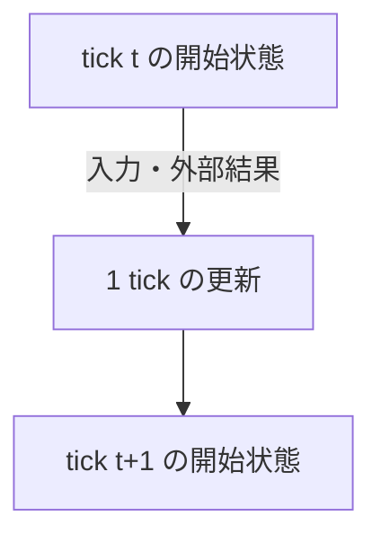

# ゲームの決定性 — 同じ入力から同じ結果を得る条件

画面が同じに見えるセーブ地点から、同じ操作で再開したのに、片方だけアイテムが落ちる。敵のHPや座標が一致していても、次に使う乱数の状態が違えば、この食い違いは起こります。ゲームの決定性を考えるときは、**どの状態を、どの入力と実行条件のもとで一致させるか**を決めます。

## この記事で分かること

固定tickだけではリプレイの結果がそろわない理由を説明できます。途中からの再開やネットワーク同期で、どの状態・入力・実行条件をそろえるか判断できます。

## 固定tickでそろうのは時間刻み

**tick** はゲームのシミュレーションを1回進める単位です。開始状態と、そのtickに割り当てた入力から、次の開始状態を作ります。**固定tick** は、その1回で進める時間を一定にします。描画が30 FPSでも120 FPSでも、同じ回数だけシミュレーションを進めた時点では同じ時間刻みを使えます。

入力をどのtickに適用するかは別に決まります。同じキー押下でも、割り当て先が1 tickずれれば、シミュレーションに渡る入力は変わります。描画と更新の分け方、記録した入力と状態の照合は、それぞれ関連ページで扱います。[ゲームループ](/game/patterns/game-loop-and-update.html) · [入力リプレイ実践](/practice/game/input-replay.html)



1 tickの更新には、時間刻みのほかに、処理順や数値環境も関わります。シミュレーションが実時計を参照したり、非同期ロードの完了をきっかけに敵を出したりするなら、その結果も次の状態に影響します。再生時にそろえるには、ゲームが受け取った結果と、それを適用したtickをログに含める方法があります。入力と状態の境界は、何がゲーム内の結果を変えるかで決まります。[GGPO 開発者ガイド](https://github.com/pond3r/ggpo/blob/master/doc/DeveloperGuide.md#using-state-and-inputs-for-synchronization)

## 開始状態に含めるもの

同じ座標とHPでも、攻撃のクールダウンが残り1 tickか、すでに終わっているかで、次の攻撃入力の結果は変わります。途中から再生したり巻き戻したりするなら、クールダウン、保留中のイベント、乱数生成器の現在の状態など、**復元後の更新に影響する値**を保存します。保存した値から同じ結果を再構築できるデータは、復元時に作り直せます。ビルドやルール、ゲームデータの版も変わり得るなら、照合対象の条件として記録します。[GGPO の状態保存・復元コールバック](https://github.com/pond3r/ggpo/blob/master/src/include/ggponet.h#L183-L225)

**シード**（seed）は乱数列を始めるための値です。シードだけを設定し直すと列の先頭に戻ります。途中から直ちに再開する場合は、次の抽選に使う生成器の状態を復元します。開始からの再生では、生成器の使い方と、どのtickで誰に値を渡したかもそろえます。乱数を目的の範囲などに割り当てる分布オブジェクトにも、内部状態を持つものがあります。使っている場合はその状態も復元の対象です。[C++規格草案の乱数分布の要件](https://eel.is/c++draft/rand.req.dist)

## 同じ乱数列でも、使う相手で結果が変わる

同じtickで敵Aと敵Bが倒れ、アイテムを落とすかを共通の乱数生成器で決めるとします。次のコードは、どちらの実行でもシードを `5489` にそろえ、乱数が `0x80000000` 未満ならアイテムを落とします。変えるのは敵を処理する順番だけです。

```cpp
#include <array>
#include <iostream>
#include <random>

void AwardLoot(std::array<char, 2> order) {
    std::mt19937 rng{5489u};
    for (char enemy : order) {
        const auto roll = rng();
        const bool drop = roll < 0x80000000u;
        std::cout << enemy << ' ' << roll << ' '
                  << (drop ? "drop" : "no drop") << '\n';
    }
}

int main() {
    AwardLoot({'A', 'B'});
    std::cout << '\n';
    AwardLoot({'B', 'A'});
}
```

| 処理順 | 1回目の乱数 `3499211612` | 2回目の乱数 `581869302` | アイテムを落とした敵 |
| --- | --- | --- | --- |
| A → B | Aが使う | Bが使う | B |
| B → A | Bが使う | Aが使う | A |

各実行で乱数列は同じです。その値をどの敵が使うかが変わるので、結果も変わります。このコードでは、判定に乱数生成器の出力と整数の比較を直接使っています。

並列処理で結果の追加をロックやアトミック操作で保護しても、完了順に追加すれば順序は実行ごとに変わり得ます。結果を確定するときに、安定したIDの順で処理するなど、同順位の扱いまで決めます。

演出用とゲーム進行用の生成器を分けると、演出で消費した値が戦闘やドロップの乱数列を進めずに済みます。[GGPO 開発者ガイドの乱数についての注意](https://github.com/pond3r/ggpo/blob/master/doc/DeveloperGuide.md#beware-of-random-number-generators)

## 同じ処理順でも実行環境で変わることがある

浮動小数点では、掛け算と足し算を別々に丸める場合と、**FMA**（積と加算をまとめて一度だけ丸める演算）を使う場合で、最終値が変わることがあります。差が小さくても、衝突などのしきい値を挟めば、そのtickで分岐が変わります。

別のCPUやコンパイラでの一致が必要なら、ビルド設定、演算の順序、使用する数値ライブラリまで比較対象に含めます。丸めの例とコンパイラ設定は関連資料で扱います。[浮動小数点の決定性](/languages/cpp/floating-point-determinism.html) · [Microsoft Learn の `/fp` の解説](https://learn.microsoft.com/en-us/cpp/build/reference/fp-specify-floating-point-behavior)

## 用途によって、どこまでそろえるかが変わる

| 用途 | 一致させる範囲 |
| --- | --- |
| 同一ビルドで再現する入力リプレイ | 記録した開始状態とtickごとの入力から、照合の対象にしたゲーム状態を再現します。別バージョンのビルドでも再生するなら、データの互換性とルールの変化も扱います。 |
| 入力ロックステップ・ピア間のロールバック | 同じ開始状態と確定入力で、各端末のシミュレーションが同じ結果に到達する必要があります。ロールバックでは、復元した過去の状態から入力を適用し直します。 |
| サーバー権威とクライアント予測 | サーバーが結果を確定し、クライアントは受け取った結果に合わせて予測を補正できます。同じ計算を使うと予測のずれを減らせます。 |

たとえばロールバック中に描画を省いても、再計算するゲーム状態が一致する設計なら、各端末の描画フレームまで合わせる必要はありません。どの端末が状態を確定して、差が出たときにどう扱うかは[ゲームのネットワーク同期](/game/network-sync.html)を参照してください。[GGPO 開発者ガイド](https://github.com/pond3r/ggpo/blob/master/doc/DeveloperGuide.md) · [Unreal Engine 5.6 のネットワーキング概要](https://dev.epicgames.com/documentation/en-us/unreal-engine/networking-overview-for-unreal-engine?application_version=5.6)

## 補足

Unity 6.3では、乱数生成器の状態の保存・復元に `Random.state` を使えます。[Unity 6.3 の `Random.state`](https://docs.unity3d.com/6000.3/Documentation/ScriptReference/Random-state.html)

`std::mt19937` の挙動は規格で定義されています。標準ライブラリの乱数分布では、ライブラリの実装が生成アルゴリズムを決めます。分布まで使った結果を異なる標準ライブラリ間で一致させたい場合は、乱数列から値を作る手順も比較の対象です。[C++17の公開最終作業草案 N4659 の `[rand.eng.mers]`・`[rand.predef]`・`[rand.dist.general]`](https://www.open-std.org/jtc1/sc22/wg21/docs/papers/2017/n4659.pdf)

Box2Dでは、並列処理の結果をまとめる際にスレッドの実行順に依存しない方式を使っています。[Box2D開発者によるマルチスレッドの決定性の解説](https://box2d.org/posts/2024/08/determinism/)

## 要点

- 固定tickでそろうのは時間刻みです。入力をどのtickに適用したかも結果に影響します。
- 途中から再開するときは、次の更新に影響する値を復元します。乱数では、シードのほかに生成器の途中状態が関わります。
- 同じ乱数列でも、処理順が変わると値を使う敵が変わります。演算や丸めの違いでも、ゲーム内の分岐が変わることがあります。
- リプレイ、端末間の同期、サーバーによる補正では、一致させる対象と条件が異なります。

## 理解度チェック

::: details 同じシードを使ったのに、敵Aのドロップ結果が変わるのはなぜ？
処理順が変わり、敵Aに割り当てられた乱数が変わったためです。ゲームの結果には乱数列と、その値をどの処理で消費するかの両方が影響します。
:::

::: details 攻撃直前のtickへ巻き戻すとき、座標とHPのほかに何を復元する？
攻撃のクールダウン、予約済みの攻撃やイベント、乱数生成器の現在の状態など、復元後の結果を変える値を復元します。
:::

## 検証範囲

C++例は2026年11月16日に、同じ Windows x64 環境の MSVC 19.35.32217.1 と GCC 16.2.0（MinGW-w64）で実行しました。両方ともC++17、最適化あり（`/O2` と `-O2`）で、表の乱数とドロップ結果に一致しました。確認範囲はこのコードの乱数生成と整数比較です。ゲーム全体の実行環境間の再現性やネット対戦での状態の一致は未検証です。

## 関連項目

- [ゲームの乱数設計 — 戦闘・ドロップ・演出の乱数を分ける](/game/random-streams.html) — 用途ごとの生成器を設計し、リプレイに残す状態を選ぶ。
- [ゲームループとUpdate — 入力・更新・描画を分ける](/game/patterns/game-loop-and-update.html) — 固定tickと描画の分離を確認する。
- [入力の記録とリプレイ](/practice/game/input-replay.html) — 記録した入力を別の描画間隔で再生し、最初にずれたtickを特定する。
- [浮動小数点の決定性](/languages/cpp/floating-point-determinism.html) — FMAやコンパイラ設定による数値の差を追う。
- [ゲームのネットワーク同期](/game/network-sync.html) — ロックステップ、ロールバック、サーバー補正を比較する。

## 参考資料

- [WG21 N4659 — C++17 final working draft](https://www.open-std.org/jtc1/sc22/wg21/docs/papers/2017/n4659.pdf)
- [GGPO — Developer Guide](https://github.com/pond3r/ggpo/blob/master/doc/DeveloperGuide.md)
- [Box2D — Determinism](https://box2d.org/posts/2024/08/determinism/)
- [Unity 6.3 — `Random.state`](https://docs.unity3d.com/6000.3/Documentation/ScriptReference/Random-state.html)
- [Microsoft Learn — `/fp` (Specify Floating-Point Behavior)](https://learn.microsoft.com/en-us/cpp/build/reference/fp-specify-floating-point-behavior)
- [Epic Games — Unreal Engine 5.6 Networking Overview](https://dev.epicgames.com/documentation/en-us/unreal-engine/networking-overview-for-unreal-engine?application_version=5.6)
