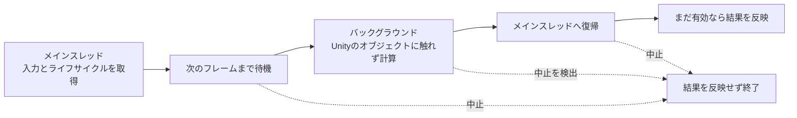

# Unityの非同期処理 — Awaitable・UniTaskとライフサイクル

アセットが届くまで待つ、次のフレームまで待つ、時間がかかる計算を別スレッドへ移す。どれも `await` で書けますが、待機の間に何が動くかと、後続のコードがどこで動くかは、待つAPIによって変わります。Unity 6.3 LTSでは、待ち方に加えて、結果を適用できるスレッドと、結果が必要な期間を決めます。

## 次のフレームと別スレッドを区別する

`await Awaitable.NextFrameAsync()` は、処理を次のフレームまで中断します。現在のフレームで重い計算を実行してからこれを呼んでも、既に実行した計算の負荷は減りません。`await Awaitable.BackgroundThreadAsync()` は、後続をバックグラウンドスレッドで進めるために使えます。例えば純粋な数値計算やデータの整形を移し、`await Awaitable.MainThreadAsync()` で戻ってから `Transform` やUIを更新します。



Unity 6.3のドキュメントでは、通常の `async Awaitable` メソッドは呼び出し側のスレッドの種類に応じて復帰すると説明しています。メソッド内では `BackgroundThreadAsync` と `MainThreadAsync` で後続のスレッドを明示できます。メインからバックグラウンドへ移ってまた戻る場合、復帰はメインスレッドの次の更新まで待つ場合があります。短い仕事を細かく行き来させると、その切り替えの分も待ち時間に入ります。

## Awaitable・UniTask・Task

| 型 | Unityで使う場面と待機の注意点 |
| --- | --- |
| `UnityEngine.Awaitable`（Unity 6.3 LTS） | Unity標準のフレーム待ち、スレッドの切り替え、対応する非同期APIに使う。プールされるため、同じインスタンスを複数回 `await` しない |
| `UniTask`（Cysharp 2.5.11） | `Delay`、`Yield` などPlayerLoopを使う待機があり、対応するAPIでは `PlayerLoopTiming` を指定できる。同一の待機結果を共有する場合はライブラリの規則に合う手段を選ぶ |
| `Task`（.NET） | Unity外のライブラリが返すことが多い。メインスレッドで未完了のTaskを通常の `await` で待ち、Unityの同期コンテキストを捕捉した場合、完了後の処理はそこへ通知される |

待機の型を選んでも、処理が自動的に別スレッドへ移るわけではありません。UniTaskのPlayerLoopベースの待機は、指定したタイミングで続きを動かします。ファイルの内部処理やI/Oの待機は、[非同期ファイルI/O](/os/asynchronous-file-io.html)で扱います。

## キャンセル — いつまで結果が必要かを決める

破棄されたコンポーネントに結果を適用すると、処理が失敗したり、古い画面に結果が届いたりします。Unity 6.3の `MonoBehaviour.destroyCancellationToken` はコンポーネントの破棄に、`Application.exitCancellationToken` はPlayモード終了やアプリ終了に対応します。画面が隠れるだけで破棄されない設計では、表示中だけ有効な別のトークンを用意します。

キャンセルは協調的です。キャンセルに対応する待機にはトークンを渡し、長いCPUループでは自分で確認します。バックグラウンドの処理が終わってから結果を反映するまでの間にも破棄は起こり得るので、メインスレッドに戻ったところでも確認します。UniTask 2.5.11のPlayerLoopベースの待機は既定でループ上でキャンセルを確認します。対応APIに `cancelImmediately: true` を渡す場合は、トークンへのコールバック登録を使います。

## コード例 — 次フレームの後に計算し、結果を表示する

Unity 6.3 LTSのコンポーネント `AsyncScaleExample.cs` です。対象オブジェクトに付けると、次フレームを待ってからバックグラウンドで整数の合計を求め、メインスレッドでスケールを変更します。Unityから呼ばれる `Start` を入口として、キャンセル以外の例外もこの境界で記録します。

```csharp
using System;
using System.Threading;
using UnityEngine;

public sealed class AsyncScaleExample : MonoBehaviour
{
    private async void Start()
    {
        using var lifetime = CancellationTokenSource.CreateLinkedTokenSource(
            destroyCancellationToken, Application.exitCancellationToken);
        CancellationToken token = lifetime.Token;

        try
        {
            await Awaitable.NextFrameAsync(token);
            await Awaitable.BackgroundThreadAsync();
            int total = Calculate(token);

            await Awaitable.MainThreadAsync();
            token.ThrowIfCancellationRequested();
            transform.localScale = Vector3.one * (1f + (total % 10) * 0.1f);
            Debug.Log($"Async total: {total}");
        }
        catch (OperationCanceledException) when (token.IsCancellationRequested)
        {
            // 終了したオブジェクトへ結果を適用しない。
        }
        catch (Exception error)
        {
            await Awaitable.MainThreadAsync();
            Debug.LogException(error);
        }
    }

    private static int Calculate(CancellationToken token)
    {
        int total = 0;
        for (int i = 0; i < 100_000; ++i)
        {
            if ((i & 1023) == 0)
            {
                token.ThrowIfCancellationRequested();
            }
            total += i % 7;
        }
        return total;
    }
}
```

剰余0〜6の合計は21で、100,000個には14,285周と剰余0〜4の5個が含まれます。したがって正常終了では `Async total: 299995` が出力され、ローカルスケールの各軸が1.5になります。コードはUnity 6000.3.27f1付属のコンパイラとUnityEngineの参照でビルド確認しました。Playモードでの確認は未実施です。

### コード例 — UniTask の次フレーム待ちをキャンセルする

Unity 6.3 LTS と UniTask 2.5.11 の `UniTaskNextFrameExample.cs` です。`UniTask.NextFrame` は現在のフレームより後で再開します。`UniTask.Yield` は指定した PlayerLoop の実行位置まで待つため、呼び出し位置によっては同じフレームで再開します。次の例はメインスレッドから開始し、再開後に対象が有効な場合だけ表示します。

```csharp
using System;
using System.Threading;
using Cysharp.Threading.Tasks;
using UnityEngine;

public sealed class UniTaskNextFrameExample : MonoBehaviour
{
    private async void Start()
    {
        using var lifetime = CancellationTokenSource.CreateLinkedTokenSource(
            destroyCancellationToken, Application.exitCancellationToken);

        try
        {
            await ShowAfterFrameAsync(lifetime.Token);
        }
        catch (OperationCanceledException) when (lifetime.IsCancellationRequested)
        {
            // 寿命が終わったため、表示しない。
        }
        catch (Exception error)
        {
            Debug.LogException(error);
        }
    }

    private static async UniTask ShowAfterFrameAsync(CancellationToken token)
    {
        int started = Time.frameCount;
        await UniTask.NextFrame(PlayerLoopTiming.Update, token);
        token.ThrowIfCancellationRequested();
        Debug.Log($"Frames elapsed: {Time.frameCount - started}");
    }
}
```

通常は `Frames elapsed: 1` が出ます。オブジェクトの破棄や Play モード終了でトークンが取り消されると、ログを出さずに終了します。`Start` は Unity が呼ぶ入口なので `void` のままにし、再利用する処理は `UniTask` を返して、呼び出し側が完了や例外を受け取ります。 Unity 6000.3.27f1 の参照アセンブリと UniTask 2.5.11 でコンパイルを確認しました。 [Cysharp — UniTask 2.5.11 の PlayerLoop](https://github.com/Cysharp/UniTask/tree/2.5.11#playerloop)

## 理解度チェック

1. メインスレッドで重い計算を行い、その直後に `NextFrameAsync` を待つと、計算はどのスレッドで動きますか。
2. バックグラウンドで計算が済んだあと、`Transform` を変える前に何を確認しますか。
3. ある `Awaitable` をフィールドに保存し、別々のメソッドから待ってよいですか。

::: details 解答
1. メインスレッドです。`NextFrameAsync` はその後の処理を次フレームへ送ります。
2. メインスレッドに戻り、対象の破棄や操作の中止などにより、結果が不要になっていないか確認します。
3. 同じインスタンスは1回だけ待ちます。複数の受け手が必要なら、それに合う待機や通知の仕組みを使います。
:::

## 関連項目

- [非同期ファイルI/O](/os/asynchronous-file-io.html)
- [アセットロード](/game/asset-loading.html)
- [ジョブシステムとワークスティーリング](/runtime/jobs-and-work-stealing.html)

## 参考資料

- [Unity、Awaitableの概要（Unity 6.3 LTS）](https://docs.unity.com/en-us/engine/6000.3/manual/scripting/programming-distribute-work-threads/async-await-support/async-awaitable-introduction)
- [Unity、Awaitableの完了と後続処理（Unity 6.3 LTS）](https://docs.unity.com/en-us/engine/6000.3/manual/scripting/programming-distribute-work-threads/async-await-support/async-awaitable-continuations)
- [Unity、Awaitable.NextFrameAsync（Unity 6.3 LTS）](https://docs.unity.com/en-us/engine/6000.3/script-reference/unityengine/awaitable/nextframeasync)
- [Unity、MonoBehaviour.destroyCancellationToken（Unity 6.3 LTS）](https://docs.unity.com/en-us/engine/6000.3/script-reference/unityengine/monobehaviour/destroycancellationtoken)
- [Unity、Application.exitCancellationToken（Unity 6.3 LTS）](https://docs.unity.com/en-us/engine/6000.3/script-reference/unityengine/application/exitcancellationtoken)
- [Cysharp、UniTask 2.5.11](https://github.com/Cysharp/UniTask/tree/2.5.11)
