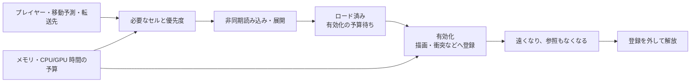

# ワールドストリーミング — セルの先読み・有効化・解放

ワールドを小さな領域に分け、プレイヤーの周辺や移動先を先に読み込む。ゲームが求めるのは「ファイルの読み込み完了」より先にある「その領域の描画や当たり判定を使えること」。[アセットの読み込み](asset-loading.md)で扱う I/O・展開・GPU 転送に加え、どの領域をいつ有効化し、いつ手放すかを管理する。



## 読み込み距離と解放距離を分ける

例えばセルを読み始めてから有効になるまで 0.4 秒かかり、プレイヤーが 30 m/s で動くと、その間に 12 m 進む。さらにカメラに見せる距離、遅い読み込みや GPU 転送への余裕を含めて先読み範囲を決める。平均時間で足りても、混雑時の遅い区間で間に合わないことがある。

読み込み範囲と解放範囲を同じにすると、境界付近で移動が往復するたびに読み込み直す場合がある。解放側の距離を広げれば、一度読み込んだセルを少し遠くまで保持できる。差を広げるほど保持するメモリは増える。テレポートなど大きく移動する場合は、移動先を別の先読み対象とし、必要な衝突やシーンの準備が終わってから移す設計もできる。

## 描画とシミュレーションの範囲

遠くの地形は簡略なプロキシで見せても、近くの領域だけに衝突、AI、音源などを置ける。逆に、画面の外でも弾の着弾やプレイヤーの移動に必要な領域は保持する。別セルのオブジェクトを直接参照すると、必要に見えないセルも一緒に保持されることがある。長く残す進行状態と、そのセルでだけ存在するインスタンスの寿命を分けると、再ロード時に破壊や取得の結果を復元しやすい。

## UE 5.8 と Unity 6.3 LTS

**Unreal Engine 5.8 の World Partition** は、単一の永続レベルをランタイムのセルに分け、ストリーミングソースの位置や範囲から必要なセルを決める。ソースはプレイヤーのほか、移動先などに配置できる。Streaming Source Component の目標状態には Loaded と Activated がある。World Partition の HLOD は、詳細セルをロードしていない遠方をプロキシで描く。Runtime Data Layers では、クエストの進行など距離以外の条件で関連する Actor のまとまりを切り替えられる。

**Unity 6.3 LTS の Addressables 2.10.3** は、アドレスを使ってシーンと依存アセットを読み込める。`Addressables.LoadSceneAsync` に `LoadSceneMode.Additive` を指定すると、既存のシーンを残して追加ロードする。保持したロードのハンドルを `Addressables.UnloadSceneAsync` に渡してシーンを解放する。どのアドレスがどの領域で必要かはゲーム側で決める。`activateOnLoad: false` でロードしたシーンの有効化を待たせると、Unity の非同期操作キューを止める場合がある。多数のシーンをこの状態で保留する設計では、後続ロードやアンロードへの影響を確認する。

## コード例 — セルを出入りしても読み直さない範囲を作る

標準 C++20 の例。一次元のセルを使い、距離 1 以下で読み込み要求、距離 2 を超えたら解放要求を出す。コードは読み込みの対象を選ぶ部分だけを扱う。実行時は要求と完了通知を分け、完了時にまだ必要かを確認してから有効化する。

```cpp
#include <array>
#include <cstddef>
#include <cstdlib>
#include <initializer_list>
#include <iostream>

int main()
{
    constexpr int cellCount = 6;
    constexpr int loadDistance = 1;
    constexpr int unloadDistance = 2;
    std::array<bool, cellCount> requested{};

    for (const int playerCell : {1, 2, 1, 3})
    {
        std::cout << "player " << playerCell << ':';
        for (int cell = 0; cell < cellCount; ++cell)
        {
            const int distance = std::abs(playerCell - cell);
            bool& keep = requested[static_cast<std::size_t>(cell)];
            if (!keep && distance <= loadDistance)
            {
                keep = true;
                std::cout << " load " << cell;
            }
            else if (keep && distance > unloadDistance)
            {
                keep = false;
                std::cout << " unload " << cell;
            }
        }
        std::cout << '\n';
    }
}
```

プレイヤーが 1 → 2 → 1 と戻ったとき、セル 0 は一時的に距離 2 になっても保持される。セル 0 が解放対象になるのは、プレイヤーがセル 3 まで離れてから。読み込み中のセルもメモリ予算に含め、重複要求や古い完了通知を扱う。

### コード例 — 加算シーンをロードして解放する

Unity 6.3 LTS と Addressables 2.10.3 のコンポーネント例。残しておく管理用シーンに付け、Addressable にしたセルのアドレスを `sceneKey` に指定する。ロードに成功したら現在のシーンに追加し、結果を 1 フレーム確認した後でロード時のハンドルを渡して解放する。管理用オブジェクトはこの一連の処理が終わるまで有効に保つ。複数セルを管理する場合は、どのセルがどのハンドルを所有するかを表に持たせる。

```csharp
using System.Collections;
using UnityEngine;
using UnityEngine.AddressableAssets;
using UnityEngine.ResourceManagement.AsyncOperations;
using UnityEngine.SceneManagement;

public sealed class AddressableCellExample : MonoBehaviour
{
    [SerializeField] private string sceneKey = "cell-01";

    private IEnumerator Start()
    {
        var load = Addressables.LoadSceneAsync(
            sceneKey, LoadSceneMode.Additive, activateOnLoad: true);
        yield return load;

        if (load.Status != AsyncOperationStatus.Succeeded)
        {
            Debug.LogError($"Cell load failed: {load.OperationException}");
            Addressables.Release(load);
            yield break;
        }

        Debug.Log($"Cell loaded: {load.Result.Scene.name}");
        yield return null;

        var unload = Addressables.UnloadSceneAsync(load, autoReleaseHandle: false);
        yield return unload;

        if (unload.Status == AsyncOperationStatus.Succeeded)
            Debug.Log("Cell unloaded");
        else
            Debug.LogError($"Cell unload failed: {unload.OperationException}");
        Addressables.Release(unload);
    }
}
```

`autoReleaseHandle: false` はアンロード操作の結果を読んでから自分でそのハンドルを解放する指定。ロード成功時はロードハンドルをアンロードへ渡す。ロードに失敗したときは失敗した操作のハンドルを解放する。上の例は有効化を保留しない。実運用では `yield return null` の位置で、セルを参照する処理が終わったかをゲーム側の状態で判断する。Unity 6000.3.27f1 と Addressables 2.10.3 の Play Mode で `Use Asset Database` を選び、`Cell loaded` と `Cell unloaded` の時点でシーンの `isLoaded` がそれぞれ `true`、`false` になることを確認した。[Unity — Addressables 2.10 のシーンのロード](https://docs.unity3d.com/Packages/com.unity.addressables@2.10/manual/LoadingScenes.html)

## 理解度チェック

1. 読み込み距離より解放距離を広くする理由は何か。
2. I/O が終わっても、まだセルをゲーム内で使えない場合に残っている処理を一つ挙げる。
3. Unity の Addressables で加算シーンをロードすると、プレイヤーが移動した際に次のセルのアドレスをどこが決めるか。

::: details 解答

1. 境界を往復しただけで同じセルを解放・再ロードする回数を減らす。
2. 描画リソースの転送や衝突への登録、シーンの有効化など。
3. ゲーム側の領域管理。Addressables は指定されたシーンや依存アセットの読み込みを扱う。

:::

## 関連項目

- [アセットの読み込み](asset-loading.md)
- [非同期 I/O](../os/asynchronous-file-io.md)
- [DirectStorage](directstorage.md)
- [テクスチャストリーミング](../graphics/texture/texture-streaming-and-mip-residency.md)

## 参考資料

- Epic Games, [World Partition](https://dev.epicgames.com/documentation/en-us/unreal-engine/world-partition-in-unreal-engine)・[HLOD](https://dev.epicgames.com/documentation/en-us/unreal-engine/world-partition---hierarchical-level-of-detail-in-unreal-engine)・[Data Layers](https://dev.epicgames.com/documentation/en-us/unreal-engine/world-partition---data-layers-in-unreal-engine)（UE 5.8）
- Unity Technologies, [Unity 6.3 LTS の Addressables](https://docs.unity.com/en-us/engine/6000.3/manual/packages-list/packages-all/pack-safe/com-unity-addressables)・[Load scenes（Addressables 2.10.3）](https://docs.unity3d.com/Packages/com.unity.addressables@2.10/manual/LoadingScenes.html)
- Unity Technologies, [AsyncOperation.allowSceneActivation（Unity 6.3 LTS）](https://docs.unity.com/en-us/engine/6000.3/script-reference/unityengine/asyncoperation/allowsceneactivation)
