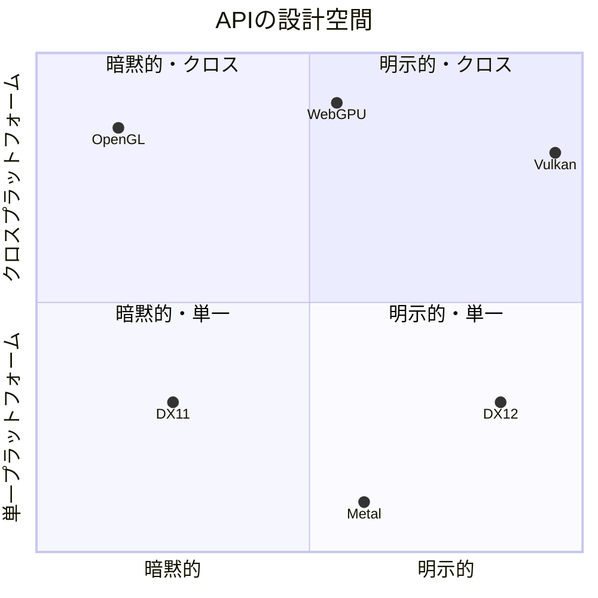

# 4大API横断比較 — OpenGL / Vulkan / DirectX 12 / WebGPU

## 概要

このページは第5章の総まとめとして、**同じ仕事が各APIでどう表現されるか**を横断比較します。「初期化 → リソース → パイプライン → コマンド → 同期」の5段階で対応表を示し、最後に「三角形を出すまで」のコード量と構造を比べます。1つのAPIを知っていれば、この対応表で他の3つへ翻訳できます。

## 概念対応表 (全体)

| 概念 | OpenGL | Vulkan | DirectX 12 | WebGPU |
|---|---|---|---|---|
| APIへの入口 | コンテキスト (wgl/glX/EGL) | VkInstance | IDXGIFactory | navigator.gpu |
| 物理GPU | (暗黙) | VkPhysicalDevice | IDXGIAdapter | GPUAdapter |
| 論理デバイス | (コンテキストと一体) | VkDevice | ID3D12Device | GPUDevice |
| 提出キュー | (暗黙) | VkQueue | ID3D12CommandQueue | GPUQueue |
| コマンド記録 | (即時・暗黙) | VkCommandBuffer | ID3D12GraphicsCommandList | GPUCommandEncoder |
| 記録メモリ | — | VkCommandPool | ID3D12CommandAllocator | (自動) |
| パイプライン | glUseProgram+状態 | VkPipeline | ID3D12PipelineState | GPURenderPipeline |
| バインドの型宣言 | (シェーダから反映) | VkPipelineLayout + SetLayout | Root Signature | GPUPipelineLayout + BGL |
| リソース束縛 | glBindTexture等 | VkDescriptorSet | Descriptor Heap/Table | GPUBindGroup |
| 頂点バッファ | VBO + VAO | VkBuffer + VertexInput | Resource + IASetVertexBuffers | GPUBuffer + buffers[] |
| 定数供給 | glUniform / UBO | UBO + Push Constants | CBV + Root Constants | uniform buffer |
| バリア/同期 | 通常は暗黙。shaderのincoherent書込み等はglMemoryBarrierが必要 | vkCmdPipelineBarrier2 | ResourceBarrier / Enhanced Barriers | usage・pass構造から実装が管理 |
| CPU-GPU同期 | glFenceSync + glClientWaitSync等 | VkFence / Timeline Semaphore | ID3D12Fence | onSubmittedWorkDone |
| GPU-GPU同期 | glMemoryBarrier / glWaitSync等（用途を区別） | VkSemaphore | ID3D12Fence + Queue::Signal/Wait（キュー間） | キュー・passの依存を実装が管理 |
| 画面出力 | SwapBuffers | VkSwapchainKHR | IDXGISwapChain | canvas context |
| シェーダ形式 | GLSLソース | SPIR-V | DXIL | WGSL |
| エラー検出 | glGetError | Validation Layers | Debug Layer | エラースコープ (常時検証) |

OpenGLの暗黙管理は「全ての同期が不要」という意味ではありません。image store/SSBO等のincoherent書込みを後続の処理で読む場合は `glMemoryBarrier` を使い、CPU待ちや別contextとの順序にはsync object等を使います。D3D12も、同じキューへ順序通りにsubmitするだけで異なるキューの依存が満たされるわけではなく、必要なresource barrierとキュー間のFence Signal/Waitを別々に指定します。

## 設計思想の比較



| 観点 | OpenGL | Vulkan | DX12 | WebGPU |
|---|---|---|---|---|
| 哲学 | ドライバが賢い | アプリが全責任 | アプリが全責任 (Windows流) | 明示的構造+自動安全 |
| 冗長さ (三角形まで) | ~50行 | ~1000行 (素書き) | ~700行 | ~150行 |
| マルチスレッド記録 | 不可 | ◎ | ◎ | ○ (Encoder並列) |
| 検証コスト | 毎コール | 開発時のみ (Layer) | 開発時のみ (Debug Layer) | 常時 (仕様の一部) |
| 拡張速度 | 停滞 | 最速 (ベンダー拡張) | 速い (Agility SDK) | 遅い (全会一致主義) |
| 学習序列 | 概念入門に最適 | 3番目 | 2番目 | 2番目としても優秀 |

## 「三角形を出すまで」構造比較

同じ仕事の各APIでの流れ:

```mermaid
flowchart TB
    subgraph GL[OpenGL]
        g1[コンテキスト作成] --> g2[VBO/VAO作成] --> g3[シェーダコンパイル] --> g4[glDraw]
    end
    subgraph WG[WebGPU]
        w1[adapter/device取得] --> w2[buffer作成] --> w3[pipeline作成<br/>WGSL+レイアウト] --> w4[encoder→pass→draw→submit]
    end
    subgraph DX[DX12]
        d1[Factory/Adapter/Device<br/>Queue/SwapChain/RTV<br/>Fence/Allocator] --> d2[リソース+ヒープ管理] --> d3[RootSig+PSO<br/>DXILコンパイル] --> d4[記録→バリア→提出<br/>→フェンス待ち]
    end
    subgraph VK[Vulkan]
        v1[Instance/Surface/PhysDev<br/>Device/Queue/Swapchain<br/>ImageView/CommandPool] --> v2[Memory/Buffer/Image<br/>+VMA] --> v3[PipelineLayout+Pipeline<br/>SPIR-V] --> v4[記録→バリア→submit<br/>semaphore+fence管理]
    end
```



行数の差は**ドライバがやっていた仕事の可視化量の差**です。逆に言えば、GLの50行の裏では残り950行相当の仕事をドライバが毎フレーム推測しながらやっていた、ということです。

## シェーダ言語の横断比較 (GLSL → HLSL → WGSL)

同一のライティング計算:

```glsl
// GLSL
vec3 shade(vec3 N, vec3 L, vec3 albedo) {
    float ndl = max(dot(normalize(N), L), 0.0);
    return albedo * ndl;
}
```

```hlsl
// HLSL
float3 Shade(float3 N, float3 L, float3 albedo) {
    float ndl = saturate(dot(normalize(N), L));
    return albedo * ndl;
}
```

```wgsl
// WGSL
fn shade(N: vec3f, L: vec3f, albedo: vec3f) -> vec3f {
    let ndl = max(dot(normalize(N), L), 0.0);
    return albedo * ndl;
}
```

完全な対応表は [シェーダ言語総論](/graphics/shader/overview.html) にあります。

## 座標系・規約の差異 (再掲)

| | NDC深度 | NDC Y | UV原点 | 行列規約(慣習) |
|---|---|---|---|---|
| OpenGL | [-1,1] | 上+ | 左下 | 列優先・列ベクトル |
| Vulkan | [0,1] | **下+** | 左上 | (glm=列優先) |
| DX12 | [0,1] | 上+ | 左上 | 行優先・行ベクトル(DirectXMath) |
| WebGPU | [0,1] | 上+ | 左上 | (wgsl=列優先) |

詳細は [座標変換](/math/rendering/transform.html) 参照。

## どのAPIを学ぶべきか (実務指針)

| 目的 | 推奨 |
|---|---|
| 概念の学習・教育 | OpenGL (資料の厚み) → すぐWebGPUへ |
| Windows AAA / Xbox | DX12 |
| モバイル・Switch・Linux | Vulkan |
| Apple専業 | Metal |
| Web・ツール・クロスプラットフォーム個人開発 | WebGPU (wgpu/Dawn) |
| エンジン開発者 | **DX12+Vulkanの両方** (RHI設計に必須) |

エンジンのRHI (Render Hardware Interface) 設計とは、まさに「この対応表の共通部分を抽象化する」作業です → [Unreal Engineのレンダラー](/graphics/engine/unreal-renderer.html)

## 前提知識

- 第5章の各APIページ ([OpenGL](/graphics/api/opengl.html), [DX11](/graphics/api/directx11.html), [DX12](/graphics/api/directx12.html), [Vulkan](/graphics/api/vulkan.html), [Metal](/graphics/api/metal.html), [WebGPU](/graphics/api/webgpu.html))

## 次に読むべきページ

- [Compute Shader](/graphics/compute/compute-shader.html) — 第6章へ
- [最終章: ゼロからレンダラーを作る](/graphics/capstone/01-design.html) — この知識の実践

## 理解度チェック

1. **「OpenGLは50行、Vulkanは1000行」の差は何の差か。本質を一文で述べよ。**
   ::: details 解答
   ドライバが実行時に推測・代行していた仕事(状態検証、ハザード追跡、メモリ管理、同期、コンパイルタイミング)を、アプリケーションが設計時に明示的に記述するようになった、その可視化された仕事量の差。
   :::

2. **WebGPUが「明示的APIの構造」と「自動同期」を両立できた理由は。**
   ::: details 解答
   リソース作成時にusageを完全宣言させ、コマンドをパス単位の構造で記録させることで、実装が依存関係を静的に導出できるだけの情報をAPI構造自体が持っているため。明示的APIの「検証の前倒し」という利得は維持しつつ、バリアという危険な自由度だけを排除した。
   :::

3. **エンジンのRHIを設計するとき、4APIの差異で最も設計を悩ませる箇所はどこか。**
   ::: details 解答
   リソースバインディングモデル(Descriptor Heap vs Descriptor Set vs BindGroup vs 暗黙バインド)の抽象化。更新頻度・バインドレス対応・シェーダ側宣言との整合をAPI横断で統一する必要があり、各エンジンのRHIで最も設計が分かれる部分。同期モデル(明示バリア vs 自動)の抽象化がそれに次ぐ。
   :::

## 参考資料

- Alain Galvan, *"Raw {DirectX12, Vulkan, Metal, WebGPU}"* シリーズ — 同一課題の4API実装比較
- gfx-rs/wgpu のバックエンド実装 — 「共通抽象の作り方」の実例
- Khronos, *Vulkan Guide: Porting from DX12*
- [Microsoft: Multi-engine synchronization](https://learn.microsoft.com/en-us/windows/win32/direct3d12/user-mode-heap-synchronization)
- [OpenGL 4.6 Core Specification: §7.13 Shader Memory Access / §4 Sync Objects](https://registry.khronos.org/OpenGL/specs/gl/glspec46.core.pdf)
