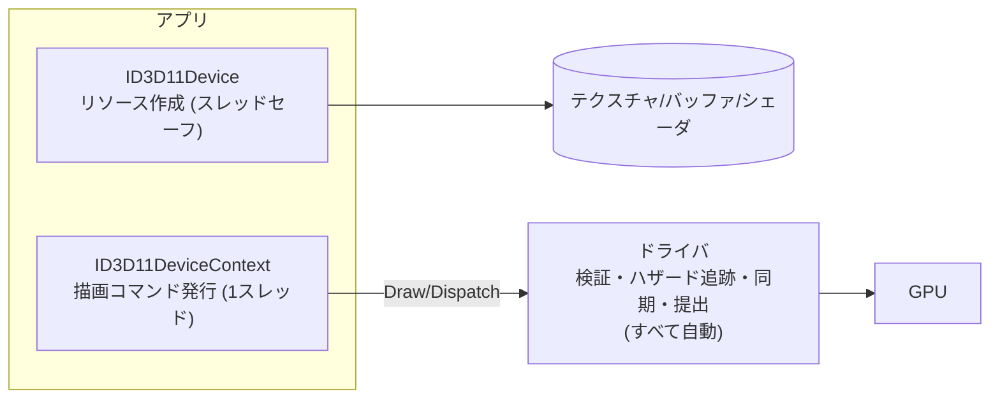

# DirectX 11

## 概要

DirectX 11 (2009) は**「ドライバが面倒を見てくれる」世代のAPIの完成形**です。ステートオブジェクト・Compute Shader・Tessellationを備え、10年以上にわたりWindowsゲーム開発の標準であり続けました。DX12より遥かに書きやすく、**今でも「とりあえずGPUを動かす」用途では現役の選択肢**です。DX12/Vulkanを学ぶ前の比較対象として最適な教材でもあります。

## なぜ必要なのか

- 膨大な既存タイトル・ツール・サンプルがDX11で書かれている
- UnityのWindows既定APIとして長く使われた (現在も選択可能)
- 「暗黙的APIの最良形」を知ることで、DX12の設計判断を評価できるようになる

## 歴史・誕生した背景

- 2006: DX10がAPIを完全再設計 (固定機能撤廃・ステートオブジェクト化) したが、Vista専用で普及に失敗
- **2009: DX11** — DX10の設計を継承しつつWindows 7と共に普及。**Compute Shader (DirectCompute)・Tessellation・マルチスレッド描画 (Deferred Context)** を追加
- 2013: DX11.2 (Tiled Resources)
- 2015: DX12登場後も、開発コストの低さから長く併存
- 現在: 新規AAAはDX12へ移行完了。インディー・ツール・エミュレーションでは現役

## それ以前の技術

DX9 (2002): ケーパビリティビット地獄 (ハードごとの機能差を無数のフラグで確認) と、固定機能とシェーダの混在。DX10がこれを「機能は世代で保証する (Feature Level)」方式に整理しました。

## 解決した課題

1. **ステートオブジェクト**: ラスタライザ/ブレンド/深度設定を不変オブジェクト化し、ドライバの検証を作成時に集約 (PSOの前身)
2. **Compute Shader**: グラフィックスパイプライン外の汎用計算を標準化 → [Compute Shader](/graphics/compute/compute-shader.html)
3. **Feature Level**: DX9級ハードでもDX11 APIで統一的に書ける
4. Deferred Contextでマルチスレッド記録を**試みた** (後述の通り不完全)

## 現在の位置づけ

「高い生産性・十分な性能・古いハードもカバー」という点で、要求の緩いプロジェクトでは合理的な選択です。ただしレイトレーシング・Mesh Shader・明示的マルチGPU等の新機能はDX12専用であり、最先端はDX12に完全移行しました。

## 内部動作

### Device と Immediate Context



- **Device**: リソース作成担当。スレッドセーフ
- **Immediate Context**: 描画コマンド担当。**1本だけ**で、実質シングルスレッド
- **Deferred Context**: 他スレッドでコマンドリストを記録できるが、ドライバ側が結局直列処理するため**期待された性能が出なかった** — DX12設計の直接の教訓

### ドライバの自動管理 (DX12との対照)

| 仕事 | DX11 | DX12 |
|---|---|---|
| リソースハザード | ドライバが自動追跡・自動バリア | アプリが `ResourceBarrier` |
| メモリ管理 | ドライバが割当・常駐管理 | アプリがヒープ管理 |
| CPU-GPU同期 | Map時に自動ストール等 | アプリがフェンス管理 |
| シェーダ最終コンパイル | ドロー時に遅延実行 (ヒッチ源) | PSO作成時に前倒し |
| 状態検証 | 毎ドロー | PSO作成時 |

`Map(WRITE_DISCARD)` によるリネーミング (ドライバが裏で新バッファを割り当てて差し替える) は、DX11ドライバの「親切さ」の代表例です。

### リソースビュー

リソース (メモリ) とビュー (解釈) の分離はDX11で確立し、DX12にも引き継がれた重要概念です:

- **SRV** (Shader Resource View): 読み取り
- **RTV** (Render Target View): 描画先
- **DSV** (Depth Stencil View): 深度
- **UAV** (Unordered Access View): 読み書き (Compute)

## 各環境での扱い

### Unity
長年のWindows既定API。安定性重視のプロジェクトでは今も選択されます。DX12対応の成熟に伴い既定はDX12へ移行しました。

### Unreal Engine
UE4の主要ターゲットでしたが、UE5ではDX12が既定 (Naniteやレイトレの要件)。DX11モードでは新機能が無効化されます。

### DirectX 12
後継。移行の要点は「ドライバの5つの自動管理を全部自分でやる」こと → [DirectX 12](/graphics/api/directx12.html)

### Vulkan
DX11に相当する「暗黙的API」はKhronos側ではOpenGLです。DX11とVulkanの比較は世代違いの比較になります。

## コード例

初期化から描画まで (C++、エラー処理略):

```cpp
// デバイスとスワップチェイン作成 — 1呼び出しで済む手軽さ
D3D11CreateDeviceAndSwapChain(nullptr, D3D_DRIVER_TYPE_HARDWARE,
    nullptr, 0, nullptr, 0, D3D11_SDK_VERSION,
    &scDesc, &swapChain, &device, &featureLevel, &context);

// 頂点バッファ
D3D11_BUFFER_DESC bd = { sizeof(verts), D3D11_USAGE_DEFAULT,
                         D3D11_BIND_VERTEX_BUFFER };
D3D11_SUBRESOURCE_DATA init = { verts };
device->CreateBuffer(&bd, &init, &vb);

// 毎フレーム — バリアもフェンスも書かない
context->OMSetRenderTargets(1, &rtv, dsv);
context->ClearRenderTargetView(rtv, clearColor);
context->IASetVertexBuffers(0, 1, &vb, &stride, &offset);
context->IASetPrimitiveTopology(D3D11_PRIMITIVE_TOPOLOGY_TRIANGLELIST);
context->VSSetShader(vs, nullptr, 0);
context->PSSetShader(ps, nullptr, 0);
context->Draw(3, 0);
swapChain->Present(1, 0);
```

定数バッファ更新の「親切な」動作:

```cpp
// ドライバがGPUの使用状況を追跡し、書込み可能になるまでの処理を自動で行う
D3D11_MAPPED_SUBRESOURCE mapped;
context->Map(cbuffer, 0, D3D11_MAP_WRITE_DISCARD, 0, &mapped);
memcpy(mapped.pData, &data, sizeof(data));   // DISCARDでリネーミング発動
context->Unmap(cbuffer, 0);
// DX12では: リングバッファ自作+フェンスでの追跡がアプリの仕事になる
```

## 前提知識

- [グラフィックスAPIの歴史](/graphics/api/history.html)
- [パイプライン全体像](/graphics/pipeline/overview.html)

## 次に読むべきページ

- [DirectX 12](/graphics/api/directx12.html) — 何が変わったかを対比しながら
- [Compute Shader](/graphics/compute/compute-shader.html) — DX11が標準化した機能
- [4大API横断比較](/graphics/api/comparison.html)

## 理解度チェック

1. **DX11のDeferred Contextがマルチスレッド描画の решениеとして不十分だった理由は。**
   ::: details 解答
   記録自体は複数スレッドで行えるが、ドライバ内部の検証・ハザード解決・最終的なコマンド生成はImmediate Contextへの提出時に単一スレッドで実行される設計が残ったため、期待した並列化効果が得られなかった。ドライバの隠れた仕事を分割できない構造こそが本質的な限界で、DX12はこの仕事自体をアプリへ移して解決した。
   :::

2. **`Map(WRITE_DISCARD)` でドライバが行う「リネーミング」とは何か。**
   ::: details 解答
   GPUがまだ参照中のバッファに対しCPUが書き込もうとしたとき、ドライバが新しいメモリ領域を割り当てて以後の参照をそちらに差し替えること。CPUはストールせずに書け、GPUは旧データを読み終えられる。DX12ではこの仕組みは提供されず、アプリがフレームインフライト数ぶんのバッファを自前で回す。
   :::

3. **今日あえてDX11を選ぶことが合理的なケースを挙げよ。**
   ::: details 解答
   開発リソースが限られる小規模プロジェクトやツール開発で、CPUボトルネックが問題にならず、レイトレーシング等のDX12専用機能も不要な場合。コード量・デバッグ難度・ドライバ成熟度の面で総開発コストが大幅に低い。
   :::

## 参考資料

- Frank Luna, *Introduction to 3D Game Programming with DirectX 11* — 定番教科書
- Microsoft Learn, *Direct3D 11 Graphics*
- GDC講演 *"DX12 Porting"* 系 — DX11→12移行の実録資料群
