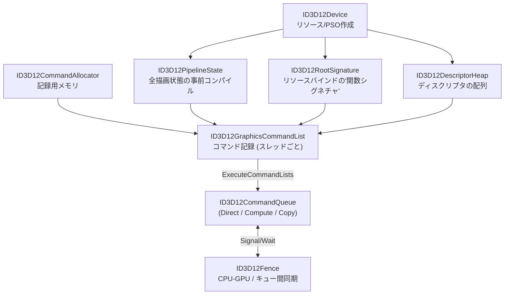

# DirectX 12

## 概要

DirectX 12 (2015) はMicrosoftの**明示的 (explicit) グラフィックスAPI**です。DX11でドライバが自動で行っていた仕事 — 状態検証・ハザード管理・メモリ管理・同期 — を**アプリケーションの責務**に移し、引き換えにマルチコアCPUの完全活用と予測可能な性能を得ました。Windows/Xboxの標準であり、レイトレーシング (DXR)・Mesh Shader・Work Graphsなど新機能の最速実装の場です。

## なぜ必要なのか

- Windows AAAゲーム開発の標準。UE5/UnityのWindows既定
- DXR・Mesh Shader・DirectStorage等、新世代機能の入口
- Xbox Series X|S のAPIとほぼ共通 (コンソール開発への足がかり)
- 明示的APIの概念 (PSO/バリア/ディスクリプタ/フェンス) はVulkan/Metal/WebGPUと相互に翻訳可能 — **1つ深く学べば全部に効く**

## 歴史・誕生した背景

- 2013: Mantle (AMD) が明示的API設計の有効性を実証 → [APIの歴史](/graphics/api/history.html)
- 2014: GDCでDX12発表。「CPUオーバーヘッドを最大50%削減」
- **2015: Windows 10と同時リリース**
- 2018: **DXR** (DirectX Raytracing) — 業界初の標準RT API
- 2019-20: **DX12 Ultimate** (DXR 1.1, Mesh Shader, VRS, Sampler Feedback) — PC/Xbox共通の機能セット
- 2021-: Agility SDK (OSと独立したAPI更新)、DirectStorage、Enhanced Barriers
- 2024: **Work Graphs** — GPUが自らワークを生成する新実行モデル

## それ以前の技術

[DirectX 11](/graphics/api/directx11.html)。その「ドライバ任せ」設計が、マルチコア時代のCPUボトルネックの元凶でした。

## 解決した課題

1. **ドローコールコストの削減**: PSO事前構築により毎ドローの検証を排除
2. **マルチスレッド記録**: コマンドリストを任意のスレッドで並列記録
3. **予測可能性**: ドライバの「気まぐれ」(隠れた同期・再コンパイル) の排除
4. **明示的マルチGPU・明示的メモリ管理**

## 現在の位置づけ

Windows/Xboxの第一線API。習得コストは高いものの、エンジン開発者には必修です。なおDX12の複雑さを緩和するため、公式ヘルパー (D3DX12)、AgilitySDKの改善 (Enhanced Barriers)、そしてメモリアロケータ (D3D12MA) 等のエコシステムが整備されています。

## 内部動作 — 5大概念

### 全体構造



### 1. コマンドリストとキュー

- **3種のキュー**: Direct (全部可能) / Compute (計算+コピー) / Copy (転送専用) — 非同期コンピュート ([最適化](/graphics/optimization/basics.html)) の基盤
- コマンドリストは**スレッドごとに並列記録**し、`ExecuteCommandLists` で一括提出
- Allocatorは記録メモリの実体。**GPUが実行を終えるまでResetできない** — フレームインフライト数ぶん用意する

### 2. PSO (Pipeline State Object)

シェーダ+ラスタライザ/ブレンド/深度設定+入力レイアウト+RTフォーマットを**1個の不変オブジェクトに事前コンパイル**。

- 作成は重い (ドライバがISAまでコンパイル) → 起動時/ロード画面で作る。実行時作成が「シェーダコンパイルスタッター」の正体
- 組み合わせ爆発への対処がエンジン設計の重要課題 (PSOキャッシュ、事前列挙)

### 3. Root Signature とディスクリプタ

リソースバインディングの2段構造:

- **Root Signature**: 「シェーダはどんな形でリソースを受け取るか」の宣言 (関数シグネチャに相当)。Root定数・Rootディスクリプタ・**ディスクリプタテーブル** (ヒープ内の連続領域を指す) を組み合わせる
- **Descriptor Heap**: SRV/UAV/CBVのディスクリプタ (リソースへのポインタ+メタデータ) を並べたGPU可視配列

SM6.6の **Dynamic Resources** (`ResourceDescriptorHeap[i]`) により、テーブル定義すら省いた**バインドレス**設計が現代の主流です:

```hlsl
// バインドレス: ヒープのインデックスだけをRoot定数で渡す
Texture2D tex = ResourceDescriptorHeap[gMaterialData.albedoIndex];
```

### 4. リソースバリア

ハザード (書いた結果を読む際の同期・キャッシュフラッシュ・レイアウト変換) を**アプリが明示**します:

```cpp
// レンダーターゲットとして書いた結果をシェーダで読む前に遷移
auto barrier = CD3DX12_RESOURCE_BARRIER::Transition(
    shadowMap.Get(),
    D3D12_RESOURCE_STATE_DEPTH_WRITE,
    D3D12_RESOURCE_STATE_PIXEL_SHADER_RESOURCE);
cmdList->ResourceBarrier(1, &barrier);
```

バリア忘れ = 不定動作 (動くように見えて壊れる)。**Enhanced Barriers** (2022) はVulkan風の細粒度同期モデルへの刷新です。バリア管理の自動化こそ [RenderGraph](/graphics/optimization/render-graph.html) の存在理由です。

### 5. フェンスとメモリ管理

- `ID3D12Fence` でGPUの進行をCPUが追跡し、資源の再利用を管理する → [CPUとGPUの役割分担](/hardware/gpu/cpu-vs-gpu.html)
- キュー間依存にも同じFenceを使う。例えばCopyキューが `Signal(fence, value)`、Graphicsキューが必要な使用の前に `Wait(fence, value)` を行う。`ID3D12CommandQueue::Wait` はGPU側の待ちで、CPUをその場で待たせる呼出しとは異なる。ResourceBarrierだけで別キューの処理完了を保証することはできない
- メモリは `CreateCommittedResource` (簡単) か `CreatePlacedResource` (ヒープに手動配置、エイリアシング可能)。実務はD3D12MA (AMDのアロケータ) が定番

## 各環境での扱い

### Unity
Windows/Xboxの既定API (Unity 6以降)。SRPのCommandBufferがDX12コマンドリストへ変換されます。`SystemInfo.graphicsDeviceType == Direct3D12` で判定。非同期コンピュートは `CommandBuffer.SetExecutionFlags` 系APIで限定的に利用可能。

### Unreal Engine
UE5の既定RHI。`D3D12RHI` モジュールがフレームグラフ (RDG) の下でバリア・ディスクリプタを自動管理します。エンジン開発者はRHI抽象越しにDX12概念 (トランジション、PSOキャッシュ) と日常的に付き合います。

### DirectX 12
本体。学習は公式サンプル (DirectX-Graphics-Samples) と D3D12 Agility SDK から。

### Vulkan
概念はほぼ1対1対応します:

| DX12 | Vulkan |
|---|---|
| Command List / Allocator | Command Buffer / Command Pool |
| Command Queue | VkQueue |
| PSO | VkPipeline |
| Root Signature | VkPipelineLayout |
| Descriptor Heap / Table | Descriptor Pool / Set |
| Resource Barrier | vkCmdPipelineBarrier |
| Fence | VkFence / Timeline Semaphore |

## コード例

フレーム描画の骨格 (C++、詳細略):

```cpp
void Renderer::RenderFrame() {
    UINT fi = frameIndex;  // 0..kFramesInFlight-1

    // 1. このスロットのGPU完了を待つ (フェンス)
    WaitForFence(frameFence[fi]);
    allocator[fi]->Reset();
    cmd->Reset(allocator[fi].Get(), nullptr);

    // 2. バックバッファを描画可能状態へ遷移
    Transition(cmd, backBuffer[fi],
        D3D12_RESOURCE_STATE_PRESENT, D3D12_RESOURCE_STATE_RENDER_TARGET);

    // 3. 描画
    cmd->OMSetRenderTargets(1, &rtvHandle[fi], FALSE, &dsvHandle);
    cmd->ClearRenderTargetView(rtvHandle[fi], clear, 0, nullptr);
    cmd->SetGraphicsRootSignature(rootSig.Get());
    cmd->SetPipelineState(opaquePSO.Get());
    cmd->SetDescriptorHeaps(1, srvHeap.GetAddressOf());
    cmd->SetGraphicsRootDescriptorTable(1, srvHeap->GetGPUDescriptorHandleForHeapStart());
    for (auto& mesh : visibleMeshes) {
        cmd->SetGraphicsRoot32BitConstants(0, 16, &mesh.world, 0);
        cmd->IASetVertexBuffers(0, 1, &mesh.vbView);
        cmd->IASetIndexBuffer(&mesh.ibView);
        cmd->DrawIndexedInstanced(mesh.indexCount, 1, 0, 0, 0);
    }

    // 4. Present可能状態へ戻して提出
    Transition(cmd, backBuffer[fi],
        D3D12_RESOURCE_STATE_RENDER_TARGET, D3D12_RESOURCE_STATE_PRESENT);
    cmd->Close();
    ID3D12CommandList* lists[] = { cmd.Get() };
    queue->ExecuteCommandLists(1, lists);
    swapChain->Present(1, 0);
    SignalFence(frameFence[fi]);
}
```

完全な初期化手順は [最終章](/graphics/capstone/02-device.html) で実装します。

## 前提知識

- [CPUとGPUの役割分担](/hardware/gpu/cpu-vs-gpu.html), [DirectX 11](/graphics/api/directx11.html)
- [パイプライン全体像](/graphics/pipeline/overview.html)

## 次に読むべきページ

- [Vulkan](/graphics/api/vulkan.html) — 概念対応で二刀流に
- [HLSL](/graphics/shader/hlsl.html) — SM6.xの言語側
- [RenderGraph / FrameGraph](/graphics/optimization/render-graph.html) — バリア地獄の解法
- [最終章: デバイス初期化](/graphics/capstone/02-device.html)

## 理解度チェック

1. **PSO事前コンパイルが解決した問題と、新たに生んだ問題を述べよ。**
   ::: details 解答
   解決: DX11ではドロー時にステート組み合わせが確定してからドライバが検証・シェーダの最終コンパイルを行い、フレーム中のヒッチと毎ドローのCPUコストを生んでいた。PSOはこれを作成時に前倒しし、ドロー時は切替のみにした。新たな問題: ステート組み合わせごとにPSOが必要になり、組み合わせ爆発によるコンパイル時間・メモリ・実行時PSO作成によるスタッターが発生。PSOキャッシュや事前収集が必須になった。
   :::

2. **リソースバリアが表現している3つの実体は何か。**
   ::: details 解答
   (1)実行依存(前の書き込みの完了を待つ)、(2)メモリ可視性(キャッシュのフラッシュ/無効化により書いた内容を読む側から見えるようにする)、(3)レイアウト変換(圧縮形式など、用途ごとに最適な内部データ配置への変換)。DX11ではドライバが全ドローの依存を推測して自動挿入していた。
   :::

3. **Copy/Computeキューを別に持つ意味は何か。**
   ::: details 解答
   ハードウェアのDMAエンジンや空き演算資源を利用し、描画と転送・計算を並行させるため。ただしキュー間に依存があればFenceのSignal/Waitと必要なresource barrierを指定する。独立した処理を重ねて短縮できるかはGPUや負荷に依存し、キューを分けただけでは高速化しない。
   :::

## 参考資料

- Microsoft, *DirectX-Graphics-Samples* (GitHub) / *Direct3D 12 プログラミングガイド*
- Microsoft, *DirectX-Specs* — Enhanced Barriers, Work Graphs等の一次仕様
- AMD GPUOpen, *D3D12 Memory Allocator* / 性能ガイド
- MJP (Matt Pettineo) のブログ — バインドレス・バリア解説の良記事群
- [Microsoft: Multi-engine synchronization](https://learn.microsoft.com/en-us/windows/win32/direct3d12/user-mode-heap-synchronization)
