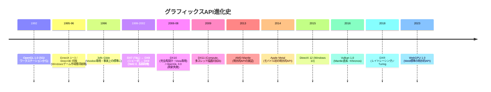
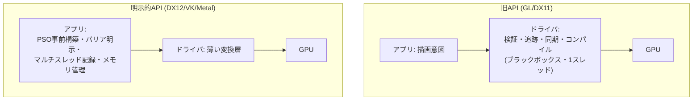

# グラフィックスAPIの歴史

## 概要

グラフィックスAPIは**アプリケーションとGPUドライバの間の契約**です。30年の歴史は「抽象度を上げてきた前半」と「抽象を剥がして明示化した後半」に分かれます。この転換の物語を理解すると、DX12/Vulkanの一見不可解な複雑さが「すべて必然だった」と分かります。

## なぜ必要なのか

- APIの設計思想を知らずに使うと、「なぜ手動でバリアを張るのか」「なぜPSOがあるのか」が暗記になってしまう
- 旧APIの限界を知ることは、新APIの正しい使い方 (マルチスレッド記録、事前コンパイル) の理解に直結する

## 年表

## 第1期: 群雄割拠 (1992〜1998)

- **OpenGL** (1992): SGIのIRIS GLを標準化。ワークステーションCAD/科学可視化が出自。ステートマシンモデル、`glBegin/glEnd` の即時モード
- **Direct3D** (1996): MicrosoftがWindowsゲーム市場のために買収 (RenderMorphics) して構築。初期は評判が悪く、Carmackの「D3Dは使い物にならない」批判 (1996) が有名
- **Glide** (1996): 3dfx Voodoo専用の薄いAPI。ハードに直結し高速 — **「薄いAPIは速い」という後の明示的APIの原点的教訓**
- この時代の課題: API乱立、ドライバ品質のばらつき、固定機能の制約

## 第2期: DirectXの覇権とプログラマブル化 (1999〜2008)

- DX7 (1999) でT&L対応、**DX8 (2000) でシェーダ導入**、DX9 (2002) が長期の業界標準に (XPと共に約7年)
- OpenGLは拡張機構で追随するも、ARB (委員会) の意思決定の遅さで徐々に後退。**OpenGL 3.0 (2008) の「旧API破棄」公約が骨抜きになった事件**でゲーム業界の信頼を失う
- DX10 (2006): API完全再設計 (ステートオブジェクト化、固定機能撤廃) だがVista専用で普及が遅れた
- この時代の教訓: **後方互換の呪縛** — 古い設計を捨てられないAPIは性能の天井に達する

## 第3期: ドローコール危機と明示的API革命 (2009〜2016)

### 当時の課題

DX11/GL時代のドライバは:
1. **隠れた状態検証**: ドローごとに全ステートの整合性をチェック
2. **隠れたリソース追跡**: ハザード (書き込み中のテクスチャを読む等) をドライバが推測して自動でバリア挿入
3. **シングルスレッド前提**: コンテキストが1本で、マルチコアCPUを活かせない
4. **シェーダの遅延コンパイル**: ドロー時にステート組み合わせが確定してから最終コンパイル → ヒッチ

結果、CPU1コアだけが忙殺され、ドローコールは数千/フレームで頭打ちでした。

### Mantle革命

2013年、AMDとDICE (Battlefield 4) が **Mantle** を発表。「ドライバの仕事をアプリに移す」設計 — コマンドバッファの明示的記録、PSO、手動ハザード管理、明示的メモリ管理 — でドローコールコストを1桁削減しました。

- 2014: Apple **Metal** (同思想をモバイルへ)
- 2015: **DirectX 12** (Windows 10)
- 2016: **Vulkan 1.0** — MantleがKhronosに寄贈され、そのまま土台に

## 第4期: 機能拡張と収斂 (2017〜現在)

- 2018: **DXR** (レイトレーシング) → Vulkan Ray Tracing (2020) → [レイトレーシング](/graphics/lighting/raytracing.html)
- 2018-20: Mesh Shader、Variable Rate Shading (DX12 Ultimate / VK拡張)
- 2023: **WebGPU** — 明示的API世代の設計をWeb安全性の制約下で再蒸留した「4番目のAPI」
- 2024-: **Work Graphs** (GPU自律的なワーク生成)、バインドレス常態化、Descriptor Buffer等 — 「GPUが自分で描画を組み立てる」方向へ
- 同時に、明示的APIの複雑さへの反省から**簡素化の揺り戻し** (VK: Dynamic Rendering, Shader Object拡張) も進行中

## それ以前の技術 / 解決した課題 / 現在の位置づけ (総括)

| 世代 | 代表 | 解決した課題 | 生んだ課題 |
|---|---|---|---|
| 即時モード | GL 1.x | ハードウェア差の抽象化 | 呼び出しオーバーヘッド |
| ステートマシン+VBO | GL 2-4 / DX9 | データのGPU常駐化 | ドライバの隠れコスト |
| ステートオブジェクト | DX10/11 | 状態変更の整理 | 1スレッド制約は残存 |
| 明示的API | DX12/VK/Metal | CPUボトルネック・マルチコア活用 | アプリ側の複雑さ激増 |
| Web標準 | WebGPU | 安全性と移植性の両立 | 機能の最大公約数化 |

## 各環境での扱い

### Unity
Graphics API設定で DX11/DX12/Vulkan/Metal/GLES を選択可能。エンジンが差を吸収するため、この歴史は「なぜUnityのAPIがこう設計されているか」(CommandBuffer、SRP Batcher等) の背景知識になります。

### Unreal Engine
RHI層が全APIを抽象化。UE5はDX12/Vulkan/Metalが主要ターゲットで、DX11は縮小方向。RHIの設計自体が「明示的API世代の共通形」を反映しています。

### DirectX 12 / Vulkan
本章の主役。それぞれ [DirectX 12](/graphics/api/directx12.html)、[Vulkan](/graphics/api/vulkan.html) で詳解します。

## 前提知識

- [CPUとGPUの役割分担](/hardware/gpu/cpu-vs-gpu.html)

## 次に読むべきページ

- [OpenGL](/graphics/api/opengl.html) — 旧世代の設計を知る
- [DirectX 11](/graphics/api/directx11.html) — 過渡期の到達点
- [DirectX 12](/graphics/api/directx12.html) / [Vulkan](/graphics/api/vulkan.html) — 現代の主役
- [4大API横断比較](/graphics/api/comparison.html)

## 理解度チェック

1. **DX11世代のドライバが行っていた「隠れた仕事」を3つ挙げ、DX12/Vulkanではそれぞれ誰の責務になったか述べよ。**
   ::: details 解答
   (1)状態検証→PSO作成時に前倒しされアプリが正しい組み合わせを保証。(2)リソースハザードの自動追跡と同期→アプリが明示的にバリア/フェンスを記述。(3)メモリ割り当てと常駐管理→アプリがヒープを確保しサブアロケーションを管理。いずれも「毎ドローの隠れコスト」を「アプリ設計時の明示コスト」に変換した。
   :::

2. **Mantleが歴史的に重要である理由を、単なる「速いAPI」以上の観点で説明せよ。**
   ::: details 解答
   明示的API設計が実ゲーム(BF4)で劇的なCPU削減を実証し、業界全体の設計転換を引き起こした。さらに仕様自体がKhronosへ寄贈されVulkanの直接の土台となり、DX12/Metalの設計にも強い影響を与えた。「一社の実験が全APIの世代交代を駆動した」稀有な例。
   :::

3. **WebGPUが「4番目の明示的API」として、DX12/VK/Metalと異なる制約下で設計された点は何か。**
   ::: details 解答
   悪意あるコードの実行を前提とするWebサンドボックスでの動作。全リソースアクセスの検証可能性、未定義動作の排除、3つのネイティブAPIすべての上で実装可能な最大公約数的機能セット、という制約の下で明示的API設計を再構成している。
   :::

## 参考資料

- Fabien Sanglard, 各種 "Game Engine Black Book" とAPI史記事
- GDC Vault: *Mantle* (2014), *DX12 & Vulkan: Lessons Learned* 系講演
- Khronos, *Vulkan: The Origin Story* / Alex St. John らのDirectX創世記の回顧録
- retro-computing系: OpenGL vs Direct3D 論争のアーカイブ (Carmack .plan files)
