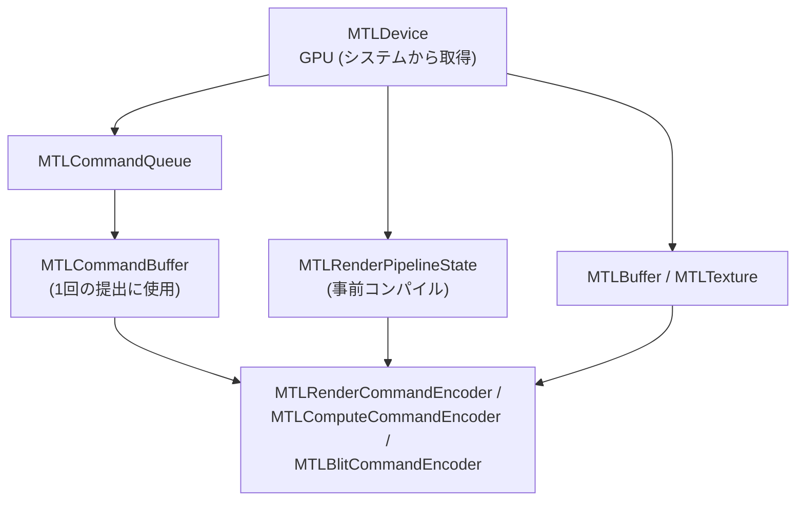

# Metal

## 概要

MetalはAppleの明示的グラフィックス/コンピュートAPIです (2014)。**DX12/Vulkanより先に出荷され**、従来APIでは対象リソースのハザード追跡をMetalに任せられます。2025年に登場したMetal 4のコアAPIでは、依存関係とリソースの寿命をアプリが明示的に管理します。iOS/macOS/visionOS向けにApple GPUのTBDR機能を使えます。

## なぜ必要なのか

- iPhone/iPad/Mac向けの高性能グラフィックスはMetal一択 (GLは非推奨、Vulkanは変換層のみ)
- モバイルゲーム市場の約半分を占めるiOSでは、UnityやUEで開発する場合にもMetalの挙動が最適化に関わる
- TBDRアーキテクチャ最適化 (タイルメモリ、メモリレスRT) の代表的実装

## 歴史・誕生した背景

- 2013: A7 (世界初の64bitモバイルSoC) 登場。GLESのドライバオーバーヘッドがボトルネックに
- **2014: WWDC でMetal発表** (iOS 8) — Mantle公開の翌年、DX12/Vulkanより先に出荷
- 2015: OS X El CapitanでMacに対応
- 2017: Metal 2 — Argument Buffers、タイルシェーダ (A11 Bionic)
- 2018: macOS Mojave 10.14でOpenGL/OpenCLが非推奨化。互換性のためAPIは残るが、新規開発はMetalへの移行を推奨
- 2022: **Metal 3** — MetalFX (アップスケーリング)、メッシュシェーダ、高速リソースロード
- 2023-: Game Porting Toolkit (DX12→Metal変換) でWindowsゲーム移植を推進
- 2025: **Metal 4** — 明示的な同期を使うコアAPI、テンソル・機械学習機能を追加

## それ以前の技術

iOS/macOSのOpenGL ES / OpenGL。

## 解決した課題

1. モバイルでのドローコールコスト削減 (GLES比で~10倍のドローコール)
2. 事前コンパイルシェーダ (`.metallib`) によるロード・安定性改善
3. コンピュートとグラフィックスの統一的API
4. **Apple GPUのTBDR機能の直接公開** (他APIでは不可能な最適化)

## 現在の位置づけ

従来のMetalは明示的なコマンド記録と対象リソースの自動ハザード追跡を組み合わせ、WebGPUの設計に影響を与えました。Metal 4に対応する環境でも従来APIを利用できます。

## 内部動作 — 主要概念

### オブジェクトモデル

従来API (`MTLCommandQueue`) のコマンド記録モデルです。



- **エンコーダ**: 1つのレンダーパス/コンピュートパスに対応するコマンド記録器。`endEncoding` で閉じる。この構造がWebGPUにそのまま継承された
- **従来APIのハザード追跡**: `MTLCommandQueue` に提出した処理では、`.tracked` のリソースをエンコーダに直接バインドした場合にMetalがハザードを追跡します。既定値は `MTLDevice` から作成したリソースが `.tracked`、`MTLHeap` から作成したリソースが `.untracked` です。
- **Metal 4の同期と寿命管理**: `MTL4CommandQueue` に提出した処理に `hazardTrackingMode` は適用されません。アプリは依存の範囲に応じてバリア・フェンス・イベントで同期します。再利用できる `MTL4CommandBuffer` はリソースへの強参照を持たないため、GPUの処理完了までアプリがリソースを保持します。

### TBDR特化機能

| 機能 | 内容 |
|---|---|
| Memoryless Render Target | タイルメモリのみに存在しVRAMを消費しないRT (深度など「パス内でしか使わない」もの) |
| タイルシェーダ / imageblock | タイルメモリ上のデータをComputeで直接加工 → [MSL](/graphics/shader/msl.html) |
| Programmable Blending | FSで同一ピクセルの現在値を読める |
| `loadAction/storeAction` | タイルへのロード/ストアを明示制御 (帯域最適化の要) |

### Argument Buffers (バインドレス)

リソース参照の集合をバッファに書き込み、GPUから間接参照する仕組み。Tier2ではほぼ無制限のリソースにアクセスでき、DX12のDynamic Resources / VKのDescriptor Indexingに相当します。

## 各環境での扱い

### Unity
iOS/macOSビルドの既定API。`Metal API Validation` はXcode経由で有効化。メモリレスRTは `RenderTexture.memorylessMode` として公開されています。

### Unreal Engine
Apple向けRHI。Metal 3世代でNanite等の対応も進行。シェーダはUSF→MSL変換。

### DirectX 12 / Vulkan
直接関係はないが、MoltenVK (VK→Metal) とGame Porting Toolkit (D3D→Metal) という変換層が存在。Metalの概念対応は [横断比較](/graphics/api/comparison.html) 参照。

## コード例

従来APIを使う Swift での描画ループ (三角形)。呼び出し元から初期化済みのビュー・キュー・PSO・頂点バッファ・変換行列を渡します。

```swift
import MetalKit
import simd

func draw(
    in view: MTKView,
    queue: MTLCommandQueue,
    pso: MTLRenderPipelineState,
    vertexBuffer: MTLBuffer,
    viewProjection: simd_float4x4,
    model: simd_float4x4
) {
    guard let drawable = view.currentDrawable,
          let rpd = view.currentRenderPassDescriptor,
          let cmdBuf = queue.makeCommandBuffer(),
          let enc = cmdBuf.makeRenderCommandEncoder(descriptor: rpd) else { return }

    // loadAction/storeActionはrpdに設定済み (TBDRの帯域制御点)
    enc.setRenderPipelineState(pso)
    enc.setVertexBuffer(vertexBuffer, offset: 0, index: 0)
    var mvp = viewProjection * model
    enc.setVertexBytes(&mvp, length: MemoryLayout<simd_float4x4>.size, index: 1)
    enc.drawPrimitives(type: .triangle, vertexStart: 0, vertexCount: 3)
    enc.endEncoding()

    cmdBuf.present(drawable)
    // 従来のキューでは、直接バインドした .tracked のリソースが自動追跡の対象。
    cmdBuf.commit()
}
```

PSOは次のように作成します。

```swift
let desc = MTLRenderPipelineDescriptor()
desc.vertexFunction   = library.makeFunction(name: "vsMain")
desc.fragmentFunction = library.makeFunction(name: "fsMain")
desc.colorAttachments[0].pixelFormat = view.colorPixelFormat
let pso = try device.makeRenderPipelineState(descriptor: desc)
```

## 前提知識

- [グラフィックスAPIの歴史](/graphics/api/history.html), [GPUアーキテクチャ詳解](/hardware/gpu/architecture.html) (TBDR)

## 次に読むべきページ

- [MSL](/graphics/shader/msl.html) — シェーダ言語側
- [WebGPU](/graphics/api/webgpu.html) — Metalの設計を色濃く継いだAPI
- [4大API横断比較](/graphics/api/comparison.html)

## 理解度チェック

1. **従来の `MTLCommandQueue` と `MTL4CommandQueue` では、ハザード追跡はどう異なるか。**
   ::: details 解答
   従来のキューでは `.tracked` のリソースをエンコーダに直接バインドすると自動で追跡される。Metal 4のキューに提出した処理には `hazardTrackingMode` が効かず、依存する処理をアプリが明示的に同期する。`MTL4CommandBuffer` はリソースを保持しないため、GPUの処理が終わるまで寿命もアプリが管理する。
   :::

2. **Memoryless Render Targetが成立する条件と利得を説明せよ。**
   ::: details 解答
   TBDRではレンダーパス中の中間データ(深度バッファやMSAAの中間サンプル等)がタイルメモリ上に存在するため、パスをまたいで保存する必要がなければVRAM上の実体を持たなくてよい。storeActionをdontCareにできるRTをmemorylessにすると、メモリ確保とVRAM帯域の両方をゼロにできる。
   :::

3. **Metalのエンコーダ構造はWebGPUにどう受け継がれたか。**
   ::: details 解答
   WebGPUのGPUCommandEncoder→beginRenderPass/beginComputePassで得るPassEncoderに記録しendで閉じる、という構造はMetalのCommandBuffer→RenderCommandEncoder/ComputeCommandEncoderの直系。レンダーパス単位でコマンドを区切る設計もloadOp/storeOpの明示もMetal由来の思想が濃い。
   :::

## 参考資料

- Apple, *Metal Programming Guide* / *Metal Feature Set Tables*
- WWDCセッション: *"Metal 3"*, *"Optimize for Apple GPUs"* 各年
- metalbyexample.com (Warren Moore)
- [Apple: MetalをMacへ導入したEl Capitan (2015)](https://developer.apple.com/news/?id=060815b)
- [Apple: macOS Mojave 10.14 Release Notes](https://developer.apple.com/documentation/macos-release-notes/macos-mojave-10_14-release-notes/)
- [Apple: Understanding the Metal 4 core API](https://developer.apple.com/documentation/metal/understanding-the-metal-4-core-api)
- [Apple: Resource synchronization](https://developer.apple.com/documentation/metal/resource-synchronization)
