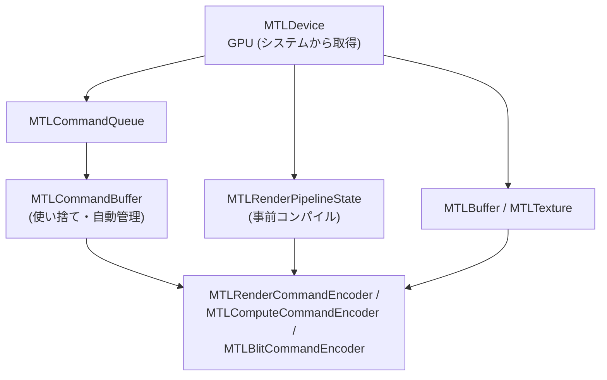

# Metal

## 概要

MetalはAppleの明示的グラフィックス/コンピュートAPIです (2014)。**明示的API世代で最初に出荷された**にもかかわらず、DX12/Vulkanより**大幅に書きやすい**のが特徴で、「明示性と人間工学のバランス」の成功例とされます。iOS/macOS/visionOSの唯一の第一級APIであり、Apple Silicon (TBDR) の性能を引き出す鍵です。

## なぜ必要なのか

- iPhone/iPad/Mac向けの高性能グラフィックスはMetal一択 (GLは非推奨、Vulkanは変換層のみ)
- モバイルゲーム市場の約半分はiOS — Unity/UE開発者もMetalの挙動理解が最適化に直結
- TBDRアーキテクチャ最適化 (タイルメモリ、メモリレスRT) の代表的実装

## 歴史・誕生した背景

- 2013: A7 (世界初の64bitモバイルSoC) 登場。GLESのドライバオーバーヘッドがボトルネックに
- **2014: WWDC でMetal発表** (iOS 8) — Mantle公開の翌年、DX12/Vulkanより先に出荷
- 2016: macOS対応
- 2017: Metal 2 — Argument Buffers、タイルシェーダ (A11 Bionic)
- 2019: macOS OpenGL非推奨化。Metal専用時代へ
- 2022: **Metal 3** — MetalFX (アップスケーリング)、メッシュシェーダ、高速リソースロード
- 2023-: Game Porting Toolkit (DX12→Metal変換) でWindowsゲーム移植を推進

## それ以前の技術

iOS/macOSのOpenGL ES / OpenGL。

## 解決した課題

1. モバイルでのドローコールコスト削減 (GLES比で~10倍のドローコール)
2. 事前コンパイルシェーダ (`.metallib`) によるロード・安定性改善
3. コンピュートとグラフィックスの統一的API
4. **Apple GPUのTBDR機能の直接公開** (他APIでは不可能な最適化)

## 現在の位置づけ

Appleプラットフォームの唯一解。設計面では「Vulkanほど冗長でなくDX11ほど暗黙でない」中間解として、WebGPUの設計に強い影響を与えました。

## 内部動作 — 主要概念

### オブジェクトモデル



- **エンコーダ**: 1つのレンダーパス/コンピュートパスに対応するコマンド記録器。`endEncoding` で閉じる。この構造がWebGPUにそのまま継承された
- **自動リソース追跡が既定**: ハザード追跡はMetalが自動で行う (`hazardTrackingMode` で手動化も可能) — DX12/VKとの最大の違いで、書きやすさの源泉
- 同期: `MTLCommandBuffer.addCompletedHandler` / `MTLEvent` / `MTLFence`。ただし自動追跡のおかげで日常的にはほぼ意識不要

### TBDR特化機能

| 機能 | 内容 |
|---|---|
| Memoryless Render Target | タイルメモリのみに存在しVRAMを消費しないRT (深度など「パス内でしか使わない」もの) |
| タイルシェーダ / imageblock | タイルメモリ上のデータをComputeで直接加工 → [MSL](/graphics/shader/msl.html) |
| Programmable Blending | FSで同一ピクセルの現在値を読める |
| `loadAction/storeAction` | タイルへのロード/ストアを明示制御 (帯域最適化の要) |

### Argument Buffers (バインドレス)

リソース参照の集合をバッファに書き込み、GPUから間接参照する仕組み。Tier2ではほぼ無制限のリソースにアクセスでき、DX12のDynamic Resources / VKのDescriptor Indexingに相当します。

## 各環境での扱い

### Unity
iOS/macOSビルドの既定API。`Metal API Validation` はXcode経由で有効化。メモリレスRTは `RenderTexture.memorylessMode` として公開されています。

### Unreal Engine
Apple向けRHI。Metal 3世代でNanite等の対応も進行。シェーダはUSF→MSL変換。

### DirectX 12 / Vulkan
直接関係はないが、MoltenVK (VK→Metal) とGame Porting Toolkit (D3D→Metal) という変換層が存在。Metalの概念対応は [横断比較](/graphics/api/comparison.html) 参照。

## コード例

Swift での描画ループ (三角形):

```swift
func draw(in view: MTKView) {
    guard let drawable = view.currentDrawable,
          let rpd = view.currentRenderPassDescriptor,
          let cmdBuf = queue.makeCommandBuffer(),
          let enc = cmdBuf.makeRenderCommandEncoder(descriptor: rpd) else { return }

    // loadAction/storeActionはrpdに設定済み (TBDRの帯域制御点)
    enc.setRenderPipelineState(pso)
    enc.setVertexBuffer(vertexBuffer, offset: 0, index: 0)
    var mvp = camera.viewProjection * model
    enc.setVertexBytes(&mvp, length: MemoryLayout<float4x4>.size, index: 1)
    enc.drawPrimitives(type: .triangle, vertexStart: 0, vertexCount: 3)
    enc.endEncoding()

    cmdBuf.present(drawable)
    cmdBuf.commit()   // フェンス管理なし — 自動追跡が面倒を見る
}
```

PSO作成:

```swift
let desc = MTLRenderPipelineDescriptor()
desc.vertexFunction   = library.makeFunction(name: "vsMain")
desc.fragmentFunction = library.makeFunction(name: "fsMain")
desc.colorAttachments[0].pixelFormat = view.colorPixelFormat
let pso = try device.makeRenderPipelineState(descriptor: desc)
```

## 前提知識

- [グラフィックスAPIの歴史](/graphics/api/history.html), [GPUアーキテクチャ詳解](/hardware/gpu/architecture.html) (TBDR)

## 次に読むべきページ

- [MSL](/graphics/shader/msl.html) — シェーダ言語側
- [WebGPU](/graphics/api/webgpu.html) — Metalの設計を色濃く継いだAPI
- [4大API横断比較](/graphics/api/comparison.html)

## 理解度チェック

1. **MetalがDX12/Vulkanより「書きやすい」とされる設計上の理由を2つ挙げよ。**
   ::: details 解答
   (1) リソースのハザード追跡が既定で自動であり、バリアやレイアウト遷移を日常的に書く必要がない(必要な箇所だけ手動化できる)。(2) 対象がApple自社ハードのみであるため、多様なベンダー・アーキテクチャの最大公約数を取る必要がなく、APIの抽象がシンプルに保たれている。
   :::

2. **Memoryless Render Targetが成立する条件と利得を説明せよ。**
   ::: details 解答
   TBDRではレンダーパス中の中間データ(深度バッファやMSAAの中間サンプル等)がタイルメモリ上に存在するため、パスをまたいで保存する必要がなければVRAM上の実体を持たなくてよい。storeActionをdontCareにできるRTをmemorylessにすると、メモリ確保とVRAM帯域の両方をゼロにできる。
   :::

3. **Metalのエンコーダ構造はWebGPUにどう受け継がれたか。**
   ::: details 解答
   WebGPUのGPUCommandEncoder→beginRenderPass/beginComputePassで得るPassEncoderに記録しendで閉じる、という構造はMetalのCommandBuffer→RenderCommandEncoder/ComputeCommandEncoderの直系。レンダーパス単位でコマンドを区切る設計もloadOp/storeOpの明示もMetal由来の思想が濃い。
   :::

## 参考資料

- Apple, *Metal Programming Guide* / *Metal Feature Set Tables*
- WWDCセッション: *"Metal 3"*, *"Optimize for Apple GPUs"* 各年
- metalbyexample.com (Warren Moore)
