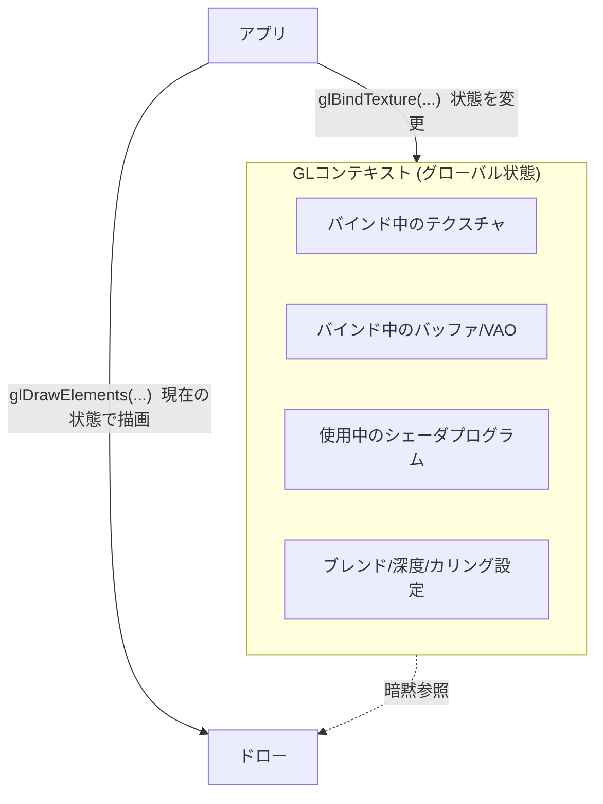

# OpenGL

## 概要

OpenGLは1992年にSGIが公開した**最古参のクロスプラットフォーム3D API**です。「グローバルなステートマシン」という設計を核とし、30年の後方互換を保ちながら拡張されてきました。現在は新規開発での採用は減りましたが、**学習資料の豊富さ・WebGL/GLESとしての遍在・「旧世代APIの設計」を体感できる教材価値**から、依然として重要です。

## なぜ必要なのか

- グラフィックスプログラミング入門の定番であり続けている (LearnOpenGL等の資料網)
- WebGL (ブラウザ)、OpenGL ES (組み込み/旧Android) として今も動き続けている
- **DX12/Vulkanが「何を捨てたのか」を知る最良の対照物**

## 歴史・誕生した背景

- 1982〜: SGIのワークステーション用 **IRIS GL** が前身
- 1992: ベンダー中立の標準として **OpenGL 1.0**。ARB (Architecture Review Board) が管理
- 1997: Quake 2 がOpenGL対応 — ゲームでの採用を牽引
- 2004: GL 2.0 (GLSL導入)
- 2008: **GL 3.0事件** — 旧APIを捨てる再設計 (Longs Peak) が土壇場で撤回され、CAD業界の互換性要求に屈した。ゲーム業界の失望を招き、DirectX優位を決定づけた
- 2010: GL 4.0 (Tessellation)、以降DX11機能を追随
- 2014-17: **AZDO** (Approaching Zero Driver Overhead) — bindless、persistent mapping、`glMultiDrawIndirect` 等で明示的API的な使い方を模索
- 2017: GL 4.6 (SPIR-V対応) — 事実上の最終メジャー更新
- 2019: AppleがmacOSで非推奨化。Khronosの重心はVulkanへ

## それ以前の技術

ベンダー専用API (IRIS GL、後にGlide) とソフトウェアレンダリング。

## 解決した課題

ハードウェア中立の標準3D APIという概念そのものを確立しました。「どのGPUでも同じコードが動く」は当時革命的でした。

## 現在の位置づけ

- **教材として現役**: 概念学習の入口としては今も最短ルート
- **WebGL 1/2**: ブラウザ3Dの現行手段 (WebGPUへ移行中)
- **OpenGL ES**: 旧Android・組み込みで現役
- 新規のデスクトップ採用はほぼなし。ドライバは保守モード

## 内部動作 — ステートマシンモデル

OpenGLの本質は**巨大なグローバル状態機械**です。「コンテキスト」が全状態を保持し、コマンドは「現在の状態」を暗黙参照します。



### 特徴と限界

| 設計 | 内容 | 限界 |
|---|---|---|
| bind-to-edit | 編集対象を一度バインドしてから操作 | 状態リーク・可読性低下 (DSAで後年改善) |
| 暗黙の同期 | ハザードはドライバが自動解決 | 隠れたストール、予測不能な性能 |
| 実行時シェーダコンパイル | GLSLソースをドライバへ | ベンダー差・ヒッチ |
| 単一コンテキスト | スレッドとコンテキストが1:1 | マルチコア活用不能 |
| 遍在する後方互換 | glBegin/glEndすら残存 (互換プロファイル) | ドライバの複雑化 |

### 描画までの典型フロー (モダンGL 3.3+)

1. `glGenBuffers` → `glBufferData` (VBO/EBO作成)
2. `glGenVertexArrays` → `glVertexAttribPointer` (VAO = 頂点レイアウト)
3. `glCompileShader` → `glLinkProgram` (シェーダ)
4. 毎フレーム: `glUseProgram` → `glBindVertexArray` → `glUniform*` → `glDrawElements`

## 各環境での扱い

### Unity
レガシーターゲット (GLES 3.x / GL Core) として選択可能ですが、既定はVulkan/Metal/DX。WebGLビルドは (現行では) GLES→WebGL変換です。

### Unreal Engine
UE5ではOpenGLサポートは事実上撤廃 (モバイルの旧GLES経路も縮小)。UE4時代はAndroid GLES3が主要ターゲットでした。

### DirectX 12 / Vulkan
対照物として。ANGLEプロジェクト (Google) はGLES→DX11/Vulkan/Metal変換層で、ブラウザのWebGLはこの上で動いています。「GLは今やレイヤとして生きている」のが現在です。

## コード例

三角形描画の最小構成 (C++ / GL 3.3 Core):

```cpp
// 初期化
GLuint vbo, vao, prog;
glGenVertexArrays(1, &vao);
glBindVertexArray(vao);

float verts[] = { 0,0.5f, 0.5f,-0.5f, -0.5f,-0.5f };
glGenBuffers(1, &vbo);
glBindBuffer(GL_ARRAY_BUFFER, vbo);
glBufferData(GL_ARRAY_BUFFER, sizeof(verts), verts, GL_STATIC_DRAW);
glVertexAttribPointer(0, 2, GL_FLOAT, GL_FALSE, 8, nullptr);
glEnableVertexAttribArray(0);

prog = LinkProgram(CompileShader(GL_VERTEX_SHADER, vsSrc),
                   CompileShader(GL_FRAGMENT_SHADER, fsSrc));

// 毎フレーム — 「状態を設定して描く」だけ。同期もバリアも書かない
glClear(GL_COLOR_BUFFER_BIT);
glUseProgram(prog);
glBindVertexArray(vao);
glDrawArrays(GL_TRIANGLES, 0, 3);
SwapBuffers(hdc);
```

**この簡潔さがOpenGLの魅力であり、この裏でドライバがやっている膨大な仕事こそがDX12/Vulkanでアプリに移管されたもの**です。同じ三角形がVulkanでは数百行になります → [Vulkan](/graphics/api/vulkan.html)

## 前提知識

- [グラフィックスAPIの歴史](/graphics/api/history.html)
- [パイプライン全体像](/graphics/pipeline/overview.html)

## 次に読むべきページ

- [DirectX 11](/graphics/api/directx11.html) — 同世代のもう一つの到達点
- [Vulkan](/graphics/api/vulkan.html) — 後継
- [WebGPU](/graphics/api/webgpu.html) — WebGLの後継
- [GLSL](/graphics/shader/glsl.html)

## 理解度チェック

1. **「bind-to-edit」モデルの問題点を、コードの保守性と性能の両面から述べよ。**
   ::: details 解答
   保守性: 操作対象が暗黙のグローバル状態で決まるため、関数呼び出しの効果が文脈依存になり、状態リーク(前の処理のバインドが残る)バグを誘発する。性能: ドライバはバインド変更のたびに内部状態の再検証・遅延処理を行い、その発生タイミングが予測不能になる。DSA(GL4.5)やオブジェクト指向的な新APIはこれを解消した。
   :::

2. **OpenGL 3.0の「Longs Peak撤回」がゲーム業界に与えた影響は。**
   ::: details 解答
   レガシーを捨てたモダンAPIへの再設計が約束されながら、CAD業界の互換性要求で撤回された。これによりOpenGLは古い設計を引きずり続けることが確定し、ゲーム開発の主流はDirectXに固定化、Khronos自身も後にゼロから作り直すVulkanを必要とすることになった。
   :::

3. **AZDOとは何か。それが証明したことは。**
   ::: details 解答
   Approaching Zero Driver Overhead。bindlessテクスチャ、persistent mapped buffer、MultiDrawIndirect等のGL4.x機能を組み合わせ、ドライバ介入を極小化する描画手法群。GLのままでも明示的API並みのドローコール性能に近づけることを示し、「ボトルネックはAPIの表面ではなくドライバの隠れた仕事」という明示的API世代の設計原理を裏付けた。
   :::

## 参考資料

- LearnOpenGL (Joey de Vries) — モダンGL入門の決定版
- OpenGL SuperBible / OpenGL Programming Guide (赤本)
- GDC 2014, *"Approaching Zero Driver Overhead"* (Cass Everitt et al.)
- docs.gl — APIリファレンスの使いやすい鏡
