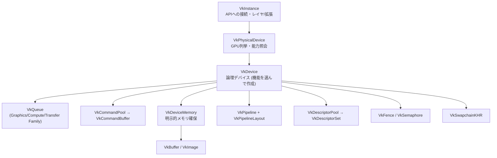

# Vulkan

## 概要

Vulkanは**Khronosのクロスプラットフォーム明示的API**です (2016)。Windows・Linux・Android等の対応実装で利用できます。Apple環境では、Metal上にVulkanの一部機能を提供する [MoltenVK](https://github.com/KhronosGroup/MoltenVK) 等の移植実装を使う方法があります。利用可能なバージョン・機能・拡張には実装ごとの差があるため、「最も移植性が高い」と一律に順位付けせず、対象の対応状況を確認します。D3D12と共通する概念も多い一方、オブジェクト・メモリ・同期等の契約はAPIごとに異なります。

## なぜ必要なのか

- **複数のOSに対応するレンダラーの選択肢** — 対応するAPIや機能は対象platformと実装ごとに確認する
- ベンダー横断の拡張を通じて新機能を利用できる (Mesh Shader EXT、Ray Tracing、Descriptor Buffer等。サポート状況の照会が必要)
- 仕様と検証レイヤが公開されており、コマンド・資源・同期の契約を調べられる

## 歴史・誕生した背景

- 2013: AMD **Mantle**。低オーバーヘッドAPIの設計が後のVulkanの基礎の一つとなった
- 2015: 「glNext」として開発発表 → **2016: Vulkan 1.0**
- 2018: Vulkan 1.1 (subgroup操作、マルチビュー)
- 2020: Vulkan 1.2 (Timeline Semaphore、Buffer Device Address) / **Vulkan Ray Tracing** (KHR標準)
- 2022: Vulkan 1.3 (**Dynamic Rendering** — RenderPass簡素化、Synchronization2)
- 2023-03-31: **VK_EXT_shader_object** の公開告知。shader objectとshader stateを扱う拡張 ([Khronos公式告知](https://www.khronos.org/news/archives/you-can-use-vulkan-without-pipelines-today))
- 2024-12-03: **Vulkan 1.4** 公開。実績のある機能をコアへ統合 ([Khronos公式発表](https://www.khronos.org/news/press/khronos-streamlines-development-and-deployment-of-gpu-accelerated-applications-with-vulkan-1.4))

**設計の背景にある緊張**: デスクトップGPU (IMR) とモバイルGPU (TBDR) の両方をカバーする必要があり、RenderPass/Subpassのような「モバイルのための抽象」が入った点がDX12との最大の違いです → [GPUアーキテクチャ](/hardware/gpu/architecture.html)

## それ以前の技術

OpenGL / OpenGL ES。→ [OpenGL](/graphics/api/opengl.html)

## 解決した課題

DX12と同じ明示化の利得に加え:
1. **単一APIでデスクトップからモバイルまで** (GLとGLESの分裂を解消)
2. **SPIR-Vによるシェーダエコシステムの刷新** → [SPIR-V](/graphics/shader/spirv.html)
3. **レイヤ機構**: 検証 (Validation Layer) をランタイムから分離し、開発時のみ有効化
4. ベンダー拡張→EXT→KHR→コア昇格という**透明な標準化プロセス**

## 現在の位置づけ

デスクトップやモバイル向けに使われる明示的APIの一つです。このページのコード例はVulkan 1.3のDynamic RenderingとSynchronization2を使って説明します。Descriptor Buffer等の追加機能は一律に必須とせず、対象実装の対応とアプリケーションの必要性に応じて選びます。

## 内部動作 — 主要概念

### オブジェクト階層



### DX12との対応と相違

| 概念 | Vulkan | DX12との違い |
|---|---|---|
| コマンド記録 | VkCommandBuffer | ほぼ同じ。Poolがスレッド単位 |
| パイプライン | VkPipeline | ほぼ同じ (PSO) |
| バインディング | Descriptor Set (set=0..3) | ヒープでなく「セット」単位。頻度別にセットを分ける設計が定石 |
| バリア | vkCmdPipelineBarrier2 | ステージ+アクセスマスクでDX12(旧)より細粒度 |
| GPU-GPU同期 | VkSemaphore | スワップチェインとの同期に必須 |
| レンダーパス | VkRenderPass / Dynamic Rendering | 1.3でDynamic Renderingがコア化。VkRenderPassも有効で、廃止されたわけではない |
| メモリ | VkDeviceMemory + memoryType選択 | より明示的。VMA (Vulkan Memory Allocator) が事実上必須 |

### 同期 — Vulkan最大の難所

Vulkanの同期は3層構造です:

1. **VkFence**: GPU→CPU (フレーム完了待ち)
2. **VkSemaphore**: キュー操作等の依存 (スワップチェイン取得→描画→Present の連鎖など)。binaryとTimeline Semaphore (1.2) を区別する。timelineは単調カウンタを使いhostからも待てるが、ここで使う `vkAcquireNextImageKHR` / `vkQueuePresentKHR` のsemaphoreはbinaryである
3. **Pipeline Barrier**: コマンド間の実行依存+メモリ依存+レイアウト遷移

```text
バリアの指定 (Synchronization2):
  srcStageMask  = COLOR_ATTACHMENT_OUTPUT   (この段階の完了を待ち)
  srcAccessMask = COLOR_ATTACHMENT_WRITE    (この書き込みをフラッシュし)
  dstStageMask  = FRAGMENT_SHADER           (この段階の実行前に)
  dstAccessMask = SHADER_READ               (この読み取りへ可視化する)
  oldLayout → newLayout                     (レイアウトも遷移)
```

「どのステージの・どのアクセスを・どのステージの・どのアクセスへ見せるか」という文で読むのがコツです。

### スワップチェインとフレームループ

```text
vkAcquireNextImageKHR (imageAvailable セマフォをシグナル予約)
→ コマンド記録
→ vkQueueSubmit (wait: imageAvailable, signal: renderFinished + fence)
→ vkQueuePresentKHR (wait: renderFinished)
```

acquire semaphore・submit fence・command bufferはフレームスロット単位、Presentが待つrenderFinishedはswapchain画像単位で管理します。submit fenceだけではPresentのsemaphore使用完了を確認できません。画像の再取得とそのacquire waitにより再利用を順序付けます → [最終章](/graphics/capstone/02-device.html)

## 各環境での扱い

### Unity
Android既定API、Windows/Linuxでも選択可。エディタ起動オプション `-force-vulkan`。SRP/URPのRenderGraphはVulkanのTBDR活用 (subpass/tile memory) を意識した設計です。

### Unreal Engine
Linux/Androidの主要RHI、Windowsでも `-vulkan` で選択可。SteamDeck対応はVulkan RHIで行われます。

### DirectX 12
概念対応は [DirectX 12ページの表](/graphics/api/directx12.html) 参照。両方を知ると相互の設計判断 (RenderPassの有無、バインディングモデルの違い) が立体的に見えます。

### Vulkan
本体。学習は vulkan-tutorial.com → vkguide.dev (モダン設計) の順が定番です。

## コード例

Vulkan 1.3での正常フレーム描画の骨格です。graphics/Presentは同じキュー、swapchainはcolor attachment対応、command poolはcommand buffer単位のresetが可能という前提です。`renderFinished` はswapchain画像数分のbinary semaphore、`frames[i]` はフレームスロットの資源です。`VK_CHECK` は失敗時に通常ループを停止します。再作成・最小化・終了時の退役処理は [第2ステップの契約](/graphics/capstone/02-device.html#再作成と終了の前提) に従う必要があり、以下には実装を含めていません:

```cpp
void DrawFrame() {
    // 1. フレームスロットのフェンスを待つ
    VK_CHECK(vkWaitForFences(device, 1, &frames[i].renderFence, VK_TRUE, UINT64_MAX));

    uint32_t imgIndex;
    VkResult ar = vkAcquireNextImageKHR(device, swapchain, UINT64_MAX,
                          frames[i].imageAvailable, VK_NULL_HANDLE, &imgIndex);
    if (ar == VK_ERROR_OUT_OF_DATE_KHR) { RecreateSwapchain(); return; }
    if (ar != VK_SUCCESS && ar != VK_SUBOPTIMAL_KHR) { VK_CHECK(ar); }
    bool recreate = (ar == VK_SUBOPTIMAL_KHR);
    VkSemaphore presentReady = renderFinished[imgIndex];

    VkCommandBuffer cmd = frames[i].cmd;
    VK_CHECK(vkResetCommandBuffer(cmd, 0));
    VkCommandBufferBeginInfo bi{VK_STRUCTURE_TYPE_COMMAND_BUFFER_BEGIN_INFO};
    VK_CHECK(vkBeginCommandBuffer(cmd, &bi));

    // 2. スワップチェイン画像を描画可能レイアウトへ (バリア)
    TransitionImage(cmd, swapchainImages[imgIndex],
                    VK_IMAGE_LAYOUT_UNDEFINED,
                    VK_IMAGE_LAYOUT_COLOR_ATTACHMENT_OPTIMAL);

    // 3. Dynamic Rendering — VkRenderPassオブジェクト不要 (1.3)
    VkRenderingAttachmentInfo colorAtt{VK_STRUCTURE_TYPE_RENDERING_ATTACHMENT_INFO};
    colorAtt.imageView   = swapchainViews[imgIndex];
    colorAtt.imageLayout = VK_IMAGE_LAYOUT_COLOR_ATTACHMENT_OPTIMAL;
    colorAtt.loadOp      = VK_ATTACHMENT_LOAD_OP_CLEAR;
    colorAtt.storeOp     = VK_ATTACHMENT_STORE_OP_STORE;
    VkRenderingInfo ri{VK_STRUCTURE_TYPE_RENDERING_INFO};
    ri.renderArea = {{0,0}, extent};
    ri.layerCount = 1;
    ri.colorAttachmentCount = 1;
    ri.pColorAttachments = &colorAtt;

    vkCmdBeginRendering(cmd, &ri);
    vkCmdBindPipeline(cmd, VK_PIPELINE_BIND_POINT_GRAPHICS, pipeline);
    vkCmdBindDescriptorSets(cmd, VK_PIPELINE_BIND_POINT_GRAPHICS,
                            layout, 0, 1, &globalSet, 0, nullptr);
    vkCmdPushConstants(cmd, layout, VK_SHADER_STAGE_VERTEX_BIT,
                       0, sizeof(mat4), &model);
    vkCmdDraw(cmd, vertexCount, 1, 0, 0);
    vkCmdEndRendering(cmd);

    // 4. Present用レイアウトへ遷移して提出
    TransitionImage(cmd, swapchainImages[imgIndex],
                    VK_IMAGE_LAYOUT_COLOR_ATTACHMENT_OPTIMAL,
                    VK_IMAGE_LAYOUT_PRESENT_SRC_KHR);
    VK_CHECK(vkEndCommandBuffer(cmd));

    VkSemaphoreSubmitInfo wait{VK_STRUCTURE_TYPE_SEMAPHORE_SUBMIT_INFO};
    wait.semaphore = frames[i].imageAvailable;
    wait.stageMask = VK_PIPELINE_STAGE_2_COLOR_ATTACHMENT_OUTPUT_BIT;
    VkSemaphoreSubmitInfo signal{VK_STRUCTURE_TYPE_SEMAPHORE_SUBMIT_INFO};
    signal.semaphore = presentReady;
    signal.stageMask = VK_PIPELINE_STAGE_2_ALL_COMMANDS_BIT;
    VkCommandBufferSubmitInfo cb{VK_STRUCTURE_TYPE_COMMAND_BUFFER_SUBMIT_INFO};
    cb.commandBuffer = cmd;
    VkSubmitInfo2 si{VK_STRUCTURE_TYPE_SUBMIT_INFO_2};
    si.waitSemaphoreInfoCount = 1;   si.pWaitSemaphoreInfos = &wait;
    si.commandBufferInfoCount = 1;   si.pCommandBufferInfos = &cb;
    si.signalSemaphoreInfoCount = 1; si.pSignalSemaphoreInfos = &signal;
    VK_CHECK(vkResetFences(device, 1, &frames[i].renderFence));
    VK_CHECK(vkQueueSubmit2(graphicsQueue, 1, &si, frames[i].renderFence));

    VkPresentInfoKHR pi{VK_STRUCTURE_TYPE_PRESENT_INFO_KHR};
    pi.waitSemaphoreCount = 1; pi.pWaitSemaphores = &presentReady;
    pi.swapchainCount = 1;     pi.pSwapchains = &swapchain;
    pi.pImageIndices = &imgIndex;
    VkResult pr = vkQueuePresentKHR(graphicsQueue, &pi);
    i = (i + 1) % kFramesInFlight;
    if (pr == VK_ERROR_OUT_OF_DATE_KHR || pr == VK_SUBOPTIMAL_KHR)
        recreate = true;
    else
        VK_CHECK(pr);
    if (recreate || framebufferResized) {
        framebufferResized = false;
        RecreateSwapchain();
    }
}
```

`TransitionImage()` はバリア詳細を省略したhelperです。最初は旧内容を破棄し `COLOR_ATTACHMENT_OUTPUT/NONE → COLOR_ATTACHMENT_OUTPUT/COLOR_ATTACHMENT_WRITE`、最後は `COLOR_ATTACHMENT_OUTPUT/COLOR_ATTACHMENT_WRITE → NONE/NONE` とし、color subresource・`VK_QUEUE_FAMILY_IGNORED`・両layoutを指定します。acquire waitと最初の遷移のsource stageを合わせ、layout遷移をwaitの後へ順序付けます。別queue familyを使う構成には所有権移譲等を追加してください。

## 前提知識

- [CPUとGPUの役割分担](/hardware/gpu/cpu-vs-gpu.html), [DirectX 12](/graphics/api/directx12.html) (概念の対応把握に)
- [SPIR-V](/graphics/shader/spirv.html), [GLSL](/graphics/shader/glsl.html) または [HLSL](/graphics/shader/hlsl.html)

## 次に読むべきページ

- [4大API横断比較](/graphics/api/comparison.html)
- [WebGPU](/graphics/api/webgpu.html) — Vulkanの設計を安全化した子孫
- [最終章: デバイス初期化](/graphics/capstone/02-device.html) — 実装で総まとめ

## 理解度チェック

1. **VulkanにRenderPass/Subpassという概念が存在した理由と、Dynamic Renderingで置き換えられつつある理由を説明せよ。**
   ::: details 解答
   TBDR(モバイルGPU)ではタイルメモリ上でのパス融合(G-Buffer→ライティングをVRAM往復なしに行う等)が省電力の要であり、パスの依存構造とattachmentの用途をドライバへ事前宣言するRenderPass/Subpassが設計された。しかしデスクトップでは利得が薄い割にAPIが極めて煩雑で、フレームバッファ互換性管理などの負担が大きかった。Dynamic Renderingは宣言をコマンド記録時に移して簡素化し、タイル最適化はドライバの解析や別拡張に委ねる方向になった。
   :::

2. **VkFenceとVkSemaphoreの使い分けを述べよ。**
   ::: details 解答
   Fenceは GPU→CPU の同期(コマンドバッファ完了をCPUが待ち、リソース再利用の安全を確認する)。binary semaphoreはキュー操作等の依存(画像の取得完了→描画開始、描画完了→Present)に使い、CPUから直接待たない。Timeline Semaphoreはhostからも待てるが、上記のWSI取得/Presentにbinaryの代わりとして渡すことはできない。
   :::

3. **Descriptor Setを「更新頻度別に分ける」定石の理由は。**
   ::: details 解答
   セット単位でバインドを差し替えるコストを最小化するため。set=0にフレーム共通(カメラ等)、set=1にマテリアル、set=2にオブジェクトごと、のように分ければ、ドロー間で差し替えるのは高頻度セットだけで済み、低頻度セットのバインドやディスクリプタ更新を再利用できる。
   :::

## 参考資料

- vulkan-tutorial.com — 古典的入門 / **vkguide.dev** — モダンVulkanの実践 (推奨)
- Khronos, *Vulkan Specification* / *Vulkan Guide* (GitHub)
- AMD, *Vulkan Memory Allocator (VMA)* / Sascha Willems, *Vulkan Samples*
- Khronos Blog, *"Vulkan Roadmap 2022/2024"* — 簡素化の方向性
- [Khronos Vulkan Guide: Swapchain Semaphore Reuse](https://docs.vulkan.org/guide/latest/swapchain_semaphore_reuse.html)
- [Khronos Vulkan Guide: Synchronization Examples](https://docs.vulkan.org/guide/latest/synchronization_examples.html)
- [Khronos Vulkan Samples: Swapchain Recreation](https://docs.vulkan.org/samples/latest/samples/api/swapchain_recreation/README.html)
- [Khronos Vulkan Samples: Timeline Semaphore](https://docs.vulkan.org/samples/latest/samples/extensions/timeline_semaphore/README.html)
