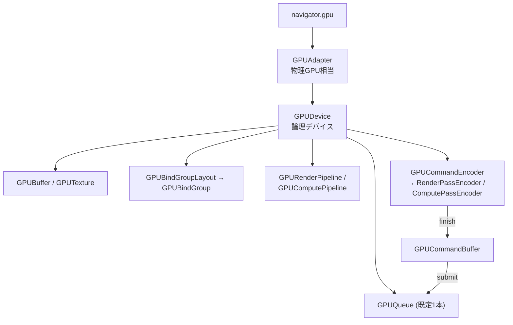

# WebGPU

## 概要

WebGPUは**Web標準の明示的グラフィックス/コンピュートAPI**です (2023, W3C)。DX12/Vulkan/Metalの設計を、Webサンドボックスの安全性要求の下で再蒸留した「第4の明示的API」であり、ブラウザ内で各ネイティブAPIの上に実装されます。JavaScriptだけでなく、**wgpu (Rust) / Dawn (C++) を通じてネイティブアプリのポータブルGPU層**としても使われる点が重要です。

## なぜ必要なのか

- WebGL (GL ES 3.0相当) では Compute Shader・ストレージバッファ・モダンなバインディングが使えない
- ブラウザで動く3Dツール・ゲーム・ML推論の需要が爆発している
- 「DX12/VK/Metalの共通部分の最良の抽象」として、ネイティブでも学習・プロトタイピングに最適

## 歴史・誕生した背景

- 2016-17: AppleがWebGPU提案 (当初はMetal直訳に近い「WebMetal」)。GoogleはNXT (後のDawn)、MozillaはwgpuでVulkan風の提案
- 2017: W3C GPU for the Web CG 発足。**シェーダ言語論争** (SPIR-V vs 新言語) → WGSL誕生 → [WGSL](/graphics/shader/wgsl.html)
- 2021-22: 仕様安定化。wgpuがRustゲームエコシステム (Bevy) の基盤に
- **2023: Chrome 113でWebGPU 1.0出荷**。Firefox/Safariも順次対応
- 2024-: subgroups、bindless等の拡張議論が進行中

## それ以前の技術

**WebGL 1/2** (2011/2017)。OpenGL ES 2.0/3.0のJavaScript化で、(1) Compute非対応、(2) グローバルステートマシン、(3) ドローコールごとの高い検証コスト、(4) GLの断片化の継承、が限界でした。

## 解決した課題

1. Compute Shaderと汎用GPU計算のWeb解禁
2. PSO/コマンドエンコーダ/バインドグループというモダンな構造 (検証を作成時に前倒し)
3. 3ネイティブAPI上での**単一の厳密仕様** — 「どのブラウザ・OSでも同一挙動」
4. WebGLに残っていたグローバル状態の排除

## 現在の位置づけ

Web側は普及期 (Three.js/Babylon.jsがWebGPUバックエンド対応済み)。ネイティブ側では wgpu/Dawn が「軽量クロスプラットフォームGPU抽象」として一定の地位を確立。機能はネイティブAPIの最大公約数のため、bindlessやRTなど最先端機能は未搭載 (拡張として議論中) です。

## 内部動作 — 主要概念

### オブジェクトモデル



- 構造は**Metalのエンコーダモデル + Vulkanのバインドグループ**のハイブリッド
- **同期APIが存在しない**: フェンス・バリア・レイアウト遷移はすべて**実装が自動管理**。明示的APIの構造を持ちながら、危険な部分だけ隠した設計
- エラーモデル: 例外でなく「エラースコープ + 無効オブジェクト伝播」— 非同期なGPUプロセス分離を前提とした設計

### DX12/VK/Metalとの対応

| WebGPU | DX12 | Vulkan | Metal |
|---|---|---|---|
| GPUDevice | ID3D12Device | VkDevice | MTLDevice |
| GPURenderPipeline | PSO | VkPipeline | MTLRenderPipelineState |
| GPUBindGroup | Descriptor Table | VkDescriptorSet | Argument Buffer |
| GPUCommandEncoder | Command List | VkCommandBuffer | MTLCommandBuffer+Encoder |
| beginRenderPass | (RTVセット) | Dynamic Rendering | RenderPassDescriptor |
| (自動) | ResourceBarrier | vkCmdPipelineBarrier | (ほぼ自動) |

## 各環境での扱い

### Unity / Unreal Engine
両エンジンともWebビルドのWebGPU対応を進行中 (UnityはWeb向けWebGPUバックエンドを提供開始)。成熟すればWebGLビルドを置き換えます。

### DirectX 12
Windows上のChrome/EdgeはDawnがWebGPUを**DX12上に実装**します。

### Vulkan
Android/LinuxではVulkan上に実装。wgpuのネイティブ利用でも主要バックエンド。

### Metal
macOS/iOS (Safari/Chrome) ではMetal上に実装。

## コード例

JavaScript — 初期化からComputeディスパッチまで:

```javascript
const adapter = await navigator.gpu.requestAdapter();
const device  = await adapter.requestDevice();

// ストレージバッファ
const buf = device.createBuffer({
  size: 1024 * 4,
  usage: GPUBufferUsage.STORAGE | GPUBufferUsage.COPY_SRC,
});

const pipeline = device.createComputePipeline({
  layout: 'auto',
  compute: {
    module: device.createShaderModule({ code: /* wgsl */`
      @group(0) @binding(0) var<storage, read_write> data: array<f32>;
      @compute @workgroup_size(64)
      fn main(@builtin(global_invocation_id) id: vec3u) {
        data[id.x] = data[id.x] * 2.0;
      }
    `}),
    entryPoint: 'main',
  },
});

const bindGroup = device.createBindGroup({
  layout: pipeline.getBindGroupLayout(0),
  entries: [{ binding: 0, resource: { buffer: buf } }],
});

// エンコード → 提出 (バリアは書かない — 自動)
const enc = device.createCommandEncoder();
const pass = enc.beginComputePass();
pass.setPipeline(pipeline);
pass.setBindGroup(0, bindGroup);
pass.dispatchWorkgroups(1024 / 64);
pass.end();
device.queue.submit([enc.finish()]);
```

描画パス (canvas表示):

```javascript
const ctx = canvas.getContext('webgpu');
ctx.configure({ device, format: navigator.gpu.getPreferredCanvasFormat() });

const enc = device.createCommandEncoder();
const pass = enc.beginRenderPass({
  colorAttachments: [{
    view: ctx.getCurrentTexture().createView(),
    loadOp: 'clear', storeOp: 'store',
    clearValue: { r: 0.1, g: 0.1, b: 0.15, a: 1 },
  }],
});
pass.setPipeline(renderPipeline);
pass.draw(3);          // 頂点バッファなしのフルスクリーン/三角形テク
pass.end();
device.queue.submit([enc.finish()]);
```

## 前提知識

- [グラフィックスAPIの歴史](/graphics/api/history.html)
- [WGSL](/graphics/shader/wgsl.html)

## 次に読むべきページ

- [4大API横断比較](/graphics/api/comparison.html) — 総まとめ
- [Compute Shader](/graphics/compute/compute-shader.html)
- [Vulkan](/graphics/api/vulkan.html) / [Metal](/graphics/api/metal.html) — 実装先の理解

## 理解度チェック

1. **WebGPUが明示的API世代でありながらバリア/フェンスAPIを持たない理由は。**
   ::: details 解答
   バリアの誤用はGPUメモリの不定状態・情報漏洩につながり、Webの安全性要件と両立しない。また3つの異なるネイティブAPIの同期モデルの共通化も困難。そこで使用宣言(usage)とパス構造から実装が依存関係を導出し自動同期する設計を採り、安全性と移植性を性能の一部と引き換えに確保した。
   :::

2. **WebGPUのネイティブ利用 (wgpu/Dawn) が選ばれる場面と、選ばれない場面を述べよ。**
   ::: details 解答
   選ばれる: クロスプラットフォームを少ないコードで達成したいツール・インディーゲーム・研究プロトタイプ、Webとネイティブでコードを共有したい場合。選ばれない: bindless・レイトレーシング・メッシュシェーダ・明示的な非同期キュー制御など最大公約数外の機能で性能を極める必要があるAAA開発。
   :::

3. **WebGLからWebGPUへの移行で最も本質的な進歩は何か。**
   ::: details 解答
   Compute Shaderとストレージバッファの解禁により、Webでも「GPUを汎用並列計算機として使う」現代的設計(GPU Driven、ML推論、シミュレーション)が可能になったこと。描画APIの近代化(PSO/バインドグループによる検証前倒し)がそれを支える。
   :::

## 参考資料

- W3C, *WebGPU Specification* / webgpu.dev
- webgpufundamentals.org — 実践教材の決定版
- gfx-rs/wgpu, google/dawn — ネイティブ実装
- Surma, *"WebGPU — All of the cores, none of the canvas"*
