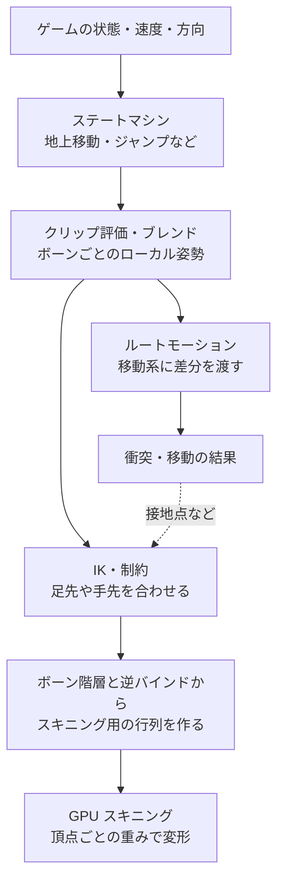

# アニメーションシステム — クリップの選択から GPU スキニングまで

キャラクターが斜面を走ってから跳ぶとき、エンジンは走るクリップを再生するだけでは足りない。現在の動作を決め、速度に応じて姿勢を混ぜ、必要なら斜面に足を合わせる。最終的なボーンの姿勢から、GPU が描画する頂点の位置を求める。



## ステートマシンとブレンド

ステートマシンは「地上移動」「空中」「着地」のように、条件によって評価する姿勢を切り替える。遷移時間を設けると、切り替え前後の姿勢が急に飛ぶのを抑えられる。遷移条件と優先順位を決めておくと、着地と攻撃など、条件が同時に成立した場合の動作を追いやすい。

ブレンドは、速度や進行方向のような連続値から複数クリップの姿勢を混ぜる。歩き 2 m/s と走り 6 m/s の間を単純に線形に混ぜる場合、速度 3 m/s は歩き 75%、走り 25%。歩きの接地と走りの遊脚を同じ位相で混ぜると足が滑るので、足の接地タイミングや再生速度も合わせる。ボーンの平行移動は線形に混ぜられる。回転の混ぜ方は [補間と曲線](../../math/rendering/interpolation-and-curves.md)、クリップ内の時間サンプルは [キーフレーム](keyframes-and-animation.md)を参照。

## IK とルートモーション

**IK**（逆運動学）は、足先の目標位置や手が握る位置から、途中の関節角度を求める。二関節の脚なら、股関節・膝・足先と、膝を曲げる側を示すヒントを使える。伸ばし切っても届かない目標は、届く範囲に制限する、腰を動かす、IK の重みを下げるといった処理が必要になる。斜面では、足先の位置に加えて接地面の法線から足の向きも調整できる。

**ルートモーション**では、アニメーションから抽出した根元の移動量・回転量をキャラクターの移動へ使う。その場で足踏みするクリップを使う方式では、移動系が速度を決め、姿勢がそれに追従する。ルートモーションを使う方式でも、衝突によって進める距離は変わりうる。移動系とアニメーションの両方で同じ差分を適用すると、位置が二重に進む。

## GPU に渡すデータ

現在のボーンの変換を $G_i$、逆バインド行列を $B_i^{-1}$、頂点ごとの重みを $w_i$ とする。列ベクトルを使い、$G_i$ をスキニングの出力と同じ座標系にそろえれば、線形ブレンドスキニングは次の式になる。逆バインド行列はバインド姿勢のメッシュ頂点を各ボーンの空間へ変換し、$G_i$ が現在の姿勢へ変換する。

$$
p'=\sum_i w_i G_i B_i^{-1}p,
\qquad \sum_i w_i=1
$$

[リグとスキニング](rigs-and-skinning.md)で扱うボーン番号と重みを頂点ごとに用意する。頂点シェーダーで毎回変形する方式と、コンピュートシェーダーで変形して頂点バッファに保存する方式がある。後者は同じ変形後の頂点を複数のパスから使える一方、保存と読み出しが増える。

| 処理 | Unity 6.3 LTS | Unreal Engine 5.8 |
| --- | --- | --- |
| 状態と姿勢の混合 | Animator Controller のステートマシンと Blend Tree | Animation Blueprint の State Machine と Blend Space |
| IK | Animation Rigging 1.4.1 の Two Bone IK Constraint | IK Rig のゴールとソルバー |
| ルートモーション | Animator が抽出するルートの動き | Animation Sequence・Montage から抽出する Root Motion |
| GPU スキニング | `PlayerSettings.meshDeformation` の `GPU` / `GPUBatched` | 頂点シェーダーの GPU Skinned Vertex Factory、コンピュートの Skin Cache |

## コード例 — 二つのボーンの変形を合成する

DXC の `-T vs_6_0 -E main` でコンパイルできる HLSL。アプリは `PosePalette` の二つの行列に $G_iB_i^{-1}$ を、`ClipFromSkinSpace` に出力空間からクリップ空間への変換を渡す。ボーン番号を固定し、頂点に付いた 2 番目のボーンの重みから 1 番目の重みを求めている。法線の変換やボーン数の一般化は [リグとスキニング](rigs-and-skinning.md)を参照。

```hlsl
cbuffer PosePalette : register(b0)
{
    float4x4 SkinFromBind[2];
    float4x4 ClipFromSkinSpace;
};

struct VertexInput
{
    float3 position : POSITION;
    float secondWeight : BLENDWEIGHT0;
};

float4 main(VertexInput input) : SV_Position
{
    float4 bindPosition = float4(input.position, 1.0);
    float4 byFirst = mul(SkinFromBind[0], bindPosition);
    float4 bySecond = mul(SkinFromBind[1], bindPosition);
    float4 posed = lerp(byFirst, bySecond, input.secondWeight);
    return mul(ClipFromSkinSpace, posed);
}
```

バインド位置を $(1,0,0)$、1 番目の行列を単位行列、2 番目を $y$ に 2 移動する行列とする。2 番目の重みが 0.25 なら、変形後の位置は $0.75(1,0,0)+0.25(1,2,0)=(1,0.5,0)$。

## 理解度チェック

1. 歩きと走りの姿勢を速度に応じて連続的に混ぜたい。どの仕組みを使うか。
2. クリップを再生すると足が斜面に埋まる。再生後にどんな情報を使って調整するか。
3. 同じキャラクターをシャドウと本描画の両方で使うとき、コンピュートスキニングで再利用できるのは何か。

::: details 解答

1. ブレンドツリーや Blend Space で混合する。足が接地する位相も合わせる。
2. 地形との接地点や法線から足先の目標を決め、IK で脚の関節を調整する。
3. スキニング済みの位置・法線などを保存した頂点バッファ。

:::

## 関連項目

- [キーフレームとアニメーション](keyframes-and-animation.md)
- [リグとスキニング](rigs-and-skinning.md)
- [補間と曲線](../../math/rendering/interpolation-and-curves.md)
- [コンピュートシェーダー](../compute/compute-shader.md)

## 参考資料

- Khronos Group, [glTF 2.0 — Skins](https://registry.khronos.org/glTF/specs/2.0/glTF-2.0.html#skins)
- Unity Technologies, [Animation State Machines](https://docs.unity3d.com/6000.3/Documentation/Manual/AnimationStateMachines.html)・[Blend Trees](https://docs.unity3d.com/6000.3/Documentation/Manual/class-BlendTree.html)・[Root Motion](https://docs.unity3d.com/6000.3/Documentation/Manual/RootMotion.html)・[PlayerSettings.meshDeformation](https://docs.unity3d.com/6000.3/Documentation/ScriptReference/PlayerSettings-meshDeformation.html)（Unity 6.3 LTS）
- Unity Technologies, [Animation Rigging 1.4.1 の対応エディター](https://docs.unity.com/en-us/engine/6000.3/manual/packages-list/packages-all/pack-safe/com-unity-animation-rigging)・[Two Bone IK Constraint](https://docs.unity3d.com/Packages/com.unity.animation.rigging@1.4/manual/constraints/TwoBoneIKConstraint.html)
- Epic Games, [Animation Blueprints](https://dev.epicgames.com/documentation/en-us/unreal-engine/animation-blueprints-in-unreal-engine)・[Blend Spaces](https://dev.epicgames.com/documentation/en-us/unreal-engine/blend-spaces-in-unreal-engine)・[Root Motion](https://dev.epicgames.com/documentation/en-us/unreal-engine/root-motion-in-unreal-engine)・[IK Rig](https://dev.epicgames.com/documentation/en-us/unreal-engine/ik-rig-in-unreal-engine)・[Skeletal Mesh Rendering Paths](https://dev.epicgames.com/documentation/en-us/unreal-engine/skeletal-mesh-rendering-paths-in-unreal-engine)（UE 5.8）
