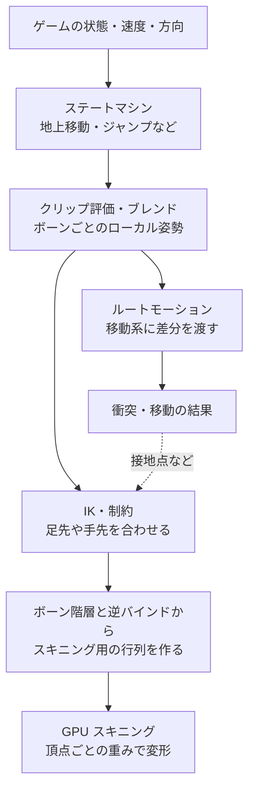
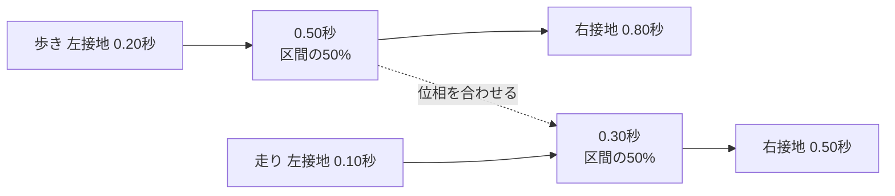
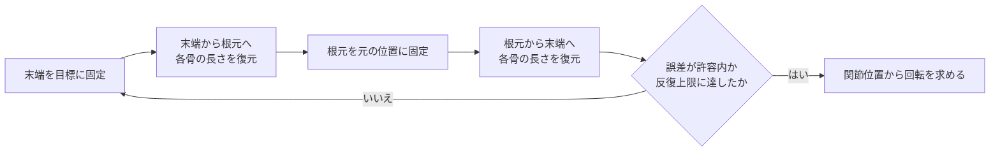

# アニメーションシステム — クリップの選択から GPU スキニングまで

キャラクターが斜面を走ってから跳ぶとき、エンジンは走るクリップを再生するだけでは足りない。現在の動作を決め、速度に応じて姿勢を混ぜ、必要なら斜面に足を合わせる。最終的なボーンの姿勢から、GPU が描画する頂点の位置を求める。



## ステートマシンとブレンド

ステートマシンは「地上移動」「空中」「着地」のように、条件によって評価する姿勢を切り替える。遷移時間を設けると、切り替え前後の姿勢が急に飛ぶのを抑えられる。遷移条件と優先順位を決めておくと、着地と攻撃など、条件が同時に成立した場合の動作を追いやすい。

ブレンドは、速度や進行方向のような連続値から複数クリップの姿勢を混ぜる。歩き 2 m/s と走り 6 m/s の間を単純に線形に混ぜる場合、速度 3 m/s は歩き 75%、走り 25%。歩きの接地と走りの遊脚を同じ位相で混ぜると足が滑るので、足の接地タイミングや再生速度も合わせる。ボーンの平行移動は線形に混ぜられる。回転の混ぜ方は [補間と曲線](../../math/rendering/interpolation-and-curves.md)、クリップ内の時間サンプルは [キーフレーム](keyframes-and-animation.md)を参照。

### 2D ブレンドツリーの軸と重み

地上移動では、キャラクターのローカル座標で横速度 $v_x$ と前後速度 $v_z$ を与えると、斜め移動を一つの連続領域で扱える。入力をワールド速度のまま渡すと、同じ世界方向へ移動するだけで、キャラクターの向きに対しては別のクリップが必要になる。姿勢だけを変えるなら、移動系が確定した速度をローカルへ戻す。ルートモーションで移動を駆動するなら、ブレンドを選ぶための意図と、衝突後に確定した実速度を区別する。例えば壁にぶつかったとき、移動要求をそのまま使う設計では走る姿勢が続くため、実速度や壁に対する専用ステートを参照する。

Unity 6.3 LTS の 2D Blend Tree は、方向ごとに一つのクリップを置く `2D Simple Directional`、同じ方向へ歩きと走りを置ける `2D Freeform Directional`、直線速度と旋回角速度のように意味の異なる軸を使う `2D Freeform Cartesian` を備える。Freeform Directional では原点に一つのクリップを置く。UE 5.8 の Blend Space では `Use Grid` を無効にするとサンプルの三角形分割で補間する。Unity の方式は選んだ種類ごとに重み付けが異なる。

三角形を用いた実装では、入力 $p$ を含む三角形の 3 クリップに重みを割り当てる。三角形の点を $a,b,c$ とし、$p-a=u(b-a)+v(c-a)$ と置く。2D 外積を $\operatorname{cross}(a,b)=a_xb_y-a_yb_x$ として両辺の外積を取ると、次の重みが得られる。

$$
D=\operatorname{cross}(b-a,c-a),\quad
u=\frac{\operatorname{cross}(p-a,c-a)}{D},\quad
v=\frac{\operatorname{cross}(b-a,p-a)}{D},\quad
(w_a,w_b,w_c)=(1-u-v,u,v)
$$

例えば $a=(0,0)$ を待機、$b=(2,0)$ を横歩き、$c=(0,4)$ を前進とする。$p=(0.5,2)$ なら $D=8$、$u=0.25$、$v=0.50$ で、待機 25%、横歩き 25%、前進 50% になる。パラメーターの単位は同じでも、クリップの実際の移動速度や歩幅がサンプル座標と一致するかは別に確認する。$D$ が 0 に近い三角形は事前に除き、サンプル範囲の外では境界上の最も近い位置へ投影するなど、負の重みを避ける規則を決める。

### 同期マーカーで足の接地を合わせる

再生時刻をクリップ長で割った正規化時刻は、歩幅や接地時間がそろっている場合に使いやすい。接地の位置が違う場合は、左右の足の接地などを同じ名前のマーカーにし、対応する二点の間で現在の位相を求める。歩きで左接地が 0.20 秒、右接地が 0.80 秒、現在が 0.50 秒なら、その区間の位相は $(0.50-0.20)/(0.80-0.20)=0.5$。走りで同じ二点が 0.10 秒と 0.50 秒なら、対応する時刻は $0.10+0.5(0.50-0.10)=0.30$ 秒になる。



UE 5.8 は、同じ Sync Group の各アニメーションに共通するマーカーを使い、対応するマーカーがなければ通常の長さによる同期へ戻る。ループの終端から始端にまたがる区間、クリップ切り替え時のリーダー、片足だけが接地する非ループ動作も確認する。接地音やヒット判定の通知は位相の計算とは別であり、同じ足音を二つのクリップから同時に出さないように、どの通知を採用するかを決める。

目視で滑りの原因を調べるときは、正規化時刻、現在のマーカー名と区間の位相、ブレンド重み、接地した足のワールド位置を同じフレームで記録する。位相がそろっていても足が流れるなら、クリップの歩幅に対してキャラクターの移動距離が大きすぎるか、ルートモーションを衝突処理で切り詰めた可能性を確認する。

## IK とルートモーション

**IK**（逆運動学）は、足先の目標位置や手が握る位置から、途中の関節角度を求める。二関節の脚なら、股関節・膝・足先と、膝を曲げる側を示すヒントを使える。伸ばし切っても届かない目標は、届く範囲に制限する、腰を動かす、IK の重みを下げるといった処理が必要になる。斜面では、足先の位置に加えて接地面の法線から足の向きも調整できる。

**ルートモーション**では、アニメーションから抽出した根元の移動量・回転量をキャラクターの移動へ使う。その場で足踏みするクリップを使う方式では、移動系が速度を決め、姿勢がそれに追従する。ルートモーションを使う方式でも、衝突によって進める距離は変わりうる。移動系とアニメーションの両方で同じ差分を適用すると、位置が二重に進む。

### 二関節 IK を余弦定理で解く

根元を $R$、目標を $T$、二本の骨の長さを $a,b>0$ とする。まず目標までの距離を $d$ とし、$|a-b|\le d\le a+b$ に制限する。$d>0$ なら、目標方向の単位ベクトル $u$ と、膝を向けたいヒントを $u$ に直交する平面へ投影して正規化した $v$ を作る。根元の角度を $\alpha$ とすると余弦定理より $b^2=a^2+d^2-2ad\cos\alpha$。したがって膝の位置 $K$ は次のように求められる。

$$
x=a\cos\alpha=\frac{a^2+d^2-b^2}{2d},\quad
h=\sqrt{\max(0,a^2-x^2)},\quad
K=R+xu+hv
$$

第 2 骨の内角を $\beta$ とすると、$\cos\beta=(a^2+b^2-d^2)/(2ab)$。伸ばした状態の屈曲を $0$ とするリグなら角度は $\pi-\beta$。$a=b=1$、$R=(0,0)$、$T=(1,0)$、上に曲げる場合は $K=(0.5,\sqrt{3}/2)$ になる。根元から膝と、膝から足先の二乗距離はともに $0.5^2+(\sqrt{3}/2)^2=1$。目標が根元に一致する場合や、ヒントの投影がゼロに近い場合は曲げ面を一意に選べない。前フレームの有効な面やリグの基準軸を使い、伸び切った付近の符号反転を抑える。

3D のリグでは、求めた点から骨の方向を得た後、親の逆変換を使ってローカル回転へ戻す。長手方向が一致しても、その軸まわりのねじれは自由に残る。膝のヒント、手首の向き、足裏の法線のような制約を別に与える。二関節 IK は計算量が一定で、足や腕に使いやすい。

### FABRIK と CCD で長い鎖を解く

FABRIK は関節位置を更新し、隣り合う関節の距離を毎回元の骨長に戻す。点 $q$ を中心に点 $p$ を距離 $\ell$ に置き直す式は $q+\ell(p-q)/\lVert p-q\rVert$。これを根元と末端を交互に固定して適用する。

1. 目標が鎖の全長より遠ければ、関節を根元から目標へ一直線に並べる。
2. 届く可能性があれば末端を目標に置き、末端から根元へさかのぼって一つずつ骨長を復元する。
3. 根元を元の位置へ戻し、今度は根元から末端へ骨長を復元する。
4. 末端の誤差が許容値に収まるか、反復上限に達するまで 2 と 3 を繰り返す。



CCD（Cyclic Coordinate Descent）は末端側から順に、一つの関節の回転だけを更新する。平面で関節 $J_i$、現在の末端 $E$、目標 $T$ とすると、$u=E-J_i$ を $v=T-J_i$ に向ける回転は $\operatorname{atan2}(\operatorname{cross}(u,v),u\cdot v)$ で求まる。更新した回転はその関節より先のすべての点に反映し、次の関節では更新後の末端を使う。3D では二つの方向から回転を作る。平行・反平行の場合は外積から軸を安定に求められないため、可動軸や前回の有効軸を使う。膝のようなヒンジは、両方向を可動面に射影して角度を求め、ローカルの可動域へ制限できる。

| ソルバー | 更新するデータ | 実装時に確かめる点 |
| --- | --- | --- |
| 二関節の解析解 | 曲げ面と膝の位置 | 到達範囲の端、ヒントの退化、ねじれ |
| FABRIK | 根元・末端を交互に固定して関節位置を更新 | 骨長、初期姿勢、制約後の末端誤差 |
| CCD | 一関節ずつ回転を更新 | 更新順、局所回転制限、末端誤差が停滞する姿勢 |

数フレームで足先が目標を追いかける実装では前回の解を初期値にできる。制約や届かない目標があるときは、反復上限に達しても得られた姿勢を使い、末端誤差と関節角を記録する。例えば骨長がほぼ保たれているのに足が浮くなら、ブレンド後の位置から IK 目標を作る順序や、腰の高さによる到達範囲を調べる。

## GPU に渡すデータ

現在のボーンの変換を $G_i$、逆バインド行列を $B_i^{-1}$、頂点ごとの重みを $w_i$ とする。列ベクトルを使い、$G_i$ をスキニングの出力と同じ座標系にそろえれば、線形ブレンドスキニングは次の式になる。逆バインド行列はバインド姿勢のメッシュ頂点を各ボーンの空間へ変換し、$G_i$ が現在の姿勢へ変換する。

$$
p'=\sum_i w_i G_i B_i^{-1}p,
\qquad \sum_i w_i=1
$$

[リグとスキニング](rigs-and-skinning.md)で扱うボーン番号と重みを頂点ごとに用意する。頂点シェーダーで毎回変形する方式と、コンピュートシェーダーで変形して頂点バッファに保存する方式がある。後者は同じ変形後の頂点を複数のパスから使える一方、保存と読み出しが増える。

| 処理 | Unity 6.3 LTS | Unreal Engine 5.8 |
| --- | --- | --- |
| 状態と姿勢の混合 | Animator Controller のステートマシンと Blend Tree | Animation Blueprint の State Machine と Blend Space |
| IK | Animation Rigging 1.4.1 の Two Bone IK Constraint | IK Rig のゴールとソルバー |
| ルートモーション | Animator が抽出するルートの動き | Animation Sequence・Montage から抽出する Root Motion |
| GPU スキニング | `PlayerSettings.meshDeformation` の `GPU` / `GPUBatched` | 頂点シェーダーの GPU Skinned Vertex Factory、コンピュートの Skin Cache |

## コード例 — 二つのボーンの変形を合成する

DXC の `-T vs_6_0 -E main` でコンパイルできる HLSL。アプリは `PosePalette` の二つの行列に $G_iB_i^{-1}$ を、`ClipFromSkinSpace` に出力空間からクリップ空間への変換を渡す。ボーン番号を固定し、頂点に付いた 2 番目のボーンの重みから 1 番目の重みを求めている。法線の変換やボーン数の一般化は [リグとスキニング](rigs-and-skinning.md)を参照。

```hlsl
cbuffer PosePalette : register(b0)
{
    float4x4 SkinFromBind[2];
    float4x4 ClipFromSkinSpace;
};

struct VertexInput
{
    float3 position : POSITION;
    float secondWeight : BLENDWEIGHT0;
};

float4 main(VertexInput input) : SV_Position
{
    float4 bindPosition = float4(input.position, 1.0);
    float4 byFirst = mul(SkinFromBind[0], bindPosition);
    float4 bySecond = mul(SkinFromBind[1], bindPosition);
    float4 posed = lerp(byFirst, bySecond, input.secondWeight);
    return mul(ClipFromSkinSpace, posed);
}
```

バインド位置を $(1,0,0)$、1 番目の行列を単位行列、2 番目を $y$ に 2 移動する行列とする。2 番目の重みが 0.25 なら、変形後の位置は $0.75(1,0,0)+0.25(1,2,0)=(1,0.5,0)$。

### コード例 — 二関節 IK を C++20 で検算する

平面に限定した二関節 IK。入力の骨長は正とし、根元は原点。折り曲げる側を `side` の符号で指定する。結果の `tip` は到達範囲に制限した足先で、指定した目標との差も確認できる。足先が根元に一致するケースでは右方向を基準にし、同じ長さの骨はそこで折り返す。

```cpp
#include <algorithm>
#include <cassert>
#include <cmath>
#include <iostream>

struct Vec2
{
    double x;
    double y;
};

struct LegPose
{
    Vec2 knee;
    Vec2 tip;
};

LegPose solveLeg(double a, double b, Vec2 target, int side)
{
    assert(a > 0.0 && b > 0.0);
    const double distance = std::hypot(target.x, target.y);
    const Vec2 u = distance > 0.0
        ? Vec2{target.x / distance, target.y / distance}
        : Vec2{1.0, 0.0};
    const Vec2 v{-u.y, u.x};
    const double d = std::clamp(distance, std::abs(a - b), a + b);
    const double sign = side < 0 ? -1.0 : 1.0;
    if (d == 0.0)
        return {{sign * a * v.x, sign * a * v.y}, {0.0, 0.0}};

    // Factor a*a - b*b to reduce cancellation for similar lengths.
    const double x = std::clamp((d * d + (a - b) * (a + b)) / (2.0 * d), -a, a);
    const double h = sign * std::sqrt(std::max(0.0, (a - x) * (a + x)));
    return {{x * u.x + h * v.x, x * u.y + h * v.y}, {d * u.x, d * u.y}};
}

bool near(double a, double b)
{
    return std::abs(a - b) < 1e-12;
}

int main()
{
    const LegPose left = solveLeg(1.0, 1.0, {1.0, 0.0}, 1);
    const LegPose right = solveLeg(1.0, 1.0, {1.0, 0.0}, -1);
    const LegPose outer = solveLeg(1.0, 1.0, {3.0, 0.0}, 1);
    const LegPose inner = solveLeg(2.0, 1.0, {0.25, 0.0}, 1);
    const LegPose folded = solveLeg(1.0, 1.0, {0.0, 0.0}, 1);
    assert(near(left.knee.x, 0.5));
    assert(near(left.knee.y, std::sqrt(3.0) / 2.0));
    assert(near(right.knee.y, -left.knee.y));
    assert(near(std::hypot(left.knee.x, left.knee.y), 1.0));
    assert(near(std::hypot(left.tip.x - left.knee.x, left.tip.y - left.knee.y), 1.0));
    assert(near(outer.tip.x, 2.0) && near(outer.knee.y, 0.0));
    assert(near(inner.tip.x, 1.0) && near(inner.knee.x, 2.0));
    assert(near(std::hypot(folded.knee.x, folded.knee.y), 1.0));
    assert(near(std::hypot(folded.tip.x, folded.tip.y), 0.0));

    std::cout << left.knee.x << ", " << left.knee.y << '\n';
}
```

出力は `0.5, 0.866025`。コンソール例では骨長が正でゲーム内のスケールに収まる場合を扱う。エンジンへ組み込む際は、曲げ面を前フレームから引き継いでから、接地点が変わったフレームの足先と膝の連続性を確認する。

## 理解度チェック

1. 歩きと走りの姿勢を速度に応じて連続的に混ぜたい。どの仕組みを使うか。
2. クリップを再生すると足が斜面に埋まる。再生後にどんな情報を使って調整するか。
3. 同じキャラクターをシャドウと本描画の両方で使うとき、コンピュートスキニングで再利用できるのは何か。
4. 骨長が 2 と 1 の脚で、根元から 0.25 離れた点を指定した。最も近い到達距離は何か。
5. 2D ブレンドの重みが連続でも足が滑る場合、クリップ間でまず比較する時間情報は何か。
6. FABRIK と CCD は、各反復でどのデータを直接更新するか。

::: details 解答

1. ブレンドツリーや Blend Space で混合する。足が接地する位相も合わせる。
2. 地形との接地点や法線から足先の目標を決め、IK で脚の関節を調整する。
3. スキニング済みの位置・法線などを保存した頂点バッファ。
4. 1。二本を反対向きに折り返しても、長さの差より内側には届かない。
5. 左右の足の接地や離地の位相。クリップの長さで割った時刻が同じでも、接地の位置は異なり得る。
6. FABRIK は骨長を保つように関節位置を更新し、CCD は関節の回転を一つずつ更新する。

:::

## 関連項目

- [キーフレームとアニメーション](keyframes-and-animation.md)
- [リグとスキニング](rigs-and-skinning.md)
- [補間と曲線](../../math/rendering/interpolation-and-curves.md)
- [コンピュートシェーダー](../compute/compute-shader.md)

## 参考資料

- Khronos Group, [glTF 2.0 — Skins](https://registry.khronos.org/glTF/specs/2.0/glTF-2.0.html#skins)
- Unity Technologies, [Animation State Machines](https://docs.unity3d.com/6000.3/Documentation/Manual/AnimationStateMachines.html)・[Blend Trees](https://docs.unity3d.com/6000.3/Documentation/Manual/class-BlendTree.html)・[Root Motion](https://docs.unity3d.com/6000.3/Documentation/Manual/RootMotion.html)・[PlayerSettings.meshDeformation](https://docs.unity3d.com/6000.3/Documentation/ScriptReference/PlayerSettings-meshDeformation.html)（Unity 6.3 LTS）
- Unity Technologies, [Animation Rigging 1.4.1 の対応エディター](https://docs.unity.com/en-us/engine/6000.3/manual/packages-list/packages-all/pack-safe/com-unity-animation-rigging)・[Two Bone IK Constraint](https://docs.unity3d.com/Packages/com.unity.animation.rigging@1.4/manual/constraints/TwoBoneIKConstraint.html)
- Epic Games, [Animation Blueprints](https://dev.epicgames.com/documentation/en-us/unreal-engine/animation-blueprints-in-unreal-engine)・[Blend Spaces](https://dev.epicgames.com/documentation/en-us/unreal-engine/blend-spaces-in-unreal-engine)・[Root Motion](https://dev.epicgames.com/documentation/en-us/unreal-engine/root-motion-in-unreal-engine)・[IK Rig](https://dev.epicgames.com/documentation/en-us/unreal-engine/ik-rig-in-unreal-engine)・[Skeletal Mesh Rendering Paths](https://dev.epicgames.com/documentation/en-us/unreal-engine/skeletal-mesh-rendering-paths-in-unreal-engine)（UE 5.8）

- Unity Technologies, [2D Blending（Unity 6.3 LTS）](https://docs.unity3d.com/6000.3/Documentation/Manual/BlendTree-2DBlending.html)
- Epic Games, [Animation Sync Groups（UE 5.8）](https://dev.epicgames.com/documentation/en-us/unreal-engine/animation-sync-groups-in-unreal-engine)
- Aristidou & Lasenby, [FABRIK: A fast, iterative solver for the Inverse Kinematics problem](https://andreasaristidou.com/publications/papers/FABRIK.pdf)（2011）
- Ben Kenwright, [Inverse Kinematics — Cyclic Coordinate Descent (CCD)](https://www.tandfonline.com/doi/abs/10.1080/2165347X.2013.823362)
