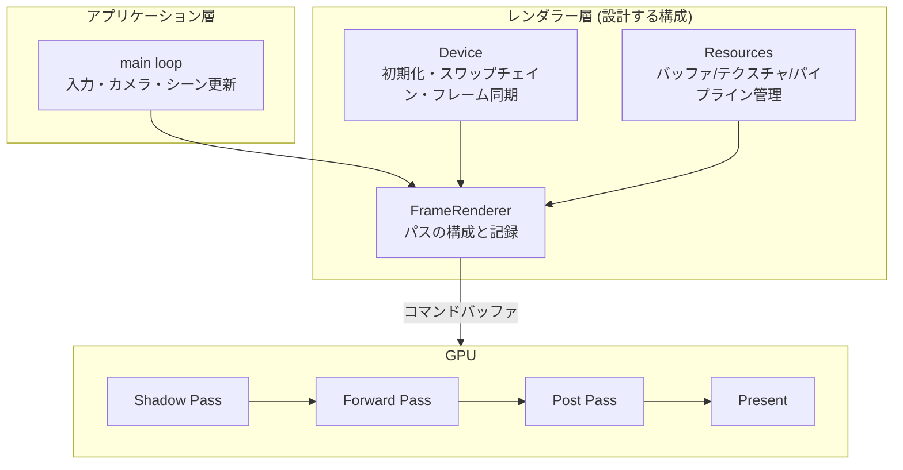
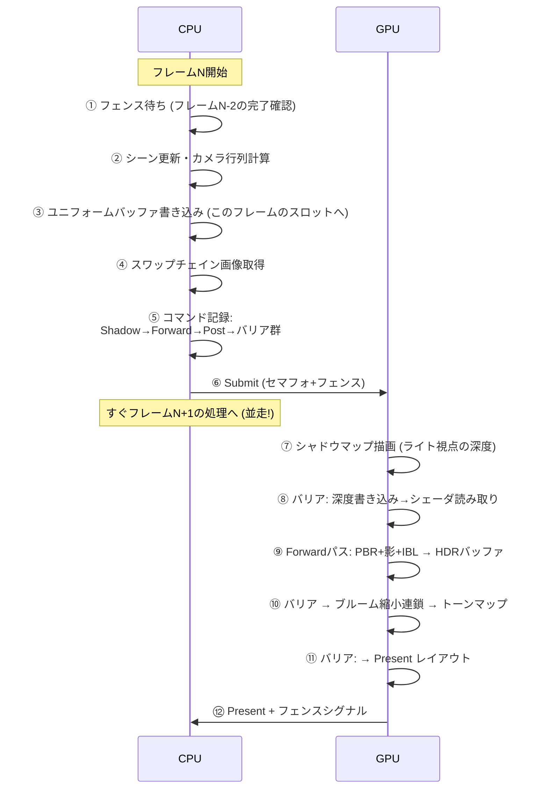

# 1. 全体設計 — 1フレームの旅

## この実践で扱う範囲

Vulkan (C++) を題材に、レンダラーの設計と主要処理のコード断片を追います。DX12との対応も併記し、CPUのコードとGPUの処理が1フレームの中でどうつながるかを確かめます。

この5ページは、そのままビルドできる完成プロジェクト一式を配布する教材ではありません。ヘルパー関数・資源生成・アセット読み込みなど、省略された処理を手元の環境へ補って組み合わせる必要があります。下の影・PBR・ポストプロセスは、設計するレンダラーの目標仕様です。

前提は[描画の学習ロードマップ](/guide/rendering/roadmap.html)で確認できます。各ステップで[パイプライン](/graphics/pipeline/overview.html)、[Vulkan](/graphics/api/vulkan.html)、[PBR](/graphics/lighting/pbr.html)などの本文へ戻り、コードと仕組みを対応付けながら進めてください。

## 設計するレンダラーの目標仕様

| 項目 | 内容 | 使う知識 |
|---|---|---|
| API | Vulkan 1.3 (Dynamic Rendering) / DX12併記 | [Vulkan](/graphics/api/vulkan.html) |
| シェーダ | HLSL→SPIR-V (DXC) or GLSL | [シェーダ言語](/graphics/shader/hlsl.html) |
| メッシュ | glTF読み込み (cgltf等) | [座標変換](/math/rendering/transform.html) |
| ライティング | PBR (GGX) + IBL + 平行光源 | [PBR](/graphics/lighting/pbr.html) |
| 影 | シャドウマップ (PCF) | [シャドウ](/graphics/lighting/shadow.html) |
| ポスト | ブルーム + ACESトーンマップ | [ポストプロセス](/graphics/postprocess/overview.html) |
| 方式 | シングルパスForward (拡張課題でForward+) | [Forward Rendering](/graphics/path/forward.html) |

## アーキテクチャ全体図



## 1フレームの旅 — 目標の構成を先に見る

実装を考える前に、目標とするレンダラーの1フレームを**CPU側とGPU側の時系列**で追います。この図が本章の地図です:



- ①③が[フレームインフライト](/hardware/gpu/cpu-vs-gpu.html)、⑤が[コマンドバッファ](/graphics/api/vulkan.html)、⑧⑩⑪が[バリア](/graphics/api/directx12.html)、⑦⑨が[パイプライン](/graphics/pipeline/overview.html)、⑨の中身が[PBR](/graphics/lighting/pbr.html)と[シャドウ](/graphics/lighting/shadow.html)、⑩が[ポストプロセス](/graphics/postprocess/overview.html)の実践です

## 設計判断とその理由

ゼロから作るとき、最初に決めるべきことと本章の選択:

| 決定 | 選択 | 理由 |
|---|---|---|
| API | Vulkan 1.3 | 全OS対応・検証レイヤが強力・「明示的APIの学習」という目的に最適 |
| RenderPass方式 | Dynamic Rendering | VkRenderPass地獄を回避 (モダン構成) → [Vulkan](/graphics/api/vulkan.html) |
| 同期 | フレームインフライト2 + Timeline Semaphore不使用の基本形 | まず古典形を理解する |
| メモリ | VMA (Vulkan Memory Allocator) | 手動メモリ管理はまず道具を使ってから学ぶ |
| バインディング | 更新頻度別Descriptor Set (0=フレーム, 1=マテリアル) | [定石](/graphics/api/vulkan.html) の体得 |
| 深度 | **Reverse-Z** | 最初から正しい習慣を → [カメラと射影](/math/rendering/camera.html) |
| 色空間 | HDR (RGBA16F) 中間+最後にトーンマップ | [ポストプロセス](/graphics/postprocess/overview.html) の原則 |

## プロジェクト構成

```text
mini-renderer/
├─ CMakeLists.txt          … シェーダの自動コンパイル込み (SPIR-Vページ参照)
├─ src/
│  ├─ main.cpp             … ループと入力 (GLFW)
│  ├─ device.cpp/.h        … 第2部: 初期化・スワップチェイン・同期
│  ├─ resources.cpp/.h     … 第3部: バッファ/画像/パイプライン
│  ├─ mesh.cpp/.h          … glTF読み込み
│  └─ frame.cpp/.h         … 第4-5部: パス記録
├─ shaders/
│  ├─ shadow.vert/.frag
│  ├─ pbr.vert/.frag
│  └─ post_*.comp
└─ assets/                 … glTFモデル・HDR環境マップ
```

**設計原則**: 「device (いつでも同じ)」「resources (ロード時)」「frame (毎フレーム)」の3層分離。これは[UEのRHI/Renderer分離](/graphics/engine/unreal-renderer.html)や[UnityのSRP設計](/graphics/engine/unity-renderer.html)の縮小版です。

## 前提知識

本章は総まとめです。最低限、以下を先に読んでください:

- [パイプライン全体像](/graphics/pipeline/overview.html)、[座標変換](/math/rendering/transform.html)
- [Vulkan](/graphics/api/vulkan.html) または [DirectX 12](/graphics/api/directx12.html)
- [CPUとGPUの役割分担](/hardware/gpu/cpu-vs-gpu.html) (フレームインフライト)

## 次に読むべきページ

- [2. デバイス初期化とスワップチェイン](/graphics/capstone/02-device.html) — 実装開始

## 理解度チェック

1. **「1フレームの旅」の⑧⑩⑪のバリアを1つでも忘れるとそれぞれ何が起きうるか。**
   ::: details 解答
   ⑧を忘れると、シャドウマップの書き込み完了前にForwardパスが読み始め、前フレームの深度や未定義値による影の破損(ちらつき・ゴミ)。⑩を忘れるとHDRバッファの書き込みとポストの読みが競合し画面の一部が壊れる。⑪を忘れるとPresent時のレイアウト不正で検証レイヤエラー、実機ではアーティファクトやクラッシュ。いずれも「たまに起きる」形で現れるのが怖いところで、これがRenderGraphによる自動化の動機。
   :::

2. **本章がDeferredでなくForwardを選んだ理由を、学習目的の観点で考察せよ。**
   ::: details 解答
   Forwardは「1つの三角形がライティング済みピクセルになるまで」を1本のシェーダで追える最短の因果で、パイプライン全体の初学に適する。DeferredはG-Bufferの設計・複数パスのバリア・位置再構成などの追加概念が絡み、Forwardを理解した後の拡張課題とする方が学習効率が良い。半透明やMSAAの制約もない。
   :::

## 参考資料

- vkguide.dev — 本章と同じ思想 (モダンVulkanでエンジンの骨格を作る) の英語教材
- Sascha Willems, Vulkan Samples — 個別機能の参照実装
- learnopengl.com — 概念の補助 (API は古いが理論解説が丁寧)
