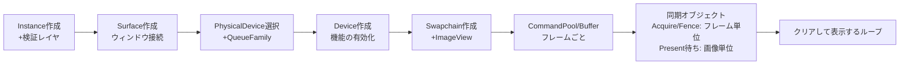

# 2. デバイス初期化とスワップチェイン

## このステップの目標

**「クリアカラーで塗った画面が毎フレーム表示される」**まで。描画はまだしません。ここで作る `Device` 層はレンダラーの心臓であり、[CPUとGPUの並走](/hardware/gpu/cpu-vs-gpu.html)・[同期](/graphics/api/vulkan.html)の知識をコードに落とします。



## 実装

### 2.1 インスタンスと検証レイヤ

```cpp
// device.cpp — 検証レイヤは開発の生命線 (tools章参照)
VkApplicationInfo app{VK_STRUCTURE_TYPE_APPLICATION_INFO};
app.pApplicationName = "mini-renderer";
app.apiVersion = VK_API_VERSION_1_3;

const char* layers[] = { "VK_LAYER_KHRONOS_validation" };
std::vector<const char*> exts = GetGlfwRequiredExtensions();  // surface系
exts.push_back(VK_EXT_DEBUG_UTILS_EXTENSION_NAME);

VkInstanceCreateInfo ci{VK_STRUCTURE_TYPE_INSTANCE_CREATE_INFO};
ci.pApplicationInfo = &app;
ci.enabledLayerCount = kEnableValidation ? 1 : 0;
ci.ppEnabledLayerNames = layers;
ci.enabledExtensionCount = (uint32_t)exts.size();
ci.ppEnabledExtensionNames = exts.data();
VK_CHECK(vkCreateInstance(&ci, nullptr, &instance));
```

::: tip DX12ではこう
`CreateDXGIFactory2` + `D3D12GetDebugInterface`→`EnableDebugLayer()`。検証を最初から有効にする習慣は共通です。
:::

### 2.2 物理デバイスとキュー

```cpp
// GPU列挙 → ディスクリートGPU優先 + 必要機能で選別 (gpu/what-is-gpuの実践)
uint32_t n; vkEnumeratePhysicalDevices(instance, &n, nullptr);
std::vector<VkPhysicalDevice> gpus(n);
vkEnumeratePhysicalDevices(instance, &n, gpus.data());

for (auto g : gpus) {
    // グラフィックス+Present対応のQueueFamilyを探す
    // VkPhysicalDeviceVulkan13Features の dynamicRendering / synchronization2 を確認
    if (Suitable(g, surface)) { physical = g; break; }
}

// 論理デバイス: 1.3機能を有効化
VkPhysicalDeviceVulkan13Features f13{VK_STRUCTURE_TYPE_PHYSICAL_DEVICE_VULKAN_1_3_FEATURES};
f13.dynamicRendering = VK_TRUE;
f13.synchronization2 = VK_TRUE;
VkPhysicalDeviceFeatures2 f2{VK_STRUCTURE_TYPE_PHYSICAL_DEVICE_FEATURES_2};
f2.pNext = &f13;

float prio = 1.0f;
VkDeviceQueueCreateInfo qci{VK_STRUCTURE_TYPE_DEVICE_QUEUE_CREATE_INFO};
qci.queueFamilyIndex = graphicsFamily;
qci.queueCount = 1;
qci.pQueuePriorities = &prio;

VkDeviceCreateInfo dci{VK_STRUCTURE_TYPE_DEVICE_CREATE_INFO};
dci.pNext = &f2;
dci.queueCreateInfoCount = 1;
dci.pQueueCreateInfos = &qci;
const char* devExts[] = { VK_KHR_SWAPCHAIN_EXTENSION_NAME };
dci.enabledExtensionCount = 1;
dci.ppEnabledExtensionNames = devExts;
VK_CHECK(vkCreateDevice(physical, &dci, nullptr, &device));
vkGetDeviceQueue(device, graphicsFamily, 0, &graphicsQueue);
```

### 2.3 スワップチェイン

表示用の画像リング (画像数はsurfaceの能力に合わせて決める)。**フォーマットとPresent Modeの選択**が要点です。以下はSDR/sRGB出力の例で、graphicsとPresentを同じキューで実行します。`Suitable()` はその両方を満たすqueue familyを選ぶ前提です:

```cpp
VkSurfaceFormatKHR PickFormat(...) {
    // 定番: BGRA8 + sRGB (最終出力はsRGB符号化 — postprocess/overview参照)
    for (auto& f : formats)
        if (f.format == VK_FORMAT_B8G8R8A8_SRGB &&
            f.colorSpace == VK_COLOR_SPACE_SRGB_NONLINEAR_KHR) return f;
    return formats[0];
}
VkPresentModeKHR PickPresentMode(...) {
    // MAILBOX = 低遅延vsync / FIFO = 確実なvsync (必ず対応)
    return supported(VK_PRESENT_MODE_MAILBOX_KHR)
         ? VK_PRESENT_MODE_MAILBOX_KHR : VK_PRESENT_MODE_FIFO_KHR;
}
```

このクリア例は `supportedUsageFlags` が `VK_IMAGE_USAGE_TRANSFER_DST_BIT` を含むsurfaceを前提に、swapchainの `imageUsage` へそのフラグを指定します。後の描画用に `VK_IMAGE_USAGE_COLOR_ATTACHMENT_BIT` も必要です。TRANSFER_DST非対応なら、Dynamic Renderingの `loadOp=CLEAR` へ切り替え、最初のアクセスに対応するwait stage・barrierも変えます。リサイズ・最小化・`VK_ERROR_OUT_OF_DATE_KHR`・`VK_SUBOPTIMAL_KHR` の扱いは下のループと再作成の前提を参照してください。

### 2.4 フレームインフライトの同期 — 本ステップの核心

[CPUとGPUの役割分担](/hardware/gpu/cpu-vs-gpu.html) の理論をそのまま実装します:

```cpp
constexpr int kFramesInFlight = 2;
struct FrameContext {
    VkCommandPool   pool;
    VkCommandBuffer cmd;
    VkSemaphore     imageAvailable;   // 取得完了 → 描画開始 (GPU-GPU)
    VkFence         inFlight;         // GPU完了 → CPU再利用可 (GPU-CPU)
};
FrameContext frames[kFramesInFlight];
// vkGetSwapchainImagesKHRで得た実際の画像数だけbinary semaphoreを作る。
std::vector<VkSemaphore> renderFinished; // [swapchain image index] 描画完了 → Present
// フェンスはシグナル済みで作る (初回フレームが待たされないように)
fci.flags = VK_FENCE_CREATE_SIGNALED_BIT;
```

`imageAvailable` と `inFlight` はCPU側のフレームスロット単位、Presentが待つ `renderFinished` はswapchain画像単位です。フレームのsubmit fenceを待っても、Presentがそのsemaphoreを使い終えた保証にはなりません。同じ画像を再取得し、そのacquire semaphoreを次のsubmitで待つことで、画像に対応するPresent待ちsemaphoreを安全に再利用できます。

### 2.5 メインループ (クリアのみ)

以下は通常フレームの同期を示す抜粋です。`VK_CHECK` は `VK_SUCCESS` 以外を例外等で停止し、失敗後に通常ループを続行しない前提です。`RecreateSwapchain()` の退役処理は後述の契約が必要で、この抜粋だけでresize/終了処理が完成するわけではありません。

```cpp
void DrawFrame() {
    auto& fr = frames[frameIndex % kFramesInFlight];

    // ① このスロットをGPUが使い終わるまで待つ (2フレーム前の完了)
    VK_CHECK(vkWaitForFences(device, 1, &fr.inFlight, VK_TRUE, UINT64_MAX));

    // ② 描画先のスワップチェイン画像を取得
    uint32_t imgIdx;
    VkResult r = vkAcquireNextImageKHR(device, swapchain, UINT64_MAX,
                                       fr.imageAvailable, VK_NULL_HANDLE, &imgIdx);
    if (r == VK_ERROR_OUT_OF_DATE_KHR) { RecreateSwapchain(); return; }
    if (r != VK_SUCCESS && r != VK_SUBOPTIMAL_KHR) { VK_CHECK(r); }
    bool recreate = (r == VK_SUBOPTIMAL_KHR);
    VkSemaphore presentReady = renderFinished[imgIdx];

    // ③ コマンド記録: レイアウト遷移 → クリア → Present遷移
    VK_CHECK(vkResetCommandPool(device, fr.pool, 0));
    VkCommandBufferBeginInfo bi{VK_STRUCTURE_TYPE_COMMAND_BUFFER_BEGIN_INFO};
    VK_CHECK(vkBeginCommandBuffer(fr.cmd, &bi));

    Transition(fr.cmd, images[imgIdx],                     // バリアの初実践!
        VK_IMAGE_LAYOUT_UNDEFINED, VK_IMAGE_LAYOUT_TRANSFER_DST_OPTIMAL);
    VkClearColorValue clear = {{0.05f, 0.05f, 0.1f, 1.0f}};
    VkImageSubresourceRange range{VK_IMAGE_ASPECT_COLOR_BIT, 0, 1, 0, 1};
    vkCmdClearColorImage(fr.cmd, images[imgIdx],
        VK_IMAGE_LAYOUT_TRANSFER_DST_OPTIMAL, &clear, 1, &range);
    Transition(fr.cmd, images[imgIdx],
        VK_IMAGE_LAYOUT_TRANSFER_DST_OPTIMAL, VK_IMAGE_LAYOUT_PRESENT_SRC_KHR);

    VK_CHECK(vkEndCommandBuffer(fr.cmd));

    // ④ 最初のswapchainアクセスはtransfer clear。取得完了をTRANSFERで待つ。
    VkSemaphoreSubmitInfo wait{VK_STRUCTURE_TYPE_SEMAPHORE_SUBMIT_INFO};
    wait.semaphore = fr.imageAvailable;
    wait.stageMask = VK_PIPELINE_STAGE_2_TRANSFER_BIT;
    VkSemaphoreSubmitInfo signal{VK_STRUCTURE_TYPE_SEMAPHORE_SUBMIT_INFO};
    signal.semaphore = presentReady;
    signal.stageMask = VK_PIPELINE_STAGE_2_ALL_COMMANDS_BIT;
    VkCommandBufferSubmitInfo cb{VK_STRUCTURE_TYPE_COMMAND_BUFFER_SUBMIT_INFO};
    cb.commandBuffer = fr.cmd;
    VkSubmitInfo2 submit{VK_STRUCTURE_TYPE_SUBMIT_INFO_2};
    submit.waitSemaphoreInfoCount = 1;   submit.pWaitSemaphoreInfos = &wait;
    submit.commandBufferInfoCount = 1;   submit.pCommandBufferInfos = &cb;
    submit.signalSemaphoreInfoCount = 1; submit.pSignalSemaphoreInfos = &signal;

    // 取得成功・記録完了後、実際にsubmitする直前にだけresetする。
    VK_CHECK(vkResetFences(device, 1, &fr.inFlight));
    VK_CHECK(vkQueueSubmit2(graphicsQueue, 1, &submit, fr.inFlight));

    // ⑤ Presentは画像単位のpresentReadyを待つ。
    VkPresentInfoKHR pi{VK_STRUCTURE_TYPE_PRESENT_INFO_KHR};
    pi.waitSemaphoreCount = 1; pi.pWaitSemaphores = &presentReady;
    pi.swapchainCount = 1;     pi.pSwapchains = &swapchain;
    pi.pImageIndices = &imgIdx;
    VkResult pr = vkQueuePresentKHR(graphicsQueue, &pi);
    frameIndex++;
    if (pr == VK_ERROR_OUT_OF_DATE_KHR || pr == VK_SUBOPTIMAL_KHR)
        recreate = true;
    else
        VK_CHECK(pr);
    if (recreate || framebufferResized) {
        framebufferResized = false;
        RecreateSwapchain();
    }
}
```

`Transition()` はstage/access maskを省略したhelperです。この例の破棄可能な旧内容は `UNDEFINED` とし、最初の遷移を `TRANSFER/NONE → TRANSFER/TRANSFER_WRITE`、最後を `TRANSFER/TRANSFER_WRITE → NONE/NONE` として、全color subresourceと `VK_QUEUE_FAMILY_IGNORED` を指定します。acquire waitと最初のbarrierのsource stageをTRANSFERに合わせてlayout遷移をwaitの後へ順序付け、最後は `PRESENT_SRC_KHR` へ戻します。第4〜5ステップでcolor attachmentへ描くときは、wait stageと最初のbarrierのsource stageを `COLOR_ATTACHMENT_OUTPUT`、宛先を `COLOR_ATTACHMENT_OUTPUT/COLOR_ATTACHMENT_WRITE` に変更します。

### 再作成と終了の前提

`RecreateSwapchain()` は最小化中の0サイズを避けてから新しいswapchainを作り、実際の画像数に合わせてviewと `renderFinished` を作成します。古い画像・view・semaphoreは、新旧を混在させず退役単位で保持します。submit fenceでcommand bufferやUBOの使用完了を確認することと、Presentが待ちsemaphore等を解放できることは別です。

Present資源を厳密に退役させるには、対応環境で `VK_KHR_swapchain_maintenance1`（またはEXT版）の機能を照会・有効化し、各Presentへpresentation fenceを付けて待つ方法があります。未拡張の通常ループには上の画像単位方式を使い、resize時の退役にはKhronosの[Swapchain Recreation sample](https://docs.vulkan.org/samples/latest/samples/api/swapchain_recreation/README.html)のような履歴管理が別途必要です。終了時も `vkDeviceWaitIdle` だけをPresent資源の解放保証として扱わず、採用した退役方式の条件を満たしてから破棄します。このページのコードはpresentation fenceや退役履歴そのものの実装を省略しています。

::: tip DX12ではこう
現在のback buffer indexは `GetCurrentBackBufferIndex()` で取得します。DXGIが表示用bufferを管理し、アプリはフェンスでCPU側の資源再利用やキュー間依存を管理します。submit完了と実際の画面表示完了を同じ意味にはしません。→ [4大API横断比較](/graphics/api/comparison.html)
:::

## 動作確認

- 起動して紺色の画面が出る。再作成・退役処理を実装したうえで、リサイズ・最小化/復帰・終了を確認する
- **検証レイヤが無言であること** — 1件でも警告があれば直してから進む
- [RenderDoc](/graphics/optimization/tools.html) でキャプチャし、Clear→Presentの2コマンドとレイアウト遷移を確認してみる

## 前提知識

- [CPUとGPUの役割分担](/hardware/gpu/cpu-vs-gpu.html), [Vulkan](/graphics/api/vulkan.html)

## 次に読むべきページ

- [3. リソースとパイプライン構築](/graphics/capstone/03-resources.html)

## 理解度チェック

1. **フェンスを「シグナル済み」で作成する理由は。**
   ::: details 解答
   DrawFrameの先頭で「このスロットの前回のGPU実行完了」をフェンスで待つ設計のため、最初のフレームでは待つべき前回が存在しない。非シグナルで作ると初回のvkWaitForFencesが永遠に返らずハングする。シグナル済み作成は「前回はすでに完了している」という初期状態の表現。
   :::

2. **imageAvailableとrenderFinishedの2つのセマフォは、それぞれどの操作とどの操作を繋いでいるか。**
   ::: details 解答
   imageAvailable: Acquire完了→最初のswapchain画像アクセス。本ステップではTRANSFER、第4〜5ステップの最終描画ではCOLOR_ATTACHMENT_OUTPUTで待つ。renderFinished[imgIdx]: その画像への描画とPresent用レイアウト遷移の完了→Presentの開始条件。どちらもbinary semaphoreで、CPU上のsubmit fence待ちとは役割と再利用条件が異なる。フレームスロットが同じというだけでは、Present待ちsemaphoreを再利用できない。
   :::

3. **kFramesInFlight=2 のとき、CPUは最大で何フレーム先を処理できるか。3にすると何が変わるか。**
   ::: details 解答
   2スロットなので、GPUがフレームNを実行中にCPUはN+1まで準備でき、N+2に進もうとするとNのフェンス待ちでブロックする(最大2フレームの並走)。3にするとCPUがさらに1フレーム先行でき、フレーム時間のばらつき吸収(スループット)は向上するが、入力から表示までの遅延が最大1フレーム分悪化し、ユニフォームバッファ等の多重化リソースも1セット増える。
   :::

## 参考資料

- vulkan-tutorial.com の *Drawing a triangle > Setup〜Presentation* 章
- vkguide.dev chapter 1 — 本ステップと同構成のモダン版
- Khronos, *Vulkan Synchronization Examples* (GitHub Wiki)
- [Khronos Vulkan Guide: Swapchain Semaphore Reuse](https://docs.vulkan.org/guide/latest/swapchain_semaphore_reuse.html)
- [Khronos Vulkan Guide: Synchronization Examples](https://docs.vulkan.org/guide/latest/synchronization_examples.html)
- [Khronos Vulkan Samples: Swapchain Recreation](https://docs.vulkan.org/samples/latest/samples/api/swapchain_recreation/README.html)
