<div id="_5-1フレーム完全実装-—-影・ライト・ポスト" class="study-legacy-anchor" aria-hidden="true"></div>

# 5. 1フレームの構成 — 影・ライト・ポスト

## このステップの目標

最終ステップです。シャドウマップ・PBR+IBLライティング・ブルーム+トーンマップを統合し、**「1フレームが描画されるまで」の全工程を自分のコードで説明できる状態**に到達します。

## 5.1 フレームの最終構成

```mermaid
flowchart LR
    UP["CPU: UBO更新<br/>(カメラ/ライト/カスケード行列)"] --> SP["Shadow Pass<br/>2048² D32 / 正射影 / DepthBias"]
    SP --> B1["バリア:<br/>DEPTH_WRITE→SHADER_READ"]
    B1 --> FP["Forward Pass<br/>PBR+影+IBL → RGBA16F"]
    FP --> B2["バリア:<br/>COLOR_WRITE→SHADER_READ"]
    B2 --> BL["Bloom (Compute)<br/>ダウンサンプル連鎖→アップ合成"]
    BL --> TM["Tonemap (Compute)<br/>露出→ACES→FP16中間画像"]
    TM --> OUT["Final FS<br/>リニアRGB→sRGB attachment"]
    OUT --> B3["バリア: →PRESENT"]
    B3 --> PR[Present]
```



## 5.2 Shadow Pass

[シャドウ](/graphics/lighting/shadow.html) の理論を最小構成で実装します (単一マップ。カスケード化は拡張課題):

```cpp
// ライト行列: シーンAABBを包む正射影 (camera章: 平行光源=正射影)
glm::mat4 lightView = glm::lookAt(-sunDir * 50.f, glm::vec3(0), {0,1,0});
glm::mat4 lightProj = glm::ortho(-30.f, 30.f, -30.f, 30.f, 0.1f, 100.f);
// Reverse-Zにするなら near/far と比較関数をここでも統一する

// Shadow PSO: カラーターゲットなし + スロープバイアス
raster.depthBiasEnable = VK_TRUE;
raster.depthBiasConstantFactor = 1.25f;
raster.depthBiasSlopeFactor    = 1.75f;   // slope-scaled (shadow章)
```

パス自体はメッシュ描画の再放送です (シェーダは位置のみのVS+空FS)。終了後、**深度書き込み→フラグメント読み取りのバリア**を張ります:

```cpp
VkImageMemoryBarrier2 b{VK_STRUCTURE_TYPE_IMAGE_MEMORY_BARRIER_2};
b.srcStageMask  = VK_PIPELINE_STAGE_2_EARLY_FRAGMENT_TESTS_BIT |
                  VK_PIPELINE_STAGE_2_LATE_FRAGMENT_TESTS_BIT;
b.srcAccessMask = VK_ACCESS_2_DEPTH_STENCIL_ATTACHMENT_WRITE_BIT;
b.dstStageMask  = VK_PIPELINE_STAGE_2_FRAGMENT_SHADER_BIT;
b.dstAccessMask = VK_ACCESS_2_SHADER_SAMPLED_READ_BIT;
b.oldLayout = VK_IMAGE_LAYOUT_DEPTH_ATTACHMENT_OPTIMAL;
b.newLayout = VK_IMAGE_LAYOUT_DEPTH_READ_ONLY_OPTIMAL;
b.image = shadowImage;  // ... (Synchronization2の「文」として読む: vulkan章)
```

## 5.3 PBR Fragment Shader — ライティングの統合

[PBR](/graphics/lighting/pbr.html)・[IBL](/graphics/lighting/ibl.html)・[シャドウ](/graphics/lighting/shadow.html) の各ページのコードをそのまま結合します:

```hlsl
// pbr.frag.hlsl (要約 — 完全版は各章のコード例の結合)
[[vk::binding(1,0)]] Texture2D gShadowMap;      [[vk::binding(1,0)]] SamplerComparisonState gShadowCmp;
[[vk::binding(2,0)]] TextureCube gIrradiance;
[[vk::binding(3,0)]] TextureCube gPrefiltered;
[[vk::binding(4,0)]] Texture2D gBrdfLUT;
[[vk::binding(0,1)]] Texture2D gAlbedo;         // set=1: マテリアル
[[vk::binding(1,1)]] Texture2D gNormalMap;
[[vk::binding(2,1)]] Texture2D gORM;

float4 main(VSOut i) : SV_Target0 {
    // 1. マテリアル取得 (fragment-shader章: TBNで法線をワールドへ)
    float3 albedo = gAlbedo.Sample(gLinear, i.uv).rgb;
    float3 orm    = gORM.Sample(gLinear, i.uv).rgb;
    float3 N      = ApplyNormalMap(gNormalMap, i);   // TBN構築
    float3 V      = normalize(gCamera.cameraPosWS.xyz - i.positionWS);

    // 2. 直接光: 太陽 x 影 (pbr章のShadePBR + shadow章のPCF)
    float shadow = SampleShadowPCF3x3(gShadowMap, gShadowCmp,
                                      gLight.lightVP, i.positionWS,
                                      saturate(dot(N, -gLight.sunDir)));
    float3 direct = ShadePBR(N, V, -gLight.sunDir, gLight.sunColor,
                             albedo, orm.b /*metal*/, orm.g /*rough*/) * shadow;

    // 3. 環境光: IBL (ibl章のEvaluateIBL)
    float3 ambient = EvaluateIBL(N, V, albedo, orm.b, orm.g, orm.r /*ao*/);

    return float4(direct + ambient, 1.0);   // HDR値のままRGBA16Fへ
}
```

## 5.4 ポストプロセスとSDR最終出力

[第3ステップのformat・usage・binding](/graphics/capstone/03-resources.html#pipeline-pso)に合わせた説明用断片です。ComputeはFP16の `ldrLinear` へトーンマップ後のリニアRGBを書き、最後のgraphics passが第2ステップのsRGB swapchain color attachmentへ出力します。swapchain画像にstorage対応を要求せず、sRGB符号化を最終attachmentへの書込みで一度だけ行います。HDRディスプレイ向けPQ/scRGB出力はこのSDR例とは別の設定です。

```hlsl
// tonemap.comp.hlsl — postSet (set=0)
[[vk::binding(0,0)]] Texture2D<float4> gHDR;
[[vk::binding(1,0)]] Texture2D<float4> gBloom; // 出力と同extentまで再構成したBloom
[[vk::binding(2,0), vk::image_format("rgba16f")]]
RWTexture2D<float4> gOut; // R16G16B16A16_SFLOAT view、GENERAL

[numthreads(8, 8, 1)]
void main(uint3 id : SV_DispatchThreadID) {
    uint width, height;
    gOut.GetDimensions(width, height);
    if (id.x >= width || id.y >= height) return; // ceil(extent/8) dispatchの端数
    float3 hdr = gHDR[id.xy].rgb + gBloom[id.xy].rgb * 0.04;
    float3 color = ACESFitted(hdr * gExposure); // [0,1]のリニアRGB
    gOut[id.xy] = float4(color, 1);
}
```

`vk::image_format("rgba16f")` はstorage imageのSPIR-V formatを明示するDXC属性です。作成するviewは `R16G16B16A16_SFLOAT` と一致させ、この例はUnknown image formatのまま使う構成にはしません。

`ACESFitted` は [ポストプロセス](/graphics/postprocess/overview.html) の関数、`gExposure` は事前に設定した値を使う省略変数です。HDR/Bloomのtexel loadと出力は同じextentを前提にしています。最終FSは同extentのfullscreen triangleで1 texelを1 pixelへ転送します:

```hlsl
// final.frag.hlsl — finalSet (set=0)、sampler不要のtexel load
[[vk::binding(0,0)]] Texture2D<float4> gLdrLinear;

float4 main(float4 positionCS : SV_Position) : SV_Target0 {
    return gLdrLinear.Load(int3(uint2(positionCS.xy), 0));
    // sRGB color attachmentへの書込みでRGBが符号化される。powは重ねない。
}
```

フレームスロットのcommand buffer内では、少なくとも次の依存を表現します。helperはstage/access/layout、対象subresource、queue familyを指定する必要があり、以下の表はその契約です:

| 対象と区間 | source stage/access | destination stage/access | layout |
|---|---|---|---|
| HDR: Forward→Compute | COLOR_ATTACHMENT_OUTPUT / COLOR_ATTACHMENT_WRITE | COMPUTE_SHADER / SHADER_SAMPLED_READ | COLOR_ATTACHMENT_OPTIMAL→SHADER_READ_ONLY_OPTIMAL |
| Bloom各段 | COMPUTE_SHADER / SHADER_STORAGE_WRITE | COMPUTE_SHADER / SHADER_SAMPLED_READ（次段のtexel load） | GENERAL→SHADER_READ_ONLY_OPTIMAL |
| ldrLinear: Tonemap→Final FS | COMPUTE_SHADER / SHADER_STORAGE_WRITE | FRAGMENT_SHADER / SHADER_SAMPLED_READ | GENERAL→SHADER_READ_ONLY_OPTIMAL |
| swapchain: Acquire→Final FS | COLOR_ATTACHMENT_OUTPUT / NONE（semaphoreのwaitと同じsource stage） | COLOR_ATTACHMENT_OUTPUT / COLOR_ATTACHMENT_WRITE | UNDEFINED→COLOR_ATTACHMENT_OPTIMAL |
| swapchain: Final FS→Present | COLOR_ATTACHMENT_OUTPUT / COLOR_ATTACHMENT_WRITE | NONE / NONE | COLOR_ATTACHMENT_OPTIMAL→PRESENT_SRC_KHR |

これはgraphics/compute/Presentを同一queueで実行する構成です。Bloomをstorage imageとして読み書きする別実装なら、宛先accessをその使い方に合わせます。次回slot再利用時はfenceで完了を確認し、各中間画像を次の書込みlayoutへ戻します。スワップチェイン同期は第2ステップの画像単位 `renderFinished[imgIdx]` を維持し、acquire waitを上表の最終color attachmentの段階へ合わせます。前段のShadow/Forwardはswapchainへ触れないため先行実行できます。

ブルームは「閾値抽出→ダウンサンプル→加算アップサンプル」のCompute連鎖です。対応する画像とdescriptor・PSOは第3ステップに従って別途作成します。この節はその全初期化やhelperの実装を含む完成プロジェクトではありません。

## 5.5 完成 — そして観察

完成したら、必ず以下をやってください。**辞典で調べた技術をフレームの中に対応付けられます**:

1. **RenderDocでフルキャプチャ** — Event Browserに Shadow→Forward→Bloom→Tonemap→Final FS が並び、各バリアが挟まっている。Texture Viewerでシャドウマップ (ライトから見た深度) とHDRバッファを目視
2. **タイムスタンプ計測** ([最適化基礎](/graphics/optimization/basics.html) のコード) — 各パスのms内訳を出す。どこが最も高いか?
3. **壊してみる** — バリアを1個消す/バイアスを0にする/sRGBをUNORMにする — 症状と原因を結びつける訓練

## 5.6 拡張課題 — Wikiの各章への再入門

このレンダラーは出発点です。各拡張が対応する章の「再読」になります:

| 課題 | 難度 | 対応する章 |
|---|---|---|
| CSM (カスケードシャドウ) 化 | ★★ | [シャドウ](/graphics/lighting/shadow.html) |
| Z-Prepass追加と効果測定 | ★ | [Forward](/graphics/path/forward.html) |
| TAA実装 (ジッタ+履歴+クランプ) | ★★★ | [TAA](/graphics/postprocess/taa.html) |
| Forward+化 (クラスタライトカリング) | ★★★ | [Forward+](/graphics/path/forward-plus.html), [Compute](/graphics/compute/compute-shader.html) |
| GPU Frustumカリング+Indirect描画 | ★★★ | [GPU Driven](/graphics/optimization/gpu-driven.html) |
| Deferred化 (G-Buffer設計) | ★★★ | [Deferred](/graphics/path/deferred.html) |
| 簡易RenderGraphの自作 | ★★★★ | [RenderGraph](/graphics/optimization/render-graph.html) |
| RayQueryによるRT影 | ★★★★ | [レイトレーシング](/graphics/lighting/raytracing.html) |
| SSAO追加 | ★★ | [SSAO](/graphics/lighting/ssao.html) |
| DX12バックエンド追加 (RHI抽象化) | ★★★★★ | [4大API比較](/graphics/api/comparison.html), [UEのRHI](/graphics/engine/unreal-renderer.html) |

## 最後に — 1フレームの旅、再訪

[CPUとGPUの役割分担](/hardware/gpu/cpu-vs-gpu.html)で見た並走から始まり、行列がメッシュをクリップ空間へ運び、ラスタライザがフラグメントを列挙し、あなたのBRDFが光を計算し、バリアがパスを繋ぎ、トーンマップがHDRを画面の8bitへ畳む — **1フレームの全工程を、あなたは今、自分の書いたコードで説明できます。**

ここから先は、辞典の各本文が「読む資料」から「実装の設計図」に変わります。新しい技術が出たら、このレンダラーに足してみてください。疑問のある技術を調べ、実装で確かめる往復に使えます。

## 前提知識

- [1〜4部](/graphics/capstone/01-design.html) すべて
- [PBR](/graphics/lighting/pbr.html), [IBL](/graphics/lighting/ibl.html), [シャドウ](/graphics/lighting/shadow.html), [ポストプロセス](/graphics/postprocess/overview.html)

## 次に読むべきページ

- 拡張課題の各対応章へ
- [学習ロードマップ](/guide/rendering/roadmap.html) — knowledge treeの再訪

## 理解度チェック

1. **本レンダラーのフレームで、GPUがアイドルになりうる箇所を挙げ、改善案を述べよ。**
   ::: details 解答
   (1)Shadow PassとForward Passの間のバリア — Shadowはラスタ/深度律速でALUが遊ぶため、非同期コンピュートでIBL関連やカリングを重ねられる。(2)ブルーム連鎖の各段間 — 解像度が下がるほどGPUが埋まらないため、独立な処理と並行化するかグループ数を確認。(3)フレーム末尾のPresent待ち — CPU側の記録をより先行させる、スワップチェイン画像数を増やす等。プロファイラのギャップ観察が第一歩。
   :::

2. **このレンダラーをDeferred化する場合の主な変更点を、パス構成・シェーダ・制約の3点で述べよ。**
   ::: details 解答
   パス構成: Forward PassをG-Buffer Pass(マテリアル書き出し)とLighting Pass(フルスクリーン/Compute)に分割し、間にバリアを追加。シェーダ: PBR計算をライティングパスに移し、G-Bufferのエンコード/デコード(法線圧縮、深度からの位置再構成)を実装。制約: 半透明用のForwardパスを残す必要があり、MSAAは事実上放棄(TAA実装が実質必須に)、G-BufferのRGBA16F×複数枚分の帯域増を許容する。
   :::

3. **「新しいGI手法が発表された」とき、辞典とレンダラーをどう使って理解・検証するか。**
   ::: details 解答
   まず[GI総論]の「シーン表現×光輸送×再構成」フレームで論文を分解し、既存手法(プローブ/SDF/RT/スクリーンスペース)との差分を特定する。次に自作レンダラーに最小構成で実装(多くの場合Computeパス追加+リソース追加)し、RenderDocとタイムスタンプで品質・コストを参照実装や既存手法と比較する。Wikiには新ページとして「歴史・それ以前・解決した課題」の型で追記し、関連ページへリンクを張る。
   :::

## 参考資料

- vkguide.dev (全編) / Sascha Willems examples — 本章の先の実装例の宝庫
- Alexander Overvoorde, *Vulkan Tutorial* / Microsoft *DirectX-Graphics-Samples MiniEngine*
- Wicked Engine / Granite / Filament — 読める中規模オープンソースレンダラー御三家
- 辞典の関連本文 — あなたの設計図として
- [Microsoft: Converting data for the color space](https://learn.microsoft.com/en-us/windows/win32/direct3ddxgi/converting-data-color-space)
- [Microsoft: DirectX with Advanced Color](https://learn.microsoft.com/en-us/windows/win32/direct3darticles/high-dynamic-range)
- [Microsoft DXC: SPIR-V — Vulkan specific Image Formats](https://github.com/microsoft/DirectXShaderCompiler/blob/main/docs/SPIR-V.rst)
- [OpenGL 4.6 Core Specification: sRGB conversion](https://registry.khronos.org/OpenGL/specs/gl/glspec46.core.pdf)
- [Khronos Vulkan Guide: Synchronization Examples](https://docs.vulkan.org/guide/latest/synchronization_examples.html)
