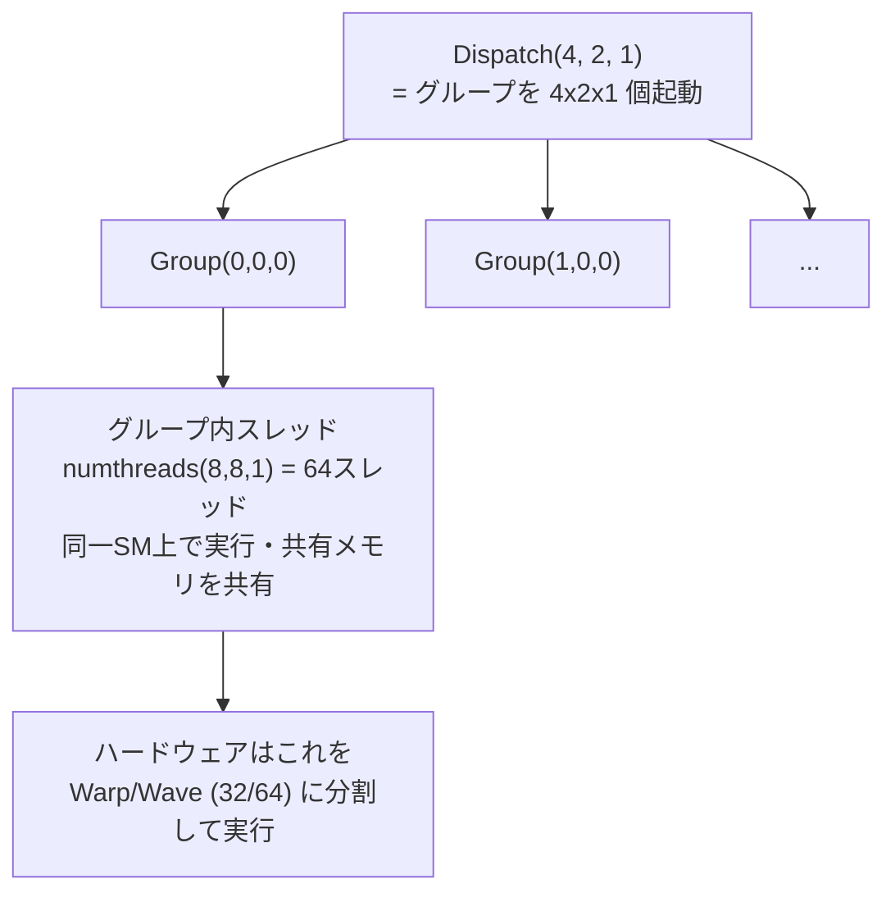

# Compute Shader

## 概要

Compute Shaderは**グラフィックスパイプラインから独立してGPUの演算能力を使うためのシェーダ**です。頂点もピクセルも関係なく、「N個のスレッドグループを起動し、各グループ内のスレッドが協調して任意の計算を行う」というシンプルな実行モデルを持ちます。現代レンダリングの最先端 (GPU Driven、Nanite、各種GI、アップスケーリング) は、ほぼすべてCompute Shaderの上に構築されています。

## なぜ必要なのか

- ラスタライズの枠に合わない計算 — カリング、ソート、パーティクル、物理、ポスト処理 — をGPUで行いたい
- 「テクスチャに偽装してFSで計算する」旧GPGPUの制約 (後述) からの解放
- **レンダリングの主役がFSからComputeへ移行中**: 現代のフレームのGPU時間の多く (ライトカリング、GI、AA、アップスケール) はComputeパスが占める

## 歴史・誕生した背景

- 2003-06: **GPGPU黎明期** — 研究者がFSを悪用して行列計算 (BrookGPU、GPGPU.org)。テクスチャ=配列、FS=カーネル、1パス=1ループという茨の道
- 2007: **CUDA** (NVIDIA) — 専用言語でGPGPUを本格化 → [CUDAとOpenCL](/graphics/compute/cuda-opencl.html)
- **2009: DirectX 11 の DirectCompute** — グラフィックスAPI内にComputeが統合された転換点
- 2012: OpenGL 4.3 Compute Shader
- 2013-14: コンソール世代交代 (PS4/XB1) — 非同期コンピュートの実用化が進む
- 2016〜: DX12/Vulkan世代でComputeキューが第一級市民に。Forward+のライトカリング、TAA、SSAOなどがCompute化
- 2018〜: DLSS/FSR等のアップスケーラ、Nanite、GPU Driven — 「Computeがレンダラーの中核」時代へ

## それ以前の技術

FSによる擬似GPGPU。制約は: (1) 散乱書き込み不可 (自ピクセルにしか書けない)、(2) スレッド間通信不可、(3) 共有メモリなし、(4) 整数/ビット演算が貧弱、(5) グラフィックスステートのセットアップが必須。

## 解決した課題

1. **自由な読み書き** (UAV / Storage Buffer) — 任意アドレスへの散乱書き込み
2. **スレッドグループと共有メモリ** — グループ内協調・通信 → [Shared Memory](/graphics/compute/shared-memory.html)
3. **同期プリミティブ** — バリア・アトミック
4. グラフィックスステート不要の軽量ディスパッチ

## 現在の位置づけ

レンダリングエンジニアの必修技能です。「描画はグラフィックスパイプライン、それ以外は全部Compute」が現代の設計であり、さらに [Mesh Shader](/graphics/pipeline/mesh-shader.html) やソフトウェアラスタライズにより描画そのものもCompute化しつつあります。

## 内部動作

### スレッド階層



| HLSL システム値 | 意味 |
|---|---|
| `SV_DispatchThreadID` | 全体での3D座標 (最頻用: 配列/画像のインデックス) |
| `SV_GroupID` | グループの3D座標 |
| `SV_GroupThreadID` | グループ内での3D座標 |
| `SV_GroupIndex` | グループ内の1次元通し番号 |

- **グループサイズの選び方**: Wave幅の倍数 (32/64) が原則。64か128が無難な既定値。2Dアクセスなら8x8
- グループ間の実行順序・並行性は**保証されない** — グループ間同期はディスパッチ分割でのみ可能

### リソースと典型パターン

```hlsl
// 読み取り: SRV
Texture2D<float4> gInput : register(t0);
StructuredBuffer<Particle> gParticlesIn : register(t1);
// 読み書き: UAV
RWTexture2D<float4> gOutput : register(u0);
RWStructuredBuffer<Particle> gParticlesOut : register(u1);
AppendStructuredBuffer<uint> gVisibleList : register(u2); // 可変長出力
```

3大パターン:
1. **Map**: 1スレッド=1要素の独立変換 (画像フィルタ、スキニング)
2. **協調**: 共有メモリでタイル読み込み→協調計算 (ぼかし、ライトカリング)
3. **集約**: Reduction/Scan/ソート → [並列アルゴリズム](/graphics/compute/parallel-algorithms.html)

### Indirect Dispatch

ディスパッチ数自体をGPUが書いたバッファから読む `DispatchIndirect`。「Computeが仕事量を決め、Computeが実行する」— [GPU Driven Rendering](/graphics/optimization/gpu-driven.html) の基礎です。

### 非同期コンピュート

グラフィックスと並行して別キューでComputeを流し、ハードウェアの遊休資源 (シャドウパス中のALU等) を埋める技法 → [GPU最適化の基礎](/graphics/optimization/basics.html)

## 各環境での扱い

### Unity
`ComputeShader` アセット (.compute)。C#から `SetBuffer/SetTexture` → `Dispatch(kernel, x, y, z)`。`GraphicsBuffer` がバッファの現代的API。VFX GraphやGPU Resident DrawerはCompute実装です。

### Unreal Engine
`FGlobalShader` 派生 + `IMPLEMENT_GLOBAL_SHADER` でUSFのComputeを登録し、RDG (`FRDGBuilder::AddPass`) でディスパッチ。Niagara・Lumen・Naniteの大部分がCompute。

### DirectX 12
`ID3D12PipelineState` (CS単体のPSO) + `Dispatch`。Computeキュー (`D3D12_COMMAND_LIST_TYPE_COMPUTE`) で非同期実行。UAVバリアで書き込み間の順序を制御。

### Vulkan
`VkComputePipeline` + `vkCmdDispatch`。Computeキューファミリで非同期。`VK_PIPELINE_STAGE_2_COMPUTE_SHADER_BIT` を使ったバリア。

## コード例

Unityでの完全な例 — パーティクル更新:

```hlsl
// Simulate.compute
#pragma kernel CSMain

struct Particle { float3 pos; float3 vel; float life; float _pad; };
RWStructuredBuffer<Particle> _Particles;
float _DeltaTime;
uint _Count;

[numthreads(64, 1, 1)]
void CSMain(uint3 id : SV_DispatchThreadID)
{
    if (id.x >= _Count) return;          // 端数グループの範囲外ガード (定石)

    Particle p = _Particles[id.x];
    p.vel += float3(0, -9.8, 0) * _DeltaTime;
    p.pos += p.vel * _DeltaTime;
    p.life -= _DeltaTime;
    if (p.pos.y < 0) { p.pos.y = 0; p.vel.y = -p.vel.y * 0.6; }
    _Particles[id.x] = p;
}
```

```csharp
// C#側
public ComputeShader sim;
GraphicsBuffer buffer;
int kernel;

void Start() {
    buffer = new GraphicsBuffer(GraphicsBuffer.Target.Structured,
                                count, 32 /*stride*/);
    kernel = sim.FindKernel("CSMain");
    sim.SetBuffer(kernel, "_Particles", buffer);
}
void Update() {
    sim.SetFloat("_DeltaTime", Time.deltaTime);
    sim.SetInt("_Count", count);
    int groups = (count + 63) / 64;      // 切り上げ除算 (定石)
    sim.Dispatch(kernel, groups, 1, 1);
    // 描画側は同じbufferをStructuredBufferとして読む (CPU往復ゼロ)
}
```

## 前提知識

- [GPUアーキテクチャ詳解](/hardware/gpu/architecture.html)
- [HLSL](/graphics/shader/hlsl.html) または他のシェーダ言語

## 次に読むべきページ

- [GPU並列実行モデル (Warp/Wave)](/graphics/compute/execution-model.html) — **必読**
- [Shared Memory と Atomic](/graphics/compute/shared-memory.html)
- [並列アルゴリズム](/graphics/compute/parallel-algorithms.html)

## 理解度チェック

1. **`[numthreads(64,1,1)]` で100万要素を処理するときのDispatch数と、シェーダ内に必要なガードを述べよ。**
   ::: details 解答
   groups = ceil(1,000,000 / 64) = 15,625。最終グループには余分なスレッドが含まれるため、シェーダ冒頭で `if (id.x >= count) return;` の範囲外ガードが必要。
   :::

2. **グループ間の同期がディスパッチ内でできない理由は。**
   ::: details 解答
   全グループが同時にGPUに常駐する保証がなく(グループ数がSM容量を超えれば順次実行される)、実行順序も未定義のため、グループ間で待ち合わせるとデッドロックしうる。グループ間の依存はディスパッチを分けてバリアを挟むことで表現する。
   :::

3. **FSによる旧GPGPUと比べ、Compute Shaderが可能にした3つの本質的機能を挙げよ。**
   ::: details 解答
   (1)UAV等による任意位置への散乱書き込み。(2)スレッドグループ内の共有メモリとバリアによる協調・通信。(3)アトミック操作による安全な競合書き込み。これらにより並列アルゴリズム(ソート、スキャン、構築系)がGPU上で実装可能になった。
   :::

## 参考資料

- Microsoft Learn, *Compute Shader Overview (DirectCompute)*
- Unity Manual, *Compute shaders* / Catlike Coding のComputeチュートリアル
- 「GPU並列図形処理入門」等の和書 / *GPU Gems 3* の GPGPU 章
- SIGGRAPH各年の *"Compute for Graphics"* 系コース
